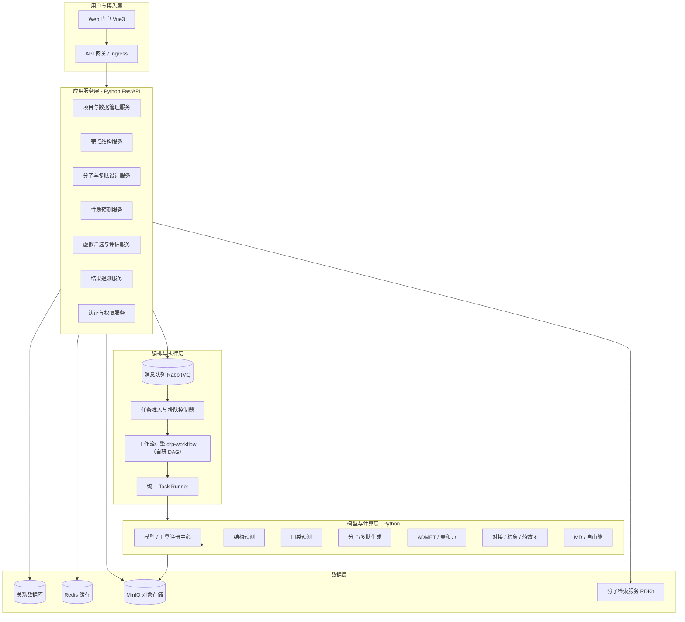
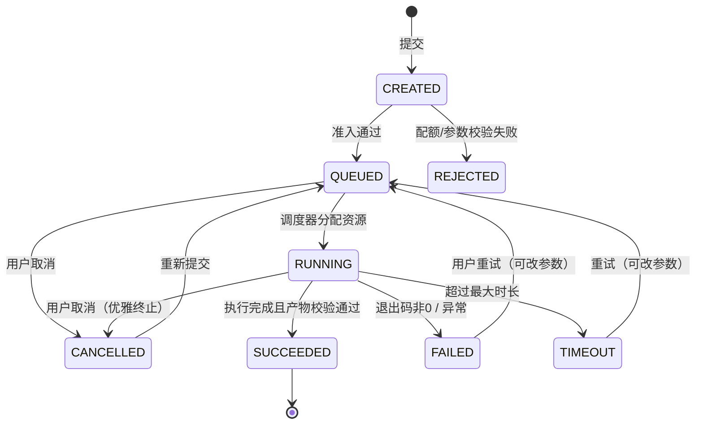
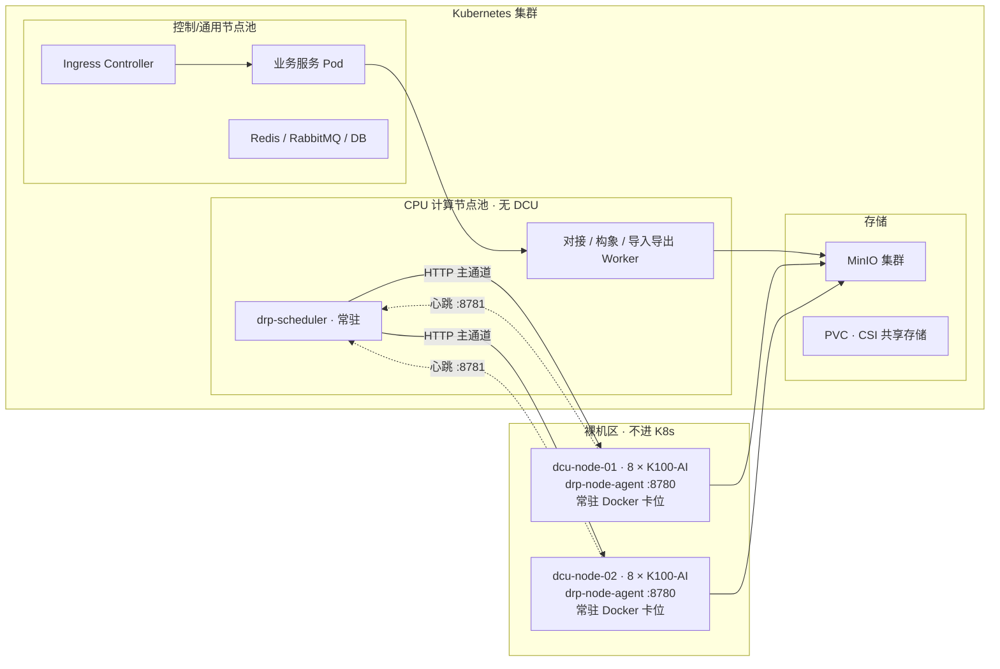
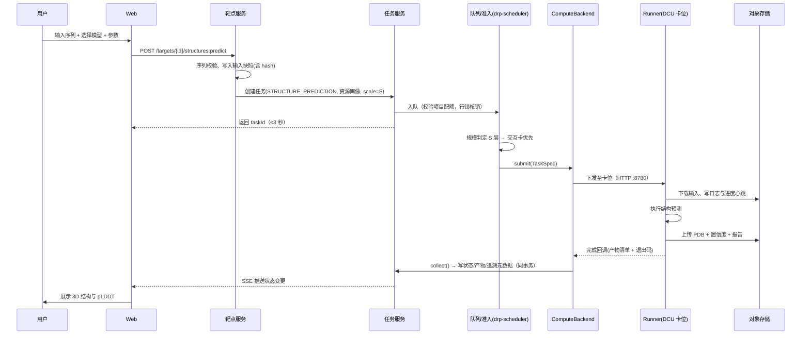
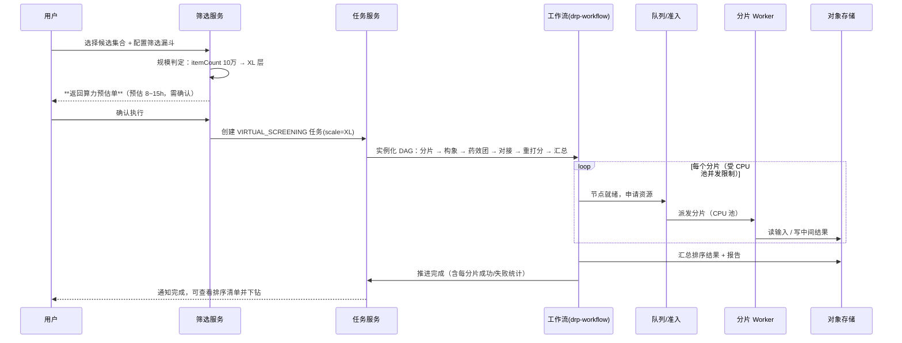

# 中国医药 AI 药物研发平台 · 系统架构设计说明书

| 项 | 内容 |
|---|---|
| 文档编号 | DRP-ARCH-v1.5 |
| 文档版本 | **v1.5**（2026-10-25 真机实测收口：§14 新增 ✅ `D-35`（卡位可见性变量写法——`CUDA_VISIBLE_DEVICES` 填容器内序号 `0`，就绪自检必须断言 `device_count()==1`）与 🔴 `D-34`（先行验证节点磁盘压力）；`D-08` 行补「已降级（`D-33`）」标注，不再视作阻塞开工项）<br>**v1.4**（2026-10-25 `D-33` 先行验证环境：§14 新增决策行，指向 `08` §7 阶段 P4 与 `09` §5.6 卡位硬件无关性）<br>**v1.2**（2026-10-23 生产级复审补齐；此前 v1.1 于 2026-10-20 架构评审修订，变更明细见 `03A`） |
| 上游 | `02-架构/00-项目总览与研发流程总纲.md`、`01-需求/01-PRD产品需求文档.md`、`01-需求/02-需求追踪矩阵.md` |
| 下游 | `02-架构/04-数据模型设计说明书.md`、`03-接口/05-API接口规格说明书.md`、`02-架构/06-UI交互与原型说明.md` |
| 状态 | v1.2 修订版，待架构评审确认 |

> **需求基线说明（2026-11-10）**：本文档中的 `DRP-M*` 是**内部技术标号**，不是需求来源。需求基线已改为甲方确认版《AI 药物研发平台需求规格说明书》V3.0（`AIYF-SRS-001`，44 条需求 / 206 条功能要求子项），标号换算见 `01` §6，逐条判定见 `26`。

> **v1.1 修订要点**（逐条对照见 `internal/03A-架构评审修订记录.md`）：
> 1. 服务划分由「12 个服务即 12 个进程」改为「**12 个逻辑模块 → 8 个部署单元**」，并显式定义事务边界（§3.2）。
> 2. 新增 **§5.6 任务规模分层与算力可行性核算**，修正原「按任务类型估耗时」的根本缺陷。
> 3. 新增 **§7.4 复现判据**，把「结果一致」拆成 **D1/D2/D3/D4 四级**（v1.2 按模型分级，新增 D4「不可复现」，明确扩散/采样类不做复现承诺），解决 M7 验收争议。
> 4. DCU 承载方式统一采信 `09`（**不在 K8s 内**），修正 §4.1 拓扑图与 §4.3 节点池、§4.4 接入方式（§4.4 降为可选路径）。
> 5. 工作流引擎统一采信 `13` §12.1（**v1.0 不引入 Argo**），修正 §5.4、§11.3、§12 时序图。
> 6. 修正 §3.3 示例中 `dtk25.04` 与固化版本 `DTK 26.04` 的冲突，并将示例模型由 esmfold 更正为已定型的 Boltz-2。
> 7. **§5.2.1 给出总耗时公式并区分「稳定态单件」与「冷启」**，配套 `07` §2.2 拆出 `steadyStateSecondsPerItem`——否则 P0-1 的根因只是从「按任务类型估」变成「按合成单件值估」（`03A` P4-19）。

---

## 1. 架构目标与原则

### 1.1 架构目标

| 目标 | 说明 | 对应需求 |
|---|---|---|
| 可追溯 | 每一次计算结果都能还原输入、环境、参数 | `AIYF-RES-01`~`RES-07`（旧编号 `DRP-M7-FR-01~06`） |
| 可扩展 | 新增模型/工具不改主链路 | DRP-NFR-11 |
| 算力高效 | 16 张 DCU 与 CPU 池按任务画像合理分配 | `AIYF-WF-07-SRS`（旧编号 `DRP-M6-FR-10`） |
| 异步不阻塞 | 长时计算与交互操作彻底解耦 | DRP-NFR-04 |
| 离线可交付 | 全组件可在内网离线重建 | 约束 C-1 |
| 可演进 | 国产算力生态变化时能替换底层而不改业务 | 风险 R-01/R-02 |

### 1.2 架构原则

1. **业务与控制分离**：交互型业务服务（低延迟、高并发）与计算型服务（长时、高吞吐）分进程、分节点池部署，互不抢占。
2. **计算即任务（Task-as-a-Job）**：一切模型推理与分子计算统一抽象为「任务」，具备统一的状态机、日志、产物与追溯元数据。
3. **算力抽象**：业务层只声明资源画像（CPU/内存/DCU/显存），不感知 DCU 型号，**也不假设算力一定运行在 K8s 上**；通过 `ComputeBackend` 接口解耦承载方式（见 `09` §3）。
4. **模型与工具插件化**：模型与工具通过「注册中心 + 统一 Runner 契约」接入，新增模型不改调度与业务代码。
5. **产物外置**：一切输入输出文件走对象存储，数据库只存索引与元数据，避免大文件拖垮数据库与页面。
6. **一切可回放**：任务的输入快照、镜像 tag、模型版本、参数 JSON 全量持久化。
7. **离线优先**：不依赖任何公网服务；依赖源、镜像、权重全部内建。

---

## 2. 关键约束与假设（架构输入）

| 编号 | 约束 | 架构对策 |
|---|---|---|
| C-1 | 内网私有化离线部署 | Harbor + 内网 PyPI + 离线模型库（§10） |
| C-2 | 前后端运行于甲方 K8s 集群 | 全容器化、Helm 交付、无状态化设计（§4） |
| C-3 | 算力为海光 K100-AI DCU（16 卡） | 资源画像 + 队列 + `ComputeBackend` 抽象；DCU 承载方式见 §4.4（**当前不进 K8s**） |
| C-4 | DTK/PyTorch 版本强绑定 | 计算镜像版本矩阵固化（§6.1） |
| C-5 | 常规操作 ≤ 3 秒、≥10 并发 | 读写分离 + 缓存 + 异步化（§3.5） |
| C-6 | 数据不出内网、需访问控制 | RBAC + 项目级 ACL + 审计（§9） |
| C-7 | 任务规模跨度极大（单分子 ↔ 10 万条批量，差 5 个数量级） | **按规模而非按任务类型**估算耗时与资源；规模分层与算力核算见 §5.6 |

### 2.1 海光 K100-AI 关键规格（架构依据）

| 项 | 规格 |
|---|---|
| 单卡显存 | 64GB HBM2e |
| 峰值算力（公开资料） | FP16/BF16 ≈ 192 TFLOPS；INT8 ≈ 392 TOPS；FP32 ≈ 49 TFLOPS |
| 显存带宽 | ≈ 896 GB/s |
| 接口/功耗 | PCIe 4.0×16，300~350W |
| 集群总算力 | 2 台 × 8 卡 = **16 卡 / 1024GB 显存** |
| 服务器型号（实测） | 浪潮 CS5468H3，单节点 8 卡 K100-AI |

### 2.2 实测软件栈版本（依据《模型海光兼容测试报告》，2026-08-19/20）

> 以下为**已在真实 K100-AI 上验证过的版本组合**，取代原先的公开资料推测值，作为镜像构建的**唯一基线**。

| 组件 | 实测版本 | 备注 |
|---|---|---|
| DTK | **26.04** | 运行库路径 `/opt/dtk-26.04/{lib,opencl/lib}` |
| HYHAL 运行库 | `/opt/hyhal/lib` | 必挂 |
| PyTorch（DTK/HIP 适配） | **2.7.1** | `torch.version.hip = 6.3.26045`，`torch.cuda.is_available()=True` |
| DGL | **1.1.3 patched** | 基于 DTK CUDA shim 源码编译；MSIGN/MolP-PC/PEARL 依赖 |
| TensorFlow | **2.13.1（DTK/ROCm）** | LVpocket 使用；需 `TF_FORCE_GPU_ALLOW_GROWTH=true` |
| GROMACS | **2026.3（OpenCL GPU build）** | `-nb gpu -pme cpu`；`OCL_ICD_VENDORS` 必须保持未设置 |
| OpenMM | 8.2.0（CPU 可用；DTK CUDA 插件 NVRTC 失败） | OpenFE GPU 路径不可用 |
| Python | 3.10（部分模型 3.9.18） | |
| 环境管理 | micromamba / `.venv-dcu` | |
| 容器内设备名 | PyTorch/TF 兼容层为 `cuda:0..cuda:7`；DGL 侧可用 `hip:0` | 实际后端为 ROCm/DCU |
| 资源观测工具 | `hy-smi` | 温度/功耗/显存/HCU 利用率 |

**架构结论（由实测修订）**

1. DCU 对 CUDA 生态兼容度高，PyTorch 标准算子可近乎零改动迁移 —— 结论成立，且**实测 PyTorch 版本为 2.7.1（高于此前推测的 2.3/2.4）**。
2. **自定义 CUDA kernel 是红线，但已有成熟绕行方案**：实测中 Boltz-2 关闭 NVIDIA cuEquivariance kernels 走 PyTorch fallback；Pocket2Mol 用 PyTorch fallback 替代 `torch_cluster` KNN/radius 与 `torch_scatter` scatter/softmax；STD-Diff 用 HIP 源码编译 `torch_scatter`。**结论：优先选择已有 fallback 路径的模型包，而不是追求原生移植。**
3. **JAX 路径风险最高**：AlphaFold 2.3.2 需自建 jaxlib（DTK LLVM 17 + bazel），GPU 端到端虽跑通（EXIT 0），但输出 pLDDT 与坐标全为 NaN，**不可作为交付路径**；其 CPU 路径可用（pLDDT 86.8~92.3）。
4. **冷启动开销显著**：Boltz-2 单任务 wall p50 123s，而 predict loop p50 仅 9~10s → **约 90% 的时间花在模型加载/编译/数据准备**。这直接决定了服务化形态必须区分「批处理」与「常驻服务」两种模式（见 §5.7 与 `03-接口/07-模型交付与运行规范.md`）。

---

## 3. 逻辑架构

### 3.1 分层视图



### 3.2 服务划分与职责

**技术栈已定：全栈 Python FastAPI**（决策 D-01 已关闭，理由见 §11.1）。

| 服务 | 形态 | 职责 | 关键接口域 |
|---|---|---|---|
| `drp-gateway` | Nginx Ingress + FastAPI 网关应用 | 路由、鉴权、限流、审计埋点 | 全站 |
| `drp-auth` | FastAPI | 用户、角色、项目级 ACL、LDAP 对接 | `/api/v1/auth` |
| `drp-project` | FastAPI + SQLAlchemy 2 + Alembic | 项目空间、成员协作、数据导入导出、版本 | `/api/v1/projects` |
| `drp-asset` | FastAPI + RDKit | 化合物/蛋白/数据集资产与检索 | `/api/v1/assets` |
| `drp-target` | FastAPI | 靶点、结构、口袋、残基元数据 | `/api/v1/targets` |
| `drp-design` | FastAPI | 候选物、候选集合、比较 | `/api/v1/candidates` |
| `drp-task` | FastAPI + `ComputeBackend` | 任务提交、状态机、日志、取消/重试、配额 | `/api/v1/tasks` |
| `drp-workflow` | FastAPI + 自研 DAG | 工作流模板、实例、节点状态 | `/api/v1/workflows` |
| `drp-result` | FastAPI | 结果、产物、追溯包、报告 | `/api/v1/results` |
| `drp-scheduler` | FastAPI + 常驻消费者 | 任务准入、排队、优先级、配额核销 | 内部 |
| `drp-mol-index` | FastAPI + RDKit | 指纹/子结构/相似性检索 | `/api/v1/search/mol` |
| `drp-model-registry` | FastAPI | 模型/工具注册、版本、参数 Schema | `/api/v1/models`、`/api/v1/admin/models` |
| `drp-compute-*` | 模型镜像（非服务） | 各类计算能力，以 Job/常驻服务形态运行 | 见 `03-接口/07-模型交付与运行规范.md` |

**服务拆分说明**：FastAPI 单体式多路由（modular monolith）起步，按业务域拆分为独立 ASGI 应用；进程内用 `httpx` 异步调用，跨服务用 REST。理由：团队规模有限、Python 单栈，过度微服务化会放大运维成本。

> 服务粒度原则：**按业务域拆，不按技术层拆**；计算能力**不做成服务，做成可调度的工作负载**（见 §5.7）。

#### 3.2.1 逻辑模块与部署单元的映射（v1.1 新增）

上表 12 行是**逻辑模块**（代码边界、团队职责边界），**不是 12 个独立进程**。部署单元划分如下：

> **v1.4 补充（`D-33`）**：上表与下表都**不含任何硬件假设**——业务侧 8 个部署单元在甲方 K8s 与先行验证的 k3s 上都一样跑；算力侧（`drp-compute-*`）差异只在 `slots.yaml` 与镜像基座（`09` §5.6、`13` §6.5）。这正是「先用 8×4090 搭建、后适配 DCU」可行的原因：**变的是配置，不是这份架构。**

| 部署单元 | 包含逻辑模块 | 副本 | 说明 |
|---|---|---|---|
| `drp-api` | gateway(应用侧) + auth + project + asset + target + design | 2~3 | 共用同一个数据库事务边界 |
| `drp-task-api` | task + workflow + result | 2 | **必须与 `drp-scheduler` 共用库连接与事务** |
| `drp-scheduler` | scheduler（常驻消费者，无对外端口） | 1（主备） | 单实例语义，靠 K8s `leader-election` 防双主 |
| `drp-mol-index` | mol-index | 1~2 | 独立因 RDKit 依赖重、CPU 密集 |
| `drp-model-registry` | model-registry | 1 | 低频读写 |
| `drp-gateway` | Nginx Ingress | — | 纯路由层 |
| `drp-worker-cpu` | 导入解析 / 导出 / 报表 / 指纹预计算 | 2~4 | 消费 RabbitMQ，CPU 密集 |
| `drp-compute-*` | 模型镜像 | 按任务 | 非服务，见 `07` |

**合并理由**：`task` / `workflow` / `result` / `scheduler` 之间存在**强事务耦合**（见 §3.2.2），拆成独立进程会把事务变成分布式事务，在 Python 技术栈下风险远大于收益。`asset` / `target` / `design` 与 `project` 共享项目隔离谓词，同库同事务最安全。

#### 3.2.2 事务边界与一致性约定（v1.1 新增）

原设计未回答「跨服务操作如何保证原子性」，这是 Python 团队最容易写出脏数据的地方。现明确：

| 跨模块操作 | 一致性要求 | 实现方式 |
|---|---|---|
| 创建任务 + 写入 `task_input_snapshot` | **强一致** | 同一事务（同在 `drp-task-api`） |
| 任务结束 + 写 `artifact` + 更新 `task.status` | **强一致** | 同一事务；对象存储写入先于事务提交，提交失败由对账任务回收孤儿对象 |
| 工作流节点状态 + 任务状态 | **强一致** | 同一事务（同在 `drp-task-api`） |
| 配额核销 + 任务入队 | **强一致** | 同在 `drp-scheduler`，行锁 `SELECT ... FOR UPDATE` 串行化 |
| 候选物写入 + 指纹计算 | 最终一致 | 先写库，发 MQ 事件，`drp-worker-cpu` 回填指纹；未回填的候选物在检索中不可见 |
| 审计日志 | 最终一致（只追加） | 同库异表，异步落盘；审计写入失败不得阻断业务 |
| 项目删除 + 资产清理 | 最终一致 | 软删除（`deleted_at`）+ 延迟物理清理任务 |

**硬约束**：
- 任何标「强一致」的操作**不得跨进程**；若将来确实要拆，必须先引入 Saga 编排与幂等补偿，不得直接改成两次 REST 调用。
- 跨进程调用一律带 `X-Request-Id` 与幂等键，重试不得产生重复副作用。

### 3.3 计算任务统一抽象

任何一次模型推理或分子计算，都归一为如下任务对象：

```json
{
  "taskId": "tsk_01J...",
  "taskType": "STRUCTURE_PREDICTION",
  "projectId": "prj_...",
  "bizRef": { "targetId": "tar_...", "candidateIds": ["cand_..."] },
  "toolRef": { "name": "boltz-2", "version": "2.0.1", "image": "harbor.drp.local/drp/compute-boltz2:2.0.1-dtk26.04-py3.10" },
  "resourceProfile": { "dcu": 1, "dcuMemGB": 40, "cpu": 8, "memGB": 32, "expectedMinutes": 45 },
  "scale": { "kind": "SINGLE", "itemCount": 1 },
  "params": { "...": "完整参数 JSON，含随机种子" },
  "inputs": [ { "urn": "oss://drp-data/.../seq.fasta", "sha256": "..." } ],
  "outputs": [ { "urn": "oss://drp-result/.../model.pdb", "sha256": "..." } ]
}
```

**任务类型枚举**：`STRUCTURE_PREDICTION` / `STRUCTURE_PREP` / `POCKET_PREDICTION` / `MOLECULE_GENERATION` / `PEPTIDE_DESIGN` / `AFFINITY_PREDICTION` / `ADMET_PREDICTION` / `CONFORMER_ANALYSIS` / `PHARMACOPHORE_MATCH` / `DOCKING` / `VIRTUAL_SCREENING` / `MD_SIMULATION` / `FREE_ENERGY` / `DATA_IMPORT` / `DATA_EXPORT` / `REPORT_GENERATION`

### 3.4 状态机



**取消语义**：向任务进程发送 SIGTERM（K8s 内为 Pod，DCU 机器上为卡位容器）→ Runner 捕获后写入断点与已完成产物 → 宽限 60s → SIGKILL；已产出的中间结果保留为「部分产物」，可下载。

### 3.5 性能设计（对应 ≤3 秒 / ≥10 并发）

| 手段 | 说明 |
|---|---|
| 读写分离 | 列表查询走只读副本；写入走主库 |
| 缓存 | Redis 缓存：用户权限、项目元信息、模型/工具注册表、热点列表首屏 |
| 异步化 | 导入/导出/批量计算全部异步，接口只回 `taskId` |
| 分页与投影 | 列表接口强制分页（默认 20，最大 200），大字段（结构文本）走详情接口 |
| 前端优化 | 2D 结构图服务端预渲染为 SVG 并缓存；3D 结构文件走 CDN 式直连 MinIO 预签名 |
| 大文件 | 上传/下载走 MinIO 直传直取（预签名 URL），不经过应用服务 |
| 队列保护 | 提交网关限流 + 项目级并发上限，防止批量任务冲垮调度 |

### 3.6 业务主线：研发阶段、决策点与研发资产（v1.1 新增）

> **为什么新增**：`01-PRD` 的 M1~M7 是**按能力横向切分**的（这是规范书的写法，便于逐条验收），但它不是一条**研发主线**。作为产品，缺少三个东西：① 用户在平台上看不出「这个项目走到哪一步了」；② 平台不承载「选哪个候选往下走」这个**真正的研发决策**；③ 决策依据不沉淀，就谈不上「研发资产」。本节是横切结构，**不改 M1~M7 任何需求编号**，也不增加新的验收条款。

#### 3.6.1 研发阶段（Stage）

在项目内引入**研发阶段**概念（区别于 `04` 已有的 `project_status` 行政状态）：

| 阶段 | 名称 | 进入条件（自动判定） | 主要产出 | 对应能力域 |
|---|---|---|---|---|
| **S0** | 立项与数据归集 | 项目创建 | 项目空间、成员、初始数据导入 | M1 |
| **S1** | 靶点确立 | 至少 1 个靶点 + 序列或结构 | 靶点记录、序列/结构资产 | M1/M2 |
| **S2** | 结构与口袋就绪 | 至少 1 个结构 + 1 个已选定口袋 | PDB、口袋定义、关键残基 | M2 |
| **S3** | 候选生成 | 至少 1 个候选集合非空 | 候选分子/多肽集合 | M3 |
| **S4** | 性质评估 | 候选集有 ADMET/亲和力结果 | 性质矩阵 | M4 |
| **S5** | 计算验证 | 候选集有对接/MD/自由能结果 | 评分排序、轨迹 | M5 |
| **S6** | 决策与归档 | 至少 1 条决策记录 | 决策记录、报告、可复用模板 | M7 |

**设计原则**：
- **阶段不是用户手动推进的**，而是根据**实际数据与任务产物自动推导**。用户看到的是「当前阶段 + 缺口提示」，而不是一个需要维护的状态字段。
- 阶段**允许回退**（如新增靶点后从 S3 回到 S2），且不阻塞任何操作——它只是**导航与提示**，不是门禁。
- 阶段推导逻辑放在 `drp-project`，纯查询，不引入额外写入。

#### 3.6.2 决策点（Decision Point）

药物研发的核心动作不是「跑完计算」，而是「**决定哪个候选往下走**」。当前设计里这个动作无处安放，用户只能看完表格后把结论记在 Excel。

| 决策点 | 位置 | 决策内容 | 必需依据 |
|---|---|---|---|
| **DP1** | S1→S2 | 靶点是否值得推进 | 靶点元数据、文献、可成药性 |
| **DP2** | S2→S3 | 选定哪个结构/口袋作为设计起点 | 结构置信度、口袋评分、残基组成 |
| **DP3** | S3→S4 | 哪些候选进入评估（从 N 个中选 K 个） | 生成模型评分、属性筛选结果 |
| **DP4** | S4→S5 | 哪些候选进入重计算 | ADMET 达标率、亲和力预测 |
| **DP5** | S5→S6 | 最终推荐哪几个候选进入实验 | 对接分、MD 稳定性、自由能 |

**决策记录（Decision Record）五要素**：

| 要素 | 内容 |
|---|---|
| 决策对象 | 靶点 ID / 口袋 ID / 候选集合 ID + **成员快照** |
| 决策依据 | 引用的任务/结果 ID 列表 + 当时的关键指标值 |
| 决策结论 | 入选/淘汰列表 + 理由（自由文本，必填） |
| 决策人与时间 | 用户 + 时间戳，不可篡改 |

> **关键设计**：决策记录必须保存**成员快照**，而不是仅存引用。因为候选集合后续会被修改（`04` 的 `candidate_set_item.snapshot_score` 已预留了这个语义），若不快照，半年后回看决策记录会看到一组与当时完全不同的数据，追溯就断了。

#### 3.6.3 研发资产（Asset）

平台对外承诺「研发资产沉淀」，但 `01` 术语表对「研发资产」的定义是泛指（数据集、模型、工作流模板、候选集合、报告）。建议在实现上**收敛为三类可复用对象**：

| 资产类型 | 来源 | 复用方式 |
|---|---|---|
| **工作流模板** | S6 固化 | 其他项目直接调用（`04` `workflow_template.is_preset=false`） |
| **候选集合（带评分）** | S3/S4/S5 | 作为新项目的起点集或阳性对照 |
| **决策记录 + 报告** | S6 | 项目复盘、审计、验收证据 |

#### 3.6.4 对下游文档的影响（已同步）

本节引入的三个新概念，**已在 `04` / `05` / `06` / `12` 同步落地**：

| 影响面 | 已落地的内容 | 状态 |
|---|---|---|
| `04` 数据模型 | 新增 `decision_record` / `decision_item`（含成员快照字段），表数 28 → 30（`04` §3、§9.5）；**v1.2 再增至 33**（新增 `sys_user`/`sys_role`/`sys_user_role`、`idempotency_key`、`molecule_fingerprint`、`upload_session`，见 `04` §3） | ✅ 已同步 |
| `05` API | 新增 `GET /api/v1/projects/{id}/stage`（§3.2）、`GET \| POST /api/v1/projects/{id}/decisions`（§3.3） | ✅ 已同步 |
| `06` UI | P-04 项目总览新增「研发主线」进度条与下一步提示（`06` §5.1）；新增 P-39 决策记录页（`06` §3）；**v1.2 再新增 P-40 工作流编排画布**（`06` §3，页面数 39 → **40**，一期边界见 `03B` `D-25`） | ✅ 已同步 |
| `12` 测试 | 新增 §5.10 研发主线用例 `TC-STAGE-01~03`，**不计入验收覆盖率** | ✅ 已同步 |
| `project_stage_event` | **不采纳**：阶段为纯推导（`05` §3.2 设计约束），不引入阶段变更事件表，避免双写不一致 | ✅ 已定 |

> **说明**：本节是**产品结构建议**，已写入架构文档供评审；若评审认为超出规范书范围，可整体回退，不影响 M1~M7 任何需求与验收。

---

## 4. 部署架构（Kubernetes）

### 4.1 集群拓扑

> **v1.1 修订**：原图把 DCU 节点画在 K8s 集群内，与 `09` 决策不符。现按 `09` §2 修正：**DCU 机器在 K8s 集群之外**，通过节点 Agent 接入；K8s 只承载业务服务与 CPU 型计算。DCU 将来若纳入 K8s，仅需新增 `K8sBackend` 实现，本节拓扑与业务代码均不变。



**为何不把 DCU 纳入 K8s**：详见 `09` §2。摘要：① DCU device plugin 在甲方环境的可用性未验证（`03` §4.4 原为假设）；② 现有已验证模型均为「常驻 Docker + 静态卡位」形态，改 K8s 需重做镜像与启动契约；③ 16 卡规模下 K8s 调度带来的弹性收益小于改造与运维成本。通道与权限边界见 `13` §4。

### 4.2 命名空间规划

| Namespace | 用途 |
|---|---|
| `drp-system` | 网关、配置中心、注册中心 |
| `drp-app` | 业务服务（`drp-api` / `drp-task-api` / `drp-scheduler` / `drp-mol-index` / `drp-model-registry`，见 §3.2.1） |
| `drp-compute` | **仅 CPU 计算任务**的 K8s Job（`drp-worker-cpu` consumer 发起的导入/导出/指纹预计算）；DCU 任务不在此命名空间，见 §4.4.1 |
| `drp-middleware` | Redis / RabbitMQ / MinIO |
| `drp-data` | 数据库（若容器化） |
| `drp-observability` | Prometheus / Grafana / Loki |

> **v1.2 修订**：`drp-compute` 原写「计算任务 Pod（Job/Workflow）」，其中 `Workflow` 指 Argo Workflow（v1.1 已决定不引入，见 §5.4 / `13` §12.1）；且 DCU 任务已确认不进 K8s（§4.4.1），故收窄为「仅 CPU 任务 Job」。业务服务列也按 §3.2.1 的 8 个部署单元写明归属。

### 4.3 节点与污点设计

> **v1.1 修订**：原表将 `dcu-compute` 作为 K8s 节点池，与 §4.1 / `09` 不符。现改为：**K8s 内只有 `general` 与 `cpu-compute` 两个池**；DCU 机器以裸机 + 节点 Agent 方式管理，卡位分配由 `09` §5 的 `slots.yaml` 声明（见 `13` §6.3）。

| 节点池 | 污点（Taint） | 用途 |
|---|---|---|
| `general` | 无 | 控制面、业务服务、中间件 |
| `cpu-compute` | `workload=cpu-compute:NoSchedule` | CPU 型计算（对接、构象、导入导出、`drp-scheduler`） |

计算 Pod 必须声明对应 `toleration` 与 `nodeSelector`，避免业务服务被调度到算力节点。

> 若后续甲方要求将 DCU 纳入 K8s（见 §4.4 可选路径），再新增 `dcu-compute` 池与 `dcu=hygon-k100:NoSchedule` 污点，届时本节同步修订。

### 4.4 DCU 接入方式

> **v1.1 修订**：原内容描述的是「DCU 经 device plugin 进 K8s」路径，与 `09` 决策不符。现拆为**当前路径（必选）** 与 **可选演进路径**。

#### 4.4.1 当前路径（已决策，见 `09` / `13`）

1. 宿主机安装海光 DCU 驱动与 DTK 26.04 运行时（`/opt/dtk-26.04`、`/opt/hyhal`）
2. 部署 `drp-node-agent`（systemd 常驻，`:8780` 执行接口 / `:8781` 心跳），仅接受平台下发的容器生命周期指令
3. 每个卡位一个常驻 Docker 容器，容器内设备名为 `cuda:0`（DGL 路径为 `hip:0`），由 `slots.yaml` 静态声明卡位→模型→卡号映射
4. 平台侧通过 `ComputeBackend`（`SSHBackend` / `HybridBackend`）调用，业务代码不感知承载方式

> 容器内**不**使用 K8s 资源声明；显存隔离靠卡位静态独占，不依赖 device plugin。

#### 4.4.2 可选演进路径（仅当甲方强制要求 DCU 入 K8s 时启用）

1. 部署海光 DCU **device plugin**（DaemonSet），向 K8s 注册算力资源
   - 资源名以海光官方 device plugin 实际暴露值为准（常见形式 `hygon.com/dcu` 或 `dcu.hygon.com/dcu`），**在 PoC 阶段确认后固化到 Helm values**
2. 计算 Pod 需挂载：驱动库目录（只读）、`/dev/kfd`、`/dev/dri*`
3. 容器内使用官方 DCU 基础镜像（含 DTK runtime），避免宿主机驱动版本与容器内不一致
4. 实现 `K8sBackend` 并切换 `ComputeBackend`，业务代码零改动

```yaml
# 仅在启用 §4.4.2 可选路径时生效
resources:
  limits:
    cpu: "8"
    memory: 32Gi
    hygon.com/dcu: 1
  requests:
    cpu: "8"
    memory: 32Gi
    hygon.com/dcu: 1
nodeSelector:
  node-role: dcu-compute
tolerations:
  - key: "dcu"
    operator: "Equal"
    value: "hygon-k100"
    effect: "NoSchedule"
```

### 4.5 存储分层

| 数据类型 | 存储 | 策略 |
|---|---|---|
| 结构化元数据 | 关系数据库（主备） | 每日全备 + WAL 归档 |
| 小分子/蛋白结构文件 | MinIO 桶 `drp-assets` | 版本化、30 天未引用转低频 |
| 计算结果（PDB/SDF/CSV） | MinIO 桶 `drp-results` | 90 天后转低频 |
| MD 轨迹等大文件 | MinIO 桶 `drp-bulk` | 分片上传、直传直取、生命周期 180 天 |
| 日志 | MinIO 桶 `drp-logs`（或 Loki） | 保留 180 天 |
| 任务工作目录 | PVC（共享文件系统，RWX） | 任务结束后回收 |

### 4.6 交付形态

- 全部组件以 **Helm Chart** 交付，支持一键安装/升级/回滚
- 镜像全部推送至内网 Harbor，镜像 tag 与版本矩阵绑定
- 提供离线安装脚本（导入镜像、初始化数据库、灌入模型权重）

> **v1.1 补注（交付形态的边界）**：上述三条**仅适用于业务侧**（`drp-*` 应用与中间件）。算力侧（§4.4.1 的两台 DCU 机器）**不在 Helm 体系内**：由 `install-agent.sh` 安装 `drp-node-agent` 与 systemd 单元，卡位声明在 `/etc/drp/slots.yaml`，由 `docker run` 拉起常驻容器（详见 `13` §6）。
>
> 两套编排体系分离是**刻意的**：把算力侧塑造成 K8s 工作负载需要 device plugin，而 device plugin 未经实机验证，且已验证的 9 个模型全部是「常驻 Docker + 静态卡位」形态（`09` §5）。若未来启用 §4.4.2 的演进路径，则算力侧再并入 Helm，届时本节需重写。

---

## 5. 算力架构与调度（核心章节）

### 5.1 资源总量与分配基线

| 资源 | 总量 | 基线分配策略 |
|---|---|---|
| DCU 卡 | 16 | 交互类预留 4 卡；批量类 10 卡；保留 2 卡冗余（故障/重跑） |
| DCU 显存 | 1024GB | 单任务上限 64GB（整卡）；卡位静态独占总显存，**不做显存共享**（DCU 不进 K8s，无 device plugin 可做配额切分，见 §4.4.1）。若未来启用 §4.4.2 演进路径，共享模式下单 Pod ≤ 16GB |
| 计算节点 CPU | **128 核**（甲方已于 2026-10-23 确认） | CPU 密集型计算任务的**唯一**承载：分子对接（Vina）、构象生成（RDKit ETKDG）、自由能（gmx_MMPBSA）、导入导出与指纹预计算。**按「CPU 计算池」整体调度，不与业务侧共享** |
| 平台部署机 CPU | **32 核**（甲方已确认） | **只跑业务侧**：8 个部署单元（`13` §3.3）+ PG / Redis / MinIO / RabbitMQ。**不承载任何计算任务**，理由见 §5.6.4 |
| 内存 | 按节点配置 | ✅ 甲方 2026-10-23 确认「**内存容量肯定够**」，`D-03-14` 已关闭。交付清单仍要求 128 核计算节点 ≥ 256GB、32 核部署机 ≥ 128GB；**具体分配与预留口径见 `D-03-15`**（单任务上限可放宽到物理内存 70%，但 OOM 保护必须保留） |

> 分配比例写入 ConfigMap，可由管理员按实际负载调整。

### 5.2 任务资源画像表

> **v1.1 修订（重要）**：原表把「典型时长」挂在**任务类型**上，但同类型任务的规模可相差 5 个数量级（1 个分子对接 vs 10 万条批量筛选）。现拆为**单件成本**（§5.2.1，与规模无关）+ **规模分层**（§5.2.2，决定总耗时）+ **算力可行性核算**（§5.6）。

#### 5.2.1 单件成本（单位资源画像）

「单件」= 一个分子 / 一个序列 / 一个复合物 / 1 ns 模拟。**资源占用与规模无关，耗时与规模线性相关。**

| 任务类型 | 资源池 | DCU | 显存 | CPU | 内存 | **单件耗时（实测/估算）** | 并发策略 |
|---|---|---|---|---|---|---|---|
| STRUCTURE_PREDICTION（Boltz-2） | DCU | 1 | 40~64GB | 8 | 32GB | **123s**（238aa，wall p50，含冷启动；loop 仅 9~10s） | 整卡独占，BATCH 合并 |
| STRUCTURE_PREP | CPU | 0 | — | 4 | 8GB | 1~5 min | 高并发 |
| POCKET_PREDICTION（LVpocket） | DCU | 1 | **≤3GB（实测 4%）** | 4 | 8GB | **25s** | RESIDENT，单卡多实例 |
| MOLECULE_GENERATION（STD-Diff） | DCU | 1 | 24~48GB | 8 | 32GB | **12s/分子**（64 分子 / 8 卡 / 1000 步 = 96.1s ⇒ 单卡单分子约 12s） | 整卡独占，批量提交 |
| PEPTIDE_DESIGN（TheraPainter） | DCU | 1 | 24~48GB | 8 | 32GB | 待补测（AR-03） | 整卡独占 |
| ADMET_PREDICTION（MolP-PC） | CPU/DCU | 0~1 | ≤16GB | 4 | 8GB | **< 1s/分子**（批量化后） | 批量分片 + 时间片共享 |
| AFFINITY_PREDICTION（MSIGN） | DCU | 1（共享） | ≤16GB | 4 | 16GB | 秒级/分子 | 时间片共享 |
| CONFORMER_ANALYSIS（RDKit ETKDG） | CPU | 0 | — | 1 | 2GB | **0.5~2s/分子** | 高并发 |
| PHARMACOPHORE_MATCH | CPU | 0 | — | 1 | 2GB | 毫秒~秒/分子 | 高并发 |
| DOCKING（Vina，exhaustiveness 8） | CPU | 0 | — | **1 核/配体** | 2GB | **10~60s/配体** | 多核并行 + 分片 |
| MD_SIMULATION（GROMACS OpenCL） | DCU | 1~4 | 32~64GB | 16 | 64GB | **500000 步 ≈ 1 ns**（实测）；100 ns 需 5×10⁷ 步 | 整卡独占，长时任务 |
| FREE_ENERGY（gmx_MMPBSA） | CPU | 0 | — | 16 | 32GB | 分钟~小时/帧集 | 依赖 MD 产物 |

> 表内**粗体**为实测值，其余为工程估算，待 `08` 复现阶段标定后回填。

**总耗时不能用「单件耗时 × 件数」算**。正确公式（也是 `drp-scheduler` 生成 XL 预估单的唯一口径）：

```
总耗时 ≈ coldBootSeconds（冷启动，每容器一次）
       + steadyStateSecondsPerItem × itemCount / 并行度
       + 排队等待（按 §5.2.2 规模层历史均值）
```

以 Boltz-2 为例：`coldBootSeconds=110`、`steadyStateSecondsPerItem=9.5`。若误用 `expectedSecondsPerItem=127`（= 冷启 + 单件）乘 1000 件，会得出 **35 小时**；按正确公式算（10 张批量卡并行、`batchMaxSize=8` 即 125 个容器）：

| 形态 | 算法 | 结果 |
|---|---|---|
| RESIDENT（无冷启） | 1000 × 9.5s ÷ 10 卡 | **≈ 16 分钟** |
| BATCH（每容器一次冷启） | (125 × 110s + 1000 × 9.5s) ÷ 10 卡 | **≈ 39 分钟** |
| ❌ 错误算法 | 127s × 1000 | **≈ 35 小时**（高估 50 倍） |

两个字段必须在 `07` §2.2 的 `manifest.resources` 中分别声明，**只给合成值视为交付包不合格**（`07` §2.3 DoD）。

#### 5.2.2 规模分层（决定总耗时与调度策略）

| 规模层 | 典型量级 | 代表场景 | 调度策略 | 用户感知要求 |
|---|---|---|---|---|
| **S（交互）** | 1~10 件 | 单序列结构预测、单分子对接、单复合物 MD | 优先级 `HIGH`，走预留交互卡 | **必须 ≤ 分钟级**，实时进度 |
| **M（常规批量）** | 10~500 件 | 一批 ADMET、一个候选集（≤500）筛选 | 优先级 `NORMAL`，分片并行 | 分钟~小时，可离开页面 |
| **L（大批量）** | 500~10000 件 | 规范书上限：批量预测 500 条 | 优先级 `BULK`，夜间调度，分片 + 断点续跑 | **小时级**，需预估完成时间 |
| **XL（超大批量）** | 10000~100000 件 | 规范书上限：10 万条虚拟筛选 | `BULK` + **强制分批**，必须先出「算力预估单」再执行 | **天级**，必须提前告知用户 |
| **T（长时单体）** | 1 件但耗时 > 1h | MD ≥ 50 ns、自由能计算 | 专用长时队列，不参与普通排队 | 小时~天级，断点续算 |

**硬性规则**：
- 规模层由 `drp-scheduler` 根据 `task.scale.itemCount` **自动判定**，不依赖用户选择。
- **XL 层任务提交时必须返回预估耗时区间与预估完成时间**，用户确认后才入队（避免 10 万条筛选静默跑三天）。
- **T 层任务不计入普通并发配额**，单独计数，防止一个 MD 阻塞整个项目。

### 5.3 排队、配额与优先级

| 机制 | 设计 |
|---|---|
| 项目配额 | 每项目配置 `maxConcurrentDcu` / `maxConcurrentCpu` / `dailyQuotaMinutes` / `quotaPeriod` / `overdraftRatio`，由管理员分配（字段定义见 `04` §5.3） |
| **配额计量口径** | **按算力分钟、按实际消耗核销**：1 张 DCU·分钟 = 1.0；1 CPU 核·分钟 = 1/64；内存不计。终态（含 `FAILED`/`CANCELLED`/`TIMEOUT`）**一律核销**，`REJECTED` 不核销。超额只告警并阻塞**新提交**，**不得回杀已入队任务** |
| 优先级 | `HIGH`（交互试算，如单分子预测）/ `NORMAL`（常规）/ `BULK`（批量离线，夜间优先） |
| 准入控制 | 提交网关校验配额 → 写入排队队列 → 准入控制器按 优先级 + FIFO 放行 |
| 抢占 | **不启用**（长任务中断代价高）；改为超时释放 + 排队可视化 |
| 排队可视化 | 页面展示排队序号、预计等待时间（**按 §5.2.2 规模层分别统计历史均值**，不得混算） |
| 超时策略 | 每类任务配置 `maxMinutes`，超时置 `TIMEOUT` 并释放资源 |
| 分片 | 批量任务（如 500 条预测、10 万条筛选）在 Runner 内自动分片为 N 个子任务并行，子任务失败可单独重试 |
| **交互卡保护** | 预留 4 卡**仅接受 S/M 层任务**；BULK/XL 层任务永远不得占用交互卡（v1.1 新增） |

### 5.4 工作流编排

> **v1.1 修订**：原版选型为 Argo Workflows，与 `05-部署/13-部署架构与上线方案.md` §12.1 的决策冲突。现统一采信 `13` §12.1：**v1.0 不引入 Argo**，`drp-workflow` 用自研轻量 DAG（DB 表 + 调度循环），保留 `WorkflowEngine` 接口待将来替换。

**选型：自研轻量 DAG 引擎（`drp-workflow` 内置）**

理由：
- 工作流节点规模小（预置模板最多 7 个节点），远未到需要通用 DAG 引擎的复杂度
- Argo 引入后需额外维护一套 CRD + 控制器 + artifact 仓库，离线环境下的运维成本高于收益
- 当前 DCU 不在 K8s 内（§4.1），Argo 的「每节点一个 Pod」核心优势在本项目失效
- 自研引擎可与 `ComputeBackend` 直接对接，同时调度 DCU（Agent）与 CPU（K8s Job）两类异构节点

**实现要点**：

| 项 | 设计 |
|---|---|
| 定义存储 | `workflow_template.dag_json`（节点、依赖、参数映射、失败策略） |
| 执行状态 | `workflow_instance` + `workflow_node`（`04` §10 已定义） |
| 调度循环 | `drp-scheduler` 内 5s 轮询：扫描就绪节点 → 创建 `task` → 等待回调 → 推进后继 |
| 依赖判定 | `depends_on` 全成功才就绪；`on_failure=ABORT` 中止整条，`CONTINUE` 跳过后继标记 `SKIPPED` |
| 参数透传 | 上游节点产物 URN 作为下游节点输入；映射规则存在 `dag_json.edges` |
| 幂等 | 节点推进以 `(workflow_instance_id, node_key)` 为幂等键，重入不重复创建任务 |
| 替换预留 | 业务层只调 `WorkflowEngine` 接口（`start/cancel/status`），将来换 Argo 只需新增实现 |

**辅助**：RabbitMQ 负责业务事件（任务状态变更、通知）；轻量异步（导入解析、通知、报表生成）由 `drp-worker-cpu` 消费。

**预置工作流模板**（对应 `AIYF-WF-01-SRS`，旧编号 `DRP-M6-FR-01`）：

| 模板 | 节点序列 |
|---|---|
| `wf-target-to-candidate` | 结构预测 → 结构准备 → 口袋预测 → 分子生成 → ADMET 预测 → 对接筛选 → 结果汇总 |
| `wf-peptide-design` | 结构预测 → 结构准备 → 口袋预测 → 多肽设计 → 性质预测 |
| `wf-virtual-screening` | 构象生成 → 药效团过滤 → 对接 → 重打分排序 |
| `wf-md-evaluation` | 对接结果选取 → 复合物构建 → MD → 自由能评估 |
| `wf-admet-batch` | 候选集合批量 ADMET + 亲和力预测 |

参数透传：上游节点的产物 URN 作为下游节点输入，工作流模板可保存至项目，作为研发资产复用。

### 5.5 长时任务保障

| 风险 | 对策 |
|---|---|
| 节点/容器被驱逐或终止 | K8s 内 CPU 计算 Pod 设 `priorityClass=high-normal` 并保留冗余资源；DCU 卡位容器由 systemd `Restart=always` 拉起（见 `13` §6.3），节点保留冗余内存 |
| 节点重启 | Runner 支持断点续跑（MD 检查点文件）、任务自动重调度一次 |
| 连接断开 | 状态持久化在服务端，前端断线重连后从服务端拉取 |
| 日志过大 | 日志分片滚动上传对象存储，页面按时间窗拉取 |
| 产物过大 | 边算边写对象存储，避免节点本地磁盘溢出 |

### 5.6 任务规模分层与算力可行性核算（v1.1 新增，v1.2 按实测核数重算）

本节回答一个原文档未回答、却直接决定 ★ S-05 能否交付的问题：**规范书承诺的批量规模，在 16 卡 + 128 核 CPU 上到底跑不跑得完？**

> **v1.2 重要修订（`D-03-11` 已关闭）**：v1.1 核算时 CPU 池核数未知，按 **64 核保守估算**。甲方已于 2026-10-23 书面确认：**计算节点 128 核、平台部署机 32 核**。本节全部数字按 128 核重算，结论由「⚠️ 勉强可行、需重谈规模预期」变为「✅ 可行，但仍需漏斗前置」。

#### 5.6.1 核算基准

| 项 | 取值 | 依据 |
|---|---|---|
| DCU 卡 | 16（交互 4 / 批量 10 / 冗余 2） | §5.1 |
| **CPU 计算池可用核** | **128**（甲方 2026-10-23 确认） | `D-03-11` ✅ 已关闭 |
| **平台部署机核数** | **32**（甲方确认，**不参与计算**） | §5.6.4 |
| 日可用算力时长 | 24h × 16 卡 = **384 DCU·h/天**；CPU 128 核 × 24h = **3072 CPU·h/天** | — |
| 并发用户 | 10（规范书硬指标） | DRP-NFR-05 |

> **「128 核」的可用性折扣（必须写进预估算法）**：核数是物理核数，实际吞吐还要乘一个折扣系数。核算时取 **70%**（即 **89.6 有效核**），理由是：SMT 超线程对浮点密集型任务收益有限（Vina/RDKit 实际只吃物理核）、内存带宽争抢、以及必须给交互型 S 层留出余量。**预估公式分母一律用 `128 × 0.7 ≈ 90` 核，不要用 128。**

#### 5.6.2 ★ 关键能力的算力核算（128 核口径）

| ★ 能力 | 规范书规模 | 单件成本 | **总成本** | 128 核下的**实际墙钟**（按 90 有效核） | **可行性结论** |
|---|---|---|---|---|---|
| S-01 结构预测 | 单序列（≤400aa，Q-01） | 123s/卡 | 约 **2 分钟·卡** | 即时（走交互卡） | ✅ 毫无压力 |
| S-02 口袋预测 | 单结构 | 25s/卡（显存 4%） | 约 0.4 分钟·卡 | 即时（走交互卡） | ✅ 毫无压力 |
| S-03 分子/多肽设计 | 单次生成一批 | 12s/分子·卡 | 1000 分子 ≈ **3.3 DCU·h** | 按卡位并行，约 20 分钟 | ✅ 可行 |
| S-04 批量 ADMET | **500 条** | <1s/分子 | 约 **8 CPU·min** | < 1 分钟 | ✅ 可行 |
| **S-05 批量虚拟筛选** | **10 万条** | 10~60s/配体（Vina 单核） | **278~1667 CPU·h** | **≈3~18.5 小时**（典型值 833 CPU·h ≈ **9.3 小时**） | ✅ **可行**，但属「**天级**」且**仍需漏斗前置** |
| MD | 常规 100 ns | 5×10⁷ 步，实测 500000 步 ≈ 1ns | 单复合物约 **数小时~1 天**（受卡数影响） | — | ⚠️ 可行，需长时队列 |

**S-05 的三种算例（用于回答甲方与用户「到底多久」）**：

| 场景 | 单配体耗时 | 总 CPU·h | /90 有效核 | /128 核（理论下限） | 一句话 |
|---|---|---|---|---|---|
| 乐观（Vina 默认 exh=8，**粗筛）** | 10 s | 278 | **3.1 h** | 2.2 h | 一个上午跑完 |
| **典型** | 30 s | **833** | **9.3 h** | 6.5 h | **一天（跨夜）跑完** |
| 保守（exh=16~32 **精筛）** | 60 s | 1667 | **18.5 h** | 13.0 h | 需要一整天 |

#### 5.6.3 结论与强制产品约束

1. **10 万条筛选仍按「天级」承诺，但实际量级已从 v1.1 估算的「2~11 个 64 核日（13~35 小时）」改善为「约 3.1~18.5 小时，典型 9.3 小时」。**
   - **强制（不变）**：XL 层任务（§5.2.2）提交时必须返回预估完成时间，并**默认启用漏斗前置**（药效团/ADMET 先筛掉 90%，再对接），否则不得放行。漏斗后 10 万 → 1 万条，典型总耗时降到 **≈56 分钟**。
   - **v1.2 新增**：预估算法必须用 **90 有效核**（128 × 0.7）而不是 128，见 §5.6.1 的折扣说明。**预估偏乐观比预估偏保守危险得多**——用户按 6.5 小时排期，实际 9 小时才完成，会直接打乱实验计划。
2. **MD 与批量筛选会争抢同一批 CPU/DCU 资源**。`09` §5 的 16 卡静态分配需配套**动态借用规则**：长时任务（T 层）运行时，交互卡可被临时占用，但必须保证**至少 2 卡对 S 层可用**，否则交互体验崩塌。
   - **v1.2 补充**：CPU 侧同理——**CPU 计算池必须为 S/M 层预留 ≥ 16 核**，否则一次 XL 筛选会把交互型任务（构象生成、自由能后处理）也堵死。128 核里最多只能用 112 核跑批量。
3. **配额以「算力分钟」而非「任务个数」计量**。口径见 `04` §5.3；失败/取消同样核销（否则可反复失败白占算力）；超额只阻塞新提交、不回杀已入队任务。**v1.2**：折算系数 `1 CPU 核·分钟 = 1/64` **保持不变**（这是 DCU/CPU 的**价值**比，与被确认的 128 核物理核数无关，不要因为有 128 核就把系数改成 1/128）。
4. **本节 S-05 的「典型 30s/配体」是估算值**。仍需 `08` 复现后在真实 DCU 机器与真实 CPU 节点上标定 `steadyStateSecondsPerItem`，否则本核算只具量级意义。

#### 5.6.4 为什么平台部署机的 32 核不参与计算（v1.2 新增）

甲方给出的 32 核算力容易被误用成「再挤出一点 CPU 来跑对接」。**明确禁止**，三条理由：

1. **CPU 型计算任务是长尾突发型**：一次 XL 筛选会把 32 核吃满并持续数小时。部署机同时承载 PG / Redis / MinIO / RabbitMQ 与 8 个部署单元，**CPU 打满会直接拖垮 API P95 与数据库**，而 `01` 的 NFR 里 API P95 是硬指标。
2. **数据不在部署机上**：计算输入的受体/配体文件在对象存储，工作目录 `/work` 挂在计算节点的 `/data/drp/work`（`07` §3.6）。放到部署机上意味着**跨节点传输 GB 级中间文件**，反而更慢。
3. **故障隔离**：计算任务会把进程打死（OOM、段错误、无限循环）。混部时一个失控的 Vina 分片能把平台自身打挂，`14` 的告警与值班模型全部失效。

> **落地方式**：`13` §3.3 的部署单元表里，`drp-worker-cpu`（导入/导出/指纹预计算）虽然有「worker」之名，但**它的执行体是 K8s Job，调度目标必须是 CPU 计算池**，不是部署机。这一点在 `13` 与 `09` 都要写死。

> ✅ **`D-03-11`（CPU 池实际核数）已关闭**：计算节点 128 核、平台部署机 32 核，甲方 2026-10-23 确认。原先「若 < 32 核则 10 万条从『天级』恶化为『周级』、必须重谈规模预期」的风险**不成立**——128 核下典型 9.3 小时，属正常天级任务。
>
> ✅ **`D-03-14`（两块节点内存容量）同日关闭**：甲方确认「内存容量肯定够」。交付清单仍按 128 核节点 ≥ 256GB、32 核部署机 ≥ 128GB 准备，但容量**不再是约束**，也不再阻塞并发设计。随之产生的 🟡 **`D-03-15`** 只关乎「怎么分配」：① 单任务内存上限可放宽到物理内存 70%；② **Vina 分片并发度由核数（112 核）决定，而不是内存**——这一点不会因内存充裕而改变，因为瓶颈在 CPU；③ **必须保留 OOM 保护**（`docker run --memory`、K8s `limits.memory`），否则一个失控任务能打满节点，`14` 的告警阈值也会失效。

### 5.7 模型运行形态（BATCH / RESIDENT）

> **v1.1 修订**：原节标题为「K8s 调度推理」、对象列写 `Job` / `Deployment`，与 `09` / §4.1 的「DCU 不进 K8s」矛盾。现保留**形态划分**（这是模型自身特征，与承载方式无关），将「K8s 对象」改为「承载形态」。

模型**不作为长驻微服务对外提供 API**，而是作为**可被平台调度的工作负载**。依据实测特征分为三种形态：

| 形态 | 适用场景 | 承载形态 | 生命周期 | 典型组件 |
|---|---|---|---|---|
| **BATCH（批处理）** | 单次耗时 > 60s、冷启动占比高、并发度低 | DCU 常驻容器内的批处理队列；或 K8s Job | 批量结束即释放显存 | Boltz-2（批量）、STD-Diff、Pocket2Mol、TheraPainter、GROMACS、Vina |
| **RESIDENT（常驻服务）** | 单次 < 60s、调用频繁、显存占用低 | DCU 机器上常驻 Docker 容器（卡位绑定） | 长期运行，进程内排队 | LVpocket（显存 4%）、MolP-PC、MSIGN、PEARL |
| **HYBRID** | 批量时走批处理，交互时走常驻 | 同一容器内双模式，按 `mode` 路由 | — | Boltz-2（交互单分子走常驻） |

**为什么必须区分**：Boltz-2 实测 wall p50 123s 而 predict loop 仅 9~10s，若每个任务都重新加载权重，冷启动浪费 >90% 算力；反之 LVpocket 单次 25s、显存仅 4%，常驻一张卡可并发服务多个请求，吞吐提升一个数量级。

> **运行后端决策（见 `05-部署/09-算力节点与模型运行部署方案.md`）**：
> 平台只依赖 `ComputeBackend` 抽象接口。**当前主用 `SSHBackend`**（DCU 机器上每个模型一个常驻 Docker 容器，通过节点 Agent 远程调用，产物回传入库），CPU 密集任务走 `K8sBackend`（K8s Job）。两者可混合，业务代码零改动。
> 形态划分（BATCH / RESIDENT）与 IO 契约不随后端变化；**排队、配额、调度、探活由平台 `drp-scheduler` 自研**，不由后端提供。

详细规范（设备映射、环境变量、权重挂载、并发与显存分配）见 **`03-接口/07-模型交付与运行规范.md`**；卡位分配方案见 **`05-部署/09-算力节点与模型运行部署方案.md`** §5。

---

## 6. 模型与计算工具层设计

### 6.1 版本矩阵（必须固化，禁止随意升级）

> 全部版本以《模型海光兼容测试报告》实测为准，**禁止推测值**。详见 `03-接口/07-模型交付与运行规范.md` §3。

| 组件 | 锁定版本 | 说明 |
|---|---|---|
| OS 基础镜像 | 与实测容器基线一致（Ubuntu 系） | 需与甲方/浪潮服务器内核匹配 |
| DTK | **26.04** | 路径 `/opt/dtk-26.04` |
| HYHAL | 随 DTK 26.04 | 路径 `/opt/hyhal/lib` |
| PyTorch | **2.7.1**（HIP 6.3.26045） | 海光适配版，**禁止 pip 覆盖** |
| DGL | **1.1.3 patched** | DTK CUDA shim 源码编译 |
| TensorFlow | **2.13.1（DTK/ROCm）** | 仅 LVpocket 类模型使用 |
| GROMACS | **2026.3（OpenCL build）** | 路径 `$HOME/gromacs-opencl` |
| OpenMM | 8.2.0 | CPU 路径；GPU 插件不可用 |
| Python | 3.10（AlphaFold 侧 3.9.18） | |
| RDKit | 实测版本（BSD-3） | 分子处理主力 |
| 环境管理 | micromamba / `.venv-dcu` | 详见 07 §4.3 |
| 数据库客户端 | psycopg 3 + SQLAlchemy 2 | PostgreSQL 15（决策 D-02 已关闭） |

> **纪律**：版本矩阵写入 `versions.yaml` 并由 CI 校验；任何升级需在隔离环境完成回归（精度对齐 + 性能基准）后方可合入生产镜像。**特别注意：不得用 pip 覆盖 torch / dgl / tensorflow**，否则 DCU 路径失效（实测已出现该风险）。

### 6.2 候选模型与工具清单（待 PoC 验证）

> **重要修订**：本表已依据《模型海光兼容测试报告》实测结果重写。原候选（ESMFold / P2Rank / TargetDiff / ProteinMPNN）**未经过 K100-AI 验证**，已被已验证组件取代。

### 6.2.1 已验证组件（可直接纳入交付，标记为 `VERIFIED`）

| 能力 | 组件 | 实测结论 | 关键性能 | 服务形态建议 |
|---|---|---|---|---|
| **蛋白结构预测 + 亲和力** | **Boltz-2** | ✅ 通过 | 8 卡并发 3 轮 24/24 成功；238 aa 单任务 wall p50 **123s** / p95 127s；predict loop p50 **9~10s**；吞吐 3.822 pred/min | 批处理（冷启动占比高） |
| **结合口袋预测** | **LVpocket** | ✅ 通过 | 112/112 工业级 soak；平均 wall **23.95~25.97s**；显存峰值 **4%（约 2.5GB）** | **常驻服务**（轻量、高频） |
| **小分子生成（扩散）** | **STD-Diff** | ✅ 通过 | 64 分子/8 卡/1000 步 **96.1s**（约 3× 加速）；Cython 交付 | 批处理 |
| **小分子生成（口袋条件）** | **Pocket2Mol** | ✅ 通过 | fallback 路径 smoke + max_steps=5 复测均通过 | 批处理 |
| **分子性质预测** | **MolP-PC** | ✅ 通过 | 2 行输入 → 56 列输出 CSV | 常驻服务 |
| **亲和力预测** | **MSIGN** | ✅ 通过 | `predicted_affinity` 正常输出（如 -11.0999） | 常驻服务 |
| **多肽设计/优化** | **TheraPainter** | ⚠️ 部分通过 | DCU 环境、依赖、tokenizer 全部验证通过；**完整 evolve smoke 产物待补测** | 批处理 |
| **多肽性质预测** | **PEARL (GAT)** | ✅ 通过 | CPU 与 DCU smoke 均通过 | 常驻服务 |
| **MD 模拟** | **GROMACS 2026.3 (OpenCL)** | ✅ 通过 | 1AKI 完整链路；生产 MD 500000 步 ≈1ns；`-nb gpu -pme cpu` | 批处理（长时） |
| **分子对接** | **AutoDock Vina** | ✅ 通过（CPU） | 1uw6 docking，最佳 -6.535 kcal/mol | CPU 批处理 |

### 6.2.2 不可用 / 受限路径（禁止作为交付路径）

| 组件 | 状态 | 原因 | 替代方案 |
|---|---|---|---|
| **AlphaFold 2.3.2（DCU）** | ❌ 不可用 | 需自建 jaxlib（DTK LLVM 17 + bazel 6.1.2 + gfx928），GPU 端到端 EXIT 0 但 **pLDDT 与坐标全为 NaN** | **Boltz-2** 承担结构预测 |
| AlphaFold 2.3.2（CPU） | ⚠️ 可用但慢 | pLDDT 86.8~92.3，可作为交叉校验/兜底 | 仅作离线复核 |
| **OpenFE / OpenMM（GPU）** | ❌ 不可用 | DTK NVRTC/HIPRTC runtime compilation 失败（`nvrtcCreateProgram` 抛异常）；OpenCL quickrun 在 simulation 阶段失败 | 自由能走 **GROMACS + gmx_MMPBSA** |
| OpenFE（CPU） | ⚠️ 可用 | RBFE CPU 路径通过 | 小样本时使用 |
| cuEquivariance / torch_cluster / torch_scatter 原生扩展 | ❌ 不可用 | 无 DCU 移植 | PyTorch fallback（Boltz-2/Pocket2Mol 已采用） |

### 6.2.3 尚未验证、需补齐的组件

| 能力 | 建议组件 | 说明 |
|---|---|---|
| 结构准备（PDB→PDBQT） | Meeko + RDKit（实测已用于 Vina 前处理） | 实测中 `mk_prepare_receptor.py` / `mk_prepare_ligand.py` 已跑通 |
| 构象生成 | RDKit ETKDG（CPU） | 无需 DCU |
| 药效团匹配 | RDKit 药效团特征 | 无需 DCU |
| 结合自由能 | gmx_MMPBSA（GROMACS + AmberTools） | 依赖已验证的 GROMACS 链路 |
| MSA 预计算 | AlphaFold reduced_dbs（约 610GB）+ hhblits/jackhmmer | **Boltz-2 压力测试使用 empty MSA**，生产精度需评估是否引入 |
| ADMET 指标族补全 | MolP-PC（56 列）+ 自研 XGBoost/指纹模型 | 56 列需映射到 PRD 定义的 ADMET 指标族 |

**适配档位定义（保留，用于新引入组件评估）**
- **A 档**：纯 PyTorch 标准算子或 CPU 程序，风险低
- **B 档**：含少量自定义算子，需 1~2 周验证；优先采用已有 fallback 路径
- **C 档**：传统 HPC 或重度自定义 kernel，必须厂商官方优化版，否则退化 CPU
- **X 档**：JAX / runtime compilation 依赖型，**本项目直接排除**（AlphaFold、OpenMM-GPU 教训）

### 6.3 DCU 适配策略（依据实测修订）

#### 6.3.1 当前状态与最大风险

> **R-01（升级为最高优先级）**：适配验证虽已于 2026-08 完成并通过（报告结论「兼容性通过」），但**测试机器已被回收，且未沉淀出可复现的镜像与权重**。这意味着：
> - 现有成果是「一次性验证」，**不是可交付资产**
> - 重新申请环境后，需按《08-DCU适配复现与验证计划》重跑全部验证
> - 复现失败点集中在：DTK 26.04 + PyTorch 2.7.1 基础环境、DGL 1.1.3 patched 编译、TF 2.13.1 ROCm、GROMACS OpenCL 编译、AlphaFold 自建 jaxlib

**因此本项目的第一要务是「环境资产化」，而不是「再次做一次验证」**。所有验证必须在**容器镜像内完成**，产物是可推送到 Harbor 的镜像 + 权重包 + manifest，而不是服务器上的目录。

#### 6.3.2 三条红线

1. **禁止 JAX / runtime-compilation 依赖型组件上 DCU**（AlphaFold-DCU、OpenMM-CUDA 已实证失败）
2. **禁止用 pip 覆盖 torch / dgl / tensorflow**（实测明确风险）
3. **禁止把权重打进镜像**（AlphaFold reduced_dbs 610GB、STD-Diff .venv 3.9G 已证明不可行）

#### 6.3.3 优先采用 fallback 路径

实测证明以下绕行方式**稳定可用**，新模型引入时应优先寻找同类方案而非硬啃原生移植：

| 原生依赖 | 已验证的 fallback | 使用者 |
|---|---|---|
| cuEquivariance CUDA 扩展 | 自动关闭 + PyTorch fallback kernels | Boltz-2 |
| `torch_cluster` KNN / radius | PyTorch fallback | Pocket2Mol |
| `torch_scatter` scatter/softmax | CPU-only torch_scatter / HIP 源码编译 | Pocket2Mol / STD-Diff |
| NVRTC runtime compilation | 无解 → 改用 GROMACS 路线 | OpenFE（放弃） |

#### 6.3.4 降级预案矩阵（修订）

| 能力 | 首选（已验证） | DCU 不可用时的降级 | 对 ★ 验收的影响 |
|---|---|---|---|
| 结构预测 S-01 | **Boltz-2（DCU）** | AlphaFold CPU（pLDDT 86.8~92.3，慢） | 演示口径需协商时长 |
| 口袋预测 S-02 | **LVpocket（DCU，25s，显存 4%）** | 无需降级 | 无影响 |
| 分子/多肽设计 S-03 | **STD-Diff / Pocket2Mol（DCU）**；TheraPainter 待补测 | 减少生成数量与步数 | 可控 |
| ADMET/亲和力 S-04 | **MolP-PC / MSIGN（DCU）** | CPU 版 GNN / XGBoost | 无影响 |
| 批量筛选 S-05 | Vina CPU 多核 + Boltz-2 重打分 | 纯 CPU 分片 | 性能口径需协商 |
| MD / 自由能 | GROMACS OpenCL（DCU）；gmx_MMPBSA | GROMACS CPU + 缩短时长 | 性能口径需协商 |

### 6.4 模型注册中心

职责：统一管理模型/工具的 **元信息 + 版本 + 资源画像 + 参数 Schema + 镜像引用**。

| 字段 | 说明 |
|---|---|
| `name` / `version` | 模型或工具标识，写入任务追溯记录 |
| `capability` | 对应任务类型枚举 |
| `image` | 计算镜像地址 + tag |
| `resourceProfile` | 默认资源画像（可被任务参数覆盖） |
| `paramSchema` | JSON Schema，驱动前端动态参数表单 |
| `inputSpec` / `outputSpec` | 输入输出契约（URN 与格式） |
| `status` | 已发布 / 已弃用（弃用后不可提交新任务，历史任务可查） |

**扩展流程**：新增模型 = 提供镜像 + 注册元信息 + 参数 Schema → 无需改动业务与调度代码（对应 DRP-NFR-11，目标 ≤ 5 人日）。

### 6.5 统一 Task Runner 契约

每个计算镜像以统一 `drp-runner` 作为 ENTRYPOINT。**完整契约的唯一定义在 `07` §3.6**，本节只做架构视角摘要，任何路径与变量名以 `07` §3.6 为准。

- **调用形态**：镜像 `ENTRYPOINT ["/opt/drp-runner/bin/drp-runner"]`，**无参数**，全部经环境变量注入（`DRP_TASK_FILE` / `DRP_RESULT_FILE` / `DRP_IN_DIR` / `DRP_OUT_DIR` / `DRP_PROGRESS_FILE` / `DRP_WORK_DIR` / `DRP_MODEL_ENTRY` / `DRP_DEVICE` / `DRP_HEARTBEAT_SEC` / `DRP_MAX_MINUTES`，**共 10 个**，见 `07` §3.6 表）。**权重目录不经环境变量下发**，固定只读挂载到 `/opt/model/weights`
- **工作根目录**：固定 `/work`，由 `drp-node-agent` 挂载；任务描述 `/work/task.json`、结果 `/work/result.json`、输出 `/work/out/`、输入 `/work/in/`
- **Runner 职责**：校验任务 Schema → 按 `inputs[].urn` 预下载输入并校验 `sha256` → 启动 `DRP_MODEL_ENTRY` 并转发日志与心跳 → 校验产物路径不越界 → 上传对象存储并回填哈希 → 按 **`07` §3.5** 退出码映射（注意：**本文 §3.5 是「性能设计」**，退出码协议不在本文档）
- **与 Agent 的分工**：`drp-node-agent` 只负责**挂载 `/work`、注入变量、计时与终止**；**输入下载、进度上报、产物上传全部在容器内由 Runner 完成**，Agent 不得读写 `/work` 内文件（唯一例外是容器被 `SIGKILL` 时的孤儿兜底上传，标 `partial=true`）。见 `07` §3.6「与 Agent 的分工」
- **分层边界**：模型**不直接访问对象存储**（对应 `07` MD-02），IO 全部经 Runner；这是 DCU 机器不开放外网、只允许经 Agent 传输的结构性保证
- 该契约是「新增模型不改调度代码」（DRP-NFR-11）的关键。

---

## 7. 追溯设计（对应 `AIYF-RES-02-SRS` 计算任务过程追溯 与 V3.0 §6 非功能要求）

### 7.1 追溯数据模型（六要素）

| 要素 | 落库位置 | 说明 |
|---|---|---|
| 输入快照 | `task_input_snapshot` | 输入 URN + SHA-256 + 数据版本号 |
| 执行环境 | `task.env_json` | 镜像 tag、模型名+版本、工具名+版本、依赖清单 |
| 运行参数 | `task.params_json` | 完整参数 JSON（含随机种子） |
| 执行过程 | `task` + `task_log` | 提交人、时间、阶段、退出码、日志 URN |
| 输出产物 | `artifact` | 产物 URN、哈希、大小、类型 |
| 归属关系 | `task.biz_ref` | 项目 / 靶点 / 候选物 / 工作流节点 |

### 7.2 追溯包导出

结果详情页可导出 `traceability.json`：

```json
{
  "taskId": "tsk_...",
  "taskType": "DOCKING",
  "submittedBy": "user@cn",
  "timeline": { "created": "...", "started": "...", "finished": "..." },
  "inputs": [ { "urn": "...", "sha256": "...", "version": "v3" } ],
  "environment": { "image": "...", "tool": {"name":"vina","version":"1.2.5"}, "model": {...} },
  "params": { "exhaustiveness": 8, "seed": 20240101 },
  "outputs": [ { "urn": "...", "sha256": "..." } ],
  "logs": "oss://drp-logs/..."
}
```

验收方式：**平台侧验证可复现能力 + 模型侧按 §7.4.1 的等级如实声明**。具体抽检：D1 抽 1 个（必须逐字节一致）、D2 抽 1 个（按该模型已标定容差，§7.4.2）、D3 抽 1 个（重复 3 次取统计量）；**D4（扩散/采样类）不参与复现验收**，只核对是否如实标注。容差初值见 §7.4.2，**最终值由 `08` 实测回填并经甲方书面确认（`D-03-12`）**。`01` §16 第 3 条与此一致。

### 7.3 日志

| 类型 | 内容 | 存储 |
|---|---|---|
| 系统运行日志 | 服务访问、异常、慢查询 | Loki + Grafana，保留 180 天 |
| 计算任务日志 | Runner stdout/stderr + 阶段进度 | 对象存储 `drp-logs`，按任务归档 |
| 审计日志 | 登录、数据访问、删除、导出、权限变更 | 独立表 + 只追加，保留 ≥ 1 年 |

### 7.4 复现判据（v1.1 新增，**v1.2 按模型分级重写**）

> **为什么必须新增**：`01-PRD` §16 验收方式原文是「随机抽取 3 个历史任务，还原其输入/参数/环境并**复算，结果一致**」。但原 `03` §7.1 六要素只解决了「**记录**」，没有解决「**可复算**」；且部分计算路径本质上不具备比特级确定性。若不预先定义「一致」的含义，验收现场必然争议。
>
> **v1.2 立场变更（重要，需甲方书面确认）**：v1.1 曾试图给「每类任务」统一规定一个容差（如 D2 全部 ≤0.5 Å）。**这个做法不成立**——同一个 D2 类别里，`RDKit 构象生成` 的稳定性与 `STD-Diff 扩散生成` 的稳定性差着数量级，用一个数卡所有模型，等于承诺了物理上给不出的东西。
>
> **本平台的承诺是：**
> 1. **平台侧 100% 可复现**——输入、参数、环境、镜像、权重、依赖版本能被完整还原并重跑（这是平台的责任，也是验收该卡的点）；
> 2. **模型侧按模型分级承诺**——每个模型的可复现等级与容差**在 manifest 里逐模型声明**，并在 `07` §2 的模型清单标定后才算数；
> 3. **不对「模型输出逐次一致」做任何超出下表等级的承诺**。达不到等级的模型，如实标注为 `NON_REPRODUCIBLE`，**验收时按「复现能力清单」核对，而不是按「结果一致」判定**。

#### 7.4.1 确定性分级（按**模型**分级，不是按任务类型）

| 级别 | 定义 | 典型模型 / 工具 | 平台承诺 | 验收方法 |
|---|---|---|---|---|
| **D1 比特级** | 相同输入 + 相同参数 + 相同镜像 ⇒ **产物 SHA-256 完全一致** | RDKit 结构准备、ETKDG 构象生成（固定随机种子）、药效团匹配、格式转换（PDB↔PDBQT）、ECFP4 指纹计算、OpenBabel 预处理 | ✅ **保证复现**。首次标定必须通过，否则该模型不得上线 | 重跑后直接比对 `artifact.sha256` |
| **D2 数值容差** | 结果在**逐模型声明**的容差内一致，字节不必相同 | Boltz-2 结构预测、LVpocket 口袋预测、AutoDock Vina 对接、MSIGN / MolP-PC 预测 | ⚠️ **承诺容差，不承诺逐字节**。容差由 `08` 复现实测后回填 `manifest`，**未标定的模型标 `PENDING`，不得声称可复现** | 按 §7.4.2 逐模型容差表比对关键指标 |
| **D3 统计等价** | 结果**统计分布**一致，单次结果不要求相同 | GROMACS MD、gmx_MMPBSA 自由能（GPU 浮点非确定性、并行归约顺序不固定） | ⚠️ **只承诺统计等价**。需重复 ≥3 次比较均值与方差 | 比较 RMSD/RMSF 曲线均值与方差、能量均值与标准差 |
| **D4 不可复现（v1.2 新增）** | 每次运行结果不同，且无稳定的统计口径 | STD-Diff 扩散分子生成、Pocket2Mol（VAE 采样）、TheraPainter 多肽设计、PEARL(GAT) 若含随机采样 | ❌ **不做复现承诺**。平台只保证「同种子同镜像能重跑」，不保证产出相同分子 | **不纳入复现验收**；仅在 `manifest.reproducibility.level = "NON_REPRODUCIBLE"` 如实声明，并在 UI 上提示用户 |

> **D4 为什么必须存在**：扩散模型 / VAE 采样本就是随机过程，固定种子只能保证同一次环境内可重放，一旦换了卡数、批大小或 kernel 路径，产出的分子集完全不同。把它们塞进 D2 用「有效分子率偏差 ≤5%」硬卡，**验收现场必然失败**，而且失败的是甲方的验收而不是模型的能力。如实标注为 D4，反而是可以交付的。

#### 7.4.2 D2 容差表（**逐模型**，由 `08` 实测回填，未标定即 `PENDING`）

| 模型 / 工具 | 关键比对指标 | 建议容差（**初值，实测后修订**） | 标定状态 |
|---|---|---|---|
| Boltz-2 结构预测 | 主链 RMSD、平均 pLDDT | RMSD ≤ **0.5 Å**；pLDDT 偏差 ≤ **1.0** | ⏳ 待 `08` 实测 |
| LVpocket 口袋预测 | Top-5 口袋中心坐标、评分 | 中心偏差 ≤ **2.0 Å**；Top-1 口袋命中一致 | ⏳ 待 `08` 实测 |
| AutoDock Vina 对接 | 最佳对接分、结合姿势 RMSD | 评分偏差 ≤ **0.5 kcal/mol**；姿势 RMSD ≤ **2.0 Å** | ⏳ 待 `08` 实测（固定种子 + exhaustiveness） |
| MSIGN / MolP-PC 预测 | 预测值 | 相对偏差 ≤ **5%**（或绝对偏差 ≤ 0.2 log 单位） | ⏳ 待 `08` 实测 |

> **这张表的最终版本由 `08` 的复现实测决定，不由本节决定**。本节只定义「怎么做、谁来定、没定之前怎么说」。标定后的容差写入 `model_registry.manifest.reproducibility`（字段见 `07` §2.2），**`D-03-12` 的签字对象就是这张最终表 + §7.4.1 的分级清单**。

#### 7.4.3 已知的不可复现因素（必须在产品上告知用户）

| 因素 | 影响 | 处置 |
|---|---|---|
| **扩散 / 采样类模型本身随机** | 同一输入两次生成不同分子集 | 归为 **D4**，不做复现承诺；`manifest` 如实标 `NON_REPRODUCIBLE` |
| **Boltz-2 使用 empty MSA**（AR-09） | 无 MSA 时结构预测对序列微小差异敏感，且无法通过「补跑 MSA」还原历史结果 | **必须固化 MSA 策略到 `task.env_json`**；若将来引入本地 MSA，历史任务仍按空 MSA 复现 |
| **GROMACS GPU 浮点非确定性** | 同一输入两次跑出的轨迹字节不同 | 归为 **D3**；追溯包记录「随机种子 + 硬件 + 驱动版本」，验收按统计口径 |
| **cuEquivariance fallback 路径**（Boltz-2） | 不同卡数/批次可能触发不同 kernel 路径 | 追溯包必须记录 `实际执行的 fallback 开关状态`（写入 `task.env_json.execution_flags`）；**同一模型不同卡数 = 不同复现基线，不可混比** |
| **DGL/TF 版本差异** | 即使镜像 tag 相同，若底层 DTK 升级仍可能变 | 镜像 tag 必须含 DTK 版本号（`-dtk26.04`），且禁止原地覆写 tag |
| **权重文件被替换** | 模型行为改变但版本号未变 | 权重必须存 SHA-256（`model_registry.weight_sha256`），任务启动时校验 |
| **槽位绑卡（DCU 静态独占）** | 换一张卡跑同一任务可能落到不同驱动实例 | 追溯包记录卡位号与 `ROCR_VISIBLE_DEVICES`，**复算优先在原卡位执行** |

#### 7.4.4 验收执行口径（写入 `12` 用例）

1. **抽检规则（v1.2 修订）**：
   - D1 抽 1 个 → **必须逐字节一致**，不一致即判失败（这是平台缺陷，不接受容差）；
   - D2 抽 1 个 → 按 §7.4.2 该模型的**已标定容差**判定；若该模型仍是 `PENDING`，**不具备验收条件，换样重抽并记录**；
   - D3 抽 1 个 → 重复 3 次取统计量比对；
   - **D4 不抽**，改为核对 `manifest` 是否如实标注 + UI 是否有提示。
2. **复算前置检查**：镜像是否仍在 Harbor、权重 SHA-256 是否匹配、输入产物是否仍在对象存储、卡位是否仍可用。**任一缺失则该任务不具备复算条件，需换样重抽**（合理例外，但必须当场记录原因）。
3. **复算判据**：按 §7.4.1 / §7.4.2 执行；**禁止把 D2 的容差套到 D4 上**。
4. **报告格式**：输出「模型 / 复现等级 / 原结果 / 复算结果 / 偏差 / 判据 / 结论」七列表。
5. **验收的实质内容（给甲方的一句话）**：本项验收检查的是「**平台能否把一个历史任务原样重跑出来**」以及「**每个模型的可复现等级是否被如实声明**」，**不是**「每个模型的输出每次都一样」。

---

## 8. 高可用、备份与扩展

### 8.1 高可用

| 层 | 方案 |
|---|---|
| 业务服务 | 无状态，多副本 + 滚动更新 + 就绪/存活探针 |
| 网关/Ingress | 多副本 + 前置负载均衡 |
| 数据库 | 主备 + 自动故障转移（或采用甲方既有高可用数据库服务） |
| Redis | 哨兵或集群模式 |
| 消息队列 | 镜像队列 / 集群 |
| MinIO | 分布式多节点纠删码 |
| 计算节点 | 2 台 DCU 节点互为冗余；单节点故障不影响任务提交（排队等待） |

### 8.2 扩展性

- 业务层：水平扩容副本数
- 计算层（DCU）：新增 DCU 节点 → 更新 `slots.yaml` 并部署 `drp-node-agent` → 队列容量自动提升（无需改代码）
- 计算层（CPU）：新增 K8s 节点 → 打上 `workload=cpu-compute` 污点 → 自动纳管
- 存储层：MinIO 扩节点、PVC 扩容

### 8.3 备份

| 对象 | 频率 | 保留 | 校验 |
|---|---|---|---|
| 数据库 | 每日全备 + 增量/WAL | 30 天 | 定期恢复演练 |
| MinIO 资产与结果 | 每日增量、每周全量 | 90 天 | 抽样哈希校验 |
| 配置与 Helm values | 每次变更 | 全量 | Git 版本化 |
| 模型权重 | 首次导入后归档 | 永久 | SHA-256 清单 |

> 对应 DRP-NFR-09，由 `06-运维/15-数据备份与恢复方案.md` 展开（`14` 为运维监控与应急手册，不含备份策略）。

### 8.4 发布策略

- 应用服务：滚动更新 + 一键回滚
- 模型/工具：**多版本并存**，通过注册中心切换，历史任务绑定旧版本不受影响（对应 DRP-NFR-14）
- 数据库变更：向后兼容的演进式迁移，禁止破坏性变更

---

## 9. 安全架构

| 维度 | 措施 |
|---|---|
| 认证 | 账号密码 + 可选的 LDAP/企业统一认证对接；JWT + 刷新令牌 |
| 授权 | **两层叠加**：系统角色 RBAC（`ADMIN` / `USER`）+ 项目级 ACL（`OWNER` 负责人 / `MEMBER` 成员 / `VIEWER` 只读）；所有数据查询强制按项目过滤。`ADMIN` 隐式拥有全部项目的 `OWNER` 权限（运维与审计需要），但**任何 ADMIN 的数据访问同样写审计日志**，可追溯谁在何时看了哪个项目。表结构与叠加规则见 `04` §5.0 |
| 数据隔离 | 项目 A 成员不可访问项目 B 任何数据与结果；接口层与数据层双重校验 |
| 传输安全 | 全站 HTTPS（内网证书）；MinIO 预签名 URL 短时效（默认 15 分钟） |
| 存储安全 | 敏感配置：K8s 内组件走 K8s Secret，**DCU 机器上的 `slots.yaml` 与 `/etc/drp/agent.env` 走文件权限 600 + 属主 `drp`（DCU 不在 K8s 内，无 Secret 可用）**，见 `13` §6.3；对象存储服务端加密可选开启 |
| 审计 | 登录、数据增删改、导出下载、权限变更全量审计 |
| 删除保护 | 项目与资产删除为软删除 + 二次确认 + 90 天保留 |
| 网络安全 | K8s 内用 NetworkPolicy 限制命名空间间访问；**DCU 机器不进 K8s，改用主机防火墙白名单：`8780/TCP` 仅放通 `drp-scheduler` 与 `drp-task-api` 所在节点，心跳/进度为 Agent 主动出站到网关 `443`，`22/TCP` 仅放通运维跳板机**，见 `13` §4.2 端口清单 |
| 合规 | 按等保三级基线设计（身份鉴别、访问控制、安全审计、数据完整性/保密性） |

---

## 10. 离线交付设计（约束 C-1）

| 交付物 | 形态 | 说明 |
|---|---|---|
| 应用镜像 | Harbor 项目 | 业务服务、前端、中间件 |
| 计算镜像 | Harbor 项目 | 每类计算按模型族拆分，tag 含 DTK/PyTorch 版本 |
| 依赖源 | 内网 PyPI 镜像（devpi/Nexus）+ Maven 私服 | 构建与运行期依赖 |
| 模型权重 | 离线权重包 + SHA-256 清单 | 导入至对象存储指定前缀 |
| 基础镜像 | OS + DTK runtime 基础镜像 | 由甲方/硬件厂商提供或我方预制 |
| 编排文件 | Helm Charts + values 样例 | 一键部署 |
| 安装脚本 | 离线安装/升级/回滚脚本 | 含镜像导入、数据库初始化、权限初始化 |

**红线**：代码与配置中禁止出现任何公网域名、外部 API、遥测上报。构建期做一次「外网调用扫描」。

---

## 11. 技术选型对比矩阵

### 11.1 后端业务栈 —— **已决策：全栈 Python FastAPI**

决策依据（用户已确认）：

| 维度 | 说明 |
|---|---|
| 与计算生态协同 | **决定性优势**：业务层与模型层同语言，RDKit/模型 IO 契约/参数校验可复用同一套 Pydantic Schema，避免跨语言重复建模 |
| 团队要求 | 单栈，人力效率最高 |
| 生态 | FastAPI 原生 OpenAPI 文档，与 `05-API接口规格说明书` 直接对齐；SQLAlchemy 2 + Alembic + Pydantic v2 组合成熟 |

**为弥补 Python 后端的短板，必须落实以下工程约束：**

| 风险 | 强制约束 |
|---|---|
| 动态类型易失控 | 全量类型标注 + `mypy --strict` 入 CI；Pydantic v2 模型作为唯一数据边界 |
| GIL 影响并发 | 全部 I/O 走 `async/await`；CPU 密集（文件解析、指纹计算）下沉到独立 Worker 进程，禁止在 API 进程内做重计算 |
| 长时任务 | 一律异步化（§5），API 进程永不执行计算 |
| 权限散落 | 统一依赖注入 `CurrentUser` + 数据层强制 `project_id` 过滤，禁止各路由手写鉴权 |
| 依赖漂移 | `uv` + 锁文件（`uv.lock`）；镜像构建离线可复现 |

### 11.2 前端

| 项 | 选型 | 理由 |
|---|---|---|
| 框架 | Vue 3 + TypeScript + Vite | 生态成熟、上手快、Element Plus 组件齐备 |
| 组件库 | Element Plus | 中后台场景覆盖完整 |
| 3D 分子可视化 | **Mol\*（Molstar）** | 支持蛋白/配体/口袋/轨迹，性能与格式支持优于 3Dmol.js |
| 2D 结构渲染 | RDKit（WASM）或服务端预渲染 SVG | 服务端预渲染可缓存，首屏更快 |
| 图表 | ECharts | 指标分布、RMSD 曲线等 |
| 状态管理 | Pinia | |

### 11.3 中间件与基础设施

| 类别 | 选型 | 备选 | 说明 |
|---|---|---|---|
| 数据库 | **PostgreSQL 15（已决策）** | — | JSONB + GIN 索引支撑弹性字段；可选 RDKit cartridge 做子结构检索 |
| ORM/迁移 | SQLAlchemy 2 + Alembic + psycopg 3 | — | 全异步驱动 |
| 缓存 | Redis 7 | — | |
| 消息队列 | RabbitMQ | Kafka / Redis Stream | 规模不大，RabbitMQ 运维简单 |
| 工作流引擎 | **自研轻量 DAG（`drp-workflow`）** | Argo Workflows | 节点规模小（≤ 7），Argo 运维成本 > 收益；且 DCU 不在 K8s 内，Argo 优势失效。详见 §5.4 与 `13` §12.1 |
| 对象存储 | MinIO（S3 兼容） | Ceph / 甲方既有存储 | |
| 镜像仓库 | Harbor | — | |
| 网关 | Nginx Ingress / Spring Cloud Gateway | — | |
| 监控 | Prometheus + Grafana | — | 含 DCU 指标采集 |
| 日志 | Loki + Grafana | ELK | 资源占用更低 |
| 链路追踪 | SkyWalking / Jaeger | — | |
| 认证 | 自研 JWT + RBAC，预留 Keycloak/LDAP | Keycloak | 视 Q-04 澄清结果 |

### 11.4 计算生态

| 类别 | 选型 | 理由 |
|---|---|---|
| 分子处理 | **RDKit**（BSD-3） | 避开 OpenBabel 的 GPL 约束 |
| 深度学习 | PyTorch（DTK 版） | DCU 官方适配 |
| 传统 ML | XGBoost / scikit-learn | ADMET 基线与重打分 |
| 对接 | AutoDock Vina / Smina（CPU） | 稳定、License 友好、可多核并行 |
| MD | GROMACS（海光 DCU 优化版优先） | 需厂商支持 |
| 口袋预测 | **LVpocket（DCU，已验证 112/112）**；P2Rank（CPU）作为兜底 | LVpocket 已实测通过（25s，显存 4%）；P2Rank 仅作降级路径 |

---

## 12. 关键技术时序

### 12.1 提交蛋白质结构预测任务

> **v1.1 修订**：原图以 Argo 为中心，现按 §4.1 / §5.4 改为 `drp-scheduler` + `ComputeBackend`。



### 12.2 批量虚拟筛选

> **v1.1 修订**：补入 XL 层「预估单」环节（§5.2.2），并将 Argo 改为 `drp-workflow` 自研 DAG。



---

## 13. 架构风险与对策

| 编号 | 风险 | 影响 | 对策 | 触发检查点 |
|---|---|---|---|---|
| **AR-00** | **测试机器已回收，适配成果未资产化** | **全部 ★ 专项无可用模型** | 立即申请环境；按 `08-DCU适配复现与验证计划` 以「产出镜像 + 权重包 + manifest」为目标重做，而非重复做一次验证 | **立即** |
| AR-01 | DCU 设备命名/版本与预期不一致 | 算力不可用 | **v1.1 修订**：不再依赖 device plugin，改为在 DCU 机器上实测容器内设备名（`cuda:N`）并固化到 `slots.yaml`；以 `hy-smi` 为唯一真相源 | 复现阶段 |
| AR-02 | 结构预测在 DCU 上不可用（AlphaFold NaN 未解决） | ★ S-01 失败 | 主用 **Boltz-2**（实测 24/24 通过）；AlphaFold CPU 作兜底；提前与甲方沟通演示口径 | W6 |
| AR-03 | TheraPainter 完整 evolve smoke 未产出 | ★ S-03 多肽部分 | 复现阶段补跑完整 smoke-evolve 并留存 output 与日志 | W8 |
| AR-04 | ~~Argo Workflows 与甲方 K8s 版本不兼容~~ **v1.1 已消除** | 编排失效 | 已决策 v1.0 **不引入 Argo**（§5.4 / `13` §12.1），改为自研轻量 DAG，风险关闭 | 已关闭 |
| AR-05 | 离线依赖缺失导致部署失败 | 上线阻塞 | 建立离线依赖清单；部署前全量离线演练 | W20 |
| AR-06 | 大文件（MD 轨迹、AlphaFold dbs 610GB）拖垮网络与存储 | 体验下降 | 直传直取 + 生命周期策略；超大数据库走节点本地盘预置 + 节点亲和 | 测试阶段 |
| AR-07 | 批量任务占满算力 | 交互任务饥饿 | 预留 4 卡给交互类 + 项目配额 | 全程 |
| AR-08 | 许可证合规问题 | 法律风险 | 组件清单审查；**实测链路中已大量使用 OpenBabel（GPL），需重点评估替代** | W6 |
| AR-09 | Boltz-2 用 empty MSA，生产精度不足 | 结构预测质量 | 评估引入本地 MSA，或限定适用范围并在产品上明确告知 | W8 |
| AR-10 | 冷启动开销导致吞吐低下 | 用户体验 | 按 §5.7 区分 BATCH / RESIDENT；常驻池预热 | 设计已定 |

---

## 14. 待决策与澄清

| 编号 | 事项 | 决议 / 建议 | 责任人 | 状态 |
|---|---|---|---|---|
| D-01 | 后端业务栈 | **全栈 Python FastAPI** | — | ✅ 已决策  |
| D-02 | 数据库 | **PostgreSQL 15** | — | ✅ 已决策  |
| D-03 | ~~DCU device plugin 资源名~~ → **卡位绑卡与容器内设备名** | 不再依赖 device plugin（DCU 不进 K8s，§4.4.1）；复现阶段确认 `ROCR_VISIBLE_DEVICES` 绑卡后容器内为 `cuda:0` | — | ⏳ 复现阶段确认  |
| D-04 | 认证方式 | 自研 JWT + RBAC，`auth_source` LOCAL/LDAP 双模（LDAP 可配置、默认关闭；登录用 username、无自助注册） | — | ✅ 已决策（2026-10-30，`18` §3.26） |
| D-05 | MD 是否走 DCU | **走 GROMACS OpenCL GPU**（已实测通过） | — | ✅ 已定  |
| D-06 | 结构预测模型 | **Boltz-2**（已实测 24/24）；AlphaFold CPU 兜底 | — | ✅ 已定  |
| D-07 | PostgreSQL RDKit cartridge | 若子结构检索需求强则引入 | — | ⏳ 待评估  |
| **D-08** | **DCU 环境重新申请与复现排期** | **立即启动，见 `08-DCU适配复现与验证计划`** **⚠ 2026-10-25 起已降级（`D-33`）**：平台骨架 / Agent / 卡位 / 部分模型改在 NVIDIA 8×4090 上先行验证（`08` §7），本项**不再阻塞开工**，只阻塞「模型标定 + 验收口径」 | — | 🔴 阻塞（已降级，见 `D-33`） |
| **D-09** | **Boltz-2 是否引入本地 MSA 数据库** | 评估精度收益 vs 610GB 存储与 MSA 计算成本 | — | ⏳ 待评估  |
| **D-10** | **OpenBabel 许可证替代方案** | 实测链路依赖 OpenBabel（PDBQT 准备、Mol2 后处理），需评估 RDKit 替代可行性 | — | ⏳ 待评估  |
| **D-11** | 模型运行后端 | **`ComputeBackend` 抽象；一期实现 `HTTPBackend`（内网 HTTP `:8780` 为主通道，`09` v1.2 已更正「主用 SSHBackend」的旧措辞），SSH 仅安装与应急；CPU 密集走 K8s Job** | — | ✅ 已决策（见 `09` §4.4）  |
| **D-12** | 业务↔算力通道 | **内网 HTTP（Agent :8780）主通道 + 反向心跳（:8781）辅通道，SSH 仅应急** | — | ✅ 已决策（见 `13` §4.1）  |
| **D-13** | 工作流引擎 | **v1.0 不引入 Argo**，`drp-workflow` 自研轻量 DAG，保留 `WorkflowEngine` 接口 | — | ✅ 已决策（见 `13` §12.1，本文 §5.4）  |
| **D-03-11** | ~~**CPU 池实际可用核数**~~ | ✅ **已关闭（2026-10-23 甲方确认）**：**计算节点 128 核 / 平台部署机 32 核**。核算已按 128 核重算（§5.6），10 万条典型 ≈ 9.3 小时（按 90 有效核）。原「< 32 核则恶化到周级」风险不成立 | — | ✅ 已确认  |
| **D-03-14** | ~~**两块节点的内存容量**~~ | ✅ **已关闭（2026-10-23 甲方确认「内存容量肯定够」）**。默认目标：128 核计算节点 ≥ 256GB、32 核部署机 ≥ 128GB。**回执编号待 PM 补录**（`03B` §0.2 要求涉甲方条目关闭须有凭据） | — | ✅ 已确认  |
| **D-03-12** | **复现能力清单 + 逐模型容差表的甲方书面认可** | v1.2 起**不再承诺所有模型结果一致**。签字对象两份：① §7.4.1 的**逐模型复现等级清单**（尤其 **D4**，扩散/采样类不做复现承诺）；② §7.4.2 的**逐模型容差表最终值**（由 `08` 实测回填，现为初值）。不签则验收必争议「为什么这次生成的分子和上次不一样」 | 产品 → 甲方 | ⏳ 待确认（**需 `08` 实测先行**） |
| **D-03-15** | **内存的具体分配与预留口径**（总量既已充足） | 总量不再是约束，可更激进地提并发：① 单任务内存上限放宽到物理内存的 70%（`manifest.resources.memGB` 上限随之提高）；② **Vina 分片并发度由核数（112 核）决定，而非内存**；③ 但仍**必须保留 OOM 保护**——`docker run --memory` 与 K8s `limits.memory` 照旧设置，否则一个失控任务能打满节点，`14` 的告警阈值也会失效 | 架构 | 🟡 待确认 |
| **D-03-13** | **服务合并方案（12 模块 → 8 部署单元）** | §3.2.1 的合并方案需架构评审确认；若确认拆分，必须先引入 Saga 编排 | — | ⏳ 待评审  |
| **D-33** | **等待 DCU 期间是否先用 NVIDIA 8×4090 搭建环境** | ✅ **已决策（2026-10-25）：先搭 4090**（Linux + NVIDIA + Docker + k3s），`D-08` 由「阻塞全部工作」降级为「阻塞模型标定与验收口径」。理由：**卡位模型与硬件无关**（见 `09` §5.6，差异只在 `slots.yaml` 的 `env{}` / `dockerArgs[]` / 镜像基座），Agent 协议与平台侧零改动；适配成本被压缩到「镜像基座 + 逐模型算子 fallback」两层，而这两层本来就是 `08` 的 P0/P1。**两条硬约束**：① 不做设备抽象层、禁止 `if 厂商 ==` 分支；② DCU 镜像与 NVIDIA 镜像同 manifest 同等级、并存不覆盖（`-dev4090` 后缀 + 独立 Harbor 项目）。**不能外推的项**：单件耗时基线、显存容量、复现等级与容差（`D-03-12` 仍需真实 DCU）——见 `08` §7.3 | — | ✅ 已决策（见 `08` §7、`09` §5.6） |
| **D-34** | **先行验证节点的磁盘压力** | `08A` 实测：`/data` 66T/73T（余 3.8T）触发 kubelet 阈值 → `node.kubernetes.io/disk-pressure:NoSchedule`，k3s 侧 GPU Pod 全部 `Pending`，加强制 toleration 后被 `Evicted`。**Docker 直跑不受影响**（P4-1/P4-3 已通过），仅 P4-2b（k3s GPU Pod）被阻塞 | 运维（节点管理员） | 🔴 阻塞（W1，P4-2b 复测前） |
| **D-35** | **卡位可见性变量的写法（v1.4 实测修正）** | ✅ **已决策（2026-10-25 真机实测）**：`CUDA_VISIBLE_DEVICES` **一律填容器内序号 `0`，不填宿主卡号**；宿主卡号只出现在 `--gpus '"device=N"'` / `NVIDIA_VISIBLE_DEVICES`。三处同时成立（容器 `Up` + `nvidia-smi` 可见 + 退出码 0）时 GPU 仍可能完全不可见，故**卡位就绪自检必须断言 `device_count()==1`**，失败置 `FAULT`。DCU 侧 `ROCR_VISIBLE_DEVICES=N` + `HIP_VISIBLE_DEVICES=0` 恰好是正确组合，照 DCU 习惯套 CVD=N 会刚好踩中 | — | ✅ 已决策（见 `09` §5.6、`13` §6.5、`08A` §4） |
