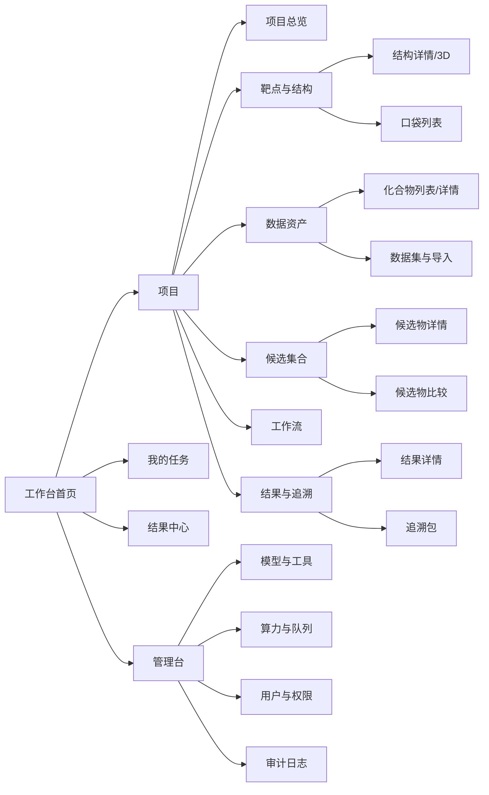

# 中国医药 AI 药物研发平台 · UI 交互与原型说明

| 项 | 内容 |
|---|---|
| 文档编号 | DRP-UI-v1.2 |
| 文档版本 | **v1.2**（2026-10-23 生产级复审补齐；**新增 P-40 工作流编排画布**，补齐 `01` M6-FR-02 的 P1 诉求——此前只有模板卡与实例状态图，无编辑态画布；页面数 39 -> 40）<br>**v1.1**（2026-10-20 评审修订；① P-04 项目总览新增「研发主线」进度条；② P-32 任务详情新增「规模」行；③ §6.3 排队预估改按规模层分算，新增 §6.4 规模分层与算力预估单；④ **新增 P-39 决策记录页**，页面数 38 → 39；⑤ **§4 全局框架侧边导航插入「决策」二级项**，并补第 4 条交互约定（决策页只读、无新建按钮，只能从决策点页面发起）） |
| 上游 | `02-架构/03-系统架构设计说明书.md`、`03-接口/05-API接口规格说明书.md` |
| 技术栈 | Vue 3 + TypeScript + Vite + Element Plus；3D 用 Mol\*（Molstar） |

> **需求基线说明（2026-11-10）**：40 个页面清单仍然有效（页面数不随需求基线变化）。文中引用的 `01` 模块号（如 `M6-FR-02`）是**内部技术标号**，需求来源已改为甲方确认版 V3.0，换算见 `01` §6，判定见 `26`。

---

## 1. 设计原则

面向的是**药物研发科学家与计算化学家**，不是普通办公用户。三条硬原则：

1. **对象优先**：页面始终围绕「项目 → 靶点 → 结构/口袋 → 候选物 → 任务 → 结果」这条主线组织，导航层级不超过 3 层。
2. **等待可见**：任何超过 3 秒的操作都必须有明确反馈；长时任务必须给出排队序号、阶段与进度，而不是转圈。
3. **错误可执行**：错误提示必须告诉用户「哪里错了 + 怎么办」，见 §7。

---

## 2. 信息架构



---

## 3. 页面清单

| # | 页面 | 路由 | 关键元素 | 关联需求 |
|---|---|---|---|---|
| P-01 | 登录 | `/login` | 账号密码、记住我、错误提示 | — |
| P-02 | 工作台首页 | `/home` | 我的项目卡片、进行中任务、最近结果、算力概览 | NFR-02 |
| P-03 | 项目列表 | `/projects` | 搜索、状态筛选、新建 | M1-FR-01 |
| P-04 | 项目总览 | `/projects/:id` | 统计卡（靶点/候选物/任务/结果）、进行中任务、成员 | M1-FR-01 |
| P-05 | 项目成员 | `/projects/:id/members` | 成员表、角色下拉、添加/移除 | M1-FR-02 |
| P-06 | 靶点列表 | `/projects/:id/targets` | 靶点卡、新建、进入结构 | M1/M2 |
| P-07 | 靶点详情/蛋白 | `/targets/:id` | 序列区、结构列表、操作入口 | M2-FR-01/03 |
| P-08 | 结构预测提交 | `/proteins/:id/predict` | 序列预览、模型选择、参数表单（Schema 驱动） | M2-FR-02 ★ |
| P-09 | 结构详情（3D） | `/structures/:id` | Mol\* 视图、pLDDT 着色、结构准备、导出 | M2-FR-08 |
| P-10 | 口袋列表 | `/structures/:id/pockets` | 排序表、3D 叠加、选定 | M2-FR-06 ★ |
| P-11 | 口袋残基 | `/pockets/:id/residues` | 残基表、3D 高亮定位 | M2-FR-07 ★ |
| P-12 | 数据资产 | `/projects/:id/assets` | Tab：化合物/蛋白/数据集 | M1-FR-03/04/05 |
| P-13 | 化合物详情 | `/compounds/:id` | 2D 结构、属性表、版本历史 | M1-FR-03 |
| P-14 | 批量导入 | `/projects/:id/import` | 上传、字段映射、模板保存、导入结果 | M1-FR-06 |
| P-15 | 分子生成 | `/design/molecules` | 靶点/口袋选择、模型选择、参数、生成数量 | M3-FR-01 ★ |
| P-16 | 多肽设计 | `/design/peptides` | 长度范围、设计条件、模型选择 | M3-FR-02 ★ |
| P-17 | 生成结果 | `/tasks/:id/results` | 结果网格（结构卡 + 评分）、筛选、排序、保存至集合 | M3-FR-04~07 |
| P-18 | 候选集合 | `/candidate-sets/:id` | 列表、多列指标、批量操作、导出 | M3-FR-04 |
| P-19 | 候选物详情 | `/candidates/:id` | 结构/序列、属性、已有预测与计算结果 | M3-FR-05 |
| P-20 | 候选物比较 | `/candidates/compare` | ≤6 个并排、差异高亮、导出 | M3-FR-08 |
| P-21 | 性质预测提交 | `/predict` | 单/批量切换、指标组勾选、模型选择 | M4 ★ |
| P-22 | 预测结果 | `/tasks/:id/predictions` | 指标矩阵、筛选排序、分布图、导出 | M4-FR-05/06 |
| P-23 | 虚拟筛选配置 | `/screen` | 漏斗配置（构象/药效团/对接/重打分）、阈值 | M5-FR-04 ★ |
| P-24 | 筛选结果 | `/tasks/:id/screening` | 排序表、下钻姿势、导出 | M5-FR-04 |
| P-25 | 对接结果详情 | `/docking-results/:id` | 3D 复合物、相互作用列表、评分 | M5-FR-07 |
| P-26 | MD 提交 | `/md` | 复合物选择、力场/时长/温压参数 | M5-FR-05 |
| P-27 | MD 结果 | `/tasks/:id/md` | 轨迹播放器、RMSD/RMSF 曲线、导出 | M5-FR-05/09 |
| P-28 | 自由能结果 | `/tasks/:id/free-energy` | ΔG、能量分解、报告 | M5-FR-06 |
| P-29 | 工作流模板 | `/workflows/templates` | 模板卡、DAG 预览、启动 | M6-FR-01 |
| P-30 | 工作流实例 | `/workflows/:id` | DAG 状态图、节点列表、取消/重试 | M6-FR-03 |
| P-31 | 任务中心 | `/tasks` | 全局任务列表、状态筛选、批量操作 | M6-FR-05 |
| P-32 | 任务详情 | `/tasks/:id` | 状态时间轴、进度、阶段、日志、产物、追溯 | M6-FR-05/06 |
| P-33 | 结果中心 | `/results` | 按项目/候选物查询、比较、导出 | M7-FR-07 |
| P-34 | 结果详情 | `/results/:id` | 指标、产物、3D、追溯包下载 | M7 |
| P-35 | 模型与工具管理 | `/admin/models` | 注册表、版本、启停、参数 Schema | NFR-11 |
| P-36 | 算力与队列 | `/admin/compute` | 节点状态、DCU 使用率、队列、配额 | M6-FR-10 |
| P-37 | 用户与权限 | `/admin/users` | 用户、角色、项目授权 | NFR-08 |
| P-38 | 审计日志 | `/admin/audit` | 操作日志检索 | NFR-08 |
| P-39 | 决策记录 | `/projects/:id/decisions` | 按决策点分组的时间线、入选/淘汰对比、依据任务与指标、导出（**v1.1 新增**，对应 `03` §3.6.2 / `05` §3.3） | M1/M7 |
| P-40 | 工作流编排画布 | `/workflows/templates/:id/edit` | **一期**：DAG 只读预览 + 节点参数面板 + 另存为新模板；**二期**：节点拖拽/增删、依赖连线、版本对比（**v1.2 新增**，对应 `01` M6-FR-02 P1，一期边界见 §3 末尾说明与 `03B` `D-25`）。数据接口：`GET /api/v1/workflow-templates/{id}`（读 DAG）、`POST /api/v1/projects/{id}/workflow-templates`（另存为新模板），见 `05` §9 | M6-FR-02 |

> **v1.2 补齐说明**：`01` §10 M6-FR-02 明确要求「工作流可视化编排」，但此前 `06` 只有 P-29（模板卡）与 P-30（实例状态图），**没有编辑态画布**，`16` §9.3 也承认「自定义工作流编排一期可能未开放」。现补 P-40，页面数 39 → **40**。
>
> **一期与二期的边界**（`03B` `D-25`，**🟠 未关闭，需产品与甲方书面确认**）：P-40 的**节点与连线编辑**属二期；一期只开放「**复制预置模板 → 调参数 → 另存**」（P-40 的只读预览 + 参数面板，不开放节点增删与连线编辑）。二期另含「并行分支」与「失败策略逐节点配置」（`16` §9.3）。
>
> ⚠ **这不是「降级」，是需求边界变化**：`01` §10 的 `DRP-M6-FR-02`（现对应 `AIYF-WF-01-SRS` 预置研发工作流）是 **P1 级**，其「编排」语义是用户可增删节点、改拓扑，「参数配置」只是其中一半。一期只做参数配置 = **M6-FR-02 一期不完整**。因此该事项在 `03B` 中登记为 🟠 待确认（`D-25`），**不得按「已关闭决策」处理**；确认后还须在 `02` 补 M6-FR-02 的二期验收用例——`02` 当前只追踪 M6-FR-01 / FR-03，这条需求链路目前是断的。

---

## 4. 全局框架

```
┌────────────────────────────────────────────────────────────────────┐
│ Logo  中国医药 AI 药物研发平台        项目切换器  算力指示灯  ⚙ 用户 │
├──────────┬─────────────────────────────────────────────────────────┤
│          │                                                          │
│ 侧边导航 │                     主内容区                              │
│          │                                                          │
│ 工作台   │   ┌────────────────────────────────────────────────┐     │
│ 项目     │   │ 面包屑：项目 / KRAS G12C / 靶点与结构             │     │
│ ├ 总览   │   ├──────────────────────────────────────────────────┤     │
│ ├ 靶点   │   │ 页面标题 + 主操作按钮                              │     │
│ ├ 数据   │   │                                                    │     │
│ ├ 候选物 │   │  Tab / 筛选区                                      │     │
│ ├ 工作流 │   │                                                    │     │
│ ├ 决策   │   │                                                    │     │
│ └ 结果   │   │  内容区（表格 / 卡片 / 3D 视图）                    │     │
│          │   │                                                    │     │
│ 任务中心 │   │  分页                                              │     │
│ 结果中心 │   └────────────────────────────────────────────────────┘     │
│ 管理台   │                                                          │
└──────────┴─────────────────────────────────────────────────────────┘
```

**关键约定**
- 顶部「项目切换器」常驻，避免用户频繁回退找项目
- 「算力指示灯」显示当前 DCU 使用率（绿/黄/红）与我的排队数
- 侧边导航二级项随项目上下文动态展开
- **（v1.1）** 项目下新增「决策」二级项（P-39），与「总览」里「最近决策」卡片互跳；决策记录**只读不可编辑**，故该页无新建按钮，只能从决策点页面（如 P-10 选定口袋、P-20 候选物比较）发起

---

## 5. 关键页面原型

### 5.1 P-04 项目总览

> **v1.1 补充**：新增顶部「研发主线」进度条与下一步提示（对应 `03` §3.6 / `01` §4.1）。阶段由数据自动推导，不靠用户手推。

```
┌───────────────────────────────────────────────────────────────┐
│ 项目 / KRAS G12C 抑制剂研发        [编辑] [成员] [归档]        │
├───────────────────────────────────────────────────────────────┤
│ 研发主线  ●S0─●S1─●S2─○S3─○S4─○S5─○S6      当前：S2 结构与口袋 │
│ ⚠ 下一步：已有 3 个结构，尚未选定口袋 → [去选口袋]              │
├───────────────────────────────────────────────────────────────┤
│ ┌────────┐ ┌────────┐ ┌────────┐ ┌────────┐ ┌────────┐        │
│ │ 靶点 3 │ │候选 1.2k│ │任务 86 │ │结果 214│ │算力 12% │        │
│ └────────┘ └────────┘ └────────┘ └────────┘ └────────┘        │
├───────────────────────────────────────────────────────────────┤
│ 进行中任务                              查看全部 >            │
│ ┌─────────────────────────────────────────────────────────┐   │
│ │ ● 结构预测 · KRAS G12C    ████████░░ 78%   剩余约 6 分钟 │   │
│ │ ● 批量对接 · 集合A        ███░░░░░░░ 31%   排队中(2/5)   │   │
│ │ ● ADMET 批量预测          ██████████ 100%  已完成        │   │
│ └─────────────────────────────────────────────────────────┘   │
├───────────────────────────────────────────────────────────────┤
│ 最近决策                                     查看全部 >        │
│ DP2 · 选定口袋 P2（评分 0.87）· 张伟 · 2 天前                  │
├───────────────────────────────────────────────────────────────┤
│ 最近结果         │ 成员（5）                                    │
│ ...              │ 张伟(负责人) 李娜 王强 ...                    │
└───────────────────────────────────────────────────────────────┘
```

**交互约定**：
- 进度条**可点击跳转**到对应阶段的首个页面；未到达的阶段置灰但可悬停查看条件。
- 阶段**允许回退**（如新增靶点），回退时顶部提示「已回到 S2，因为新增了靶点」，不弹错误。
- 「下一步」最多展示 1 条主提示 + 3 条次要提示，避免变成待办清单。

### 5.2 P-09 结构详情（3D）

```
┌───────────────────────────────────────────────────────────────┐
│ 结构详情 · KRAS G12C predicted-01        [结构准备] [导出]     │
├──────────────────────────────┬────────────────────────────────┤
│                              │ 基本信息                        │
│      [ Mol* 3D 视图 ]        │  来源：Boltz-2 v2.0.1           │
│                              │  平均 pLDDT：87.4               │
│                              │  残基数：169                    │
│                              │  创建：2026-07-01 10:22         │
│  显示模式：[卡通][表面][棒状] │                                 │
│  着色：[链][pLDDT][疏水性]    │ 口袋（5）                       │
│  叠加：[口袋1][配体]          │  1  score 18.42  已选定  ★      │
│  [重置视角][截图]             │  2  score 15.10                 │
│                              │  ...                            │
├──────────────────────────────┴────────────────────────────────┤
│ 逐残基置信度条 ▁▂▄▆█▇▅▃▂ ...（可点击定位）                     │
└───────────────────────────────────────────────────────────────┘
```

**3D 视图规范（Mol\*）**
- 渲染格式：PDB（蛋白）、SDF/MOL2（配体）、XTC（轨迹）
- 默认：蛋白卡通 + 口袋半透明体积 + 配体棒状
- pLDDT 着色：蓝（高）→ 红（低）
- 交互：滚轮缩放、左键旋转、右键平移、点击残基/原子高亮并弹出信息
- 性能：>5000 残基自动降级为 cartoon 简化；轨迹播放按帧抽稀
- 截图导出 PNG，用于报告

### 5.3 P-17 生成结果（分子设计）

```
┌───────────────────────────────────────────────────────────────┐
│ 生成结果 · 187 个有效分子（生成 200 / 重复 9 / 非法 13）       │
├───────────────────────────────────────────────────────────────┤
│ 筛选：评分 ≥ [0.6]  分子量 [300-600]  logP [1-4]  QED ≥ [0.5]  │
│ 排序：[模型评分 ▼] [分子量] [QED]        已选 42 个             │
├───────────────────────────────────────────────────────────────┤
│ ┌──────┐ ┌──────┐ ┌──────┐ ┌──────┐ ┌──────┐                  │
│ │[结构]│ │[结构]│ │[结构]│ │[结构]│ │[结构]│                  │
│ │0.92  │ │0.89  │ │0.87  │ │0.85  │ │0.84  │                  │
│ │MW432 │ │MW398 │ │MW511 │ │MW377 │ │MW466 │                  │
│ │☑ 选择│ │☐     │ │☑     │ │☐     │ │☐     │                  │
│ └──────┘ └──────┘ └──────┘ └──────┘ └──────┘                  │
├───────────────────────────────────────────────────────────────┤
│ [全选本页] [保存至候选集合 ▾] [比较选中] [导出]                 │
└───────────────────────────────────────────────────────────────┘
```

### 5.4 P-32 任务详情

```
┌───────────────────────────────────────────────────────────────┐
│ 任务 · 批量对接 · 集合A                  [取消] [重试] [导出]  │
├───────────────────────────────────────────────────────────────┤
│ 状态时间轴                                                     │
│  ○ 已提交 10:01 → ● 排队中 10:01(第2位) → ● 运行中 10:07       │
│     → ○ 完成                                                   │
│ 当前阶段：对接分片 7/20      进度 ███████░░░ 35%                │
│ 已运行 12分34秒   预计剩余 23分钟                               │
├───────────────────────────────────────────────────────────────┤
│ Tab: [概览] [参数] [输入] [日志] [产物] [追溯]                  │
│                                                                │
│ 参数：exhaustiveness=8, topPoses=3, seed=42                    │
│ 工具：AutoDock Vina 1.2.5    镜像：harbor/drp/vina:1.2.5-py3.10│
│ 资源：CPU×16 / 内存32GB / DCU 0                                 │
│ 输入：受体 complex.pdb (sha256: ab12...)  配体集合 cset_...(v3) │
└───────────────────────────────────────────────────────────────┘
```

**v1.1 新增「规模」行**（上框原型中的 `资源` 下方）：按 `03` §5.2.2 展示规模层（S/M/L/XL/T）、优先级与实际使用的卡池（交互卡 / 批量卡 / 长时队列）。用户**不需要选择**规模层（由 `drp-scheduler` 按 `task.scale.itemCount` 自动判定），但**必须能看到自己这个任务被分到哪一层**——否则「为什么它排了 6 小时」无法解释。

**日志区**：支持按级别过滤（INFO/WARN/ERROR）、关键字搜索、按时间窗加载、下载完整日志。

**追溯 Tab**：一键下载 `traceability.json` + 输入文件包。

---

## 6. 状态与反馈规范

### 6.1 任务状态视觉

| 状态 | 颜色 | 图标 | 文案 | 可用操作 |
|---|---|---|---|---|
| 排队中 | 蓝 | 时钟 | 排队中（第 2 位，预计等待 3 分钟） | 取消 |
| 运行中 | 蓝（动） | 旋转 | 运行中 35% · 分片 7/20 | 取消、查看日志 |
| 成功 | 绿 | 对勾 | 已完成 · 耗时 23 分钟 | 查看结果、导出 |
| 失败 | 红 | 叉 | 失败：受体文件格式错误 | 重试、查看日志 |
| 已取消 | 灰 | 减号 | 已取消（保留部分产物） | 重新提交 |
| 超时 | 橙 | 感叹号 | 超时终止（上限 24 小时） | 调整参数重试 |

### 6.2 进度反馈层级

| 场景 | 反馈形式 |
|---|---|
| < 1 秒 | 无需反馈 |
| 1~3 秒 | 按钮 loading |
| 3~30 秒 | 全局 loading + 文字说明 |
| > 30 秒 | 转为异步任务，返回任务卡片，页面可离开 |
| > 10 分钟 | 任务中心 + 站内通知（可选邮件/IM 扩展） |

### 6.3 算力拥挤提示

当 DCU 使用率 > 90% 时，提交按钮下方显示：
> 当前算力繁忙，您的任务将进入排队，预计等待约 25 分钟。可切换为「批量模式」在夜间自动执行。

> **v1.1 修正**：预估等待时间必须**按 `03` §5.2.2 的规模层分别统计历史均值**，不得混算——把 S 层的秒级样本混进 XL 层均值会让预估系统性偏乐观。文案须带规模层信息，如「同为 **L 大批量** 的任务平均等待 25 分钟」。

### 6.4 规模分层与算力预估单（v1.1 新增）

| 触发条件 | 交互形式 | 说明 |
|---|---|---|
| 判定为 **S 交互层** | 无额外交互，直接提交 | 走预留交互卡，`03` §5.3 硬规则 |
| 判定为 **M / L 层** | 提交后返回排队位置 + 按规模层的预估完成时间 | 不阻断 |
| 判定为 **XL 层**（≥1 万件） | **阻断式预估单弹窗**，必须显式确认才入队 | `03` §5.2.2 硬性规则；见下方原型 |
| 判定为 **T 长时层**（单体 >1h） | 提示「长时任务，不占普通配额，但**可能等待更久**」 | 专用队列，`03` §5.3 |

**XL 层预估单原型**：

```
┌───────────────────────────────────────────────────────────┐
│ 算力预估单 · 大批量虚拟筛选                      [取消]    │
├───────────────────────────────────────────────────────────┤
│ 本次提交 100,000 个配体，已自动归入 XL 层（超大批量）。    │
│                                                            │
│ 预估耗时：约 3.1~18.5 小时，典型 9.3 小时（按 90 有效核估）│
│ 预估完成：最快 2026-10-24 03:00，最晚 2026-10-24 18:30     │
│ 资源占用：CPU 计算池 112/128 核，期间 S/M 层预留 16 核     │
│                                                            │
│ ⚠ 建议先启用漏斗前置（药效团 + ADMET 粗筛），可减少约 90%  │
│   勾选后预估降至 10,000 个配体，约 35~110 分钟             │
│   [✓] 先跑漏斗粗筛（推荐）                                 │
│                                                            │
│ 本任务将核销约 833 算力·小时（项目剩余 2,400 算力·小时）   │
│                                    [我再想想] [确认提交]   │
└───────────────────────────────────────────────────────────┘
```

**三条交互约束**：
1. 预估必须给**区间不给单值**（模型冷启、卡位争抢、分片失败重跑都会拉长）——给单值就是给承诺。
2. 「先跑漏斗粗筛」**默认勾选**且必须说明预估降幅；`03` §5.6.3① 要求不启用漏斗不得放行 XL。
3. 预估单的估算值必须可与事后实际值对比（`14` AL-22 监控偏差 >3 倍即告警），偏差累积后回填 `03` §5.2.1。

---

## 7. 错误提示清单（对应 NFR-12）

| 场景 | 提示文案 | 引导动作 |
|---|---|---|
| 文件格式不支持 | 不支持 `.docx` 格式。分子文件请上传 `.sdf` / `.smi` / `.mol2`；表格请上传 `.csv` / `.xlsx` | 提供格式说明链接 |
| SMILES 解析失败 | 第 128 行 SMILES 无法解析，已跳过该行（共 4 行失败） | 下载错误报告 |
| 序列长度超限 | 序列长度 2140 aa，超出当前模型上限 1500 aa | 建议分段预测或换模型 |
| 候选集合为空 | 候选集合中没有候选物，请先生成或导入 | 跳转生成/导入 |
| 配额不足 | 本项目并发 DCU 任务已达上限 2，请等待或联系管理员调整配额 | 查看队列 |
| 任务提交失败 | 提交失败：受体结构未完成「结构准备」，请先执行结构准备 | 一键跳转结构准备 |
| 无权访问 | 您不是该项目成员，无法查看此内容 | 申请加入 |
| 项目已归档 | 项目已归档，处于只读状态 | 联系负责人取消归档 |
| 下载失败 | 文件已过期或已被清理，请重新发起导出 | 重新导出 |
| 网络中断 | 连接已断开，正在重连…（任务在服务端继续执行） | 自动重连 |

**文案纪律**：不使用「操作失败」「系统错误」等无信息量提示；每条错误必须包含 现象 + 原因 + 下一步。

---

## 8. 交互细节约定

| 项 | 约定 |
|---|---|
| 批量选择 | 表格支持跨页选择（记录已选 ID 集合），顶部显示「已选 N 项」操作条 |
| 对比 | 最多 6 项，超出提示；差异项高亮；支持导出对比表 |
| 导出 | 一律异步，完成后站内通知 + 下载中心；大文件走预签名直取 |
| 表单 | 模型参数表单由 `paramSchema` 动态渲染，必填校验 + 单位提示 + 默认值 |
| 参数复用 | 「使用上次参数」「保存为默认」按钮，减少重复配置 |
| 长列表 | 虚拟滚动；2D 结构图服务端预渲染 SVG 并缓存 |
| 3D 视图 | 懒加载，进入视口才初始化 Mol\* |
| 权限 | 无权限的操作按钮直接隐藏（而非点击后报错）；只读成员隐藏所有写操作 |
| 空状态 | 每个列表页都有引导型空状态（说明用途 + 一键开始） |
| 危险操作 | 删除、取消长时任务需二次确认弹窗，输入确认或勾选「我知道后果」 |

---

## 9. 视觉与组件规范（摘要）

| 项 | 约定 |
|---|---|
| 主色 | 深蓝（科技/医药感），`#1F5FA9` 系；状态色沿用 Element Plus 语义色 |
| 字体 | 14px 正文；表格 13px；标题 16/18/20px；代码与序列等宽字体 |
| 圆角 | 卡片 8px，按钮 4px |
| 密度 | 表格默认「中等密度」；候选物网格卡片宽度 160px |
| 图标 | 统一线性图标，禁止混用风格 |
| 序列展示 | 等宽字体 + 每 10 位分色 + 行号，支持复制与长度提示 |
| 数据可视化 | ECharts：指标分布用直方图/箱线图，RMSD 用折线图，筛选漏斗用漏斗图 |

---

## 10. 原型交付方式

1. 本文件作为**低保真原型说明**，与 PRD 一并评审
2. 评审通过后产出**高保真设计稿**（Figma/即时设计），覆盖 §3 全部 40 个页面
3. 高保真稿确认后进入前端实现；实现阶段以组件库为约束，禁止脱离 Element Plus 自造基础组件
