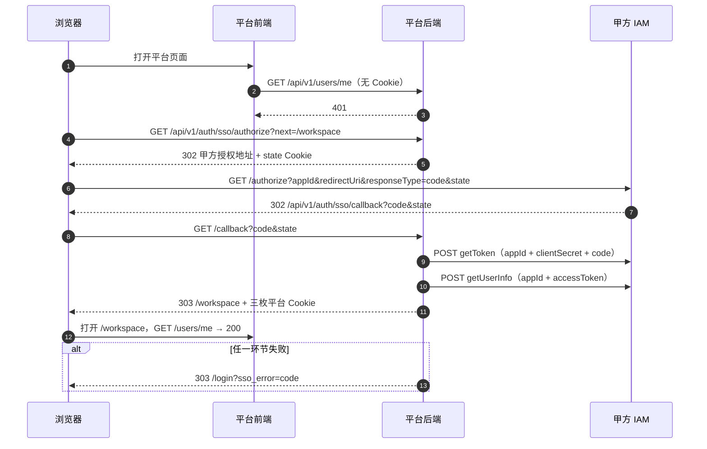

# 统一身份认证（IAM）对接方案

| 项 | 内容 |
| --- | --- |
| 文档编号 | `DRP-IAM-v1.0` |
| 文档版本 | **v1.0**（2026-11-13 首版） |
| 文档状态 | 代码已实现，待甲方联调验证 |
| 上游依据 | 甲方《统一身份认证与管理系统-统一认证接口规范 v1》4.1「WEB 非网关模式」；[`05-API接口规格说明书`](05-API接口规格说明书.md) v1.30 |
| 下游消费 | 甲方 IT / 运维联调、平台部署与值班、[`13-部署架构与上线方案`](../05-部署/13-部署架构与上线方案.md) 上线检查单 |
| 核心约束 | 只做统一认证对接，**不上架应用商店**；统一票据只存服务端；`SSO_ENABLED=false` 时行为与接入前一致 |

## 0. 本文档要解决的六个问题

1. 用户怎么从甲方账号登进平台，浏览器跳几次？
2. 甲方要给我们哪些材料，缺了会怎样？
3. IAM 用户怎么对上平台账号，同名怎么办？
4. 平台会话多久失效，IAM 故障时会不会全员掉线？
5. 报错 `sso_error=...` / `40103` 怎么查？
6. 密钥、Cookie、票据的安全边界在哪？

不在本文档范围：甲方 IAM 侧的用户与组织维护、APP/网关模式、应用商店上架、平台业务权限模型。

## 1. 背景与范围

### 1.1 为什么接 IAM
- 甲方要求一个账号登录全部系统：平台不再单独发账号，用户从 IAM 登录后直接进平台。
- 平台不存甲方口令：平台只保存 IAM 返回的 `userId` 映射，口令校验发生在甲方页面。
- 登出联动：平台登出后跳甲方 GLO，连带结束 IAM 会话；IAM 短时不可达时，配置的离线窗口内允许已登录用户继续刷新平台会话（见 §6.5）。

### 1.2 本期范围
- 对接模式：**WEB 非网关模式**，标准 OAuth2 授权码（`response_type=code`），平台后端持 `clientSecret` 换票。
- 平台角色：OAuth2 客户端（`appId` + `clientSecret`），不是 IAM 的网关代理，也不接收 IAM 注入的用户头。
- 平台账号：`users.auth_source` 新增 `sso`；`users.sso_uid` 存 IAM `userId`（部分唯一索引）。
- 会话：浏览器只拿平台 JWT Cookie；甲方 `accessToken`/`refreshToken` 加密后挂在平台 refresh 会话行上，不下发浏览器。
- 开关：`SSO_ENABLED=false` 时 `authorize` 直接回登录页，其余行为与接入前一致。

### 1.3 不在范围
- APP 模式（移动端 SDK / 原生授权）、网关模式（IAM 反向代理注入身份头）。
- 应用商店上架、应用元数据申报。
- IAM 侧用户、组织、角色、应用可见范围的维护（甲方负责）；平台业务权限与 IAM 角色的映射（本期只映射平台 `role`，默认 `user`）。

### 1.4 与 LDAP 方案的关系
[`2026-10-30-enterprise-ldap-auth-design.md`](../superpowers/specs/2026-10-30-enterprise-ldap-auth-design.md) 是 LDAP 方向的早期设计，被后端注释直接引用，**不可移动或改名**；其结论不作为本期实现口径。本期以本文档与代码为准，两者可以并存：`auth_source` 区分 `local` / `ldap` / `sso`，但同一账号不允许同时走多套外部认证。

### 1.5 术语表
| 术语 | 含义 |
| --- | --- |
| IAM | 甲方统一身份认证与管理系统 |
| 统一票据 | 甲方签发的 `accessToken` 与 `refreshToken`，只在服务端流转 |
| 平台会话 | 平台自己签发的 JWT（`cpumodel_access` / `cpumodel_refresh`） |
| 授权码 | IAM 回跳时带的一次性 `code`，只能由后端用 `clientSecret` 兑换 |
| `state` | 平台生成的随机串，用于把回跳与发起登录的浏览器绑定 |
| GLO | 甲方全局登出端点（`/GLO`），浏览器顶层跳转访问 |
| 锚点 | `refresh_tokens.iam_checked_at`，最近一次成功校验统一票据的时间 |

## 2. 角色、端点与一次完整登录

### 2.1 四个角色
| 角色 | 职责 | 不做什么 |
| --- | --- | --- |
| 浏览器 | 两次顶层跳转；持有平台 Cookie | 不接触 `clientSecret`，不换票 |
| 平台前端 | 调 `/users/me`、`/auth/refresh`、`/auth/sso/logout`；读 `sso_error`；`40103` 时按开关顶层跳 IAM | 不解析 IAM 响应，不接触统一票据 |
| 平台后端 | 生成/校验 `state`，换票，取用户，映射账号，签发平台会话 | 不信任 URL 里的回跳目标 |
| 甲方 IAM | 登录页、发码、发票、给用户信息、全局登出 | 不直接访问平台数据库 |

### 2.2 端点
| 方法 | 路径 | 作用 | 成功 | 失败 |
| --- | --- | --- | --- | --- |
| GET | `/api/v1/auth/sso/status` | 前端探测是否启用 | `200`，`data` 含 `enabled`/`authorize_path`/`auto_provision` | 无 IAM 调用，不失败 |
| GET | `/api/v1/auth/sso/authorize` | 发起登录 | `302` 到 IAM + `Set-Cookie: cpumodel_sso_state` | `303 /login?sso_error=disabled` |
| GET | `/api/v1/auth/sso/callback` | 接收授权码 | `303` 到 `next` + 三枚平台 Cookie | `303 /login?sso_error=<码>` |
| POST | `/api/v1/auth/sso/logout` | 结束平台会话并取 GLO 地址 | `200`，`data.logout_url` | `403` CSRF 失败（不清 Cookie） |

### 2.3 时序图


### 2.4 十二步说明
1. 用户打开平台页面；前端发现没有会话。
2. 前端调 `/users/me`，无 Cookie，得到 401。
3. 前端跳到 `/login`；用户点「统一认证登录」，或直接访问 `/api/v1/auth/sso/authorize`。
4. 浏览器访问 `/auth/sso/authorize?next=/workspace`；`next` 只接受站内路径。
5. 后端生成 32 字节随机 `state`，把 `state`、`target` 与 HMAC 写进 host-only Cookie，302 到 IAM 授权地址。
6. 浏览器在甲方页面完成登录；IAM 校验 `appId` 与报备过的 `redirectUri`。
7. IAM 302 回平台回调，带 `code` 与 `state`。
8. 后端先校验 `state`（Cookie 与查询参数一致、HMAC 有效、未过期），再从 Cookie 里取回 `target`。
9. 后端用 `appId` + `clientSecret` + `code` 调 `getToken`；`clientSecret` 只出现在这个 POST body 里。
10. 后端用 `accessToken` 调 `getUserInfo`，拿 `userId`/`userName`/`employeeNo`/`email`/`fullname`。
11. 后端按 §5 解析或创建平台账号，签发平台 JWT；统一票据加密后写进 refresh 会话行；303 到 `target`，同时下发三枚 Cookie、清 state Cookie。
12. 浏览器带平台 Cookie 打开 `target`，`/users/me` 返回 200，登录完成。

图中 `alt` 分支（第 13 条）是统一失败出口：任何一步失败都 `303 /login?sso_error=<码>`，前端不需要理解 IAM 错误码。

### 2.5 为什么 `code` 必须服务端兑换
- `clientSecret` 只允许出现在服务端到服务端的 POST body：不进浏览器、不进 URL、不进日志与异常（`iam_client.py` 的约束）。
- 授权码与 `redirectUri`、`appId`、`clientSecret` 绑定，且一次性；浏览器拿到 `code` 也换不出票。
- 换票结果含 `refreshToken`，它的寿命远长于授权码；一旦进浏览器就等于把长期凭证交给前端。

### 2.6 为什么 `state` 必须签名
- **防登录 CSRF**：攻击者用自己的 `code` 诱导受害者访问回调，若平台不校验 `state`，受害者的浏览器会被绑到攻击者的平台账号（或反过来）。
- **防篡改回跳**：签名覆盖 `state` 与 `target`；`target` 只从 Cookie 里读，**不信 URL 的 `next`**，否则就是开放重定向。
- 比较用 `hmac.compare_digest`；非 ASCII 直接判失败而不是抛 500。
- Cookie 是 host-only、`Path=/api/v1/auth/sso`、`HttpOnly`、TTL `SSO_STATE_TTL_SECONDS`（默认 300 秒），回调后立即清除。
- `COOKIE_SAMESITE=strict` 时 state Cookie 自动降级为 `lax`：IAM 回跳是顶层导航，`strict` 会丢 Cookie。

## 3. 配置清单

### 3.1 SSO 专有配置（15 项）
| 配置项 | 含义 | 默认值 | 生产建议值 | 必填 |
| --- | --- | --- | --- | --- |
| `SSO_ENABLED` | 总开关 | `false` | `true` | 是 |
| `SSO_BASE_URL` | IAM 基址，拼六个接口路径 | 空 | 甲方生产基址 | 启用时是 |
| `SSO_APP_ID` | 甲方分配的应用 ID | 空 | 甲方分配值 | 启用时是 |
| `SSO_CLIENT_SECRET` | 换票密钥，只走服务端 | 空 | 甲方分配值，走 Secret | 启用时是 |
| `SSO_REDIRECT_URI` | 回调绝对地址，必须与报备一致 | 空 | `https://<平台域名>/api/v1/auth/sso/callback` | 启用时是 |
| `SSO_SUCCESS_PATH` | 回跳默认落地（站内路径） | `/workspace` | `/workspace` | 否 |
| `SSO_AUTO_PROVISION` | 首次登录自动开户 | `true` | 按准入策略，见 §5.6 | 否 |
| `SSO_DEFAULT_ROLE` | 自动开户角色，仅 `user`/`admin` | `user` | `user` | 否 |
| `SSO_USERNAME_CLAIM` | 开户用户名优先取哪个字段 | `userName` | `userName` | 否 |
| `SSO_VALIDATE_ON_REFRESH` | 刷新时校验统一票据 | `true` | `true` | 否 |
| `SSO_TIMEOUT_SECONDS` | 单次 IAM 调用超时（秒） | `5.0` | `5` | 否 |
| `SSO_TLS_VALIDATE` | 校验 IAM 证书 | `true` | `true` | 否 |
| `SSO_STATE_TTL_SECONDS` | state Cookie 寿命（秒） | `300` | `300` | 否 |
| `SSO_OFFLINE_GRACE_SECONDS` | IAM 不可达宽限（秒） | `86400` | `86400`，上限见 §3.3 | 否 |
| `SSO_LOGOUT_REDIRECT_URI` | GLO 回跳绝对地址 | 空 | `https://<平台域名>/login?sso_logout=1` | 否 |

`SSO_LOGOUT_REDIRECT_URI` 留空时，从 `SSO_REDIRECT_URI` 取 `scheme://netloc` 拼 `/login?sso_logout=1`；再取不到就用相对路径 `/login?sso_logout=1`。

### 3.2 关联配置（9 项）
| 配置项 | 含义 | 默认值 | 生产建议值 | 必填 |
| --- | --- | --- | --- | --- |
| `JWT_SECRET_KEY` | 平台 JWT 与 state HMAC 的密钥 | 空（dev 随机生成） | ≥32 字节随机值，走 Secret | 生产是 |
| `ACCESS_TOKEN_EXPIRE_MINUTES` | 平台 access 寿命（分钟） | `60` | `30`~`60` | 否 |
| `REFRESH_TOKEN_EXPIRE_DAYS` | 平台 refresh 寿命（天） | `7` | `7` | 否 |
| `SETTINGS_ENCRYPTION_KEY` | 票据加密密钥 | `null` | ≥32 字节，走 Secret，≠ JWT 密钥 | 生产是 |
| `COOKIE_SECURE` | Cookie 只走 HTTPS | `false` | `true` | 生产是 |
| `COOKIE_DOMAIN` | Cookie 域 | `null` | 留空（host-only） | 否 |
| `COOKIE_SAMESITE` | access/CSRF 的 SameSite | `lax` | `lax`；跨站嵌入才用 `none` | 否 |
| `ALLOWED_HOSTS` | TrustedHost 白名单 | `["*"]` | 平台域名，显式列出 | 生产是 |
| `ENFORCE_HTTPS` | 强制 HTTPS | `null`（生产且 `COOKIE_SECURE` 时开） | `true` | 生产建议 |

### 3.3 校验规则（启动时执行）
- `SSO_ENABLED=true` 时，`SSO_BASE_URL` / `SSO_APP_ID` / `SSO_CLIENT_SECRET` / `SSO_REDIRECT_URI` 四项去空格后必须非空，否则启动失败。
- `SSO_BASE_URL` 与 `SSO_REDIRECT_URI` 必须绝对 `http(s)`；`ENVIRONMENT` 为 `staging`/`production` 时回调必须 `https`。
- `0 ≤ SSO_OFFLINE_GRACE_SECONDS ≤ REFRESH_TOKEN_EXPIRE_DAYS * 86400`；默认 7 天对应上限 604800。
- `SSO_LOGOUT_REDIRECT_URI` 非空时不得含控制字符，必须绝对 `http(s)`，staging/production 必须 `https`。
- `COOKIE_SAMESITE=none` 必须同时 `COOKIE_SECURE=true`，否则浏览器直接丢弃 Cookie。
- staging/production 还要求：`JWT_SECRET_KEY` ≥32；`SETTINGS_ENCRYPTION_KEY` 非占位、≥32、且不等于 `JWT_SECRET_KEY`；`COOKIE_SECURE=true`；`ALLOWED_HOSTS` 显式。配置只在进程启动时读取，**改环境变量必须重启**，没有热加载。

### 3.4 密钥注入
三个密钥（`JWT_SECRET_KEY`、`SETTINGS_ENCRYPTION_KEY`、`SSO_CLIENT_SECRET`）走 K8s Secret 或等价机制，不进镜像、不进 compose 明文、不进 Git。`backend/.env.example` 只保留占位与注释。

> 排查陷阱：`GET /auth/sso/status` 的 `enabled` 只等于 `SSO_ENABLED`，**不校验四项材料是否齐全**。看到 `enabled=true` 但 `authorize` 立刻 `disabled`，说明配置在启动校验之外被改坏了，或进程没重启。

## 4. 甲方需要提供的信息

### 4.1 信息清单（10 项）
| 项 | 用途 | 口径要求 |
| --- | --- | --- |
| `appId` | 授权、换票、GLO | 三套环境分别给，不共用 |
| `clientSecret` | 换票/续期 | 只经安全通道交付，不贴工单/IM |
| 回调地址报备 | IAM 校验 `redirectUri` | 精确到 scheme+host+port+path，见 §7.3 |
| 三套环境基址 | 拼六个接口路径 | 内网、外网、生产各一个 |
| 字段口径 | 账号映射 | `userId`/`userName`/`employeeNo` 的实际拼写与是否稳定 |
| `userId` 稳定性 | `sso_uid` 主键 | 换应用、改用户名后是否不变 |
| 是否下发邮箱 | 资料回填 | 是否总返回 `email` |
| 是否下发全名 | 显示名 | 字段名是 `fullname` 还是别的 |
| GLO 地址与参数 | 全局登出 | 是否需要额外参数、回跳白名单 |
| 应用可见范围 | 准入控制 | 哪些组织/角色能看到本应用 |

### 4.2 三套环境地址
| 环境 | 基址 | 用途 | 标注 |
| --- | --- | --- | --- |
| 甲方内网联调 | `http://am.gttest.com:60100` | 内网联调 | 甲方提供，仅联调时使用 |
| 甲方外网联调 | `https://login.genertec.com.cn` | 外网联调 | 甲方提供，仅联调时使用 |
| 生产 | `https://login.gt.cn` | 生产 | 甲方提供，仅上架时使用 |

地址只用于联调与上线配置，不写进代码、`.env.example` 或镜像。

### 4.3 字段口径
平台代码读取的键：`userId`、`userName`、`employeeNo`、`email`、`fullname`、`mobile`、`gender`、`changePasswordMust`、`orgs`；其中只有前五个参与账号映射与资料回填，`mobile`/`gender`/`orgs` 不落库。

**待确认**：规范 4.1 的 `getUserInfo` 返回体里写的是 `userName`，与代码读取的键一致；但 `employeeNo`、`mobile`、`email` 等字段标注「需要申请」，实际是否下发要在联调时用一次真实响应确认。若甲方最终给的是别名（例如把用户名放进别的键），当前代码会退到 `employeeNo` 或邮箱前缀，需要在 `backend/app/services/iam_client.py` 调整读取键。

### 4.4 缺失时的降级
| 缺什么 | 现象 | 平台行为 | 处理 |
| --- | --- | --- | --- |
| `appId`/`clientSecret` | 启动失败或 `authorize` 回 `disabled` | 无法发起登录 | 向甲方补材料；临时 `SSO_ENABLED=false` |
| 回调未报备 | IAM 拒绝授权或回跳不带 `code` | 回调得到 `denied` | 按 §7.3 精确报备后重试 |
| 环境地址不可达 | 登录/刷新超时 | 登录 `unavailable`；刷新走宽限 | 查网络/DNS/证书；临时提高 `SSO_TIMEOUT_SECONDS` |
| 无 `employeeNo` | 用户名回退 | 退到 `userName`，再退邮箱前缀 | 确认 `userId` 稳定即可 |
| 无 `email` | 邮箱为空 | 账号可用，资料留空 | 接受；不阻塞登录 |
| 无 `fullname` | 显示名为空 | 退到 `userName`，再退 `employeeNo` | 接受 |
| 无 `userId` | `getUserInfo` 报错 | 登录 `userinfo` | 要求甲方必须下发 `userId`，否则无法映射 |
| 无 GLO 地址 | `logout_url` 为 `null` | 只清平台会话，IAM 会话仍在 | 手工在甲方页面登出；补 GLO 配置 |

## 5. 账号映射

### 5.1 判定顺序
| 顺序 | 命中条件 | 结果 | 失败码 |
| --- | --- | --- | --- |
| ① | `users.sso_uid = userId` | 直接登录，回填空资料 | — |
| ② | 归一化用户名命中，`sso_uid` 为空且 `auth_source='sso'` | 绑定 `sso_uid` 后登录 | — |
| ③ | 归一化用户名命中，但 `sso_uid` 属于另一个 `userId` | 拒绝 | `conflict` |
| ④ | 归一化用户名命中，但 `auth_source` 是 `local`/`ldap` | 拒绝，不接管 | `conflict` |
| ⑤ | 无命中，`SSO_AUTO_PROVISION=true` | 新建 `auth_source='sso'` 账号 | 并发撞索引时 `conflict` |
| ⑥ | 无命中，`SSO_AUTO_PROVISION=false` | 拒绝 | `not_provisioned` |
| ⑦ | 无命中且无可用用户名 | 拒绝 | `conflict` |
| ⑧ | 命中后账号 `status != ACTIVE` | 拒绝 | `inactive` |

判定链顺序不可调：先 `sso_uid` 再用户名，保证甲方改名不会串号。

### 5.2 用户名归一化
- 去首尾空白；`[^A-Za-z0-9._-]` 全部替换为 `_`；截断到 56 字符；再去掉首尾的 `._-`；为空则视为没有用户名。
- 候选顺序：`SSO_USERNAME_CLAIM=userName` 时 `[userName, employeeNo]`，为 `employeeNo` 时 `[employeeNo, userName]`；再退 `email` 的 `@` 前缀；最后退 `userId`。
- 落库前按列宽截断：`username` 64、`sso_uid` 128、`display_name` 100、`email` 255。

### 5.3 同名本地/LDAP 账号为什么拒绝接管
如果允许同名接管，任何能在 IAM 登录的人，只要把自己的 `userName` 改成平台管理员的用户名，就能拿到平台管理员账号；甲方允许用户自助改名时，这等于把平台管理员的归属交给 IAM 的自助改名。平台无法从 `getUserInfo` 证明「这个 IAM 用户就是平台上那个本地账号的主人」，所以必须拒绝。

处理办法（三选一）：

1. **运维受控绑定**：确认该 IAM 用户确为账号主人后，在维护窗口执行 `UPDATE users SET sso_uid='<userId>', auth_source='sso' WHERE username='<name>' AND auth_source='local' AND sso_uid IS NULL;`。同时把 `auth_source` 改成 `sso`，否则该账号仍可用平台口令登录，等于留了绕过 IAM 的旁路。执行前确认还有可用的本地管理员做 break-glass。
2. **另起账号**：让该用户在 IAM 侧使用不与平台本地账号冲突的 `userName`（如加后缀），由平台自动开户；旧本地账号改名或停用。
3. **甲方改 `userName`**：把 IAM 的 `userName` 改成与平台本地账号不同，避免同名。

当前**没有绑定 API/UI**：`POST /users` 的 `auth_source` 只接受 `local`/`ldap`，也没有更新 `sso_uid` 的接口；绑定只能走受控 SQL。

### 5.4 冲突分型
| 类型 | 现象 | 处理 |
| --- | --- | --- |
| 用户名被另一个 `sso_uid` 占用 | `conflict`「用户名已被另一个统一认证账号占用」 | 确认是否同一人换号；清旧行 `sso_uid`，或让甲方改 `userName` |
| 同一 `sso_uid` 在 IAM 改名 | 正常登录，平台用户名不变 | 需要同步时运维改 `username`，先查唯一索引 |
| 无可用标识 | `conflict`「统一认证用户信息里没有可用的账号标识」 | 要求甲方下发 `userId`/`userName` |
| 并发开户撞唯一索引 | `conflict`「统一认证账号开户冲突，请重试」 | 让用户重试一次；仍失败查是否有同名行 |

### 5.5 停用账号
`status != ACTIVE` 的账号在映射完成后统一拒绝，返回 `inactive`「该账号已被停用，请联系管理员」。停用优先于自动开户：已停用的 `sso_uid` 不会被重新开户。

### 5.6 预建账号
`SSO_AUTO_PROVISION=false` 时，必须先建号。`POST /users` 不接受 `sso`，只能用受控 SQL：

```sql
CREATE TABLE users_backup_20261113 AS SELECT * FROM users;
INSERT INTO users (id, username, display_name, email, auth_source, sso_uid, role, status, created_at, updated_at)
VALUES (gen_random_uuid()::text, 'zhangsan', '张三', 'zhangsan@example.internal',
        'sso', '<userId>', 'user', 'ACTIVE', now() AT TIME ZONE 'UTC', now() AT TIME ZONE 'UTC');
SELECT lower(username), count(*) FROM users GROUP BY 1 HAVING count(*) > 1;
SELECT sso_uid, count(*) FROM users WHERE sso_uid IS NOT NULL GROUP BY 1 HAVING count(*) > 1;
```

### 5.7 资料回填与审计
- 只填空字段：`display_name` 为空才写 IAM 全名，`email` 为空才写 IAM 邮箱；平台已改过的值不覆盖。
- 自动开户角色取 `SSO_DEFAULT_ROLE`（默认 `user`，不要设成 `admin`，见 §9.7）；登录审计动作名为「统一认证单点登录」，同名冲突另记一条失败审计，原因「统一认证账号与本地账号同名，拒绝自动接管」。

## 6. 会话、续期与登出

### 6.1 三枚平台 Cookie
| Cookie | HttpOnly | Path | SameSite | TTL |
| --- | --- | --- | --- | --- |
| `cpumodel_access` | 是 | `/` | `COOKIE_SAMESITE`（默认 `lax`） | `ACCESS_TOKEN_EXPIRE_MINUTES` 分钟 |
| `cpumodel_refresh` | 是 | `/api/v1/auth` | `strict`（`COOKIE_SAMESITE=none` 时 `none`） | `REFRESH_TOKEN_EXPIRE_DAYS` 天 |
| `cpumodel_csrf` | 否（前端要读） | `/` | 同 access | 同 refresh |

`COOKIE_DOMAIN` 留空时全部 host-only。

### 6.2 统一票据存在哪
`refresh_tokens` 行新增四列，全部 nullable：`iam_access_token_enc`、`iam_refresh_token_enc`（Fernet 密文）、`iam_access_expires_at`、`iam_checked_at`。浏览器永远拿不到这四列。

### 6.3 续期链路（7 步）
1. 前端带 `cpumodel_refresh` 调 `POST /api/v1/auth/refresh`；Cookie 认证的非安全方法要带 `X-CSRF-Token`。
2. 后端验 refresh JWT，取 `sub`/`jti`，读用户与旧会话行，解密票据。
3. 签发新 access/refresh，`rotate_refresh_token` 轮换 `jti`；旧 `jti` 再用即触发复用检测。
4. **先 commit** 轮换结果，再调 IAM：IAM 最长 `SSO_TIMEOUT_SECONDS`，不能把行锁压在事务里。
5. `SSO_ENABLED` 且 `SSO_VALIDATE_ON_REFRESH` 且用户 `auth_source='sso'` 时，调 `validate_iam_session`。
6. 按四态处理（§6.4）；DEAD 或超宽限则结束平台会话并返回 40103。
7. 成功重下发三枚 Cookie；响应体默认不含 token，只有 `X-Token-Transport: body` 才回。

### 6.4 四态
| 状态 | 触发 | 平台动作 |
| --- | --- | --- |
| `ALIVE` | access 剩余 >60 秒且 `checkAccessToken` 返 `9001` | 只更新 `iam_checked_at` |
| `REFRESHED` | access 过期或判无效，`refreshToken` 换票成功 | 覆盖四列票据与 `iam_checked_at` |
| `DEAD` | `2002`/`1025`、refresh 阶段 HTTP 401/403、未知码、票据缺失 | 结束平台会话，40103 |
| `UNAVAILABLE` | 网络/超时/408/429/5xx/系统码 | 宽限内放行，超限 40103 |

### 6.5 宽限期
- 锚点是 `iam_checked_at`，即**最近一次成功校验**的时间；放行不推进锚点，所以宽限期是绝对窗口，不是滑动窗口。
- 上限公式：`SSO_OFFLINE_GRACE_SECONDS ≤ REFRESH_TOKEN_EXPIRE_DAYS * 86400`；默认 86400 秒（24 小时）；设 0 表示关闭宽限，IAM 一不可达就 40103。
- 没有锚点（`iam_checked_at` 为空）时不发放宽限，直接按失效处理。
- 运维口径：**故障开始 + 宽限 = 全员掉线时间**。默认 24 小时；超过后所有 sso 会话在下一次刷新时 40103，且必须等 IAM 恢复才能重新登录。

### 6.6 40103
HTTP 401，业务码 `40103`，`detail.reason=iam_session_expired`；`/auth/refresh` 返回 401 时中间件同时清三枚 Cookie。前端拦截器不做原地重试：`detail.reason=iam_session_expired` 且 SSO 启用时，顶层跳 `/authorize?next=<当前页>`（登录页除外，会落到 `/workspace`）；否则回登录页（`frontend/src/api/sso-session.ts`）。原地重试会死循环。

### 6.7 全局登出（GLO）
1. 前端 `POST /api/v1/auth/sso/logout`（必须 POST + CSRF；允许 access 已过期）。
2. 后端吊销平台 refresh 会话、清票据、清三枚 Cookie。
3. 仅当 `is_sso_user` 且 `SSO_ENABLED` 且 IAM 客户端可用时，才生成 `logout_url`；否则返回 `null`。
4. 前端 `window.location.assign(data.logout_url)` 做顶层跳转。
5. 甲方 GLO 清 IAM 会话后，302 回 `SSO_LOGOUT_REDIRECT_URI`（默认 `<scheme://netloc>/login?sso_logout=1`）；登录页读到 `sso_logout=1` 时提示一次并清掉参数。

**为什么不用 302**：`logout` 是 XHR/fetch，跨域 302 的最终 URL 前端读不到（CORS 与 `response.url` 都不可靠）；而且 XHR 的 302 不会让浏览器带着 IAM Cookie 做顶层导航，IAM 会话清不掉。必须由浏览器顶层跳转。

### 6.8 升级后要重登一次
升级前签发的 refresh 会话没有四列票据，刷新时 `tickets is None` → 40103。这是预期行为，不是故障；公告一次「升级后需重新登录」即可。

### 6.9 应急开关与 break-glass
- `SSO_VALIDATE_ON_REFRESH=false`：刷新不再校验 IAM，用于 IAM 长时间故障；代价是会话不再受 IAM 吊销约束，恢复后立即改回并重启。
- `SSO_ENABLED=false`：不再发起新登录，`/authorize` 回 `disabled`；已有 sso 会话因 `needs_iam_check` 为假而不再校验 IAM，自然过期。本地管理员（`auth_source='local'`）始终可用平台口令登录，是 break-glass 通道；不要把全部管理员都转成 sso——sso 账号即使关掉 SSO 也不能口令登录（40101）。

## 7. 联调步骤

### 7.1 环境矩阵
| 环境 | 平台入口 | IAM 基址 | 关键约束 |
| --- | --- | --- | --- |
| 开发本地 | `http://127.0.0.1:5173`（前端代理） | 见 §4.2 第 1 行 | `ENVIRONMENT=development`，可用 http |
| 甲方内网联调 | `http://<平台内网地址>` | 见 §4.2 第 1 行 | 回调 http；`ENVIRONMENT` 不能是 staging/production |
| 甲方外网联调 | `https://<平台域名>` | 见 §4.2 第 2 行 | 回调 https；`COOKIE_SECURE=true` |
| 生产 | `https://<平台域名>` | 见 §4.2 第 3 行 | 全链路 https；`ALLOWED_HOSTS` 显式 |

### 7.2 前置条件（6 项）
1. 迁移到 head：`cd backend && python -m alembic upgrade head`（含 `20261113_01`、`20261113_02`）。
2. `SETTINGS_ENCRYPTION_KEY` 已配：非 development 必须 ≥32 且不等于 `JWT_SECRET_KEY`；缺失时票据加密直接抛错。
3. `JWT_SECRET_KEY` ≥32；换它会让进行中的 `state` 与全部平台会话失效。
4. HTTPS + `COOKIE_SECURE=true` + `ALLOWED_HOSTS` 含平台域名；生产 `ENFORCE_HTTPS` 默认开。
5. 前后端同源：`/login` 与 `SSO_SUCCESS_PATH` 都是站内相对路径，跨源会 303 到后端 404。
6. 浏览器从平台域名进入，不要直连后端 `:8000`（Cookie 域、CSRF、回跳都会错）。

### 7.3 回调地址报备
报备值必须是 `scheme://host[:port]/api/v1/auth/sso/callback` 的精确串，不能通配、不能带 query、不能漏端口。内网用 http 时，`ENVIRONMENT` 必须是 `development`（或任何非 staging/production 值），否则启动校验直接拒绝 http 回调。改域名/端口/协议都要重新报备。

### 7.4 hosts 与 DNS
- 浏览器机改 hosts：Windows `C:\Windows\System32\drivers\etc\hosts`，Linux/macOS `/etc/hosts`；需要管理员权限，且联调用的 hosts 不要带到生产机器。
- 命令行优先 `curl --resolve`，不改系统文件：
```bash
# 仅对本次请求生效；主机名与 IP 由甲方提供
curl --resolve "<IAM 主机名>:443:<IAM IP>" "https://<IAM 主机名>/auth/api/user/webungateway/authorize"
```

### 7.5 七步联调清单
1. `GET /api/v1/auth/sso/status` → `enabled=true`、`authorize_path` 正确。
2. 浏览器访问 `/api/v1/auth/sso/authorize?next=/workspace` → 302 到 IAM，响应含 `Set-Cookie: cpumodel_sso_state`（host-only、Path 正确）。
3. 甲方登录后回跳 → 303 到 `/workspace`，响应含三枚平台 Cookie，state Cookie 被清。
4. `GET /api/v1/users/me` → 200；库里该用户 `auth_source='sso'`、`sso_uid` 非空。
5. 等 access 过期或删 `cpumodel_access` 后调 `/auth/refresh` → 200，`refresh_tokens` 新行的 `iam_checked_at` 更新。
6. `POST /api/v1/auth/sso/logout` → 200，`logout_url` 非空；跳转后回 `/login?sso_logout=1`。
7. 断开 IAM（改错 `SSO_BASE_URL` 或防火墙）→ 宽限内刷新仍 200；超过宽限（可临时设 60 秒）→ 40103。

### 7.6 curl 三例
```bash
# 1) 平台状态（无 IAM 调用）
curl -sS "https://<平台域名>/api/v1/auth/sso/status"

# 2) checkAccessToken：只带 appId 与 accessToken
export IAM_BASE_URL="https://<IAM 基址>"
export SSO_APP_ID="<appId>"
export IAM_ACCESS_TOKEN="<accessToken>"
curl -sS -X POST "$IAM_BASE_URL/auth/api/user/webungateway/checkAccessToken" \
  --data-urlencode "appId=$SSO_APP_ID" \
  --data-urlencode "accessToken=$IAM_ACCESS_TOKEN"

# 3) getToken：secret 从环境变量取，不写进命令行；跑完清掉
read -r -s -p "clientSecret: " SSO_CLIENT_SECRET
export SSO_CLIENT_SECRET
curl -sS -X POST "$IAM_BASE_URL/auth/api/user/webungateway/getToken" \
  --data-urlencode "appId=$SSO_APP_ID" \
  --data-urlencode "clientSecret=$SSO_CLIENT_SECRET" \
  --data-urlencode "code=<code>" \
  --data-urlencode "grantType=authorization_code"
unset SSO_CLIENT_SECRET
```

### 7.7 数据与日志核对
```sql
SELECT id, username, auth_source, sso_uid, status, last_login_at
FROM users WHERE auth_source = 'sso' ORDER BY last_login_at DESC NULLS LAST LIMIT 20;
SELECT jti, iam_access_expires_at, iam_checked_at
FROM refresh_tokens WHERE iam_checked_at IS NOT NULL ORDER BY iam_checked_at DESC LIMIT 20;
```

日志按「统一认证」检索；审计日志按动作「统一认证单点登录」检索。票据、`clientSecret`、`state` 都不要贴进工单。

### 7.8 回滚
1. 首选 `SSO_ENABLED=false` + 重启：不再发起新登录，已有会话在 refresh 到期前按 §6.9 自然收敛。
2. 不做 `alembic downgrade`，除非确定要放弃 IAM：降级 `20261113_02` 会删四列票据，所有 sso 会话立即 40103。
3. 降级 `20261113_01` 会删 `sso_uid` 列；若库里仍有 `auth_source='sso'` 行，迁移保留宽松 CHECK 并告警，但这些账号**回滚后无法登录**（口令登录被 40101 拒绝）。回滚前确认本地管理员可登录，并导出 `users` 备份。

## 8. 排错对照表

### 8.1 `sso_error` 与 40103（10 行）
| 码 | 常见原因 | 处理 |
| --- | --- | --- |
| `disabled` | `SSO_ENABLED=false`，或 IAM 客户端未构造 | 查 `/status` 与配置，改完重启 |
| `state` | state Cookie 缺失/不匹配/过期/签名不符 | 按本节末尾的清单逐项查 |
| `denied` | 用户取消授权，或回调缺 `code` 且带 `error` | 重试；核对 `authorize` 的 `appId`/`redirectUri` |
| `token` | `getToken` 业务失败：code 过期/已用、secret 错、回调不匹配 | 用 §7.6 的 curl 复现，核对三项材料 |
| `userinfo` | `getUserInfo` 失败：token 无效、缺 `userId` | 核对票据；要求甲方下发 `userId` |
| `unavailable` | 网络、DNS、TLS、超时、5xx | 查连通性与证书；确认 `SSO_TLS_VALIDATE` |
| `conflict` | 用户名被占、同名本地/LDAP、无标识、并发开户 | 按 §5.3/§5.4 处理 |
| `inactive` | 平台账号被停用 | 启用账号或走审批 |
| `not_provisioned` | 关闭自动开户且没有预建账号 | 预建（§5.6）或开自动开户 |
| `40103` | 统一票据失效/解密失败/宽限耗尽/旧会话无票据 | 按 §8.2 分因处理 |

`state` 失败最常见的原因不是签名算错，而是 **Cookie 没发出去**：`Path` 不符、换了 host、`COOKIE_SAMESITE=none` 但 `COOKIE_SECURE=false` 被浏览器丢弃、超过 `SSO_STATE_TTL_SECONDS`、后端重启换了 `JWT_SECRET_KEY`。

### 8.2 40103 的四种原因
| 原因 | 判据 | 处理 |
| --- | --- | --- |
| IAM 判票据失效 | 日志有 `2002`/`1025`，或 refresh 阶段 HTTP 401/403 | 重新登录；确认 IAM 侧会话未被管理员吊销 |
| 票据解密失败 | 日志「统一认证票据解密失败」 | 恢复原 `SETTINGS_ENCRYPTION_KEY`；换过就只能全员重登 |
| 宽限耗尽 | `iam_checked_at` 早于「现在减宽限」 | 恢复 IAM 后重登；期间可临时 `SSO_VALIDATE_ON_REFRESH=false` |
| 旧会话无票据 | 行内四列全为 NULL | 重登一次（升级后的预期行为） |

### 8.3 排查顺序（5 步）
1. 看 URL 的 `sso_error` 或响应 `code`，先分到 §8.1 的某一行。
2. `GET /auth/sso/status` 确认 `enabled`；再看进程是否真的重启过。
3. 后端日志按「统一认证」检索，拿到阶段（check/refresh）与业务码。
4. 用 §7.6 的 curl 直连 IAM，确认是 IAM 侧还是平台侧。
5. 最后查四项配置、回调报备、证书、时钟偏差。

### 8.4 工单必填
时间（含时区）、`requestId`、`userId`/`username`、环境、`sso_error` 或业务码、后端日志片段、复现步骤。**`clientSecret` 永远不进工单，票据与 `state` 也不进。**

## 9. 安全说明

### 9.1 state 与登录 CSRF
`state` 是 32 字节随机串，签名覆盖 `state` 与 `target`，密钥派生自 `JWT_SECRET_KEY`；比较用恒定时间；Cookie 为 host-only、HttpOnly、限定 Path、TTL 300 秒；回调后清除。攻击者无法伪造 `target`，也无法把受害者的回跳绑到自己的账号。

### 9.2 Cookie 属性
- 三枚 Cookie 默认 host-only（`COOKIE_DOMAIN` 留空）；access/refresh 是 HttpOnly，CSRF 必须可读。
- refresh 的 `Path=/api/v1/auth`，只在刷新/登出接口上发送；access 的 `Path=/`。
- `Secure` 由 `COOKIE_SECURE` 控制，生产必须为 `true`；refresh 的 SameSite 固定 `strict`（除非跨站用 `none`）。

### 9.3 CSRF 双提交
非安全方法要求 `X-CSRF-Token` 与 `cpumodel_csrf` 相等，否则 403「CSRF 校验失败」；登出必须 POST，不能用 GET。`/auth/sso/logout` 允许 access 过期，但仍强制 CSRF。

### 9.4 票据不落明文
统一票据用 Fernet 加密后写库，密钥是 `SHA256(SETTINGS_ENCRYPTION_KEY)` 的 urlsafe base64；日志、审计、接口响应都不出现明文。展示用 `mask_secret`：长度 ≤8 显示 `****`，否则前 3 + `****` + 后 4。

### 9.5 密钥轮换
| 密钥 | 影响 | 操作建议 |
| --- | --- | --- |
| `SETTINGS_ENCRYPTION_KEY` | 已存票据全部无法解密，sso 会话下次刷新 40103 | 无法在线重加密；维护窗口轮换并公告重登 |
| `JWT_SECRET_KEY` | 全部平台会话与进行中的 `state` 立即失效 | 低峰轮换，全员重登 |
| `SSO_CLIENT_SECRET` | 换票/续期失败（`token`/`userinfo` 或系统码） | 与甲方同窗口换，按甲方是否支持双 secret 定先后 |

两个平台密钥分开轮换，避免叠加故障；每次只动一个，观察一个刷新周期再动下一个。

### 9.6 HTTPS、TrustedHost 与同源
生产必须 HTTPS；`ENFORCE_HTTPS` 默认在 `production` 且 `COOKIE_SECURE=true` 时开启；`ALLOWED_HOSTS` 必须显式列出平台域名。前后端必须同源：回跳目标只接受站内路径，跨源部署会让 303 落到后端 404。

### 9.7 最小权限与审计
- 不要设 `SSO_DEFAULT_ROLE=admin`：自动开户默认给 `user`，管理员另行审批。
- 本地口令登录仍是旁路：sso 账号被禁止口令登录（401 + 40101）、改密/重置被拒（400 + 40002），但 `local` 管理员仍可登录，这是 break-glass 的需要，不是漏洞。
- IAM 应用可见范围就是准入控制：看不到应用的用户拿不到 `code`，平台侧不再维护第二套白名单。
- 审计：登录记「统一认证单点登录」，同名拒绝记失败原因；审计里不写票据。

## 10. 已知限制与后续
| # | 限制 | 影响 | 规避 |
| --- | --- | --- | --- |
| 1 | IAM 吊销有延迟 | 平台只在刷新时校验，最长一个 access 周期内仍可用 | 缩短 `ACCESS_TOKEN_EXPIRE_MINUTES`，或接受窗口 |
| 2 | 宽限耗尽会全员掉线 | IAM 长时间故障后无法刷新，也无法重新登录 | 值班监控 IAM；必要时临时 `SSO_VALIDATE_ON_REFRESH=false` |
| 3 | 未采用 `__Host-` 前缀 | 同域子域理论上可覆盖 Cookie | 不设 `COOKIE_DOMAIN`，全站 HTTPS，收紧子域 |
| 4 | 无 `sso_uid` 绑定 API/UI | 同名冲突只能运维 SQL | 上线前预建或统一命名 |
| 5 | 自动开户无白名单 | 能看到应用的人都会开户 | 用 IAM 应用可见范围收口，或关闭自动开户 |
| 6 | 用户名归一化会改写 | 与甲方登录名不完全一致 | 约定 `[A-Za-z0-9._-]` 且 ≤56 |
| 7 | 并发刷新触发复用检测 | 多标签页同时刷新可能被吊销全部会话 | 前端做单飞刷新，或接受偶发重登 |
| 8 | 部署清单未注入 `SSO_*` | 容器内仍是 `SSO_ENABLED=false` | 上线检查单（附录 B）逐项核对 |
| 9 | 换 `SETTINGS_ENCRYPTION_KEY` 无法在线重加密 | 旧票据解密失败，全部 sso 会话 40103 | 低峰轮换并公告重登；两个密钥分开轮换 |
| 10 | 回调 303 的目标是相对路径 | 前后端不同源时落到后端域名，`/login` 404 | 反代统一域名（§7.2） |

## 附录 A 错误码速查

| 码 | 含义 |
| --- | --- |
| `disabled` | 未启用统一认证 |
| `state` | state 校验失败 |
| `denied` | 用户拒绝或回调缺 code |
| `token` | 换票失败 |
| `userinfo` | 取用户信息失败 |
| `unavailable` | IAM 不可达 |
| `conflict` | 账号映射冲突 |
| `inactive` | 平台账号停用 |
| `not_provisioned` | 未开通且未自动开户 |
| `40103` | 平台会话因统一票据失效而结束 |

IAM 业务码：`9001` 成功；`2002`/`1025` 票据无效（判 DEAD）；`1005`/`1008`/`1009`/`1010`/`1012`/`9002`/`9100` 配置或系统错误（按 UNAVAILABLE 走宽限）；其它未知码按 DEAD 处理（fail-closed）。

## 附录 B 联调检查单（20 项）

- [ ] 1. `alembic current` 为 `20261113_02`。
- [ ] 2. `SETTINGS_ENCRYPTION_KEY` 已配且 ≥32，不等于 `JWT_SECRET_KEY`。
- [ ] 3. `JWT_SECRET_KEY` ≥32，未使用仓库里的示例值。
- [ ] 4. `SSO_ENABLED=true` 且四项材料齐全，进程已重启。
- [ ] 5. `SSO_REDIRECT_URI` 与报备值逐字符一致。
- [ ] 6. 回调地址协议与 `ENVIRONMENT` 匹配（http 仅限非 staging/production）。
- [ ] 7. 平台与 IAM 时间同步（偏差 < 60 秒）。
- [ ] 8. 平台域名在 `ALLOWED_HOSTS` 中，`COOKIE_SECURE` 与协议匹配。
- [ ] 9. 前后端同源，`/login` 可直达。
- [ ] 10. `/auth/sso/status` 返回 `enabled=true`。
- [ ] 11. `/authorize` 302 到正确 IAM，state Cookie 为 host-only。
- [ ] 12. 甲方登录后回跳带 `code` 与 `state`。
- [ ] 13. 回调 303 到 `next`，三枚 Cookie 齐全。
- [ ] 14. `/users/me` 200，`auth_source='sso'`。
- [ ] 15. 刷新后 `iam_checked_at` 更新。
- [ ] 16. 登出返回 `logout_url`，GLO 后回 `/login?sso_logout=1`。
- [ ] 17. 断 IAM 演练：宽限内 200，超限 40103。
- [ ] 18. `sso_error` 十码抽查（至少 state/denied/token）。
- [ ] 19. 本地管理员可登录（break-glass）。
- [ ] 20. 回滚开关 `SSO_ENABLED=false` 演练通过。

## 附录 C 字段与缩写

| 名称 | 说明 |
| --- | --- |
| `appId` | 甲方应用 ID |
| `clientSecret` | 换票密钥，仅服务端 |
| `accessToken` | 甲方短期票据 |
| `refreshToken` | 甲方续期票据，一次刷新即作废 |
| `userId` | 甲方用户唯一标识，落 `sso_uid` |
| `userName` | 甲方登录名，参与用户名匹配 |
| `employeeNo` | 甲方员工号，可作用户名候选 |
| `jti` | 平台 refresh JWT 的唯一标识，用于轮换与复用检测 |
| `redirctToUrl` | 甲方 GLO 参数拼写，照抄，不能改成 `redirectToUrl` |
| `GLO` | 甲方全局登出端点 |
| `sso_uid` | `users` 表列，存 `userId`，部分唯一 |

## 待确认

1. **字段实际下发范围**：规范标注 `employeeNo`/`mobile`/`email` 等「需要申请」，需一次真实 `getUserInfo` 响应确认（§4.3）。
2. **`checkAccessToken` 的入参**：代码只发 `accessToken`，是否还需要 `appId` 或其它参数，需甲方确认。
3. **IAM 返回 HTTP 401/403 的语义**：代码把 check 阶段当作「继续续期」、refresh 阶段当作 DEAD；需甲方确认是否符合其规范。
4. **GLO 参数**：当前只发 `redirctToUrl`、`redirectToLogin=false`、`appId`；是否还需要签名或其它参数，需甲方确认。
5. **编号**：`31` 为空号且永久跳过，本文档占 `32`，下一个新文档取 `33`；`AGENTS.md` 第 259 行仍写 `31`，不在本次改动范围。
6. **契约层**：`docs/03-接口/05-API接口规格说明书.md` 的改动属契约层，需单独提交/PR，不与本文档同一 commit。
7. **配置注释旧口径**：`config.py` 自动开户处的注释仍写旧的错误响应形态，实际是 303 + `sso_error=not_provisioned`；本次不改代码。
8. **代码注释与实现不符**：`_resolve_user` 的注释写「sso 账号 uid 变了重新绑定」，但实现会先命中「uid 不同 → conflict」；以实现为准。
