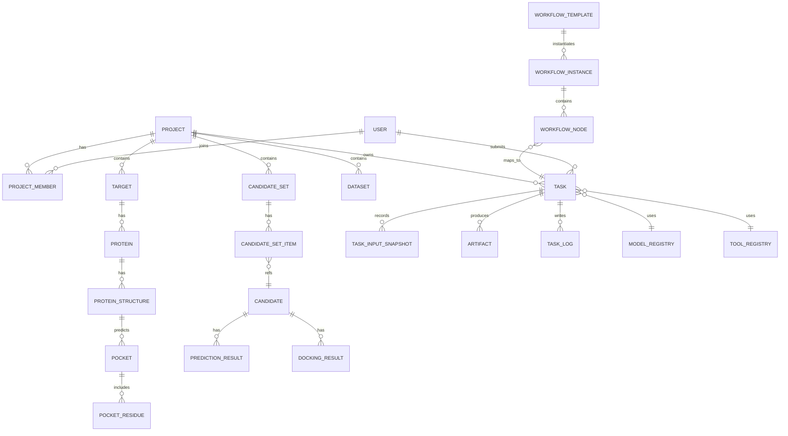

# 中国医药 AI 药物研发平台 · 数据模型设计说明书

| 项 | 内容 |
|---|---|
| 文档编号 | DRP-DM-v1.2 |
| 文档版本 | **v1.2**（2026-10-23 生产级复审补齐；① **§5.0 首次定义 `sys_user` / `sys_role` / `sys_user_role`** 并明确系统角色与项目角色的两层叠加规则——此前只在表清单列名，导致 Alembic 首版迁移无法编写；② **§5.5 新增 `idempotency_key`**，落地 `05` 的 `X-Idempotency-Key`；③ **§5.6 新增并发控制总表**，明确哪些表启用乐观锁、冲突错误码 `40903`、口袋选定 partial unique index 等 5 条专项约束；④ §5.7 / §5.8 新增 `molecule_fingerprint` / `upload_session`；表数 30 → **33**）<br>**v1.1**（2026-10-20 评审修订；① 新增 `decision_record` / `decision_item`；② §5.3 `project_quota` 改为算力分钟口径；③ §9.1 `task.resource_profile` 补 `scale` 与 `cost`） |
| 上游 | `03-系统架构设计说明书.md` |
| 下游 | `05-API接口规格说明书.md` |
| 数据库 | PostgreSQL 15（信创场景可选 openGauss / 达梦，SQL 方言需二次校验） |

---

## 1. 设计原则

1. **元数据入库、文件入对象存储**：数据库只存索引、属性与关系；分子/蛋白/轨迹文件一律存 MinIO，库内只存 `urn` 与 `sha256`。
2. **一切归属于项目**：核心业务表均带 `project_id`，作为数据隔离与权限过滤的根。
3. **不可变追溯**：任务一旦开始执行，其输入快照、参数、环境版本只追加不修改。
4. **软删除**：业务对象统一 `deleted_at`，避免追溯链断裂。
5. **版本化**：数据资产与模型/工具均带版本号，历史任务绑定当时版本。
6. **JSONB 用于弹性字段**：预测指标、运行参数等结构多变的字段用 JSONB + GIN 索引。

---

## 2. 概念模型（核心实体关系）



---

## 3. 表清单总览

| 分组 | 表 | 说明 |
|---|---|---|
| 组织与权限 | `sys_user`、`sys_role`、`sys_user_role`、`project`、`project_member`、`project_quota`、`audit_log`、`idempotency_key` | 用户、项目、配额、审计、幂等 |
| 分子检索 | `molecule_fingerprint` | 指纹缓存（`v1.2` 新增） |
| 文件上传 | `upload_session` | 分片上传会话（`v1.2` 新增） |
| 靶点与结构 | `target`、`protein`、`protein_structure`、`pocket`、`pocket_residue` | 靶点域 |
| 化合物与候选物 | `compound`、`candidate`、`candidate_set`、`candidate_set_item` | 分子与多肽 |
| 数据资产 | `dataset`、`data_file`、`data_version` | 导入数据 |
| 任务与追溯 | `task`、`task_input_snapshot`、`task_log`、`artifact` | 计算与追溯核心 |
| 决策记录（v1.1 新增） | `decision_record`、`decision_item` | 研发主线的「选哪个往下走」，见 `03` §3.6.2 |
| 工作流 | `workflow_template`、`workflow_instance`、`workflow_node` | 编排 |
| 模型与工具 | `model_registry`、`tool_registry` | 注册中心 |
| 结果 | `prediction_result`、`docking_result`、`screening_result`、`md_result`、`free_energy_result` | 各类计算结果 |

> **口径说明（v1.2，三号审核 A 节）**：此前全库写的「33 张」是**沿用的错误数字**——`candidate_set`/`candidate_set_item`、`decision_record`/`decision_item`、`workflow_instance`/`workflow_node` 三对「一对表」在统计时各只算了 1 张。正确口径：**清单 38 个表名 = 系统表 3 + 业务表 35**（`04` §5~§12 正文按 35 个标题定义，其中 3 个标题用斜杠合并定义一对表）。
> 合计 **38 张表**（其中系统表 3 张：`sys_user` / `sys_role` / `sys_user_role`；业务表 35 张）。其中 `decision_record` / `decision_item` 为 **v1.1 新增**（对应 `03` §3.6.2 研发决策点）；**`sys_user` / `sys_role` / `sys_user_role` 在 v1.2 首次给出字段定义**（v1.0~v1.1 只在清单里列了名字，见 §5.0）；`idempotency_key` / `molecule_fingerprint` / `upload_session` 为 **v1.2 新增**（§5.5 / §5.7 / §5.8）。以下给出核心表字段设计，通用字段（`id`、`created_at`、`updated_at`、`deleted_at` 等）在 §4.1 统一说明，各表不再重复列出。
>
> **v1.2 新增的并发与幂等约定集中在 §5.6**，所有可编辑业务表默认启用乐观锁，冲突返回 `40903`。

---

## 4. 通用约定

### 4.1 通用字段

| 字段 | 类型 | 说明 |
|---|---|---|
| `id` | `uuid` PK | 业务主键，前缀化字符串（如 `prj_`/`tsk_`）+ ULID |
| `created_at` / `updated_at` | `timestamptz` | 创建/更新时间 |
| `created_by` / `updated_by` | `varchar(64)` | 操作人（`sys_user.username` 快照，用户改名/停用不影响历史；见 §5.0） |
| `deleted_at` | `timestamptz` NULL | 软删除标记 |
| `version` | `int` | 乐观锁版本号，默认 `1`；更新时 `WHERE version = :old`（`04` §5.6），失败返回 `40903` |

> **两点实现口径（v1.2 明确，避免开发各自解释）**：
> 1. **`created_by`/`updated_by` 存 username 而不是 `user_id`**：审计要求「谁做的」在用户停用、改名、被删除后仍可读；存 UUID 会导致追溯包导出时还要反查一张可能已软删除的用户表。代价是改名后历史记录显示旧名——这正是审计想要的（当时是谁）。
> 2. `id` 用「前缀 + ULID」而不是自增整数：跨服务合并、离线导入、按时间排序都不需要中心序列（`10` DB-01）。
>
> `version` 为通用字段，因此 `task` / `pocket` / `project` 等表都有该列；**是否参与业务校验以 §5.6 的表为准**（`task` 保留但不参与，走状态机 CAS）。

### 4.2 通用枚举

| 枚举 | 取值 |
|---|---|
| `project_status` | `ACTIVE` / `PAUSED` / `ARCHIVED` |
| `project_role` | `OWNER` / `MEMBER` / `VIEWER` |
| `task_status` | `CREATED` / `QUEUED` / `RUNNING` / `SUCCEEDED` / `FAILED` / `CANCELLED` / `TIMEOUT` / `REJECTED` |
| `task_priority` | `HIGH` / `NORMAL` / `BULK` |
| `artifact_type` | `STRUCTURE` / `MOLECULE` / `TRAJECTORY` / `SCORE` / `REPORT` / `LOG` / `OTHER` |
| `candidate_type` | `SMALL_MOLECULE` / `PEPTIDE` |
| `mol_source` | `IMPORT` / `DESIGN` / `SCREENING` / `MANUAL` |

---

## 5. 组织与权限

### 5.0 认证与授权基础表（**v1.2 新增，生产搭建阻塞项补齐**）

> **为什么补**：`sys_user` / `sys_role` / `sys_user_role` 从 v1.0 起就出现在 §3 表清单，但**从未定义字段**。而 `05` §2 已定义 `/auth/login`、`/auth/refresh`、`/auth/logout`、`/auth/me`、`GET|POST /users`、`PUT /users/{id}/status` 七个接口，`03` §9 承诺 RBAC + LDAP 对接，`06` P-37 有用户与权限页。缺这三张表意味着 **Alembic 第一版迁移写不出来、认证无法落库**，是所有业务表的前置依赖。
>
> **两层角色的关系（此前文档未说清，现予明确）**：
> - **系统角色**（`sys_role`）：`ADMIN` / `USER`。`ADMIN` 可进管理台（`06` P-35~P-38）、可停用模型、可改配额；`USER` 不可。系统角色是**平台级**的，与项目无关。
> - **项目角色**（`project_member.role`）：`OWNER` / `MEMBER` / `VIEWER`，仅在单个项目内生效（§5.2）。
> - **判定规则**：`ADMIN` 隐式拥有全部项目 `OWNER` 权限（跨项目审计需要，`03` §9）；非 `ADMIN` 用户对某项目的有效角色 = 该项目 `project_member.role`，无成员记录则无任何访问权（40301）。**`16` §3 提到的 `PL` 是 `OWNER` 的业务称谓，不是独立角色**，代码中只出现 `OWNER`。
> - **`ADMIN` 与成员记录的关系**：`ADMIN` **不需要**在 `project_member` 中留记录；若某管理员恰好也是项目成员，鉴权以 `ADMIN` 为准（**不做权限并集**），该成员记录仅用于"成员列表里显示这个人"，移出项目只删记录、不影响其全局权限。
> - **`RES` / `CADD` 不是平台角色**：`16` §1.1 的 RES / CADD / PL 是按岗位划分的**阅读指引**，其中只有 `PL` 对应 `OWNER`；`RES`、`CADD` 在平台里就是 `MEMBER` 或 `VIEWER`，**不落库、不参与鉴权**。
> - **`sys_user_role` 的增删只能经 `PUT /api/v1/users/{id}` 的 `role` 字段**，不提供独立接口；`permissions` jsonb 只做服务端判定，不对外暴露。

#### `sys_user` 用户

| 字段 | 类型 | 必填 | 说明 |
|---|---|---|---|
| `id` | uuid | 是 | 主键，前缀 `usr_` + ULID |
| `username` | varchar(64) | 是 | 登录名，**唯一**（存用户输入原样，大小写不敏感由 `UNIQUE (lower(username))` 函数索引保证，不再另存小写副本） |
| `display_name` | varchar(128) | 是 | 显示名 |
| `email` | varchar(255) | 否 | 唯一（可空；LDAP 同步来源） |
| `phone` | varchar(32) | 否 | |
| `password_hash` | text | 否 | Argon2id 哈希；**LDAP 用户为 NULL**（本地口令禁用） |
| `auth_source` | varchar(16) | 是 | `LOCAL` / `LDAP`；默认 `LOCAL` |
| `ldap_dn` | text | 否 | LDAP 专有名称；`auth_source=LDAP` 时用于唯一性判定 |
| `status` | varchar(16) | 是 | `ACTIVE` / `DISABLED` / `LOCKED`；默认 `ACTIVE` |
| `failed_login_count` | int | 是 | 连续失败次数，默认 0；≥5 置 `LOCKED`（对应 `14` **AL-24 登录失败暴增** 与 **AL-25 账号被锁定**） |
| `locked_until` | timestamptz | 否 | 锁定到期时间 |
| `last_login_at` | timestamptz | 否 | |
| `password_updated_at` | timestamptz | 否 | 口令过期策略依据 |
| `must_change_password` | boolean | 是 | 默认 `true`（创建与重置后置 `true`），首次登录强制改密；**LDAP 用户恒为 `false`** |
| `password_reset_by` | varchar(64) | 否 | 最近一次口令重置的操作人，配合 `audit_log.action=PASSWORD_RESET` |

索引：`UNIQUE (lower(username))`、`UNIQUE (email) WHERE email IS NOT NULL`、`UNIQUE (ldap_dn) WHERE ldap_dn IS NOT NULL`、`(status)`。**注意**：唯一性只靠函数索引，`username` 列本身不加普通 `UNIQUE`，避免同列两个唯一约束语义重复。

**约束**：`status=DISABLED` 的用户**不得**被删除（审计溯源需要），只能停用；`audit_log.actor` 存 `username` 快照，即使用户改名也保留当时值。

#### `sys_role` 系统角色

| 字段 | 类型 | 必填 | 说明 |
|---|---|---|---|
| `id` | uuid | 是 | 主键 |
| `code` | varchar(32) | 是 | `ADMIN` / `USER`，**唯一** |
| `name` | varchar(64) | 是 | 中文名 |
| `permissions` | jsonb | 是 | 权限点数组，取值**必须**来自下方固定枚举；`ADMIN` 为全部，`USER` 为 `[]` |
| `is_builtin` | bool | 是 | 内置角色不可删改，默认 `true` |

**权限点固定枚举（v1.2）**：`sys_role.permissions` 只是「角色 → 权限点」的服务端判定表，权限点字符串**不允许自由发明**，否则各服务会写出互不相同的名字，鉴权中间件无法统一。

| 权限点 | 含义 | 对应接口（`05`） |
|---|---|---|
| `user.read` | 查看用户列表 | `GET /api/v1/users` |
| `user.write` | 创建/修改用户、分配系统角色 | `POST /api/v1/users`、`PUT /api/v1/users/{id}` |
| `user.reset_password` | 重置他人本地口令 | `POST /api/v1/users/{id}:reset-password` |
| `model.toggle` | 停用/启用模型 | `05` §11 |
| `quota.write` | 修改项目配额 | `PUT /api/v1/projects/{id}/quota` |
| `audit.read` | 查看审计日志 | `05` §11 |
| `node.operate` | 节点置维护/恢复 | `05` §11 |
| `workflow.template.write` | 保存自定义工作流模板 | `POST /api/v1/projects/{id}/workflow-templates` |

**一期不做自定义角色**（`D-21`）：`sys_role` 只有 `ADMIN` / `USER` 两行，`is_builtin=true` 且不可删改；`06` P-37 的「角色管理」因此是**只读展示 + 成员分配**，不提供角色编辑器。

初始数据：`ADMIN`（全部权限点）、`USER`（空）。**一期只做这两个角色，不做自定义角色**——`03` §9 的 RBAC 指「角色→权限点」可配置，但角色集合固定，避免权限模型过度设计。

**权限点清单（v1.2 补齐——原文档只举了 3 个例子，开发会各自发明字符串）**

权限点命名规则：`{资源}.{动作}`，全小写，点分隔；**只在这张表里登记过的字符串才有效**，`sys_role.permissions` 中出现未登记字符串时启动自检报错。

| 权限点 | 含义 | 对应接口（`05`） | ADMIN | USER |
|---|---|---|---|---|
| `user.read` | 查看用户列表 | §2 `GET /users` | ✅ | ❌ |
| `user.write` | 创建用户、改角色、启停 | §2 `POST /users`、`PUT /users/{id}`、`PUT /users/{id}/status` | ✅ | ❌ |
| `user.reset_password` | 重置他人口令 | §2 `POST /users/{id}:reset-password` | ✅ | ❌ |
| `model.read` | 查看模型注册表 | §11 | ✅ | ✅ |
| `model.toggle` | 启停模型 | §11 | ✅ | ❌ |
| `model.register` | 注册新模型版本 | §11 | ✅ | ❌ |
| `node.read` | 查看算力节点 | §11 | ✅ | ✅ |
| `node.drain` | 节点排空/恢复 | §11 | ✅ | ❌ |
| `quota.read` | 查看配额 | §3、§9 | ✅ | ✅ |
| `quota.write` | 调整配额（按算力分钟） | §3 | ✅ | ❌ |
| `audit.read` | 查看审计日志 | §11 | ✅ | ❌ |
| `audit.export` | 导出审计日志 | §11 | ✅ | ❌ |

**项目内权限不走权限点**，走 `project_member.role`（`OWNER` / `MEMBER` / `VIEWER`），见 §5.0 两层叠加规则；上表的 `USER` 列只表示「平台级能力」，用户在某个项目里能否写由 `project_member.role` 决定。

> **ADMIN 的「全部权限点」= 上表 `ADMIN` 列全为 ✅ 的那 12 个**，不是「任意字符串都通过」。实现上 `ADMIN` 判定为 `permissions 包含所需权限点 OR (sys_role.code='ADMIN' AND 权限点在已登记清单内)`——**未登记的权限点对任何角色都为 false**，防止手抖写成 `model.toggele` 却静默通过。
>
> **`06` P-37「用户、角色、项目授权」页面在这一期只展示**：用户列表、系统角色（ADMIN/USER 两个下拉）、项目成员与角色（三个下拉）、12 个权限点只读矩阵。**不提供自定义角色编辑**（与「一期只做两个固定角色」一致）。

#### `sys_user_role` 用户角色关联

| 字段 | 类型 | 必填 | 说明 |
|---|---|---|---|
| `user_id` | uuid | 是 | FK → `sys_user` |
| `role_id` | uuid | 是 | FK → `sys_role` |
| `granted_by` | varchar(64) | 是 | 授予人 |
| `granted_at` | timestamptz | 是 | |

约束：`PRIMARY KEY (user_id, role_id)`。**用户在 `sys_user_role` 中无记录即视为 `USER`**（默认角色不落库），避免新增用户时两处写入。

**认证相关（`05` §2 的落点）**：
- `refresh_token` **不入库**——一期采用无状态 JWT（access 15 分钟 / refresh 7 天，`refresh` 携带 `jti`），登出通过 Redis 黑名单实现 `03` §9 的「登出即失效」，黑名单 TTL = token 剩余有效期。若甲方要求「强制下线」「设备列表」再做状态化改造（`D-04-01`）。
- `/auth/login` 的限流与锁定写 `sys_user.failed_login_count` / `locked_until`，同时追加 `audit_log`（`action=LOGIN_FAILED`）。

### 5.1 `project` 项目

| 字段 | 类型 | 必填 | 说明 |
|---|---|---|---|
| `name` | varchar(128) | 是 | 项目名称 |
| `code` | varchar(64) | 是 | 项目编号（唯一） |
| `description` | text | 否 | |
| `status` | project_status | 是 | 默认 `ACTIVE`；归档后只读 |
| `owner_id` | uuid | 是 | 负责人（**冗余，真源是 `project_member` 中 `role='OWNER'` 的那一行**，见下方一致性规则） |
| `visibility` | varchar(16) | 是 | **v1.2 新增**：`PRIVATE`（默认，仅成员可见）/ `INTERNAL`（登录用户可见，但只有成员可写）。`16` §3 提到的「全员可见」需要这一列——原表没有，承诺无法落库 |
| `target_ids` | jsonb | 否 | 关联靶点摘要（冗余加速列表展示） |
| `asset_summary` | jsonb | 否 | 候选物数/任务数/结果数（异步刷新） |

索引：`(status, created_at)`、`(owner_id)`、`(visibility)`、全文检索 `name`。

**负责人一致性规则（v1.2 补齐，原文档缺失）**

`project.owner_id` 与 `project_member.role='OWNER'` 都能表达「负责人」，必须定死真源与同步规则，否则会出现「成员列表里查不到负责人」或「负责人被降成 MEMBER 后仍能归档」：

1. **真源**：`project_member` 中 `role='OWNER'` 的行。`project.owner_id` 是冗余，仅为列表页排序与 `(owner_id)` 索引加速。
2. **创建项目**：必须**在同一事务**内插入 `project` 与 `project_member(role='OWNER')` 两行；任一失败整体回滚（`03` §3.2.2 强一致项）。
3. **变更负责人**：只有两种合法路径——`PUT /projects/{id}/members/{userId}` 把某人改成 `OWNER`，或直接 `DELETE` 掉当前 OWNER 成员行并同时指定新 OWNER。两种情况都**在同一事务**内 `UPDATE project SET owner_id = :newOwner`。**不允许出现 `owner_id` 指向一个非 OWNER 成员的状态**。
4. **不得删除最后一个 OWNER**：删除成员前校验「该用户是 OWNER 时，项目内 OWNER 数量 > 1」，否则返回 `42206`（不能移除最后一个负责人）。同理不得把最后一个 OWNER 降为 `MEMBER`/`VIEWER`。
5. **ADMIN 与项目成员的关系**：`ADMIN` **可以**同时是某项目的成员（此时两套角色叠加，取权限并集）；`ADMIN` **不必**是成员即可读该项目的全部数据（隐式 OWNER），但**每次隐式访问都写 `audit_log`**（`action=READ`, `detail.access=IMPLICIT_OWNER`）。
6. **`INTERNAL` 可见性下非成员的能力**：可读项目元数据与阶段，**不可读候选物/结果/追溯包**，不可写任何东西；否则「公开项目」等于把研发数据对外裸奔。

### 5.2 `project_member` 项目成员

| 字段 | 类型 | 说明 |
|---|---|---|
| `project_id` | uuid | |
| `user_id` | uuid | |
| `role` | project_role | OWNER/MEMBER/VIEWER |

唯一约束：`(project_id, user_id)`。

### 5.3 `project_quota` 项目配额

| 字段 | 类型 | 说明 |
|---|---|---|
| `project_id` | uuid | |
| `max_concurrent_dcu` | int | 默认 2 |
| `max_concurrent_cpu_tasks` | int | 默认 10 |
| `daily_quota_minutes` | int | 每日**算力分钟**配额，0 = 不限。**v1.1 口径**：不是「任务个数」也不是「墙钟分钟」，而是按 `03` §5.6.3③ 的实际资源消耗折算的算力分钟；长时 T 层与 XL 层按同一口径核销，但**不占并发数** |
| `max_single_task_minutes` | int | 单任务时长上限（墙钟），超时置 `TIMEOUT` |
| `quota_period` | varchar(16) | **v1.1 新增** `DAILY` / `MONTHLY` / `NONE`。默认 `DAILY`；XL 层任务（≥1 万件）建议项目级改为 `MONTHLY`，否则一个 XL 就能把日配额一次性打穿 |
| `overdraft_ratio` | numeric(4,2) | **v1.1 新增** 超额告警阈值，默认 `1.00`（用完即告警）；`1.20` 表示允许超 20% 后才告警。**不允许拒绝已入队任务**，只告警与阻塞新提交 |

**算力分钟折算口径（v1.1 新增，必须与 `03` §5.6 一致）**：

| 资源 | 折算系数 | 说明 |
|---|---|---|
| 1 张 DCU·分钟 | **1.0** | 基准单位 |
| 1 个 CPU 核·分钟 | **1/64** | 按「一张 DCU ≈ 64 核」的**价值等价**折算。⚠ **注意**：甲方已确认计算节点为 **128 核**（`D-03-11` 已关闭，见 `03` §5.1/§5.6），但**折算系数不变**——它表达的是「DCU 与 CPU 的单位算力价值比」，不是物理核数。不要因为核数变了就改成 1/128，否则全部历史配额与告警阈值都会失真 |
| 内存·GB·分钟 | **0** | 不计费（无法公平折算且不是瓶颈） |

核销时机：任务进入终态（`SUCCEEDED`/`FAILED`/`TIMEOUT`/`CANCELLED`）时，按 `duration_ms × 实际卡数/核数` 一次性核销；**失败与取消同样核销**（否则可以反复失败来白嫖算力）；`REJECTED` 不核销。核销写 `task.resource_profile.cost` 与 Prometheus `drp_task_cost_dcu_seconds` / `drp_task_cost_cpu_seconds`（见 `14` §2.1）。

### 5.4 `audit_log` 审计日志（只追加）

| 字段 | 类型 | 说明 |
|---|---|---|
| `actor` | varchar(64) | |
| `action` | varchar(64) | `LOGIN`/`READ`/`CREATE`/`UPDATE`/`DELETE`/`EXPORT`/`DOWNLOAD`/`PERM_CHANGE` |
| `resource_type` | varchar(64) | |
| `resource_id` | varchar(64) | |
| `detail` | jsonb | 变更前后值 |
| `ip` | varchar(64) | |
| `created_at` | timestamptz | 分区键（按月） |

### 5.5 `idempotency_key` 幂等键（**v1.2 新增**）

> **为什么补**：`05` §1.2 头部约定表规定「创建类 POST 必填 `X-Idempotency-Key`」，但**从未定义键存在哪里、保留多久、冲突时返回什么**。用户双击提交按钮会产生两个 Boltz-2 任务，各占一张 DCU 卡各烧 2 分钟算力；`14` §3 的算力成本告警会因此误报。

| 字段 | 类型 | 必填 | 说明 |
|---|---|---|---|
| `key` | varchar(128) | 是 | 客户端传入的 `X-Idempotency-Key` |
| `scope` | varchar(80) | 是 | `{user_id}:{METHOD}:{path_template}`，如 `usr_01J...:POST:/api/v1/tasks`。**不含 tenant**（一期单租户，全库无 tenant 概念）；**用路由模板不用实际路径**（`/tasks/{id}` 而非 `/tasks/tsk_01J...`），否则同一接口的不同资源会各占一行；**不含服务标识**（`drp-api` 与 `drp-task-api` 各自清理自己的行，见下方清理说明） |
| `request_hash` | char(64) | 是 | 请求体 SHA-256；用于识别「同 key 不同体」的误用 |
| `response_status` | int | 否 | 首次处理完成后的 HTTP 状态码 |
| `response_body` | jsonb | 否 | 首次处理完成后的响应体（截断至 64KB） |
| `resource_id` | varchar(64) | 否 | 首次处理创建的资源 ID（如 `tsk_...`） |
| `state` | varchar(16) | 是 | `IN_PROGRESS` / `COMPLETED` / `FAILED` |
| `expires_at` | timestamptz | 是 | 过期时间 = 创建时间 + **24 小时** |

约束：`PRIMARY KEY (scope, key)`。

> **多服务共存**：`drp-api` 与 `drp-task-api` 共用本表但各自清理。为免一个服务误删另一个服务仍在用的行，清理语句限定为「只删**本服务路由**产生的行」（路由前缀 `scope LIKE '%:{METHOD}:/api/v1/tasks%'` 之类不可靠），因此改为**按 owner 列删除**——实际实现用 `expires_at < now() - interval '1 hour'`（比 TTL 多留 1 小时宽限）统一删除，两个服务都只删自己写入的行由 `ON CONFLICT` 语义自然保证（同一 `(scope,key)` 只会有一个写入方）。


**行为约定（`05` 需据此返回）**：

| 场景 | 行为 |
|---|---|
| 键不存在 | `INSERT ... ON CONFLICT DO NOTHING`，抢到则继续处理；抢不到说明并发中，走下一行 |
| 键存在且 `COMPLETED`、`request_hash` 相同 | **直接重放**首次响应（同状态码同体），不重复创建资源 |
| 键存在且 `request_hash` **不同** | 返回 `40905`（幂等键已用于另一请求），`detail` 给出首次请求的 `request_hash` 前 8 位便于排查 |
| 键存在且 `IN_PROGRESS` | 返回 `40904`（幂等键处理中），`Retry-After: 2` |
| 键存在且 `FAILED` | 允许重试：更新 `state=IN_PROGRESS` 并重新处理 |

**清理**：`drp-api` / `drp-task-api` 各自的定时任务每小时删 `expires_at < now()`；不参与备份（可从客户端重试恢复）。

**必填范围**：仅**创建类的 POST**（提交任务、启动工作流、批量预测、批量筛选、MD 计算）。查询类 GET 与幂等天然的 PUT 不需要。

### 5.6 并发控制约定（**v1.2 新增**）

> **为什么补**：`04.1` 定义了 `version` 字段，但**没有任何文档说明哪些表启用乐观锁、冲突时返回哪个错误码**。生产上会出现「两人同时编辑同一候选集，后写的静默覆盖前者」这类不可复现的数据问题。

**四种机制，逐类覆盖**（v1.2 修订：原表只有三种，漏了三类真实写冲突，见下方「例外与补充」）：

| 机制 | 适用表 | 实现 | 冲突返回 |
|---|---|---|---|
| **乐观锁** | 除只追加表与 `task` 外的**可编辑业务表**（`project`、`candidate_set`、`workflow_template` 等） | `UPDATE ... WHERE id=? AND version=?`；影响行数 0 → 冲突 | `40903`（`REVISION_CONFLICT`），响应带 `currentVersion` |
| **唯一约束** | 见下方专项 | DB 级 `UNIQUE` / partial unique index | `40901`（`DUPLICATE`），`detail` 指明冲突字段 |
| **行锁（悲观）** | 仅 **`project_quota`（配额核销）** | `SELECT ... FOR UPDATE` | 阻塞等待，`lock_timeout=5s` 超时 → **`50302`**（`LOCK_TIMEOUT`） |
| **单语句原子更新** | `pocket.selected` 翻转、`upload_session.parts` 追加、`sys_user_role` 增删 | 见下方「例外与补充」 | 按机制各自约定 |

> **v1.2 修正（B-6/B-7）**：
> 1. 原表把「**卡位分配**」写成行锁对象——**全库没有任何表承载卡位**（`03` §3.2 的卡位状态由 `drp-node-agent` 持有并经 `13` §4.1 上报，38 张表里没有 slot 表）。锁一张不存在的表等于没锁。**卡位的互斥由 `slots.yaml` 静态声明 + Agent 单队列保证**（`09` §4.5），不在数据库层。
> 2. 行锁超时原来返回 `42902`，但 `05` §1.3 里 `42902` 是「**并发任务超限**」（业务准入限流）。同一个码两种含义，前端无法给可执行提示。现改为新增 **`50302`（`LOCK_TIMEOUT`）**，语义是「服务器内部锁等待超时，可重试」，与限流彻底分开。

**不启用乐观锁的表（有明确理由）**：`audit_log` / `task_log` / `decision_record` / `decision_item` —— 均为**只追加**，不存在更新；`task` —— 状态流转走状态机 CAS（`WHERE status=?` 本身就是乐观锁），`version` 字段保留但不参与业务校验；`idempotency_key` —— `(scope,key)` 主键 + `ON CONFLICT`；`molecule_fingerprint` —— `INSERT ... ON CONFLICT (compound_id) DO NOTHING`（MQ 重复投递时天然幂等）。

**例外与补充（原表漏掉的三类，v1.2 补齐）**

| 场景 | 冲突形态 | 处理 | 返回 |
|---|---|---|---|
| **`pocket.selected` 翻转**（两人同时把不同口袋置为选定） | 不是「重复」，是「被抢先」 | `UPDATE pocket SET selected = (id = :newId) WHERE structure_id = :sid AND ...`，**一条语句同时置旧的 false、新的 true**；partial unique index `uk_pocket_selected` 作兜底 | 兜底触发时不允许直接报 `40901`「重复」——用户语义是「你选的口袋已被他人改为另一个」。`drp-api` 捕获 `23505` 且约束名为 `uk_pocket_selected` 时，**转换为 `40903`**（版本冲突）并在 `detail` 给出当前选定的 `pocket_id`，前端提示「口袋已被切换为 X，请刷新后重选」 |
| **`sys_user_role` 增删** | 同一用户在同一时刻被授予/撤销角色 | `INSERT ... ON CONFLICT (user_id, role_id) DO NOTHING`（授予幂等）；撤销 `DELETE ... WHERE user_id=? AND role_id=?` 天然幂等；**权限点在每次请求时从 `sys_role.permissions` 实时读取，不做进程内缓存**（否则撤销后最长一个缓存周期内仍然有权） | 无冲突码，幂等成功 |
| **`upload_session.parts` 追加** | jsonb 整列读-改-写会丢更新（两个分片并发上报，后者覆盖前者） | **禁止** `UPDATE upload_session SET parts = <整个数组>`。改为服务端在事务内 `SELECT ... FOR UPDATE`（行级，`id` 单行，hold 时间 < 1ms）后再追加；或把分片记录拆到独立的 `upload_part` 子表。**一期采用前者**（避免多一张表），因为单行锁竞争窗口极短 | 无冲突码 |

**MQ 重复投递（必须幂等的地方）**：`molecule_fingerprint` 回填、`candidate` 创建、`task_log` 写入均可能因 MQ 至少一次投递而重复执行，统一用 `ON CONFLICT DO NOTHING` 或按业务键去重；**任何 `INSERT` 若不带 `ON CONFLICT` 而依赖「不会重复投递」，实现即不合规**（`10` DB-05）。

**专项唯一约束（此前口头承诺、现落为 DB 约束）**

| 约束 | 表 | SQL | 对应文档承诺 |
|---|---|---|---|
| 一个结构同时只有一个选定口袋 | `pocket` | `CREATE UNIQUE INDEX uk_pocket_selected ON pocket (structure_id) WHERE selected;` | `16` §5.4「一个结构同时只能 1 个选定口袋」 |
| 候选集内候选不重复 | `candidate_set_item` | `UNIQUE (set_id, candidate_id)` | 已有 |
| 项目内成员不重复 | `project_member` | `UNIQUE (project_id, user_id)` | 已有 |
| 项目编号唯一 | `project` | `UNIQUE (code)` | 已有 |
| ~~同一任务只产生一次决策快照~~ | ~~`decision_record`~~ | **v1.2 撤销**：`(project_id, decision_point, subject_id)` **不得**建唯一约束，见 §9.5 末段 | 原引用「`03` §3.6.2 决策点唯一性」在 `03` 中**不存在此规定**，属引用方杜撰 |

> 错误码定义见 `05` §1.3：`40901`~`40905` 均为「状态冲突」区间，语义各不相同（项目已归档 / 任务状态不允许 / 乐观锁冲突 / 幂等键处理中 / 幂等键已用于另一请求），**不可复用**。
>
> `pocket.selected` 字段在 §6.4 已存在（`boolean`），本约束直接在其上建 **partial unique index**。
>
> **为什么必须是 partial index**（v1.2 修正了原先写反的论证）：业务要求是「同一 structure 下**任意多个**未选定 + **至多 1 个**选定」。
> - 写普通 `UNIQUE (structure_id, selected)`：PostgreSQL 的唯一索引对 `true` 只许一行、对 `false` 也只许一行 → **一个结构只能有一个未选定口袋**，直接违反业务前提。
> - 若把未选定改成 `NULL`：唯一索引允许多个 `NULL`，看似可行，但 `pocket.selected` 是 `NOT NULL boolean`，改类型代价大，且 `NULL` 语义（「未知」）与「未选定」混淆。
> - 正确做法：`WHERE selected` 的 partial index —— 索引里**只有 `true` 行**，自然满足「至多 1 个选定、任意多个未选定」。
> - **不要**写成 `WHERE NOT selected`（那是限制「至多一个未选定」，正好写反）。

### 5.7 `molecule_fingerprint` 分子指纹缓存（**v1.2 新增**）

> **为什么补**：`03` §3.2.2 最终一致项第 1 条写「候选物与指纹走 MQ 回填，未回填的候选物在检索中不可见」，但**指纹存哪从未定义**。指纹是相似性检索与去重的唯一依据，存进 `compound` 表会随行锁严重争抢。

| 字段 | 类型 | 说明 |
|---|---|---|
| `compound_id` | uuid | PK，FK → `compound` |
| `fp_ecfp4` | bytea | ECFP4，2048 bit（256 字节） |
| `fp_maccs` | bytea | MACCS 167 bit |
| `fp_ecfp4_bits` | int | 实际位数，默认 2048 |
| `rdkit_version` | varchar(32) | 生成指纹的 RDKit 版本，**纳入追溯**（不同版本指纹不可比） |
| `computed_at` | timestamptz | |

**索引（v1.2 修正——原写法是伪代码且引用了不存在的列，Alembic 会直接编译失败）**：

```sql
-- 唯一需要的索引：主键
ALTER TABLE molecule_fingerprint ADD PRIMARY KEY (compound_id);
-- compound_id 已由 PK 覆盖；一期【不建任何指纹列索引】
```

- **不建 `fingerprint` 列索引**：本表**没有** `fingerprint` 这一列（真实列名是 `fp_ecfp4` / `fp_maccs`）；原文所谓「`btree_gist` extended」也与 Tanimoto 无关——`btree_gist` 是给范围/排他约束用的，不是相似度索引。照原文写迁移脚本会直接报 `column "fingerprint" does not exist`。
- **一期相似性检索就是全表扫描 + 应用内 Tanimoto**：`drp-mol-index` 用 RDKit `AllChem.GetMorganFingerprintAsBitVect` 生成、用 `BulkTanimotoSimilarity` 批量算（NumPy 加速，2 万 × 2048bit ≈ 5MB，全扫 < 200ms）。
- **规模保护**：**限制项目内候选数 ≤ 20000**，超过则提示「请先缩小范围」。
- 若需要更大规模，另立需求引入 RDKit cartridge 或 pgvector（`D-07` 仍未决）；届时新增索引而不是修改本表结构。

**检索 SQL（Tan 在哪个列、怎么算）**：

```sql
-- 步骤 1：DB 只负责把「有指纹的候选物」选出来（内连接 = 未回填不可见）
SELECT c.id, m.fp_ecfp4
FROM candidate c
JOIN molecule_fingerprint m ON m.compound_id = c.compound_id
WHERE c.project_id = :pid AND c.set_id = :setId;
-- 步骤 2：应用内对 fp_ecfp4 逐条算 Tanimoto，排序取 Top-K
```

> `fp_maccs` 一期**只落库不参与检索**（MACCS 167 bit 颗粒度粗，适合做快速去重预筛，见下）；**Tanimoto 一律算在 `fp_ecfp4`（2048 bit）上**，且必须校验两侧行的 `rdkit_version` 一致，不一致时提示而非静默比较（不同 RDKit 版本的位向量定义可能变化）。

**不可见语义**：检索 SQL 一律 `JOIN molecule_fingerprint`（而非 `LEFT JOIN`），未回填的候选物自然被过滤，与 `03` §3.2.2 表述一致。

### 5.8 `upload_session` 分片上传会话（**v1.2 新增**）

> **为什么补**：`04` §13.2 要求 `>100MB` 强制 Multipart 上传，`05` §4.1 也有分片上传接口，但没有会话表——分片状态存内存会在 `drp-api` 多副本重启后丢失，用户无法续传。

| 字段 | 类型 | 说明 |
|---|---|---|
| `id` | uuid | 主键，前缀 `ups_` |
| `project_id` | uuid | |
| `declared_filename` | varchar(255) | 客户端声明的文件名 |
| `declared_size` | bigint | 声明大小，用于配额与校验 |
| `content_type` | varchar(128) | |
| `minio_upload_id` | varchar(255) | MinIO Multipart Upload ID |
| `object_key` | varchar(512) | 目标对象路径（§13.1 前缀规则） |
| `part_size` | int | 分片大小（默认 16MB） |
| `parts` | jsonb | 已完成分片 `[{partNumber, etag, size}]` |
| `state` | varchar(16) | `INITIATED` / `UPLOADING` / `COMPLETED` / `ABORTED` / `EXPIRED` |
| `expires_at` | timestamptz | 默认创建 + 24 小时 |

**清理**（原写「`13` §7 需补一条」，但 `13` §7 是「上线步骤」，并非对象存储章节——v1.2 已改正）：

1. `drp-api` 定时任务（每小时）把 `expires_at < now()` 的会话置 `EXPIRED` 并调 MinIO `AbortMultipartUpload`，否则未完成分片会在 MinIO 上长期占用空间。
2. MinIO 侧配 lifecycle 规则作为第二道保险：**`drp-temp` 桶** 对未完成分片 `AbortIncompleteMultipartUpload` 7 天、对对象 `Expiration` 30 天（定义见 `13` §7「对象存储前置配置」）。
3. 单文件上限 2GB（`16` §4.1 格式表），分片数 ≤ 128，`parts` 的 jsonb 不会膨胀。

**接口**：见 `05` §4.2 分片上传三个接口（创建会话 / 上报分片 / 完成合并）。

---

## 6. 靶点与结构

### 6.1 `target` 靶点

| 字段 | 类型 | 说明 |
|---|---|---|
| `project_id` | uuid | |
| `name` | varchar(128) | 靶点名称 |
| `target_type` | varchar(32) | 默认 `PROTEIN` |
| `uniprot_id` | varchar(32) | 可选 |
| `gene_name` | varchar(64) | 可选 |
| `description` | text | |

### 6.2 `protein` 蛋白质（序列/结构母记录）

| 字段 | 类型 | 说明 |
|---|---|---|
| `target_id` | uuid | |
| `name` | varchar(128) | |
| `sequence` | text | 氨基酸序列 |
| `seq_length` | int | 冗余，便于检索与校验 |
| `source` | mol_source | IMPORT / MANUAL |
| `current_version` | int | 版本链当前版本 |

### 6.3 `protein_structure` 蛋白结构

| 字段 | 类型 | 说明 |
|---|---|---|
| `protein_id` | uuid | |
| `source_type` | varchar(16) | `PREDICTED` / `IMPORTED` / `PREPARED` |
| `structure_urn` | varchar(512) | MinIO 路径（PDB） |
| `prepared_urn` | varchar(512) | 结构准备产物 |
| `pdbqt_urn` | varchar(512) | 对接用 PDBQT |
| `sha256` | char(64) | 文件哈希 |
| `plddt_mean` | numeric(5,2) | 预测置信度均值（预测结构才有） |
| `plddt_urn` | varchar(512) | 逐残基置信度数据 |
| `model_name` / `model_version` | varchar(64) | 来源模型 |
| `tool_name` / `tool_version` | varchar(64) | 结构准备工具 |
| `task_id` | uuid | 产出该结构的任务 |

### 6.4 `pocket` 结合口袋

| 字段 | 类型 | 说明 |
|---|---|---|
| `structure_id` | uuid | |
| `rank` | int | 排序序号（1 = 最优） |
| `score` | numeric(10,4) | 预测评分 |
| `volume` | numeric(12,3) | 体积 |
| `center_x/y/z` | numeric(10,3) | 中心坐标 |
| `box_size_x/y/z` | numeric(10,3) | 对接盒尺寸（可派生） |
| `residue_count` | int | |
| `selected` | boolean | 是否选定为设计/对接约束 |
| `tool_name` / `tool_version` | varchar(64) | |
| `task_id` | uuid | |

### 6.5 `pocket_residue` 口袋残基

| 字段 | 类型 | 说明 |
|---|---|---|
| `pocket_id` | uuid | |
| `chain` | varchar(8) | |
| `residue_seq` | int | 残基序号 |
| `residue_name` | varchar(8) | 三字母码 |
| `is_key` | boolean | 是否关键残基 |
| `contribution` | numeric(10,4) | 贡献度/评分（如有） |

索引：`(pocket_id, is_key)`。

---

## 7. 化合物与候选物

### 7.1 `compound` 化合物（去重主表）

| 字段 | 类型 | 说明 |
|---|---|---|
| `inchikey` | char(27) | 唯一（小分子） |
| `canonical_smiles` | varchar(2048) | |
| `mol_formula` | varchar(128) | |
| `mol_weight` | numeric(10,3) | |
| `props` | jsonb | logP、TPSA、HBD/HBA、RotB、QED 等（RDKit 计算） |
| ~~`fingerprint`~~ | — | **v1.2 废弃**：与 `molecule_fingerprint.fp_ecfp4` 语义重复且算法不同（Morgan vs ECFP4），会形成两份真值源；存进 `compound` 还会让批量导入与指纹回填争抢同一行锁。**指纹唯一存放在 `molecule_fingerprint`（§5.7）**，本列不再定义 |
| `structure_urn` | varchar(512) | 2D 渲染 SVG 或 MOL 文件 |

### 7.2 `candidate` 候选物

| 字段 | 类型 | 说明 |
|---|---|---|
| `project_id` | uuid | |
| `candidate_type` | candidate_type | 小分子 / 多肽 |
| `compound_id` | uuid NULL | 小分子指向 `compound` |
| `peptide_sequence` | text NULL | 多肽序列 |
| `name` / `code` | varchar(128) | |
| `source` | mol_source | |
| `design_score` | numeric(10,4) | 生成模型评分 |
| `task_id` | uuid | 产出任务 |
| `attrs` | jsonb | 设计条件、修饰、自定义属性 |

索引：`(project_id, candidate_type, created_at)`、`(compound_id)`、`attrs` GIN。

### 7.3 `candidate_set` / `candidate_set_item`

- `candidate_set`：`project_id`、`name`、`description`、`item_count`、`source_task_id`
- `candidate_set_item`：`set_id`、`candidate_id`、`ordinal`、`snapshot_score`（加入时的评分快照）

唯一约束：`(set_id, candidate_id)`。

---

## 8. 数据资产与版本

### 8.1 `dataset` 数据集

| 字段 | 类型 | 说明 |
|---|---|---|
| `project_id` | uuid | |
| `name` | varchar(128) | |
| `dataset_type` | varchar(32) | `COMPOUND` / `PROTEIN` / `ACTIVITY` / `LITERATURE` / `EXPERIMENT` |
| `file_urn` | varchar(512) | 原始文件 |
| `row_count` | int | |
| `import_task_id` | uuid | |

### 8.2 `data_file` 数据文件

| 字段 | 类型 | 说明 |
|---|---|---|
| `dataset_id` | uuid | |
| `urn` | varchar(512) | |
| `file_name` / `file_type` / `size_bytes` | | |
| `sha256` | char(64) | |
| `storage_tier` | varchar(16) | `STANDARD` / `BULK` |

### 8.3 `data_version` 数据版本

| 字段 | 类型 | 说明 |
|---|---|---|
| `entity_type` | varchar(32) | `COMPOUND` / `PROTEIN` / `DATASET` |
| `entity_id` | uuid | |
| `version` | int | |
| `source_type` | varchar(32) | `IMPORT` / `COMPUTE` / `MANUAL` |
| `source_file_urn` | varchar(512) | |
| `change_summary` | text | |
| `content_hash` | char(64) | |
| `operator` | varchar(64) | |

索引：`(entity_type, entity_id, version)` 唯一。

---

## 9. 任务与追溯（核心）

### 9.1 `task` 任务

| 字段 | 类型 | 说明 |
|---|---|---|
| `project_id` | uuid | |
| `task_type` | varchar(48) | 见架构文档 §3.3 枚举 |
| `status` | task_status | 状态机见 `03` §3.4；**状态迁移一律用条件更新（CAS）实现**：`UPDATE task SET status=:next WHERE id=:id AND status=:expected`，影响行数为 0 即说明被并发修改，**重读后按状态机重新判定**（不报错，因为多数竞争是合法的双向迁移） |
| `version` | integer | **v1.2 补列**（三号审核 B-2）：原 `04` §4.1 把 `version` 列为通用字段、§5.6 又称 `task` 走 CAS，但本表从未列出该列。现补上，注明**仅用于诊断与审计留痕，不参与业务校验**（`task` 的并发正确性由 `status` 的 CAS 保证） |
| `priority` | task_priority | |
| `biz_ref` | jsonb | `{targetId, structureId, pocketId, candidateIds[], setId}` |
| `tool_name` / `tool_version` | varchar(64) | |
| `model_name` / `model_version` | varchar(64) | |
| `image_ref` | varchar(256) | 计算镜像 tag |
| `params_json` | jsonb | 完整运行参数（含随机种子） |
| `env_json` | jsonb | 依赖与环境变量快照 |
| `resource_profile` | jsonb | `{dcu, dcuMemGB, cpu, memGB, expectedMinutes, scale, cost}`。**v1.1 说明**：这不是静态取值，由 `drp-scheduler` 在准入时**按任务规模（S/M/L/XL/T）与实际参数重新计算后落库**（见 `03` §5.2.2 / §5.6），提交时传入的值仅作预估与上限保护。`scale` 为调度器判定值（不信任客户端）；`cost` 为终态时回写的实际算力分钟（`{dcuMinutes, cpuMinutes, totalMinutes}`），供 `project_quota` 核销与 `14` 的 `drp_task_cost_*` 指标对账 |
| `progress` | int | 0~100 |
| `stage` | varchar(64) | 当前执行阶段描述 |
| `queue_position` | int | 排队序号 |
| `exit_code` | int | |
| `error_message` | text | |
| `started_at` / `finished_at` / `duration_ms` | | |
| `workflow_instance_id` / `workflow_node_id` | uuid NULL | 归属工作流 |
| `submitted_by` | varchar(64) | |
| `retry_of` | uuid NULL | 重试来源任务 |

索引：`(project_id, status, created_at)`、`(task_type, status)`、`(submitted_by)`、`biz_ref` GIN。

### 9.2 `task_input_snapshot` 输入快照（只追加）

| 字段 | 类型 | 说明 |
|---|---|---|
| `task_id` | uuid | |
| `input_role` | varchar(32) | `RECEPTOR` / `LIGAND` / `SEQUENCE` / `POCKET` / `SET` |
| `entity_type` / `entity_id` | | 业务实体引用 |
| `urn` | varchar(512) | 输入文件 |
| `sha256` | char(64) | 内容哈希 |
| `data_version` | int | 输入数据版本 |

### 9.3 `artifact` 产物

| 字段 | 类型 | 说明 |
|---|---|---|
| `task_id` | uuid | |
| `artifact_type` | artifact_type | |
| `name` | varchar(256) | |
| `urn` | varchar(512) | |
| `size_bytes` | bigint | |
| `sha256` | char(64) | |
| `format` | varchar(32) | `PDB`/`SDF`/`CSV`/`XTC`/`PDF`/`JSON` |
| `is_primary` | boolean | 是否主产物（结果页默认展示） |

### 9.4 `task_log` 任务日志

| 字段 | 类型 | 说明 |
|---|---|---|
| `task_id` | uuid | |
| `level` | varchar(16) | `DEBUG`/`INFO`/`WARN`/`ERROR` |
| `stage` | varchar(64) | |
| `message` | text | |
| `logged_at` | timestamptz | |
| `chunk_urn` | varchar(512) | 完整日志分片文件路径 |

> 实时进度走 Redis + SSE；历史日志落对象存储，库内仅存检索索引。

### 9.5 `decision_record` / `decision_item` 研发决策记录（v1.1 新增）

> **为什么需要**：`03` §3.6.2 定义的 DP1~DP5 决策点。平台原来只能「跑完计算」，无法承载「决定哪个候选往下走」这一研发核心动作，决策依据无处沉淀。

**`decision_record`（只追加，不可修改与删除）**

| 字段 | 类型 | 说明 |
|---|---|---|
| `project_id` | uuid | |
| `decision_point` | varchar(8) | `DP1`~`DP5` |
| `subject_type` | varchar(32) | `TARGET` / `POCKET` / `CANDIDATE_SET` / `STRUCTURE` |
| `subject_id` | uuid | 决策对象 |
| `reason` | text | 决策理由（**必填**） |
| `basis_task_ids` | uuid[] | 引用的任务 |
| `basis_metrics` | jsonb | 当时的关键指标值（如 `{avgDockingScore:-8.2, admetPassRate:0.73}`） |
| `decided_by` | varchar(64) | 决策人 |
| `decided_at` | timestamptz | 决策时间 |

**`decision_item`（成员快照，只追加）**

| 字段 | 类型 | 说明 |
|---|---|---|
| `decision_id` | uuid | |
| `candidate_id` | uuid | |
| `verdict` | varchar(16) | `SELECTED` / `EXCLUDED` |
| `snapshot_score` | numeric | **决策当时**的评分快照 |
| `snapshot_rank` | int | 决策当时的排名 |
| `snapshot_attrs` | jsonb | 决策当时的关键属性（可选） |

> **关键约束（与 `03` §3.6.2 一致）**：`decision_item` 必须保存**成员快照**而非仅存引用。候选集合后续会被修改，若不快照，半年后回看决策记录会看到一组与当时完全不同的数据，追溯链断裂。此语义与 `candidate_set_item.snapshot_score` 一致。
>
> **权限**：需项目角色 ≥ `MEMBER`；`VIEWER` 提交返回 `403xx`。写入同时追加一条 `audit_log`。

---

## 10. 工作流

### 10.1 `workflow_template` 模板

| 字段 | 类型 | 说明 |
|---|---|---|
| `code` | varchar(64) | 如 `wf-target-to-candidate` |
| `name` / `description` | | |
| `dag_json` | jsonb | 节点与依赖定义 |
| `default_params` | jsonb | |
| `is_preset` | boolean | 是否预置 |
| `project_id` | uuid NULL | 项目自定义模板 |

### 10.2 `workflow_instance` / `workflow_node`

- `workflow_instance`：`template_id`、`project_id`、`status`、`params_json`、`started_at`、`finished_at`
- `workflow_node`：`instance_id`、`node_key`、`node_name`、`task_id`、`status`、`depends_on`（jsonb 数组）、`on_failure`（`ABORT` / `CONTINUE`）

---

## 11. 模型与工具注册中心

### 11.1 `model_registry`

| 字段 | 类型 | 说明 |
|---|---|---|
| `name` / `version` | varchar(64) | 联合唯一 |
| `capability` | varchar(48) | 对应任务类型 |
| `display_name` | varchar(128) | |
| `image_ref` | varchar(256) | 计算镜像 |
| `resource_profile` | jsonb | **默认模板**（仅作上限与默认值，实际值由调度器按规模重算，见 `task.resource_profile`） |
| `param_schema` | jsonb | JSON Schema，驱动前端动态表单 |
| `input_spec` / `output_spec` | jsonb | 输入输出契约 |
| `status` | varchar(16) | `PUBLISHED` / `DEPRECATED` |
| `weights_urn` | varchar(512) | 权重包位置 |
| `weights_sha256` | char(64) | |

### 11.2 `tool_registry`

字段同上，`capability` 面向分子计算工具（Vina / GROMACS / 结构准备等），`license_note` 记录许可信息以便合规审查。

---

## 12. 结果表

### 12.1 `prediction_result` 预测结果（ADMET / 亲和力）

| 字段 | 类型 | 说明 |
|---|---|---|
| `task_id` | uuid | |
| `candidate_id` | uuid | |
| `metric_group` | varchar(32) | `ADMET` / `AFFINITY` |
| `metric_key` | varchar(64) | 如 `hERG`、`logS`、`pIC50` |
| `metric_label` | varchar(128) | 中文展示名 |
| `value` | numeric(16,6) | |
| `unit` | varchar(32) | |
| `verdict` | varchar(32) | `GOOD` / `MODERATE` / `POOR`（按阈值规则） |
| `model_name` / `model_version` | varchar(64) | |
| `confidence` | numeric(6,4) | 可选 |

索引：`(candidate_id, metric_group)`、`(task_id)`、`(metric_key, value)`（便于按指标筛选排序）。

### 12.2 `docking_result` 对接结果

| 字段 | 类型 | 说明 |
|---|---|---|
| `task_id` / `candidate_id` | uuid | |
| `structure_id` / `pocket_id` | uuid | 受体与口袋 |
| `pose_index` | int | 第几个姿势 |
| `score` | numeric(10,4) | kcal/mol |
| `rmsd_lb` / `rmsd_ub` | numeric(8,3) | |
| `pose_urn` | varchar(512) | 构象文件 |
| `interactions` | jsonb | 氢键、疏水、π 堆积等 |
| `tool_name` / `tool_version` | varchar(64) | |
| `seed` | bigint | 随机种子 |

### 12.3 `screening_result` 批量筛选结果

| 字段 | 类型 | 说明 |
|---|---|---|
| `task_id` | uuid | |
| `candidate_id` | uuid | |
| `stage` | varchar(32) | `CONFORMER` / `PHARMACOPHORE` / `DOCKING` / `RESCORE` |
| `passed` | boolean | 是否通过该级 |
| `stage_score` | numeric(10,4) | |
| `final_rank` | int | 最终优先级排序 |
| `final_score` | numeric(10,4) | |

索引：`(task_id, final_rank)`、`(task_id, passed)`。

### 12.4 `md_result` 分子动力学

| 字段 | 类型 | 说明 |
|---|---|---|
| `task_id` | uuid | |
| `complex_urn` | varchar(512) | 初始复合物 |
| `trajectory_urn` | varchar(512) | 轨迹（BULK 桶） |
| `topology_urn` | varchar(512) | |
| `steps` / `duration_ns` | | |
| `rmsd_series_urn` | varchar(512) | 曲线数据 |
| `rmsf_series_urn` | varchar(512) | |
| `force_field` / `water_model` | varchar(64) | |
| `temperature_k` / `pressure_bar` | numeric | |

### 12.5 `free_energy_result` 结合自由能

| 字段 | 类型 | 说明 |
|---|---|---|
| `task_id` | uuid | |
| `md_task_id` | uuid | 依赖的 MD 任务 |
| `method` | varchar(32) | `MM-PBSA` / `MM-GBSA` |
| `delta_g` | numeric(10,4) | kcal/mol |
| `components` | jsonb | 能量分解项 |
| `report_urn` | varchar(512) | |

---

## 13. 对象存储规范

### 13.1 桶与前缀

| 桶 | 前缀规范 | 示例 |
|---|---|---|
| `drp-assets` | `{projectId}/{type}/{yyyyMMdd}/{uuid}.{ext}` | `prj_x1/compound/20260701/uuid.sdf` |
| `drp-results` | `{projectId}/task/{taskId}/{filename}` | `prj_x1/task/tsk_y2/model.pdb` |
| `drp-bulk` | `{projectId}/task/{taskId}/md/{filename}` | MD 轨迹等大文件 |
| `drp-logs` | `{yyyyMMdd}/{taskId}/part-{n}.log` | |
| `drp-models` | `{modelName}/{version}/{file}` | 模型权重（只读） |
| `drp-temp` | `{userId}/{uuid}` | 临时上传，24h 生命周期清理 |

### 13.2 命名与校验

- 所有写入必须计算 `sha256` 并落库
- 大文件（> 100MB）强制分片上传（Multipart），前端直传，服务端只做合并回调
- 下载统一走预签名 URL，有效期默认 15 分钟，且服务端校验该用户对资源的项目权限

---

## 14. 数据量估算与容量规划

| 表 | 首年预估行数 | 说明 |
|---|---|---|
| `task` | 10⁵ | 含批量子任务 |
| `candidate` | 10⁵~10⁶ | |
| `compound` | 10⁵~10⁶ | |
| `prediction_result` | 10⁶~10⁷ | 按候选物 × 指标数展开，建议按 `task_id` 做分区 |
| `docking_result` | 10⁶ | 按 pose 展开 |
| `task_log` | 10⁶~10⁷ | 按月分区，仅保留检索索引 |
| `artifact` | 10⁵ | |

**分区策略**：`prediction_result`、`docking_result`、`screening_result`、`task_log`、`audit_log` 按时间或 `task_id` 哈希分区，避免单表膨胀。

**对象存储首年预估**：资产 GB 级；结果 TB 级（MD 轨迹为主，`drp-bulk` 需重点规划）。

---

## 15. 数据完整性约束

1. 外键与级联：业务对象软删除，不使用物理级联删除，避免追溯链断裂。
2. 文件一致性：产物写入后校验 `sha256` 与文件大小，不一致则任务置 `FAILED`。
3. 状态一致性：任务状态流转由状态机控制，仅允许合法迁移；非法迁移直接拒绝并记审计。
4. 孤儿产物检测：定时任务扫描对象存储中无 `artifact` 记录的文件，标记清理。
5. 权限一致性：所有查询强制带 `project_id` 过滤，服务层与数据访问层双重校验。
