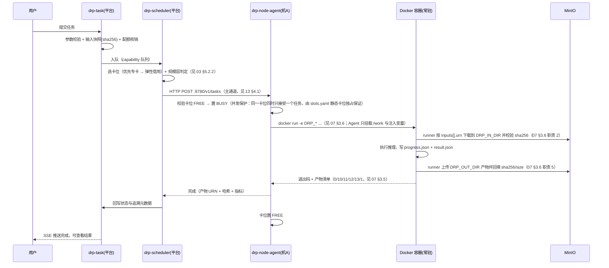

# 中国医药 AI 药物研发平台 · 算力节点与模型运行部署方案

| 项 | 内容 |
|---|---|
| 文档编号 | DRP-COMPUTE-DEPLOY-v1.4 |
| 文档版本 | **v1.4**（2026-10-25 真机实测修正 §5.6：NVIDIA 卡位可见性变量由 `CUDA_VISIBLE_DEVICES=6` 更正为 **`=0`**（容器内序号，不是宿主卡号），示例卡位由 A0 改为 **A6** 以暴露语义差异，补实测矩阵与「DCU 习惯照搬会刚好踩中」的说明，迁移纪律由四条增至**五条**（新增卡位验收必须断言 `device_count()==1`）；依据 `08A` §4，见 `03A` P7-8）<br>**v1.3**（2026-10-25 新增 §5.6「卡位方案的硬件无关性」与双形态 `slots.yaml`，把「8 卡 4090 先行验证」落成配置而非代码分支）<br>**v1.2**（2026-10-23 生产级复审补齐；§4.4 执行时序图由 `SSH: submit(...)` 改为 `HTTP POST :8780/v1/tasks`，与 §3 决策及 `13` §4.1 通道口径一致，并补上规模层判定与 `07` §3.6 Runner 契约引用）<br>**v1.1**（2026-10-20 评审修订；通道口径统一为内网 HTTP 为主） |
| 上游 | `03-系统架构设计说明书.md`、`07-模型交付与运行规范.md`（§3.6 Runner 契约）、`08-DCU适配复现与验证计划.md` |
| 决策主题 | 模型运行后端：**K8s 原生调度** vs **SSH 远程执行 + 静态绑卡** |
| 状态 | **已决策**：**通道 = 内网 HTTP（Agent `:8780` 执行 / `:8781`→网关 `443` 反向心跳），SSH 仅用于安装与应急排障**（`13` §4.1 通道 A/B，`03B` `D-12` 已关闭）。**后端抽象 = `ComputeBackend`，一期实现 `HTTPBackend`**（原写「采信 SSH 后端」是 v1.0 措辞，v1.1 起通道已改 HTTP，v1.2 更正此处） |

---

## 1. 结论摘要

| 问题 | 结论 |
|---|---|
| SSH + 每模型一个 Docker + 静态绑卡，可行吗？ | **可行**，且在「16 卡、约 10 个模型、用户规模有限」的条件下是**务实的首选** |
| 能满足规范书需求吗？ | **能满足**——规范书要求的是「调度 CPU/GPU 资源」「排队管理」「长时任务状态展示」这些**能力**，并未指定实现技术 |
| 但有代价吗？ | 有。**平台侧必须自建排队、配额、调度、探活、拉起**，不能把这些甩给 SSH。SSH 只是**执行通道** |
| 要不要放弃 K8s？ | **不要放弃抽象**。前后端业务仍部署在 K8s（甲方要求）；模型运行后端抽象为 `ComputeBackend` 接口，当前实现 SSH 后端，未来可切 K8s 后端，**业务代码零改动** |

**一句话**：SSH 方案能让你最快打通 4 个 ★ 专项（§5.1~§5.4），但**必须把调度逻辑留在平台里**，而不是靠"固定绑卡"天然解决。

---

## 2. 两种方案对比

| 维度 | K8s 原生调度（device plugin + Job） | SSH 远程执行 + 静态绑卡 |
|---|---|---|
| 落地速度 | 慢（需 device plugin、Argo、镜像在集群内跑通） | **快**（与 2026-08 验证形态几乎一致，容器直接跑） |
| 与已有适配成果衔接 | 需重新验证容器内设备可见性 | **直接复用**（当时就是在容器里跑脚本） |
| 调试直观性 | 差（要看 Pod 事件、日志） | **好**（ssh 进去就能看、能手动复现） |
| 排队/配额/优先级 | Argo/调度器部分提供，仍需自研准入 | **完全自研** |
| 故障自愈 | 原生（Pod 重启、重调度） | **自建**（探活 + 拉起） |
| 资源利用率 | 高（弹性分配） | **低**（静态分区碎片）→ 用弹性借用缓解 |
| 扩缩容 | 加节点即可 | 人工改配置 |
| 多卡并行任务 | 原生支持 | 受限（**跨机多卡难**，需同机内） |
| 甲方合规观感 | 好（资源统一纳管） | 需确认甲方是否要求算力节点纳入集群管理 |

**判断依据**：本项目算力规模固定（16 卡）、模型数量有限（约 10 个）、用户规模有限（≥10 并发是页面操作，非计算并发）。在这种规模下，K8s 调度带来的弹性收益有限，而落地成本显著。**SSH 方案是合理的工程取舍**。

---

## 3. 推荐架构：执行后端抽象（关键设计）

> **不要让运行形态绑死业务架构。** 平台只依赖一个接口，后端可替换。

```python
class ComputeBackend(Protocol):
    async def submit(self, task: TaskSpec) -> RunHandle: ...      # 提交并在目标卡位执行
    async def cancel(self, handle: RunHandle) -> None: ...        # 取消
    async def status(self, handle: RunHandle) -> RunStatus: ...   # 状态 + 进度 + 阶段
    async def collect(self, handle: RunHandle) -> ArtifactList: ...# 产物回收
    async def capacity(self) -> CapacitySnapshot: ...             # 各卡位占用与空闲
```

| 后端实现 | 适用期 | 说明 |
|---|---|---|
| `SSHBackend` | **当前** | 通过 SSH 调用目标机 `drp-node-agent`，执行 Docker 容器 |
| `K8sBackend` | 后续可选 | K8s `Job`（v1.0 不引入 Argo，见 `13` §12.1），用于 CPU 密集任务或未来算力扩容 |
| `HybridBackend` | 推荐过渡 | **DCU 走 SSH，CPU 密集（Vina 对接、构象、导入导出）走 K8s Job** |

**收益**：
- 现在用 SSH 快速打通 ★ 专项
- 后续若甲方要求算力纳管或机器扩容，只换 `K8sBackend` 实现
- CPU 侧天然适合 K8s（无 GPU 绑定），可立即采用混合模式，降低 DCU 机器负载

---

## 4. SSH 后端详细设计

### 4.1 物理布局

```
┌─ 机 A（浪潮 CS5468H3）────────────┐   ┌─ 机 B（浪潮 CS5468H3）────────────┐
│ 8 × K100-AI   DCU 0..7            │   │ 8 × K100-AI   DCU 0..7            │
│ CPU: 海光 C86（多核）             │   │ CPU: 海光 C86（多核）             │
│ 本地盘: /var/drp/model-cache      │   │ 本地盘: /var/drp/model-cache      │
│         /var/drp/work             │   │         /var/drp/work             │
│ drp-node-agent (systemd 常驻)     │   │ drp-node-agent (systemd 常驻)     │
│ Docker Engine + DCU 驱动          │   │ Docker Engine + DCU 驱动          │
└───────────────────────────────────┘   └───────────────────────────────────┘
              ▲                                       ▲
              └────────────── SSH（内网）──────────────┘
                                 │
                     ┌───────────┴────────────┐
                     │  平台 drp-scheduler     │
                     │  （K8s 内，业务服务）   │
                     └────────────────────────┘
```

### 4.2 节点 Agent（强烈建议，而不是裸 ssh 拼命令）

在每台机器上部署 `drp-node-agent`（Python FastAPI，systemd 常驻，仅监听内网）。平台通过**内网 HTTP 调用 Agent（:8780）**为主通道，SSH 仅作应急与安装通道（详见 `13` §4.1）。

**为什么不建议平台直接 `ssh root@host "docker run ..."`**：
- 无法做并发控制（两个请求同时跑同一张卡 → OOM）
- 无进度回调（只能轮询日志）
- 无健康状态（不知道卡位是不是还活着）
- 命令拼接易出注入与转义问题

`drp-node-agent` 职责：

| 职责 | 说明 |
|---|---|
| 卡位管理 | 维护本机 8 个卡位状态（FREE/BUSY/FAULT），**串行化访问** |
| 容器生命周期 | 按 manifest 启动常驻容器、按需启动一次性容器 |
| 任务执行 | 组装 `DRP_*` 环境变量并 `docker run` 拉起模型镜像；**不下载输入、不解析进度、不上传产物**（这三件事由镜像内 `drp-runner` 完成，见 `07` §3.6） |
| 卡位与容器观测 | 从容器 stdout / 宿主目录**只读观测** `progress.json` 与日志，作为 Runner 上报失败时的兜底；**不得写入或清理 `/work` 内任何文件** |
| 超时与失败处置 | 按 `manifest.resources.maxMinutes` 计时 → `SIGTERM` → 宽限 60s → `SIGKILL`；把退出码原样回传平台（`07` §3.5） |
| 孤儿兜底上传 | **仅在容器被 `SIGKILL`（Runner 无法完成上传）时**，把 `/work/out` 上传并标注 `partial=true`；正常路径下 Agent 不碰产物 |
| 健康检查 | 周期探活容器与 DCU（`hy-smi`），异常上报 |
| 本地缓存 | 权重命中 `/var/drp/model-cache` 则不重复拉取 |

> **Agent 不是必需的替代品，而是把「SSH 的简单」和「调度所需的可控性」结合起来**。若坚持纯 SSH，则以上职责必须平台侧远程实现，复杂度更高。

### 4.3 容器启动规范

**常驻容器（推荐，规避冷启动）**

```bash
docker run -d --name boltz2-A0 \
  --restart=unless-stopped \
  --device=/dev/kfd --device=/dev/dri \
  --group-add video \
  --security-opt seccomp=unconfined \
  -e HIP_VISIBLE_DEVICES=0 \
  -e CUDA_VISIBLE_DEVICES=0 \
  -e DRP_DEVICE=cuda:0 \
  -e LD_LIBRARY_PATH=/opt/hyhal/lib:/opt/dtk-26.04/lib:/opt/dtk-26.04/opencl/lib \
  -v /opt/hyhal:/opt/hyhal:ro \
  -v /var/drp/model-cache/boltz2/2.0.1:/opt/model/weights:ro \
  -v /var/drp/work/boltz2-A0:/work \
  harbor.drp/model/boltz2:2.0.1-dtk26.04-py3.10-r3
```

**要点**
- `HIP_VISIBLE_DEVICES=0` / `CUDA_VISIBLE_DEVICES=0` 把容器**隔离到单张物理卡**，容器内逻辑编号固定为 `cuda:0`（与实测一致）
- `--device=/dev/kfd --device=/dev/dri` 是 DCU/ROCm 系容器的标准做法；**具体参数以复现阶段实测为准**（不同驱动版本可能需要精确到 `/dev/dri/renderDxxx`）
- 驱动相关目录（`/opt/hyhal`）建议**挂载宿主机**而非打进镜像，避免宿主机驱动升级后容器失效
- **冷启动治理**：Boltz-2 冷启动 ~110s，必须常驻。常驻容器内部跑一个轻量服务等待任务，模型在启动时加载一次

**一次性容器（仅用于长时/大批量任务）**

```bash
docker run --rm --name drp-md-tsk01J \
  --device=/dev/kfd --device=/dev/dri --group-add video \
  -e ROCR_VISIBLE_DEVICES=6 \
  -e HIP_VISIBLE_DEVICES=0 \
  -e DEVICE=cuda:0 \
  -e OMP_NUM_THREADS=16 \
  -e GMX_GPU_DISABLE_COMPATIBILITY_CHECK=1 \
  -e DRP_TASK_FILE=/work/task.json \
  -e DRP_RESULT_FILE=/work/result.json \
  -e DRP_IN_DIR=/work/in \
  -e DRP_OUT_DIR=/work/out \
  -e DRP_PROGRESS_FILE=/work/out/progress.json \
  -e DRP_WORK_DIR=/work \
  -e DRP_MODEL_ENTRY=/opt/model/entrypoint/run.sh \
  -e DRP_DEVICE=cuda:0 \
  -e DRP_HEARTBEAT_SEC=15 \
  -e DRP_MAX_MINUTES=1440 \
  -v /var/drp/work/tsk01J:/work \
  -v /var/drp/model-cache/gromacs/2026.3:/opt/model/weights:ro \
  --stop-timeout 60 \
  harbor.drp/model/gromacs:2026.3-dtk26.04-r1
# 入口由镜像 ENTRYPOINT（/opt/drp-runner/bin/drp-runner）承担，
# 禁止在命令行追加 bash run.sh —— 那会覆盖 ENTRYPOINT（07 §3.6 / 10 MD-01）
# ⚠️ OCL_ICD_VENDORS 必须保持未设置
```

> 完整变量表见 `07` §3.6，本节不重复定义。

> GROMACS / MD 属长时任务，一次性容器可接受（冷启动占比极低），且便于 checkpoint 续跑与资源回收。

### 4.4 执行流程



> **v1.2 修订**：原图第 172 行写的是 `S->>A: SSH: submit(...)`，与本文 §3 的「SSH 主通道 vs HTTP 主通道」决策、`13` §4.1 的通道口径表不一致，会让开发误以为要写 paramiko 调用。现统一为 **内网 HTTP :8780 主通道**；SSH 仅用于安装与应急排障（`13` §4.1 通道 B）。

### 4.5 产物入库

- **产物由镜像内 `drp-runner` 上传**到 `drp-results/{projectId}/task/{taskId}/`（`07` §3.6 职责 5）；Agent **不**上传，仅在容器被 `SIGKILL` 时做孤儿兜底并标 `partial=true`
- runner 返回每个产物的 URN、大小、SHA-256；Agent 原样透传给平台
- 平台写入 `artifact` 表与 `prediction_result` / `docking_result` 等结果表
- **追溯元数据由平台写入**（镜像 tag、模型版本、卡位、节点 IP），满足 DRP-NFR-07

### 4.6 健康检查与故障处理

| 场景 | 处理 |
|---|---|
| 容器崩溃 | `--restart=unless-stopped` 自动拉起；Agent 探活失败上报平台，卡位置 FAULT |
| DCU 卡故障 | Agent 用 `hy-smi` 周期检测，故障卡置 FAULT 并从可用池移除，任务改调度到其他卡位 |
| 整机宕机 | 平台心跳超时（>90s）→ 该机所有卡位 FAULT → 任务重新入队调度到另一台机 |
| 任务卡死 | 平台按 `maxMinutes` 超时 → Agent kill 容器 → 任务置 TIMEOUT |
| 长任务断连 | 任务在 Agent 侧执行，平台断连不影响；重连后按 taskId 回查状态 |
| 磁盘满 | Agent 监控 `/var/drp/work`，超过阈值告警并拒绝新任务 |

---

## 5. 16 卡分配方案

### 5.1 分配原则

1. **每个关键模型必须跨两台机器分布** —— 否则单台机器宕机，该能力**完全中断**。这是本方案最重要的可用性约束。
2. 常驻模型给**整卡**（冷启动成本高）；低显存模型（LVpocket 显存 4%）**多实例共享一卡**。
3. 预留**弹性卡位**，用于多卡任务与故障接管。
4. **不启用抢占**（长任务中断代价大）。

### 5.2 分配表

| 卡位 | 机 A | 机 B | 承载模型 | 形态 | 关联 ★ |
|---|---|---|---|---|---|
| 0 | A0 | B0 | **Boltz-2** 实例 | 常驻，整卡 | S-01 / S-04 |
| 1 | A1 | B1 | **Boltz-2** 实例 | 常驻，整卡 | S-01 / S-04 |
| 2 | A2 | B2 | **STD-Diff** 实例 | 常驻，整卡 | S-03 |
| 3 | A3 | B3 | **STD-Diff** 实例 | 常驻，整卡 | S-03 |
| 4 | A4 | B4 | **TheraPainter** 实例 | 常驻，整卡 | S-03（多肽） |
| 5 | A5 | B5 | **LVpocket** ×3 + **MolP-PC** + **MSIGN** + **PEARL** | 常驻，多实例共享 | S-02 / S-04 |
| 6 | A6 | B6 | **GROMACS（MD）** | 一次性容器，整卡，长时 | S-05 相关 |
| 7 | A7 | B7 | **弹性 / 备用 / 故障接管** | 按需 | — |

**合计**：机 A 8 卡 + 机 B 8 卡 = 16 卡。

**未占用 DCU 的任务**（走 CPU 计算池）：
AutoDock Vina 对接、RDKit 构象生成、药效团匹配、gmx_MMPBSA 自由能、数据导入导出、结构准备（PDB→PDBQT）、指纹预计算

> **v1.2 明确（`D-03-11` 已关闭）**：这些任务 **CPU 密集且可大规模并行**，全部落在**独立的 CPU 计算节点（128 核）**上，即 `13` §3.2/§3.3 的 `node-role: cpu-compute` 池。三条硬约束：
> 1. **不占 DCU 机器的 CPU**——避免 DCU 任务的数据供给（`seccomp`/解压/PDBQT 展开）被抢；
> 2. **不上平台部署机（32 核）**——部署机只跑业务侧 8 个部署单元与中间件（`03` §5.6.4、`13` §3.3）；
> 3. **必须为 S/M 层预留 ≥ 16 核**（`03` §5.6.3②），即批量 XL 任务最多用 **112/128 核**，否则一次 10 万条筛选会把交互型任务（构象生成、自由能后处理）一起堵死。
>
> **容量基线（实测算例见 `03` §5.6.2）**：128 核按 0.7 折扣 = **90 有效核**。10 万条 Vina 筛选典型 833 CPU·h ≈ **9.3 小时**；乐观 10s/配体约 3.1 小时，保守 60s/配体约 18.5 小时。漏斗前置筛掉 90% 后（1 万条）典型约 **56 分钟**。

### 5.3 弹性借用规则

静态分区的最大问题是碎片：Boltz-2 排队 10 个，而 TheraPainter 空闲。规则如下：

| 规则 | 说明 |
|---|---|
| 触发条件 | 目标模型队列长度 ≥ 3 **且** 借用目标卡位空闲 ≥ 5 分钟 |
| 借用顺序 | ① 弹性卡位（A7/B7）→ ② 同机空闲专卡 → ③ 跨机空闲专卡 |
| 借用方式 | 在借用的卡上**启动该模型的新常驻实例**（镜像已预拉取），任务完成后保留 30 分钟再销毁（冷却期） |
| 归还 | 借用实例在连续空闲 30 分钟后销毁，卡位归还 FREE |
| 禁止 | **禁止抢占正在运行的任务**；禁止跨机多卡并行（无高速互联） |

### 5.4 多卡任务的限制（必须提前知晓）

实测 STD-Diff **8 卡并行可获得约 3× 加速**，但这是**单机内**的 8 卡。本方案给 STD-Diff 固定 2+2=4 卡：

| 场景 | 处理 |
|---|---|
| 单批 ≤ 32 分子 | 单机 2 卡或 4 卡（借用 A7/B7）即可 |
| 单批 64+ 分子（要 3× 加速） | 需单机凑够 4~8 卡：调度器在**同一台机器**内借用空闲卡位（A2,A3 + A7 + 借 A5 若空闲） |
| 跨机 8 卡 | **不支持**（无高速互联，GROMACS/STD-Diff 多机通信未验证） |

> 若甲方后续明确要求「大批量生成必须 8 卡并行」，则需要重新规划卡位（例如 STD-Diff 独占一整台机器的 8 卡），**这会挤掉其他模型**，需与甲方确认优先级。

### 5.5 卡位状态机

```
FREE ──(调度选中)──▶ RESERVED ──(容器就绪)──▶ BUSY ──(任务完成)──▶ FREE
  │                                            │
  │                                            ├──(超时/取消)──▶ FREE
  │                                            └──(异常)──▶ FAULT ──(探活恢复)──▶ FREE
  └──(借用)──▶ BORROWED ──(冷却到期)──▶ FREE
```

### 5.6 卡位方案的硬件无关性（v1.3 新增，支撑 `08` §7 的 4090 先行验证）

> **结论先行**：卡位这套设计**不绑定 DCU**。同一份 `slots.yaml` + 同一个 Agent，只要**只改每卡位的 `env{}` 与镜像基座**，就能在 K100-AI 与 NVIDIA 4090 上跑；`drp-scheduler`、`drp-task-api`、业务代码一行不改。唯一硬编码的是「一张卡 = 一个卡位」，这条在两种硬件上都成立。

**两种形态的差异只有 3 个字段**

| 项 | DCU（K100-AI） | NVIDIA（4090） | 谁负责 |
|---|---|---|---|
| 可见性变量 | `ROCR_VISIBLE_DEVICES=6` + `HIP_VISIBLE_DEVICES=0` | **`NVIDIA_VISIBLE_DEVICES=6` + `CUDA_VISIBLE_DEVICES=0`** ⚠️ | `slots.yaml` 的 `env{}` |
| 设备挂载 | `--device=/dev/kfd --device=/dev/dri --group-add video` | `--gpus '"device=6"'`（或 `--runtime=nvidia`）+ 驱动由宿主注入 | `slots.yaml` 的 `dockerArgs[]` |
| 镜像基座 | `*-dtk26.04-py3.10` | `*-cu12x-py3.10` | `slots.yaml` 的 `image` |

> ### ⚠️ 两个变量的含义不同，不能都填宿主卡号（v1.4 实测修正）
>
> **`NVIDIA_VISIBLE_DEVICES` 填宿主卡号，`CUDA_VISIBLE_DEVICES` 填容器内序号（恒为 `0`）**。两者是**串联过滤**，不是同义词：
>
> - `NVIDIA_VISIBLE_DEVICES=6` 把容器可见范围限制为「宿主第 6 张卡」，它在容器内变成列表的**第 0 个**；
> - 此时若再写 `CUDA_VISIBLE_DEVICES=6`，等于从一个只有 1 个元素的列表里取下标 6 → **空集**；
> - 后果：`torch.cuda.device_count()` **返回 0**，容器**正常启动、正常退出、退出码 0、无任何报错**，模型静默 fallback 到 CPU。Boltz-2 从 9.5s/件 变成小时级，MD 直接跑不动，用户只会觉得「这机器好慢」。
>
> **实测矩阵**（`pytorch/pytorch:2.6.0-cuda12.4-cudnn9-runtime`，见 `08A` §4.2）：
>
> | 启动方式 | `device_count()` |
> |---|---|
> | `--gpus '"device=3"'` + `CUDA_VISIBLE_DEVICES=3` | **0** ❌ |
> | `--gpus '"device=3"'` + `CUDA_VISIBLE_DEVICES=0` | 1 ✅ |
> | `--gpus '"device=3"'`（不设 `CUDA_VISIBLE_DEVICES`） | 1 ✅ |
> | `--gpus all` + `CUDA_VISIBLE_DEVICES=6` | 1 ✅（全暴露后由 CVD 选，另一种机制） |
>
> **DCU 侧为什么没这个问题**：`ROCR_VISIBLE_DEVICES=6` 与 `HIP_VISIBLE_DEVICES=0` 恰好就是「宿主卡号 + 容器内 0」的正确组合（§4.3 示例即如此）。**照 DCU 习惯往 NVIDIA 上套 `CUDA_VISIBLE_DEVICES=6` 会刚好踩中这个坑**——这也是它容易被漏掉的原因。

**容器内一律仍是 `DRP_DEVICE=cuda:0`**（NVIDIA 与 DCU 的 PyTorch 兼容层都把单卡映射到 `cuda:0`；DGL 路径在 DCU 上取 `hip:0`，见 `07` §9）。**因此不要引入任何 `vendor` 字段或 `if 厂商 ==` 分支**——差异必须全部落在配置里。

**双形态配置示范（同一 schema）**

```yaml
# /etc/drp/slots.yaml —— DCU 生产形态
schemaVersion: 2
nodeId: dcu-node-01
accelerator:
  model: "K100-AI"
  count: 8
slots:
  - id: A0
    deviceIds: [0]
    env: { ROCR_VISIBLE_DEVICES: "0", HIP_VISIBLE_DEVICES: "0" }
    dockerArgs: ["--device=/dev/kfd", "--device=/dev/dri", "--group-add", "video"]
    models: ["boltz-2"]
    image: "harbor.drp.local/drp/compute-boltz2:2.0.1-dtk26.04-py3.10-r3"
```

```yaml
# /etc/drp/slots.yaml —— NVIDIA 4090 先行验证形态（改动仅 env / dockerArgs / image）
# 注意：A6 卡位挂在宿主第 6 张卡上
schemaVersion: 2
nodeId: dev4090-01
accelerator:
  model: "RTX-4090"
  count: 8
slots:
  - id: A6
    deviceIds: [6]                     # 宿主卡号，供 Agent 做可用性校验与观测
    env:
      NVIDIA_VISIBLE_DEVICES: "6"      # ← 宿主卡号
      CUDA_VISIBLE_DEVICES: "0"        # ← 容器内序号，恒为 0（填 6 会导致 0 卡可见）
    dockerArgs: ["--gpus", "device=6", "--ipc=host"]
    models: ["boltz-2"]
    image: "harbor.drp.local/drp/compute-boltz2:2.0.1-cu121-py3.10-r1"
```

> **为什么示例从 A0 改成 A6（v1.4）**：v1.3 的示例用卡 0，于是 `NVIDIA_VISIBLE_DEVICES: "0"` 与 `CUDA_VISIBLE_DEVICES: "0"` 恰好都是 `0`，**把「两个 0 含义不同」这件事完全掩盖了**——照着抄到卡 6 上就会写成 `"6"` / `"6"` 而静默失败。用非 0 卡号做示例，写错就立刻暴露。**这类「示例值恰好掩盖了语义差异」的错误，在文档里比语法错误危险得多。**

**五条迁移纪律**

1. `accelerator` 段**只做观测与展示**（`14` 的节点页显示型号），**不得参与调度判定**——调度看的是 `slot.models[]` 与 `slot.state`，不看卡是 DCU 还是 NVIDIA。
2. 显存不写进 `slots.yaml`，由 `manifest.resources.gpuMemGB` 声明上限、Agent 做**准入前置校验**（4090 24GB 会在准入阶段就拒绝本该给 DCU 64GB 的任务，这正是要的效果：**在 4090 上越早暴露显存需求越好**）。
3. `08` §7.3 的「不能证明什么」必须同步进 `12` 的测试报告模板：凡是标注 `环境=dev4090` 的结论，**不得作为 `03` §5.2.1 耗时基线与 `D-03-12` 容差签字依据**。
4. 验证环境的镜像 tag 一律带 `-dev4090` / `-cu121` 后缀且**存于独立 Harbor 项目**（`11` §1.2 禁止原地覆写的红线同样适用），避免与生产 tag 混淆。
5. **卡位验收必须断言 `device_count()==1`，不允许只看容器 `Up`**（v1.4 新增）。容器起来、`nvidia-smi` 能看到卡、退出码 0——**这三件事同时成立时 GPU 仍可能完全不可见**（见上文变量陷阱）。Agent 的就绪自检必须包含一条：在卡位容器内执行 `python -c "import torch; assert torch.cuda.device_count()==1"`，失败则该卡位置 `FAULT`、不接任务。**这条已由 2026-10-25 实测反推得出（`08A` §4）**。

---

## 6. 平台侧必须自建的能力（不能甩给 SSH）

> 这是本方案能否满足规范书的**决定性因素**。SSH 只负责"在那台机器上跑起来"，下列能力必须平台实现。

| 能力 | 对应规范书/需求 | 实现方式 |
|---|---|---|
| **排队管理** | 「根据 CPU、GPU 等计算资源的可用情况，对不同类型的计算任务进行调度和排队管理」 | `drp-scheduler` 按 capability 分队列；页面展示排队序号与预计等待 |
| **资源调度** | 「根据任务的资源需求调度 CPU 或 GPU 计算资源」 | 任务声明资源画像 → 调度器选卡位（DCU 走 SSH 后端，CPU 走 K8s 后端） |
| **状态与进度展示** | 「支持长时计算任务的持续运行与状态展示」「查看任务状态、运行进度及相关日志」 | Agent 上报 `progress.json` → 平台落库 → SSE 推送 |
| **取消 / 重试** | 规范书 3.6.5 / 3.6.6 | 平台下发 cancel → Agent kill 容器；重试重新入队 |
| **项目配额与优先级** | DRP-NFR-05 | 调度器准入控制 |
| **追溯** | DRP-NFR-07 | 平台记录卡位、节点 IP、镜像 tag、模型版本、参数 |
| **审计** | DRP-NFR-08 | SSH 调用与 Agent 操作全量入审计日志 |

**关键提醒**：如果只做"固定绑卡 + ssh 跑一下"，而没有排队器，那么两个用户同时提交同一模型的任务就会**撞到同一张卡导致 OOM 或串行阻塞且无反馈**，直接违反规范书的排队管理要求。

---

## 7. 规范书符合性分析

| 规范书条款 | 是否满足 | 说明 |
|---|---|---|
| 3.6.7 根据资源需求调度 CPU 或 GPU 计算资源 | ✅ | 混合后端：DCU 走 SSH，CPU 走 K8s |
| 3.6.8 支持长时计算任务持续运行与状态展示 | ✅ | 常驻容器 + 断连保持 + 进度上报 |
| 4.3 ≥10 用户同时常规操作 + 调度和排队管理 | ✅ | 页面操作在 K8s 业务服务；计算由平台排队器管理 |
| 4.3 可查看任务状态、运行进度及相关日志 | ✅ | Agent 采集日志与进度 |
| 4.7 架构便于维护扩展、支持接入新模型与计算工具 | ⚠️ | 依赖 manifest 与交付包规范（07 文档）达成；**卡位分配变更需人工改配置** |
| 4.7 扩容时减少改造 | ⚠️ | **较弱**：加机器需人工配置；建议后续切 K8s 后端 |
| 甲方「K8s 集群部署前后端」 | ✅ | 前后端业务服务仍在 K8s；模型计算在 DCU 机器 |

**结论**：**能满足规范书的功能与非功能要求**，前提是第 6 节的平台侧能力全部落地。

---

## 8. 诚实列出的风险

| 编号 | 风险 | 影响 | 缓解 |
|---|---|---|---|
| CR-01 | **甲方可能要求算力节点统一纳入 K8s 纳管/监控** | 验收争议 | **尽早与甲方确认**：算力服务器是否必须加入 K8s 集群。若必须，需提前引入 device plugin。**⚠ 本条本质是决策而非技术风险，编号已并入 `03B` 的 `D-13-01`（🔴 阻塞级），此处仅作技术风险留痕——周会统计以 `D-13-01` 为准，不要双计** |
| CR-02 | 静态分区资源利用率低 | 部分卡空转 | 弹性借用规则（§5.3）+ 预留弹性卡位 |
| CR-03 | 单机故障导致容量减半 | 吞吐下降 | 关键模型跨机分布（§5.2）已保证**不中断**，仅容量下降 |
| CR-04 | 跨机多卡并行不支持 | 大批量加速受限 | 限制单批规模；或为 STD-Diff 独占整机（需甲方确认优先级） |
| CR-05 | SSH 凭据与操作审计 | 安全合规 | 专用密钥 + 跳板/内网隔离 + Agent 操作全量审计 |
| CR-06 | Agent 成为新单点 | 该机不可用 | Agent 无状态，崩溃后由 systemd 拉起；平台心跳检测 |
| CR-07 | 容器与宿主机驱动版本耦合 | 驱动升级后容器失效 | `/opt/hyhal` 挂载而非打进镜像；升级后必须回归验证 |
| CR-08 | 未来算力扩容人工成本高 | 运维负担 | 保留 `K8sBackend` 接口，条件成熟时切换 |

---

## 9. 何时迁移到 K8s 原生调度

出现以下任一情况时，建议启用 `K8sBackend`：

| 触发条件 | 说明 |
|---|---|
| 甲方明确要求算力节点纳入 K8s 集群统一管理 | 合规硬要求 |
| 算力规模扩大（> 3 台机器 / > 24 卡） | 静态分配的配置维护成本超过收益 |
| 需要跨机多卡并行 | K8s + RDMA/网络方案更成熟 |
| 出现多租户强隔离需求 | K8s 命名空间 + 资源配额更规范 |
| 运维人力允许引入 device plugin（+ 可选工作流引擎） | 前提是有对应人力 |

**迁移路径**：`ComputeBackend` 接口不变 → 新增 `K8sBackend` → 按模型灰度切换 → 业务代码零改动。前提是 **07 文档的 IO 契约与 manifest 规范被严格执行**（这两者与运行后端无关）。

---

## 10. 与 07 文档的关系

| 07 文档内容 | 在本方案下是否变化 |
|---|---|
| 模型交付包结构 | **不变** |
| manifest.yaml 规范 | **不变**（新增 `deployment.allowedSlots` 可选字段用于表达卡位偏好） |
| 统一 IO 契约（task.json / result.json） | **不变** |
| 三层镜像体系 | **不变** |
| 权重存放规范 | **不变**（节点本地盘 `/var/drp/model-cache` 更为重要） |
| BATCH / RESIDENT 形态划分 | **不变**，但「BATCH」由 K8s Job 改为**本机一次性 Docker 容器** |
| 排队/配额/优先级 | 由 K8s 调度器改为**平台 `drp-scheduler` 自研** |

---

## 11. 落地清单

| # | 任务 | 产出 |
|---|---|---|
| 1 | 与甲方确认算力节点是否必须纳入 K8s | 书面确认（**阻塞项**） |
| 2 | 实现 `ComputeBackend` 接口与 `SSHBackend` | 平台代码 |
| 3 | 实现 `drp-scheduler`（排队/配额/选卡/弹性借用） | 平台代码 |
| 4 | 实现 `drp-node-agent`（卡位/容器/进度/产物） | 部署到机 A、机 B |
| 5 | 按 §5.2 分配卡位并启动常驻容器 | 部署脚本 + 配置 |
| 6 | 复现阶段实测：容器内单卡隔离参数（`HIP_VISIBLE_DEVICES` 是否生效） | 验证记录 |
| 7 | 心跳、探活、超时、故障演练（拔掉一台机器） | 演练报告 |
| 8 | SSH 密钥与审计方案 | 安全方案 |
