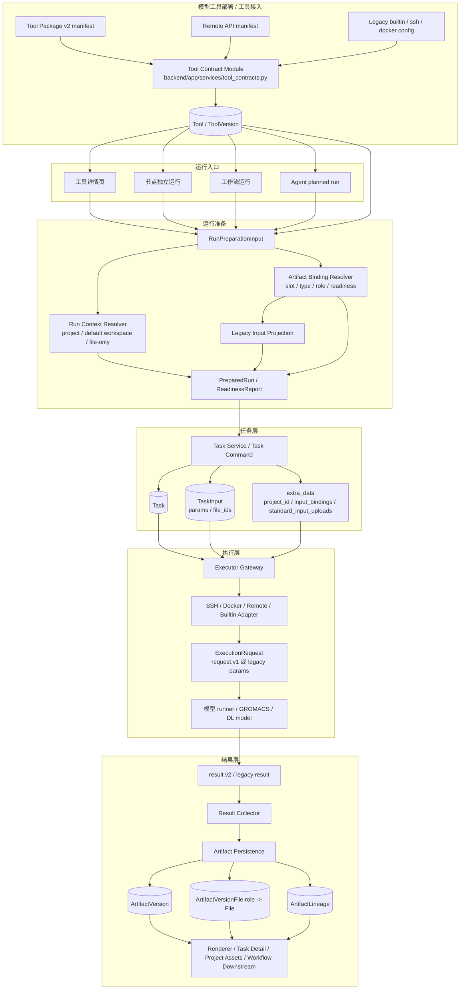
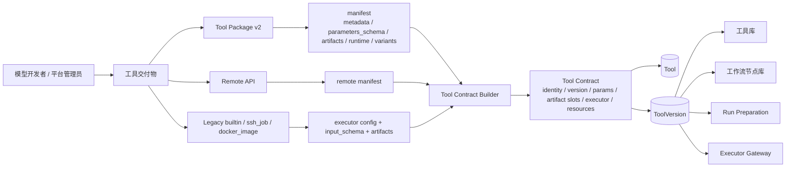
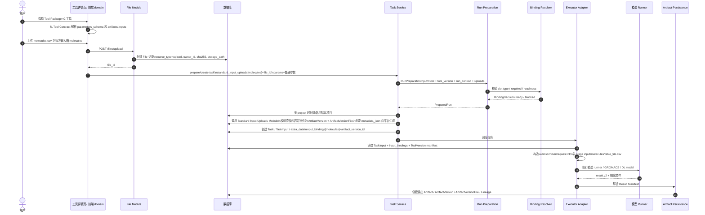
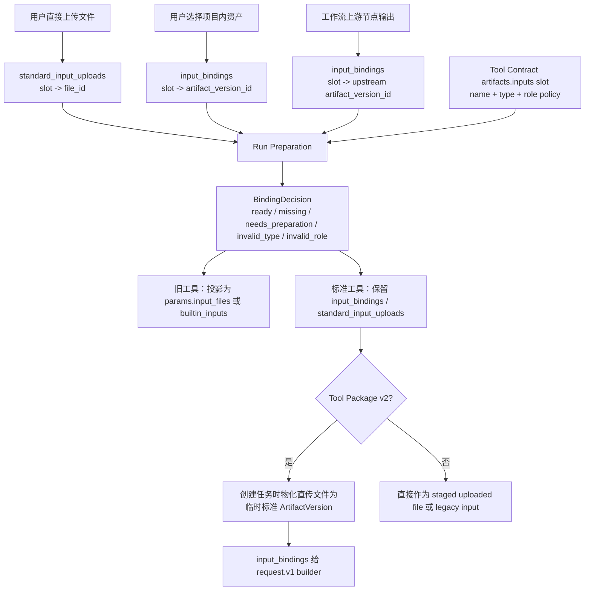
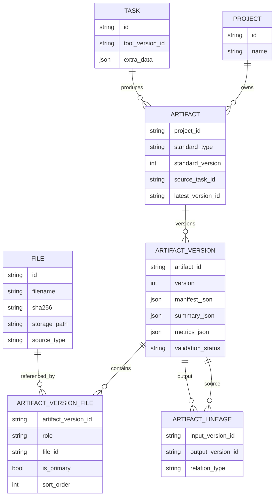
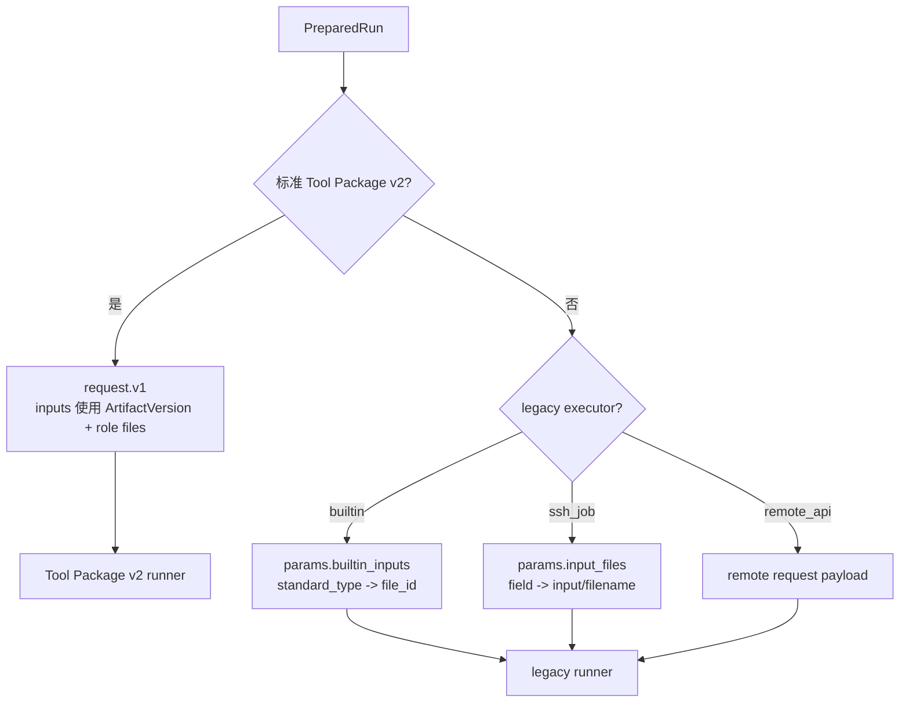

# 核心模块链路可视化

> 修订日期：2026-09-10。本文件用于把模型工具部署、用户输入、Task、Standard Artifact、执行器和结果持久化串成一张可读链路图。详细规则仍以 Tool Contract、Run Preparation、标准 Artifact 类型和执行器设计文档为准。

## 1. 一句话理解

平台的核心不是“上传文件后直接塞给模型跑”，而是：

```text
模型工具先标准化为 Tool Contract
用户输入先标准化为 RunPreparationInput
运行任务先标准化为 PreparedRun / Task
执行请求先标准化为 request.v1 或 legacy params
模型输出先标准化为 result.v2
最终沉淀为 ArtifactVersion + FileRole + Lineage
```

其中：

- `Tool Contract` 是平台理解工具的统一 Interface。
- `Run Preparation` 是所有运行入口的统一准备 Module。
- `ArtifactVersion` 是平台可复用、可追踪的数据资产版本。
- `input_bindings` 是“某个工具输入 slot 绑定哪个 ArtifactVersion”的运行时绑定。
- `standard_input_uploads` 是“用户直接上传文件满足某个标准输入 slot”的入口表达。

## 2. 核心模块全景



## 3. 模型工具部署到平台可运行工具



工具接入后，平台只应该依赖 `Tool Contract` 理解工具，而不是让工具详情页、工作流画布、Agent、执行器分别猜字段。

## 4. 用户上传文件后的一次独立运行链路

以下是用户在工具详情页直接上传文件并运行 Tool Package v2 的链路。



### 4.1 这条链路里数据被包装成什么

| 阶段 | 输入对象 | 平台包装 / 标准化结果 | 主要 Module |
| --- | --- | --- | --- |
| 浏览器选择文件 | `File` / `UploadFile` | 前端上传列表，只是 UI 状态；accept、缺失必填和文件投影由 domain 纯函数处理 | `frontend/src/views/tools/Detail.vue`、`frontend/src/components/tools/StandardArtifactInputs.vue`、`ArtifactFilePicker`、`frontend/src/domain/tools/standard-artifact-inputs.ts`、`detail-file-inputs.ts` |
| 上传到平台 | multipart file | `File` 数据库记录：`id`、`filename`、`sha256`、`storage_path`、`source_type=upload` | `backend/app/api/v1/files.py`、`backend/app/files/` |
| 表达标准输入 | `file_id` | `standard_input_uploads: { slotName: fileId }` | 前端 domain、`TaskCreate` schema |
| 运行准备 | Tool + Run Context + uploads | `PreparedRun`、`BindingDecision`、legacy params 投影 | `backend/app/services/run_preparation.py`、`artifact_binding_resolver.py` |
| Tool Package v2 create | `standard_input_uploads` | 校验文件格式/基础内容，生成 metadata，物化为 executor-facing `input_bindings: { slotName: artifactVersionId }` | `backend/app/services/standard_input_uploads.py`、`backend/app/services/standard_upload_metadata.py`、`backend/app/tasks/service.py` |
| 执行请求 | Task + input_bindings | `aidd.sciminer/request.v1` | `backend/app/execution/request_builder.py`、executor adapter |
| 模型输出 | 输出文件 + result manifest | `aidd.sciminer/result.v2` | 模型 runner / adapter |
| 结果持久化 | `result.v2` | `Artifact`、`ArtifactVersion`、`ArtifactVersionFile`、`ArtifactLineage` | `backend/app/services/standard_artifacts.py` |

## 5. 三种输入来源的差异



规则解释：

- 用户选择已有项目资产时，必须有项目上下文，因为需要校验 ArtifactVersion 是否属于该项目。
- 用户直接上传文件时，可以没有项目上下文；如果工具产生标准输出，平台会使用用户默认工作空间承接输出。
- 工作流上游输出已经是标准 ArtifactVersion，所以下游直接使用 `input_bindings`。
- Tool Package v2 的 runner 消费 `request.v1`，当前执行实现需要 ArtifactVersion 形态的输入，所以创建任务阶段会把直传文件物化为标准 ArtifactVersion，再传给 request builder。

## 6. Standard Artifact 的内部结构



一个标准 Artifact 不是一个文件，而是一个带类型、版本、文件角色、metadata、校验状态和谱系的资产版本。例如：

```text
Artifact: molecule_table@1
└─ ArtifactVersion v1
   ├─ manifest_json.type = molecule_table@1
   ├─ files.table_file -> File(molecules.csv)
   └─ files.metadata_json -> File(metadata.json)
```

## 7. Tool Package v2 的标准请求和标准结果

### 7.1 request.v1

Tool Package v2 执行时，平台会把 Task 和标准输入绑定组装成 `aidd.sciminer/request.v1`：

```json
{
  "request_version": "aidd.sciminer/request.v1",
  "task": {
    "id": "task-id",
    "tool_slug": "molp-pc",
    "tool_version": "2.0.0"
  },
  "inputs": {
    "molecules": {
      "artifact_version_id": "artifact-version-id",
      "type": "molecule_table@1",
      "files": {
        "table_file": {
          "path": "input/molecules/table_file.csv",
          "sha256": "...",
          "content_type": "text/csv"
        }
      },
      "metadata": {}
    }
  },
  "parameters": {},
  "execution": {
    "variant": "cpu",
    "accelerator": "cpu",
    "work_dir": ".",
    "output_dir": "output"
  }
}
```

### 7.2 result.v2

模型 runner 完成后，应返回标准结果 manifest。平台不直接信任文件夹里的任意文件，而是按 manifest 校验和持久化。

```json
{
  "result_version": "aidd.sciminer/result.v2",
  "artifacts": {
    "properties": [
      {
        "type": "molecule_table@1",
        "name": "Predicted properties",
        "files": {
          "table_file": {
            "path": "output/properties.csv",
            "sha256": "...",
            "content_type": "text/csv"
          },
          "metadata_json": {
            "path": "output/properties.metadata.json",
            "sha256": "...",
            "content_type": "application/json"
          }
        },
        "metadata": {},
        "summary": {},
        "metrics": {}
      }
    ]
  },
  "relations": []
}
```

## 8. 工作流里的链路


工作流保存时不应该只保存临时文件路径，而应该保存节点、边、contract snapshot、Task 和 ArtifactVersion binding。加载工作流时，平台根据这些绑定恢复节点状态和下游可运行性。

## 9. 旧工具和标准工具的兼容路径



这就是当前平台还会同时看到 `file_ids`、`params.input_files`、`input_bindings`、`standard_input_uploads` 的原因：它们分别服务于不同阶段和不同执行器，但都应该由 Run Preparation / Task Service 收敛，而不是散落在 UI 或工作流里。

## 10. 模块与代码位置速查

| 模块 | Interface / 对象 | 主要代码位置 | 职责 |
| --- | --- | --- | --- |
| Tool Package Config Resolver | `tool_package_manifest_data`、`tool_package_v2_manifest` | `backend/app/tool_packages/config_resolver.py` | 统一解析 `tool_package_manifest` 和 `tool_package.manifest` 两种入库形态，避免各业务 Module 重复判断 v2 manifest |
| Tool Contract Module | `ToolContract` | `backend/app/services/tool_contracts.py`、`backend/app/tool_packages/`、`frontend/src/domain/tools/standard-artifact-inputs.ts` | 把各种工具交付物归一化为平台可理解的工具契约；前端只解析 slot、兼容 Artifact 和上传约束 |
| Artifact Registry | `StandardArtifactSpec` | `backend/app/artifact_standards/` | 定义标准类型、版本、file roles、metadata schema、validator |
| File Module | `File` | `backend/app/api/v1/files.py`、`backend/app/files/` | 保存用户上传和任务输出文件，记录 sha256、storage_path、权限信息 |
| Run Preparation | `RunPreparationInput`、`PreparedRun` | `backend/app/services/run_preparation.py` | 统一准备运行输入、校验项目/文件/ArtifactVersion、投影 legacy 参数 |
| Binding Resolver | `BindingDecision` | `backend/app/services/artifact_binding_resolver.py` | 判断某个 ArtifactVersion/file 是否满足工具输入 slot 的 type、role、readiness |
| Standard Input Uploads | `standard_input_uploads -> input_bindings` | `backend/app/services/standard_input_uploads.py` | 校验 Tool Package v2 直传文件的标准 slot、role 和格式，物化为标准 ArtifactVersion，并生成 executor-facing input_bindings |
| Standard Upload Metadata | `File -> metadata_json` | `backend/app/services/standard_upload_metadata.py` | 从 CSV/JSON/PDB/SDF 直传内容推断最低可用 metadata，并拒绝空表、坏 JSON、无原子 PDB、非 SDF 内容 |
| Task Service | `Task`、`TaskInput`、`extra_data` | `backend/app/tasks/service.py` | 创建任务、记录 prepared inputs、调度执行器，调用标准上传物化 Module |
| Executor Adapter | `ExecutionRequest` | `backend/app/tasks/executors/`、`backend/app/execution/request_builder.py` | 把 Task 转成具体执行请求，屏蔽 SSH/Docker/Remote/Builtin 差异 |
| Result Collector | `ResultManifest` | `backend/app/execution/result_parser.py`、`backend/app/services/standard_artifacts.py` | 校验标准结果 manifest，创建 ArtifactVersion 和 lineage |
| Workflow Orchestration | `WorkflowDefinition`、`NodeTaskBinding` | `backend/app/services/workflow_scheduler.py`、`frontend/src/workflow/` | 管理节点、边、上游输出到下游输入的 ArtifactVersion 绑定 |
| Renderer Registry | `ArtifactRendererDescriptor` | `frontend/src/components/artifacts/`、`frontend/src/domain/` | 根据标准 Artifact 类型和 role 展示表格、结构、报告等结果 |

## 11. 当前需要统一记住的边界

- 前端可以展示预检、收集用户输入，但不应该构造最终执行路径。
- 选择已有项目 ArtifactVersion 时使用 `input_bindings`，必须有项目上下文。
- 用户直接上传标准输入时使用 `standard_input_uploads`，可以没有项目上下文。
- Tool Package v2 执行前需要 `request.v1`；如果输入来自直传文件，Task 创建阶段会物化为临时标准 ArtifactVersion 后再生成 executor-facing `input_bindings`。
- 标准输出必须通过 `result.v2 -> ArtifactVersion`，不能让下游直接依赖输出目录文件。
- 工作流边表达的是 slot 到 slot 的标准 Artifact 语义，不是文件路径。
