# 科学计算工具管理平台 - 详细设计说明书

**版本**: v1.2
**日期**: 2025-12-25
**状态**: MVP阶段设计
**作者**: 系统设计组

---

## 文档变更历史

| 版本 | 日期 | 修改人 | 修改内容 |
|------|------|--------|----------|
| v1.0 | 2025-12-14 | 系统设计组 | 初始版本，MVP阶段详细设计 |
| v1.1 | 2025-12-18 | 系统设计组 | 新增工具系统优化相关设计：用户工具创建、工具审核流程，详见 [05-工具系统优化方案.md](./05-工具系统优化方案.md) |
| v1.2 | 2025-12-25 | 系统设计组 | 新增验证码模块设计、密码重置流程；更新用户注册流程（验证码验证）；更新认证模块（验证码服务） |

---

## 目录

- [1. 核心业务流程设计](#1-核心业务流程设计)
  - [1.1 用户注册登录流程](#11-用户注册登录流程)
  - [1.2 游客模式访问流程](#12-游客模式访问流程)
  - [1.3 工具注册审核流程](#13-工具注册审核流程)
  - [1.4 任务提交执行流程](#14-任务提交执行流程)
  - [1.5 GPU资源分配流程](#15-gpu资源分配流程)
  - [1.6 文件生命周期管理流程](#16-文件生命周期管理流程)
  - [1.7 密码重置流程](#17-密码重置流程) **[v1.2新增]**
- [2. 认证授权模块详细设计](#2-认证授权模块详细设计)
  - [2.1 JWT Token管理](#21-jwt-token管理)
  - [2.2 游客Session管理](#22-游客session管理)
  - [2.3 权限检查中间件](#23-权限检查中间件)
  - [2.4 验证码服务](#24-验证码服务) **[v1.2新增]**
- [3. 工具管理模块详细设计](#3-工具管理模块详细设计)
  - [3.1 工具注册与配置](#31-工具注册与配置)
  - [3.2 版本管理](#32-版本管理)
  - [3.3 参数Schema验证](#33-参数schema验证)
- [4. 任务管理模块详细设计](#4-任务管理模块详细设计)
  - [4.1 任务状态机](#41-任务状态机)
  - [4.2 任务执行器](#42-任务执行器)
  - [4.3 任务队列管理](#43-任务队列管理)
  - [4.4 进度推送机制](#44-进度推送机制)
- [5. GPU资源管理模块详细设计](#5-gpu资源管理模块详细设计)
  - [5.1 GPU检测与注册](#51-gpu检测与注册)
  - [5.2 智能调度算法](#52-智能调度算法)
  - [5.3 资源监控](#53-资源监控)
- [6. 文件管理模块详细设计](#6-文件管理模块详细设计)
  - [6.1 文件上传流程](#61-文件上传流程)
  - [6.2 去重算法](#62-去重算法)
  - [6.3 生命周期管理](#63-生命周期管理)
- [7. 监控告警模块详细设计](#7-监控告警模块详细设计)
  - [7.1 健康检查](#71-健康检查)
  - [7.2 指标采集](#72-指标采集)
  - [7.3 告警规则](#73-告警规则)
- [8. 异常处理与降级策略](#8-异常处理与降级策略)
  - [8.1 外部API调用异常](#81-外部api调用异常)
  - [8.2 GPU资源不足](#82-gpu资源不足)
  - [8.3 存储服务异常](#83-存储服务异常)
- [9. 日志设计](#9-日志设计)
  - [9.1 日志级别与格式](#91-日志级别与格式)
  - [9.2 日志存储策略](#92-日志存储策略)
  - [9.3 敏感信息脱敏](#93-敏感信息脱敏)

---

## 1. 核心业务流程设计

### 1.1 用户注册登录流程

#### 1.1.1 用户注册流程

> **[v1.2更新]** 注册流程新增邮箱验证码验证步骤

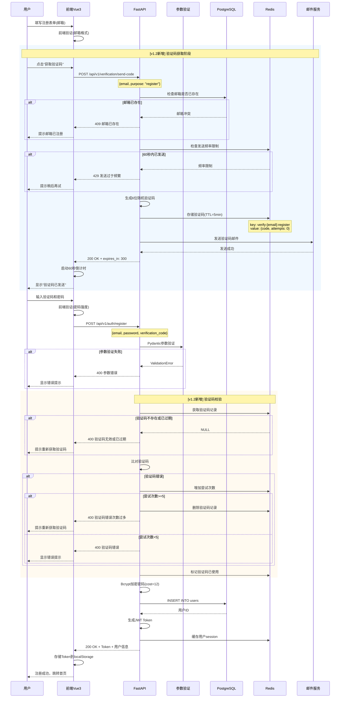

#### 1.1.2 用户登录流程

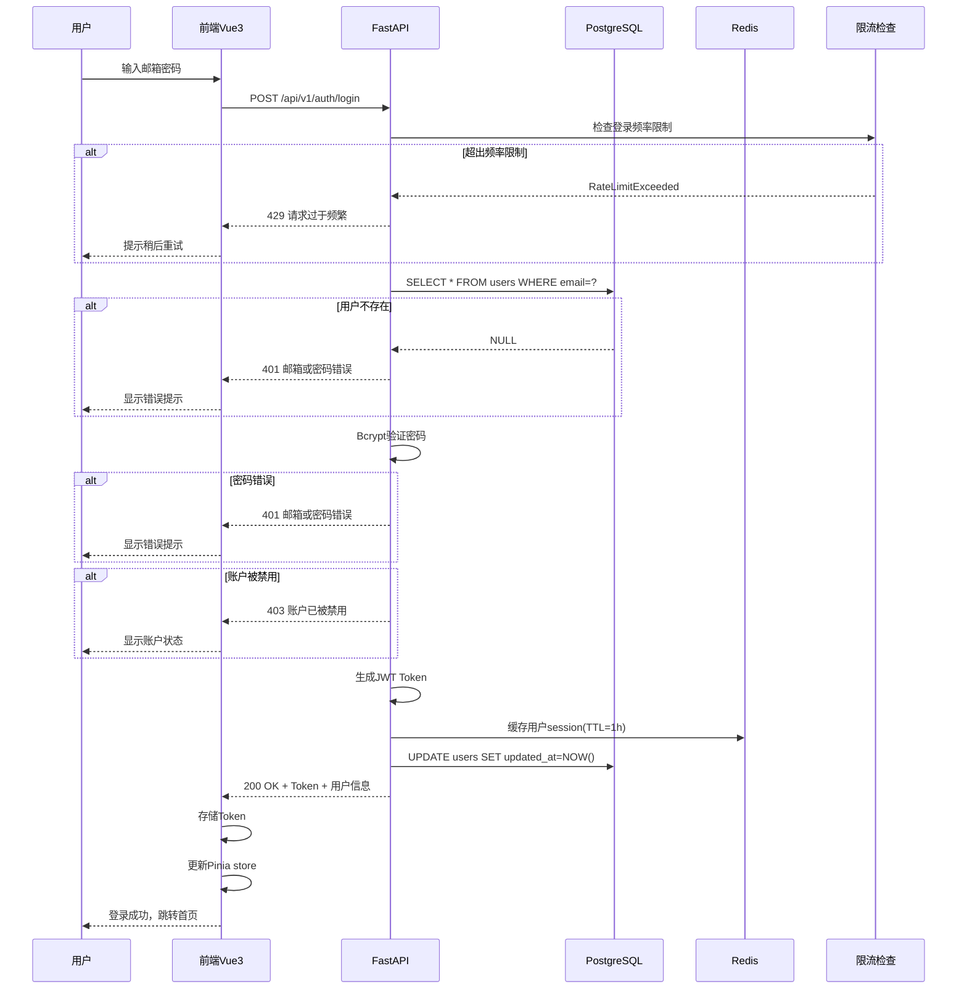

#### 1.1.3 Token刷新流程

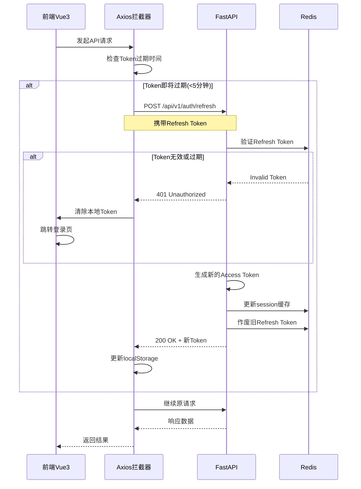

### 1.2 游客模式访问流程

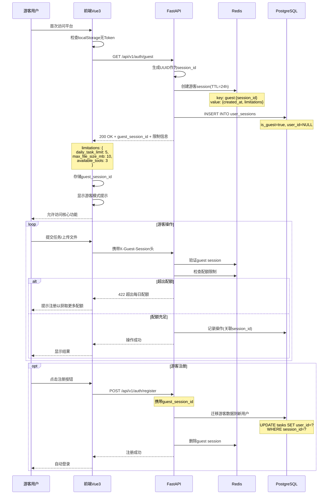

### 1.3 工具注册审核流程

> **[v1.1更新]** 本节新增用户工具创建流程和审核机制，详见 [05-工具系统优化方案.md](./05-工具系统优化方案.md)

#### 1.3.1 平台官方工具注册流程

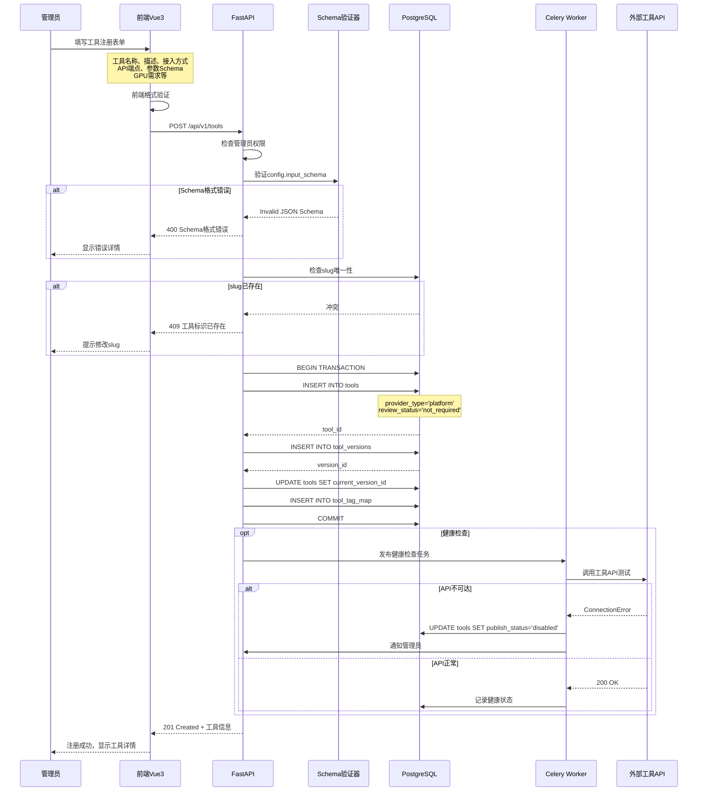

#### 1.3.2 [v1.1新增] 用户工具创建流程

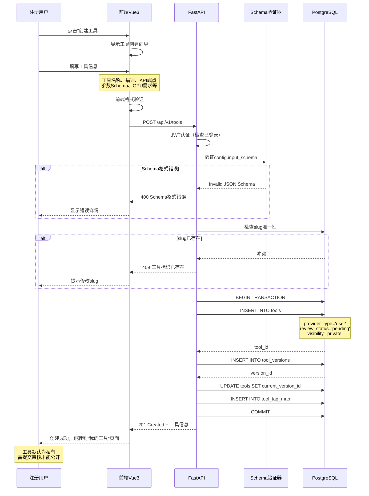

#### 1.3.3 [v1.1新增] 用户工具审核流程

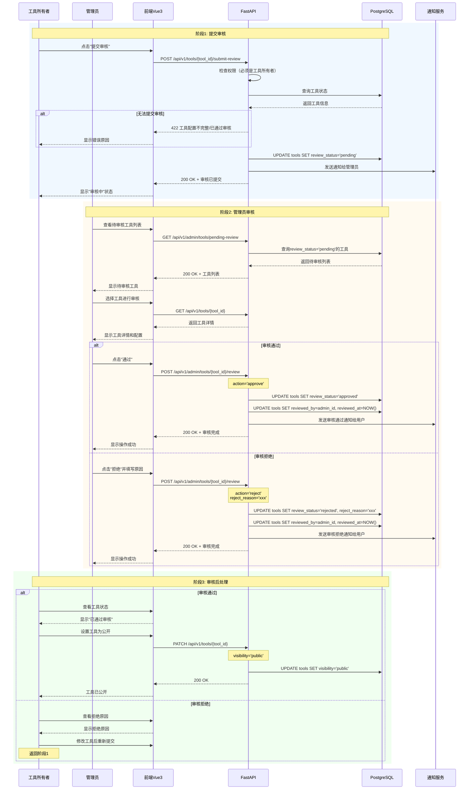

#### 1.3.4 [v1.1新增] 工具审核状态机

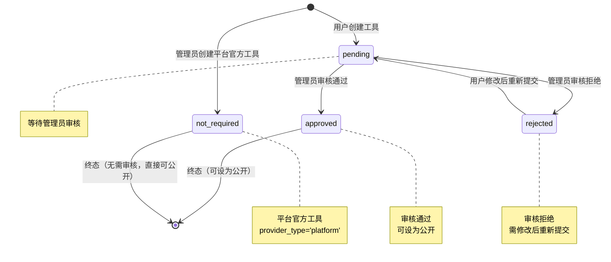

### 1.4 任务提交执行流程

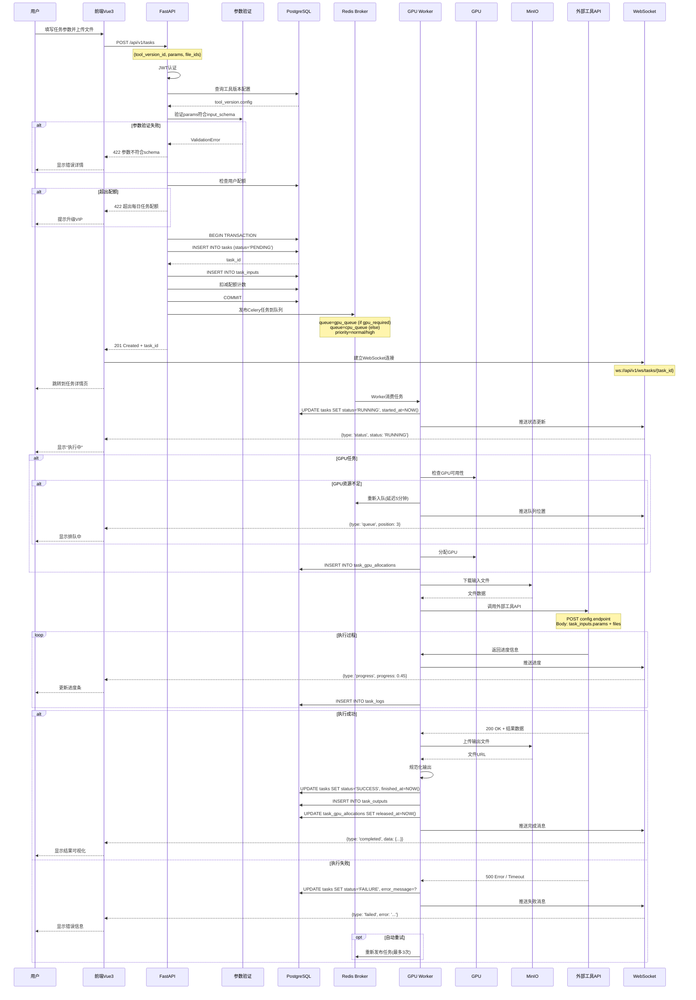

### 1.5 GPU资源分配流程

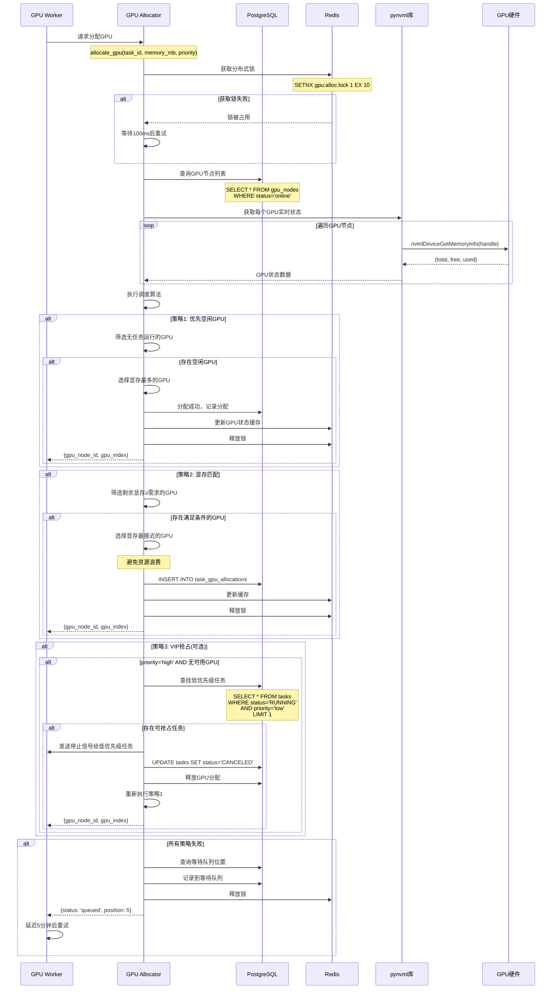

### 1.6 文件生命周期管理流程

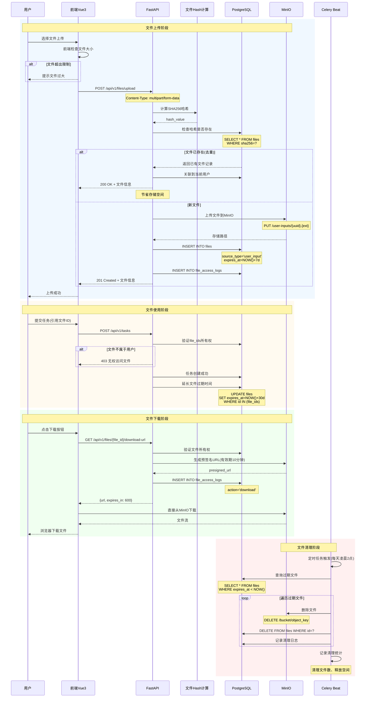

### 1.7 密码重置流程 - [v1.2新增]

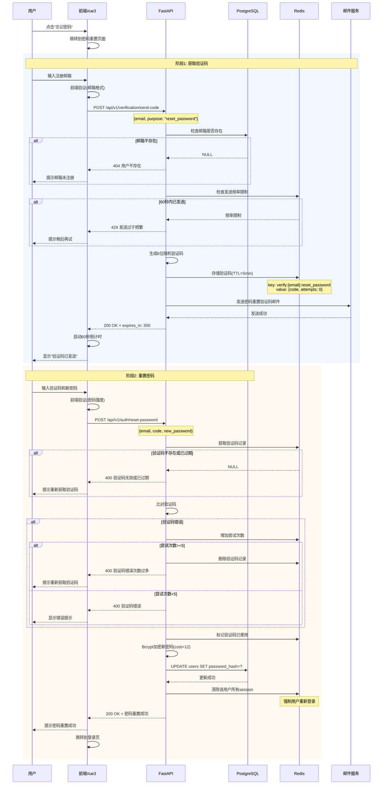

**密码重置业务规则**：

| 规则项 | 说明 |
|--------|------|
| 验证码有效期 | 5分钟 |
| 发送频率限制 | 同一邮箱60秒内不可重复发送 |
| 每日发送上限 | 10次/邮箱 |
| 最大验证尝试 | 5次，超过后验证码失效 |
| 密码要求 | 6-100位字符 |
| 重置后处理 | 清除所有登录session，强制重新登录 |

---

## 2. 认证授权模块详细设计

### 2.1 JWT Token管理

#### 2.1.1 Token生成器类设计

```python
# backend/app/auth/jwt_handler.py

from datetime import datetime, timedelta
from typing import Optional, Dict, Any
import jwt
from app.config import settings

class JWTHandler:
    """JWT Token生成和验证处理器"""

    def __init__(self):
        self.secret_key = settings.JWT_SECRET_KEY
        self.algorithm = "HS256"
        self.access_token_expire_minutes = 60
        self.refresh_token_expire_days = 7

    def create_access_token(
        self,
        user_id: str,
        email: str,
        role: str,
        extra_claims: Optional[Dict[str, Any]] = None
    ) -> str:
        """生成Access Token"""
        now = datetime.utcnow()
        expire = now + timedelta(minutes=self.access_token_expire_minutes)

        payload = {
            "sub": user_id,      # Subject (用户ID)
            "email": email,
            "role": role,
            "exp": expire,       # Expiration Time
            "iat": now,          # Issued At
            "jti": self._generate_jti(),  # JWT ID (唯一标识)
            "type": "access"
        }

        if extra_claims:
            payload.update(extra_claims)

        token = jwt.encode(payload, self.secret_key, algorithm=self.algorithm)
        return token

    def create_refresh_token(self, user_id: str) -> str:
        """生成Refresh Token"""
        now = datetime.utcnow()
        expire = now + timedelta(days=self.refresh_token_expire_days)

        payload = {
            "sub": user_id,
            "exp": expire,
            "iat": now,
            "jti": self._generate_jti(),
            "type": "refresh"
        }

        token = jwt.encode(payload, self.secret_key, algorithm=self.algorithm)

        # 存储到Redis，用于一次性验证
        redis_client.setex(
            f"refresh_token:{payload['jti']}",
            timedelta(days=self.refresh_token_expire_days),
            user_id
        )

        return token

    def verify_token(self, token: str, token_type: str = "access") -> Dict[str, Any]:
        """验证Token"""
        try:
            payload = jwt.decode(
                token,
                self.secret_key,
                algorithms=[self.algorithm]
            )

            # 检查Token类型
            if payload.get("type") != token_type:
                raise jwt.InvalidTokenError("Invalid token type")

            # 检查Refresh Token是否已使用
            if token_type == "refresh":
                jti = payload.get("jti")
                if not redis_client.exists(f"refresh_token:{jti}"):
                    raise jwt.InvalidTokenError("Refresh token already used")

            return payload

        except jwt.ExpiredSignatureError:
            raise HTTPException(status_code=401, detail="Token expired")
        except jwt.InvalidTokenError as e:
            raise HTTPException(status_code=401, detail=f"Invalid token: {str(e)}")

    def revoke_refresh_token(self, jti: str) -> None:
        """作废Refresh Token"""
        redis_client.delete(f"refresh_token:{jti}")

    @staticmethod
    def _generate_jti() -> str:
        """生成JWT ID"""
        import uuid
        return str(uuid.uuid4())


# 全局实例
jwt_handler = JWTHandler()
```

#### 2.1.2 认证依赖函数

```python
# backend/app/auth/dependencies.py

from fastapi import Depends, HTTPException, Header
from fastapi.security import HTTPBearer, HTTPAuthorizationCredentials
from typing import Optional
from app.auth.jwt_handler import jwt_handler
from app.database.session import get_db
from sqlalchemy.ext.asyncio import AsyncSession
from app.models.users import User

security = HTTPBearer()

async def get_current_user(
    credentials: HTTPAuthorizationCredentials = Depends(security),
    db: AsyncSession = Depends(get_db)
) -> User:
    """获取当前认证用户"""
    token = credentials.credentials

    # 验证Token
    payload = jwt_handler.verify_token(token, token_type="access")
    user_id = payload.get("sub")

    # 从数据库查询用户
    user = await db.get(User, user_id)
    if not user:
        raise HTTPException(status_code=401, detail="User not found")

    # 检查用户状态
    if user.status != "active":
        raise HTTPException(status_code=403, detail="User account is disabled")

    return user


async def get_current_active_user(
    current_user: User = Depends(get_current_user)
) -> User:
    """获取当前活跃用户"""
    if current_user.status != "active":
        raise HTTPException(status_code=403, detail="Inactive user")
    return current_user


async def get_admin_user(
    current_user: User = Depends(get_current_user)
) -> User:
    """获取管理员用户"""
    if current_user.role != "admin":
        raise HTTPException(status_code=403, detail="Admin access required")
    return current_user


async def get_current_user_or_guest(
    authorization: Optional[str] = Header(None),
    x_guest_session: Optional[str] = Header(None),
    db: AsyncSession = Depends(get_db)
) -> Dict[str, Any]:
    """获取当前用户或游客"""
    if authorization:
        # Bearer Token认证
        token = authorization.replace("Bearer ", "")
        payload = jwt_handler.verify_token(token)
        user = await db.get(User, payload["sub"])

        return {
            "type": "user",
            "user_id": user.id,
            "role": user.role,
            "limitations": get_user_limitations(user.role)
        }

    elif x_guest_session:
        # 游客Session认证
        session_data = redis_client.get(f"guest:{x_guest_session}")
        if not session_data:
            raise HTTPException(status_code=401, detail="Invalid guest session")

        return {
            "type": "guest",
            "session_id": x_guest_session,
            "role": "guest",
            "limitations": get_user_limitations("guest")
        }

    else:
        raise HTTPException(status_code=401, detail="Authentication required")
```

### 2.2 游客Session管理

#### 2.2.1 游客管理器类设计

```python
# backend/app/auth/guest_manager.py

from typing import Dict, Any
import uuid
import json
from datetime import timedelta
from app.database.session import get_db
from app.models.users import UserSession

class GuestManager:
    """游客Session管理器"""

    GUEST_SESSION_TTL = timedelta(hours=24)
    GUEST_LIMITATIONS = {
        "daily_task_limit": 5,
        "max_file_size_mb": 10,
        "available_tools": 3,  # 仅允许访问3个核心工具
        "max_concurrent_tasks": 1
    }

    def create_guest_session(self) -> Dict[str, Any]:
        """创建游客Session"""
        session_id = str(uuid.uuid4())

        session_data = {
            "session_id": session_id,
            "created_at": datetime.utcnow().isoformat(),
            "limitations": self.GUEST_LIMITATIONS,
            "usage": {
                "tasks_today": 0,
                "files_uploaded": 0
            }
        }

        # 存储到Redis
        redis_client.setex(
            f"guest:{session_id}",
            self.GUEST_SESSION_TTL,
            json.dumps(session_data)
        )

        # 存储到数据库（用于数据迁移）
        async with get_db() as db:
            db_session = UserSession(
                id=session_id,
                user_id=None,
                session_token=session_id,
                is_guest=True,
                metadata=session_data,
                expires_at=datetime.utcnow() + self.GUEST_SESSION_TTL
            )
            db.add(db_session)
            await db.commit()

        return {
            "guest_session_id": session_id,
            "expires_in": int(self.GUEST_SESSION_TTL.total_seconds()),
            "limitations": self.GUEST_LIMITATIONS
        }

    def validate_guest_session(self, session_id: str) -> Dict[str, Any]:
        """验证游客Session"""
        data = redis_client.get(f"guest:{session_id}")
        if not data:
            raise HTTPException(status_code=401, detail="Invalid or expired guest session")

        return json.loads(data)

    def check_guest_quota(self, session_id: str, quota_type: str) -> bool:
        """检查游客配额"""
        session_data = self.validate_guest_session(session_id)

        if quota_type == "task":
            used = session_data["usage"]["tasks_today"]
            limit = session_data["limitations"]["daily_task_limit"]
            return used < limit

        elif quota_type == "file_size":
            # 在文件上传时检查
            return True

        return False

    def increment_guest_usage(self, session_id: str, usage_type: str) -> None:
        """增加游客使用计数"""
        session_data = self.validate_guest_session(session_id)

        if usage_type == "task":
            session_data["usage"]["tasks_today"] += 1
        elif usage_type == "file":
            session_data["usage"]["files_uploaded"] += 1

        # 更新Redis
        redis_client.setex(
            f"guest:{session_id}",
            self.GUEST_SESSION_TTL,
            json.dumps(session_data)
        )

    async def migrate_guest_data(self, session_id: str, user_id: str) -> None:
        """迁移游客数据到注册用户"""
        async with get_db() as db:
            # 迁移任务
            await db.execute(
                "UPDATE tasks SET user_id = :user_id WHERE user_id IS NULL "
                "AND id IN (SELECT task_id FROM user_sessions WHERE id = :session_id)",
                {"user_id": user_id, "session_id": session_id}
            )

            # 迁移文件
            await db.execute(
                "UPDATE files SET owner_id = :user_id WHERE owner_id IS NULL "
                "AND id IN (SELECT file_id FROM user_sessions WHERE id = :session_id)",
                {"user_id": user_id, "session_id": session_id}
            )

            # 删除游客Session
            await db.execute(
                "DELETE FROM user_sessions WHERE id = :session_id",
                {"session_id": session_id}
            )

            await db.commit()

        # 删除Redis缓存
        redis_client.delete(f"guest:{session_id}")


# 全局实例
guest_manager = GuestManager()
```

### 2.3 权限检查中间件

```python
# backend/app/middleware/auth_middleware.py

from fastapi import Request, HTTPException
from starlette.middleware.base import BaseHTTPMiddleware
from app.auth.dependencies import get_current_user_or_guest

class AuthMiddleware(BaseHTTPMiddleware):
    """认证授权中间件"""

    # 无需认证的路径
    PUBLIC_PATHS = [
        "/api/v1/auth/register",
        "/api/v1/auth/login",
        "/api/v1/auth/guest",
        "/api/v1/system/health",
        "/api/v1/system/config",
        "/api/v1/tags",
        "/docs",
        "/redoc",
        "/openapi.json"
    ]

    async def dispatch(self, request: Request, call_next):
        # 检查是否为公开路径
        if any(request.url.path.startswith(path) for path in self.PUBLIC_PATHS):
            return await call_next(request)

        # 验证认证信息
        try:
            auth_info = await get_current_user_or_guest(
                authorization=request.headers.get("Authorization"),
                x_guest_session=request.headers.get("X-Guest-Session")
            )

            # 将认证信息添加到请求状态
            request.state.auth = auth_info

        except HTTPException as e:
            return JSONResponse(
                status_code=e.status_code,
                content={"code": e.status_code * 100, "message": e.detail}
            )

        return await call_next(request)
```

### 2.4 验证码服务 - [v1.2新增]

#### 2.4.1 验证码服务类设计

```python
# backend/app/services/verification_service.py

from typing import Optional, Dict, Any
from datetime import datetime, timedelta
import random
import string
from sqlalchemy.ext.asyncio import AsyncSession
from sqlalchemy import select, and_
from app.models.verification import VerificationCode
from app.models.users import User
from fastapi import HTTPException

class VerificationService:
    """验证码服务

    [v1.2新增] 处理邮箱验证码的发送和验证
    """

    # 验证码配置
    CODE_LENGTH = 6                    # 验证码长度
    CODE_EXPIRE_MINUTES = 5            # 验证码有效期（分钟）
    SEND_INTERVAL_SECONDS = 60         # 发送间隔（秒）
    MAX_ATTEMPTS = 5                   # 最大验证尝试次数
    DAILY_SEND_LIMIT = 10              # 每日发送上限

    def __init__(self, db: AsyncSession):
        self.db = db

    async def send_code(
        self,
        email: str,
        purpose: str  # 'register' | 'reset_password'
    ) -> Dict[str, Any]:
        """发送验证码

        Args:
            email: 邮箱地址
            purpose: 用途（register/reset_password）

        Returns:
            {expires_in: 300}

        Raises:
            HTTPException: 409 邮箱已存在(register), 404 用户不存在(reset_password)
            HTTPException: 429 发送过于频繁
        """
        # 1. 根据用途检查邮箱
        if purpose == 'register':
            # 注册时检查邮箱是否已存在
            existing_user = await self.db.execute(
                select(User).where(User.email == email)
            )
            if existing_user.scalar_one_or_none():
                raise HTTPException(status_code=409, detail="邮箱已存在")

        elif purpose == 'reset_password':
            # 重置密码时检查邮箱是否存在
            existing_user = await self.db.execute(
                select(User).where(User.email == email)
            )
            if not existing_user.scalar_one_or_none():
                raise HTTPException(status_code=404, detail="用户不存在")

        # 2. 检查发送频率限制
        recent_code = await self.db.execute(
            select(VerificationCode).where(
                and_(
                    VerificationCode.email == email,
                    VerificationCode.purpose == purpose,
                    VerificationCode.created_at > datetime.utcnow() - timedelta(seconds=self.SEND_INTERVAL_SECONDS)
                )
            )
        )
        if recent_code.scalar_one_or_none():
            raise HTTPException(status_code=429, detail="发送过于频繁，请稍后再试")

        # 3. 检查每日发送上限
        today_start = datetime.utcnow().replace(hour=0, minute=0, second=0, microsecond=0)
        daily_count = await self.db.scalar(
            select(func.count(VerificationCode.id)).where(
                and_(
                    VerificationCode.email == email,
                    VerificationCode.created_at >= today_start
                )
            )
        )
        if daily_count >= self.DAILY_SEND_LIMIT:
            raise HTTPException(status_code=429, detail="今日发送次数已达上限")

        # 4. 生成验证码
        code = self._generate_code()
        expires_at = datetime.utcnow() + timedelta(minutes=self.CODE_EXPIRE_MINUTES)

        # 5. 存储验证码
        verification = VerificationCode(
            email=email,
            code=code,
            purpose=purpose,
            expires_at=expires_at,
            is_used=False,
            attempts=0
        )
        self.db.add(verification)
        await self.db.commit()

        # 6. 发送邮件（异步任务）
        await self._send_email(email, code, purpose)

        return {"expires_in": self.CODE_EXPIRE_MINUTES * 60}

    async def verify_code(
        self,
        email: str,
        code: str,
        purpose: str
    ) -> bool:
        """验证验证码

        Args:
            email: 邮箱地址
            code: 验证码
            purpose: 用途

        Returns:
            True 验证成功

        Raises:
            HTTPException: 400 验证码无效/错误/过期
        """
        # 1. 查询验证码记录
        result = await self.db.execute(
            select(VerificationCode).where(
                and_(
                    VerificationCode.email == email,
                    VerificationCode.purpose == purpose,
                    VerificationCode.is_used == False,
                    VerificationCode.expires_at > datetime.utcnow()
                )
            ).order_by(VerificationCode.created_at.desc())
        )
        verification = result.scalar_one_or_none()

        if not verification:
            raise HTTPException(status_code=400, detail="验证码无效或已过期")

        # 2. 检查尝试次数
        if verification.attempts >= self.MAX_ATTEMPTS:
            # 标记为已使用（失效）
            verification.is_used = True
            await self.db.commit()
            raise HTTPException(status_code=400, detail="验证码错误次数过多，请重新获取")

        # 3. 验证码比对
        if verification.code != code:
            verification.attempts += 1
            await self.db.commit()
            raise HTTPException(status_code=400, detail="验证码错误")

        # 4. 验证成功，标记为已使用
        verification.is_used = True
        await self.db.commit()

        return True

    def _generate_code(self) -> str:
        """生成随机验证码"""
        return ''.join(random.choices(string.digits, k=self.CODE_LENGTH))

    async def _send_email(self, email: str, code: str, purpose: str) -> None:
        """发送验证码邮件

        TODO: 实际项目中应使用异步任务队列（Celery）发送
        """
        subject_map = {
            'register': '注册验证码',
            'reset_password': '密码重置验证码'
        }

        subject = subject_map.get(purpose, '验证码')
        body = f"您的验证码是：{code}，有效期{self.CODE_EXPIRE_MINUTES}分钟。"

        # 调用邮件服务
        # await email_service.send(email, subject, body)
        logger.info(f"Verification code sent to {email}: {code}")


# 全局实例工厂
def get_verification_service(db: AsyncSession) -> VerificationService:
    return VerificationService(db)
```

#### 2.4.2 验证码数据模型

```python
# backend/app/models/verification.py

from sqlalchemy import Column, String, Boolean, Integer, DateTime
from sqlalchemy.dialects.postgresql import UUID
from app.database.base import Base
import uuid

class VerificationCode(Base):
    """验证码模型

    [v1.2新增]
    """
    __tablename__ = "verification_codes"

    id = Column(UUID(as_uuid=True), primary_key=True, default=uuid.uuid4)
    email = Column(String(255), nullable=False, index=True)
    code = Column(String(10), nullable=False)
    purpose = Column(String(20), nullable=False)  # register, reset_password
    is_used = Column(Boolean, default=False, nullable=False)
    attempts = Column(Integer, default=0, nullable=False)
    expires_at = Column(DateTime, nullable=False)
    created_at = Column(DateTime, default=datetime.utcnow, nullable=False)

    __table_args__ = (
        Index('idx_verification_email_purpose', 'email', 'purpose', 'is_used'),
        Index('idx_verification_expires_at', 'expires_at'),
    )
```

#### 2.4.3 验证码清理任务

```python
# backend/app/tasks/cleanup_verification.py

from celery import shared_task
from datetime import datetime, timedelta
from app.database.session import get_db
from app.models.verification import VerificationCode

@shared_task
def cleanup_expired_verification_codes():
    """清理过期验证码（每小时执行）

    [v1.2新增]
    """
    async with get_db() as db:
        # 删除过期超过1小时的验证码
        cutoff_time = datetime.utcnow() - timedelta(hours=1)

        result = await db.execute(
            delete(VerificationCode).where(
                VerificationCode.expires_at < cutoff_time
            )
        )

        deleted_count = result.rowcount
        await db.commit()

        logger.info(f"Cleaned up {deleted_count} expired verification codes")
        return deleted_count
```

---

## 3. 工具管理模块详细设计

> **[v1.1更新]** 本章新增用户工具创建和审核服务相关设计，详见 3.4 [v1.1新增] 工具审核服务

### 3.1 工具注册与配置

#### 3.1.1 工具服务类设计

> **[v1.1更新]** create_tool 方法新增 provider_type 和 review_status 字段处理

```python
# backend/app/tools/service.py

from typing import List, Dict, Any, Optional
from sqlalchemy.ext.asyncio import AsyncSession
from app.models.tools import Tool, ToolVersion, Tag
from app.schemas.tools import ToolCreate, ToolVersionCreate
from jsonschema import validate, ValidationError as JSONSchemaValidationError

class ToolService:
    """工具管理服务"""

    def __init__(self, db: AsyncSession):
        self.db = db

    async def create_tool(
        self,
        tool_data: ToolCreate,
        owner_id: str,
        is_admin: bool = False  # [v1.1新增] 区分管理员和普通用户
    ) -> Tool:
        """创建工具

        [v1.1更新]
        - 普通用户创建的工具默认 provider_type='user', review_status='pending'
        - 管理员创建的工具默认 provider_type='platform', review_status='not_required'
        """
        # 检查slug唯一性
        existing = await self.db.execute(
            select(Tool).where(Tool.slug == tool_data.slug)
        )
        if existing.scalar_one_or_none():
            raise HTTPException(status_code=409, detail="Tool slug already exists")

        # [v1.1新增] 确定 provider_type 和 review_status
        if is_admin:
            # 管理员可以指定 provider_type，默认为 platform
            provider_type = getattr(tool_data, 'provider_type', 'platform') or 'platform'
            review_status = 'not_required' if provider_type == 'platform' else 'pending'
        else:
            # 普通用户只能创建用户工具
            provider_type = 'user'
            review_status = 'pending'

        # 创建工具
        tool = Tool(
            owner_id=owner_id,
            name=tool_data.name,
            slug=tool_data.slug,
            description=tool_data.description,
            visibility=tool_data.visibility or 'private',  # [v1.1] 用户工具默认私有
            publish_status="disabled",  # 默认禁用
            provider_type=provider_type,      # [v1.1新增]
            review_status=review_status       # [v1.1新增]
        )

        self.db.add(tool)
        await self.db.flush()

        # 关联标签
        if tool_data.tags:
            await self._associate_tags(tool.id, tool_data.tags)

        await self.db.commit()
        await self.db.refresh(tool)

        return tool

    async def create_tool_version(
        self,
        tool_id: str,
        version_data: ToolVersionCreate,
        created_by: str
    ) -> ToolVersion:
        """创建工具版本"""
        # 验证工具存在
        tool = await self.db.get(Tool, tool_id)
        if not tool:
            raise HTTPException(status_code=404, detail="Tool not found")

        # 验证版本号唯一性
        existing = await self.db.execute(
            select(ToolVersion).where(
                ToolVersion.tool_id == tool_id,
                ToolVersion.version == version_data.version
            )
        )
        if existing.scalar_one_or_none():
            raise HTTPException(status_code=409, detail="Version already exists")

        # 验证配置Schema
        try:
            self._validate_tool_config(version_data.config)
        except JSONSchemaValidationError as e:
            raise HTTPException(status_code=400, detail=f"Invalid config: {str(e)}")

        # 创建版本
        version = ToolVersion(
            tool_id=tool_id,
            version=version_data.version,
            config=version_data.config,
            notes=version_data.notes,
            created_by=created_by
        )

        self.db.add(version)

        # 如果是第一个版本，设置为当前版本
        if not tool.current_version_id:
            await self.db.flush()
            tool.current_version_id = version.id

        await self.db.commit()
        await self.db.refresh(version)

        return version

    def _validate_tool_config(self, config: Dict[str, Any]) -> None:
        """验证工具配置"""
        # 必需字段
        required_fields = ["type", "input_schema", "output_schema"]
        for field in required_fields:
            if field not in config:
                raise ValueError(f"Missing required field: {field}")

        # 验证type字段
        valid_types = ["remote_api", "docker_image", "python_script"]
        if config["type"] not in valid_types:
            raise ValueError(f"Invalid type: {config['type']}")

        # 验证input_schema是否为有效的JSON Schema
        try:
            from jsonschema import Draft7Validator
            Draft7Validator.check_schema(config["input_schema"])
        except Exception as e:
            raise ValueError(f"Invalid input_schema: {str(e)}")

        # 验证特定类型的额外字段
        if config["type"] == "remote_api":
            if "endpoint" not in config:
                raise ValueError("remote_api type requires 'endpoint' field")
            if "method" not in config:
                raise ValueError("remote_api type requires 'method' field")

        elif config["type"] == "docker_image":
            if "image" not in config:
                raise ValueError("docker_image type requires 'image' field")

    async def _associate_tags(self, tool_id: str, tag_names: List[str]) -> None:
        """关联标签"""
        for tag_name in tag_names:
            # 查找或创建标签
            result = await self.db.execute(
                select(Tag).where(Tag.name == tag_name)
            )
            tag = result.scalar_one_or_none()

            if not tag:
                tag = Tag(name=tag_name)
                self.db.add(tag)
                await self.db.flush()

            # 创建关联
            await self.db.execute(
                "INSERT INTO tool_tag_map (tool_id, tag_id) VALUES (:tool_id, :tag_id) "
                "ON CONFLICT DO NOTHING",
                {"tool_id": tool_id, "tag_id": tag.id}
            )
```

### 3.2 版本管理

#### 3.2.1 版本管理策略

```python
# backend/app/tools/version_manager.py

class ToolVersionManager:
    """工具版本管理器"""

    def __init__(self, db: AsyncSession):
        self.db = db

    async def switch_current_version(
        self,
        tool_id: str,
        version_id: str
    ) -> Tool:
        """切换当前版本"""
        # 验证工具和版本存在
        tool = await self.db.get(Tool, tool_id)
        if not tool:
            raise HTTPException(status_code=404, detail="Tool not found")

        version = await self.db.get(ToolVersion, version_id)
        if not version or version.tool_id != tool_id:
            raise HTTPException(status_code=404, detail="Version not found")

        # 更新当前版本
        tool.current_version_id = version_id
        await self.db.commit()

        # 清除缓存
        redis_client.delete(f"tool:detail:{tool_id}")

        return tool

    async def deprecate_version(self, version_id: str) -> None:
        """废弃版本"""
        version = await self.db.get(ToolVersion, version_id)
        if not version:
            raise HTTPException(status_code=404, detail="Version not found")

        # 检查是否为当前版本
        tool = await self.db.get(Tool, version.tool_id)
        if tool.current_version_id == version_id:
            raise HTTPException(
                status_code=400,
                detail="Cannot deprecate current version"
            )

        # 标记为废弃（软删除）
        version.deprecated = True
        version.deprecated_at = datetime.utcnow()
        await self.db.commit()

    async def rollback_version(self, tool_id: str) -> Tool:
        """回滚到上一个版本"""
        # 查询版本历史
        result = await self.db.execute(
            select(ToolVersion)
            .where(ToolVersion.tool_id == tool_id)
            .order_by(ToolVersion.created_at.desc())
            .limit(2)
        )
        versions = result.scalars().all()

        if len(versions) < 2:
            raise HTTPException(
                status_code=400,
                detail="No previous version available"
            )

        # 切换到上一个版本
        return await self.switch_current_version(tool_id, versions[1].id)
```

### 3.3 参数Schema验证

```python
# backend/app/tools/schema_validator.py

from jsonschema import validate, ValidationError as JSONSchemaValidationError
from typing import Dict, Any

class ToolSchemaValidator:
    """工具参数Schema验证器"""

    @staticmethod
    def validate_input_params(
        params: Dict[str, Any],
        schema: Dict[str, Any]
    ) -> None:
        """验证输入参数"""
        try:
            validate(instance=params, schema=schema)
        except JSONSchemaValidationError as e:
            raise HTTPException(
                status_code=422,
                detail={
                    "field": ".".join(str(p) for p in e.path),
                    "message": e.message,
                    "schema_path": ".".join(str(p) for p in e.schema_path)
                }
            )

    @staticmethod
    def generate_form_config(schema: Dict[str, Any]) -> List[Dict[str, Any]]:
        """根据Schema生成前端表单配置"""
        form_fields = []

        properties = schema.get("properties", {})
        required = schema.get("required", [])

        for field_name, field_schema in properties.items():
            field_config = {
                "name": field_name,
                "label": field_schema.get("title", field_name),
                "description": field_schema.get("description", ""),
                "required": field_name in required,
                "type": field_schema.get("type", "string"),
            }

            # 处理不同类型的字段
            if field_schema["type"] == "string":
                if "enum" in field_schema:
                    field_config["widget"] = "select"
                    field_config["options"] = field_schema["enum"]
                else:
                    field_config["widget"] = "input"
                    field_config["minLength"] = field_schema.get("minLength")
                    field_config["maxLength"] = field_schema.get("maxLength")

            elif field_schema["type"] == "number":
                field_config["widget"] = "number"
                field_config["minimum"] = field_schema.get("minimum")
                field_config["maximum"] = field_schema.get("maximum")

            elif field_schema["type"] == "boolean":
                field_config["widget"] = "checkbox"

            elif field_schema["type"] == "array":
                field_config["widget"] = "array"
                field_config["items"] = field_schema.get("items")

            # 默认值
            if "default" in field_schema:
                field_config["default"] = field_schema["default"]

            form_fields.append(field_config)

        return form_fields
```

### 3.4 [v1.1新增] 工具审核服务

#### 3.4.1 工具审核服务类设计

```python
# backend/app/tools/review_service.py

from typing import Optional, Dict, Any, List
from datetime import datetime
from sqlalchemy.ext.asyncio import AsyncSession
from sqlalchemy import select, and_
from app.models.tools import Tool
from app.models.users import User
from fastapi import HTTPException

class ToolReviewService:
    """工具审核服务

    [v1.1新增] 处理用户工具的审核流程
    """

    def __init__(self, db: AsyncSession):
        self.db = db

    async def submit_for_review(
        self,
        tool_id: str,
        submitter_id: str
    ) -> Tool:
        """提交工具审核

        Args:
            tool_id: 工具ID
            submitter_id: 提交人ID（必须是工具所有者）

        Raises:
            HTTPException: 403 无权限, 422 状态不允许
        """
        tool = await self.db.get(Tool, tool_id)
        if not tool:
            raise HTTPException(status_code=404, detail="Tool not found")

        # 权限检查：必须是工具所有者
        if str(tool.owner_id) != submitter_id:
            raise HTTPException(
                status_code=403,
                detail="Only tool owner can submit for review"
            )

        # 状态检查：只有 user 类型的工具需要审核
        if tool.provider_type != 'user':
            raise HTTPException(
                status_code=422,
                detail="Platform tools do not require review"
            )

        # 状态检查：只有 pending 或 rejected 状态可以提交
        if tool.review_status not in ('pending', 'rejected'):
            raise HTTPException(
                status_code=422,
                detail=f"Cannot submit review: current status is {tool.review_status}"
            )

        # 配置完整性检查：必须有至少一个版本
        if not tool.current_version_id:
            raise HTTPException(
                status_code=422,
                detail="Tool must have at least one version before submitting for review"
            )

        # 更新状态为待审核
        tool.review_status = 'pending'
        await self.db.commit()
        await self.db.refresh(tool)

        # 发送通知给管理员（异步任务）
        # await notification_service.notify_admin_new_review(tool)

        return tool

    async def review_tool(
        self,
        tool_id: str,
        reviewer_id: str,
        action: str,  # 'approve' | 'reject'
        reject_reason: Optional[str] = None
    ) -> Tool:
        """审核工具

        Args:
            tool_id: 工具ID
            reviewer_id: 审核人ID（必须是管理员）
            action: 审核操作 ('approve' | 'reject')
            reject_reason: 拒绝原因（action='reject'时必填）

        Raises:
            HTTPException: 404 工具不存在, 422 状态不允许
        """
        tool = await self.db.get(Tool, tool_id)
        if not tool:
            raise HTTPException(status_code=404, detail="Tool not found")

        # 状态检查：只有待审核状态可以审核
        if tool.review_status != 'pending':
            raise HTTPException(
                status_code=422,
                detail=f"Tool is not pending review: {tool.review_status}"
            )

        # 平台官方工具无需审核
        if tool.provider_type == 'platform':
            raise HTTPException(
                status_code=422,
                detail="Platform tools do not require review"
            )

        # 执行审核操作
        now = datetime.utcnow()

        if action == 'approve':
            tool.review_status = 'approved'
            tool.reviewed_at = now
            tool.reviewed_by = reviewer_id
            tool.reject_reason = None

        elif action == 'reject':
            if not reject_reason:
                raise HTTPException(
                    status_code=400,
                    detail="Reject reason is required"
                )
            tool.review_status = 'rejected'
            tool.reviewed_at = now
            tool.reviewed_by = reviewer_id
            tool.reject_reason = reject_reason

        else:
            raise HTTPException(
                status_code=400,
                detail=f"Invalid action: {action}"
            )

        await self.db.commit()
        await self.db.refresh(tool)

        # 发送通知给工具所有者（异步任务）
        # await notification_service.notify_owner_review_result(tool)

        return tool

    async def get_pending_reviews(
        self,
        page: int = 1,
        page_size: int = 20,
        sort: str = 'oldest'  # 'oldest' | 'newest'
    ) -> Dict[str, Any]:
        """获取待审核工具列表

        Args:
            page: 页码
            page_size: 每页数量
            sort: 排序方式（oldest优先显示最早提交的）

        Returns:
            分页结果
        """
        # 构建查询
        query = select(Tool).where(
            and_(
                Tool.provider_type == 'user',
                Tool.review_status == 'pending'
            )
        )

        # 排序
        if sort == 'oldest':
            query = query.order_by(Tool.created_at.asc())
        else:
            query = query.order_by(Tool.created_at.desc())

        # 统计总数
        count_result = await self.db.execute(
            select(func.count(Tool.id)).where(
                and_(
                    Tool.provider_type == 'user',
                    Tool.review_status == 'pending'
                )
            )
        )
        total = count_result.scalar()

        # 分页查询
        offset = (page - 1) * page_size
        query = query.offset(offset).limit(page_size)
        result = await self.db.execute(query)
        tools = result.scalars().all()

        return {
            "items": tools,
            "meta": {
                "page": page,
                "page_size": page_size,
                "total": total,
                "total_pages": (total + page_size - 1) // page_size
            }
        }

    async def set_platform_tool(
        self,
        tool_id: str,
        is_platform: bool,
        operator_id: str
    ) -> Tool:
        """设置/取消平台官方工具

        Args:
            tool_id: 工具ID
            is_platform: True设为官方，False取消官方
            operator_id: 操作人ID（必须是管理员）
        """
        tool = await self.db.get(Tool, tool_id)
        if not tool:
            raise HTTPException(status_code=404, detail="Tool not found")

        if is_platform:
            # 设为平台官方工具
            tool.provider_type = 'platform'
            tool.review_status = 'not_required'
        else:
            # 取消平台官方，变为用户工具
            tool.provider_type = 'user'
            # 保持已通过状态（如果之前是公开的）
            tool.review_status = 'approved'

        await self.db.commit()
        await self.db.refresh(tool)

        return tool


# 全局实例工厂
def get_review_service(db: AsyncSession) -> ToolReviewService:
    return ToolReviewService(db)
```

#### 3.4.2 我的工具查询服务

```python
# backend/app/tools/my_tools_service.py

from typing import Optional, Dict, Any, List
from sqlalchemy.ext.asyncio import AsyncSession
from sqlalchemy import select, and_, func
from app.models.tools import Tool

class MyToolsService:
    """我的工具查询服务

    [v1.1新增] 用户查看自己创建的工具
    """

    def __init__(self, db: AsyncSession):
        self.db = db

    async def get_my_tools(
        self,
        user_id: str,
        status: Optional[str] = None,  # 'draft' | 'published'
        review_status: Optional[str] = None,  # 'pending' | 'approved' | 'rejected'
        page: int = 1,
        page_size: int = 20
    ) -> Dict[str, Any]:
        """获取用户创建的工具列表

        Args:
            user_id: 用户ID
            status: 发布状态筛选
            review_status: 审核状态筛选
            page: 页码
            page_size: 每页数量
        """
        # 基础查询条件：用户创建的工具
        conditions = [Tool.owner_id == user_id]

        # 状态筛选
        if status == 'draft':
            conditions.append(Tool.publish_status == 'disabled')
        elif status == 'published':
            conditions.append(Tool.publish_status == 'enabled')

        # 审核状态筛选
        if review_status:
            conditions.append(Tool.review_status == review_status)

        # 构建查询
        query = select(Tool).where(and_(*conditions))
        query = query.order_by(Tool.updated_at.desc())

        # 统计总数
        count_query = select(func.count(Tool.id)).where(and_(*conditions))
        count_result = await self.db.execute(count_query)
        total = count_result.scalar()

        # 分页
        offset = (page - 1) * page_size
        query = query.offset(offset).limit(page_size)
        result = await self.db.execute(query)
        tools = result.scalars().all()

        return {
            "items": tools,
            "meta": {
                "page": page,
                "page_size": page_size,
                "total": total,
                "total_pages": (total + page_size - 1) // page_size
            }
        }

    async def get_my_tool_stats(self, user_id: str) -> Dict[str, int]:
        """获取用户工具统计

        Returns:
            {
                "total": 总数,
                "pending": 待审核数,
                "approved": 已通过数,
                "rejected": 已拒绝数
            }
        """
        result = await self.db.execute(
            select(
                Tool.review_status,
                func.count(Tool.id).label('count')
            )
            .where(Tool.owner_id == user_id)
            .group_by(Tool.review_status)
        )

        stats = {"total": 0, "pending": 0, "approved": 0, "rejected": 0, "not_required": 0}
        for row in result:
            stats[row.review_status] = row.count
            stats["total"] += row.count

        return stats
```

---

## 4. 任务管理模块详细设计

### 4.1 任务状态机

```python
# backend/app/tasks/state_machine.py

from enum import Enum
from typing import Dict, Set

class TaskStatus(str, Enum):
    """任务状态枚举"""
    PENDING = "PENDING"
    RUNNING = "RUNNING"
    SUCCESS = "SUCCESS"
    FAILURE = "FAILURE"
    CANCELED = "CANCELED"


class TaskStateMachine:
    """任务状态机"""

    # 状态转换规则
    TRANSITIONS: Dict[TaskStatus, Set[TaskStatus]] = {
        TaskStatus.PENDING: {
            TaskStatus.RUNNING,
            TaskStatus.CANCELED
        },
        TaskStatus.RUNNING: {
            TaskStatus.SUCCESS,
            TaskStatus.FAILURE,
            TaskStatus.CANCELED,
            TaskStatus.PENDING  # 重试时回到PENDING
        },
        TaskStatus.SUCCESS: set(),  # 终态，不可转换
        TaskStatus.FAILURE: {
            TaskStatus.PENDING  # 重试
        },
        TaskStatus.CANCELED: {
            TaskStatus.PENDING  # 重新提交
        }
    }

    @classmethod
    def can_transition(
        cls,
        from_status: TaskStatus,
        to_status: TaskStatus
    ) -> bool:
        """检查状态转换是否合法"""
        return to_status in cls.TRANSITIONS.get(from_status, set())

    @classmethod
    def transition(
        cls,
        task: "Task",
        to_status: TaskStatus,
        **kwargs
    ) -> None:
        """执行状态转换"""
        if not cls.can_transition(task.status, to_status):
            raise ValueError(
                f"Invalid transition: {task.status} -> {to_status}"
            )

        old_status = task.status
        task.status = to_status

        # 状态转换副作用
        if to_status == TaskStatus.RUNNING:
            task.started_at = datetime.utcnow()

        elif to_status in [TaskStatus.SUCCESS, TaskStatus.FAILURE, TaskStatus.CANCELED]:
            task.finished_at = datetime.utcnow()
            if task.started_at:
                task.execution_time_sec = int(
                    (task.finished_at - task.started_at).total_seconds()
                )

        # 记录状态变更日志
        logger.info(
            f"Task {task.id} state transition: {old_status} -> {to_status}",
            extra={"task_id": task.id, "old_status": old_status, "new_status": to_status}
        )
```

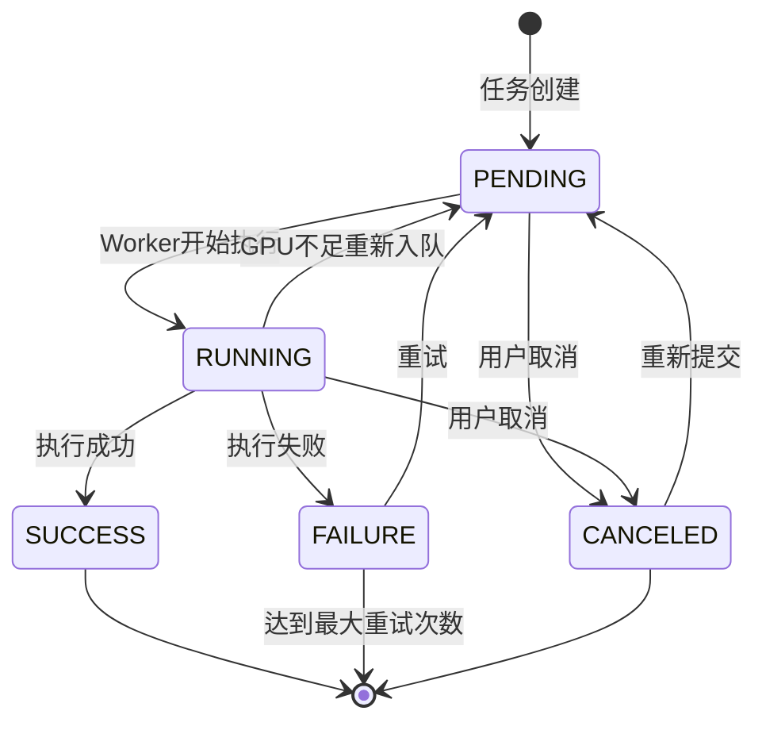

### 4.2 任务执行器

```python
# backend/app/tasks/executor.py

from typing import Dict, Any
import httpx
import subprocess
from app.models.tasks import Task
from app.files.minio_client import minio_client

class TaskExecutor:
    """任务执行器"""

    def __init__(self, task: Task, tool_version: ToolVersion):
        self.task = task
        self.tool_version = tool_version
        self.config = tool_version.config

    async def execute(self) -> Dict[str, Any]:
        """执行任务"""
        executor_type = self.config["type"]

        if executor_type == "remote_api":
            return await self._execute_remote_api()
        elif executor_type == "docker_image":
            return await self._execute_docker()
        elif executor_type == "python_script":
            return await self._execute_python_script()
        else:
            raise ValueError(f"Unsupported executor type: {executor_type}")

    async def _execute_remote_api(self) -> Dict[str, Any]:
        """执行远程API调用"""
        endpoint = self.config["endpoint"]
        method = self.config.get("method", "POST")
        headers = self.config.get("headers", {})
        timeout = self.config.get("timeout_sec", 600)

        # 准备请求数据
        request_data = {
            "task_id": self.task.id,
            "params": self.task.input.params
        }

        # 下载输入文件
        if self.task.input.file_ids:
            files = await self._download_input_files()
            request_data["files"] = files

        # 发送HTTP请求
        async with httpx.AsyncClient(timeout=timeout) as client:
            try:
                if method == "POST":
                    response = await client.post(
                        endpoint,
                        json=request_data,
                        headers=headers
                    )
                elif method == "GET":
                    response = await client.get(
                        endpoint,
                        params=request_data,
                        headers=headers
                    )

                response.raise_for_status()
                result = response.json()

                # 上传输出文件
                if "output_files" in result:
                    uploaded_files = await self._upload_output_files(
                        result["output_files"]
                    )
                    result["output_file_ids"] = uploaded_files

                return result

            except httpx.HTTPStatusError as e:
                raise TaskExecutionError(
                    f"API returned error: {e.response.status_code} - {e.response.text}"
                )
            except httpx.TimeoutException:
                raise TaskExecutionError("API request timeout")
            except Exception as e:
                raise TaskExecutionError(f"API request failed: {str(e)}")

    async def _execute_docker(self) -> Dict[str, Any]:
        """执行Docker容器任务"""
        image = self.config["image"]
        command = self.config.get("command", [])

        # 构建Docker运行命令
        docker_cmd = [
            "docker", "run", "--rm",
            "-v", f"{self._get_work_dir()}:/workspace",
        ]

        # GPU支持
        if self.config.get("gpu_required"):
            docker_cmd.extend(["--gpus", "all"])

        docker_cmd.append(image)
        docker_cmd.extend(command)

        # 执行命令
        try:
            process = subprocess.run(
                docker_cmd,
                capture_output=True,
                text=True,
                timeout=self.config.get("timeout_sec", 600),
                cwd=self._get_work_dir()
            )

            if process.returncode != 0:
                raise TaskExecutionError(
                    f"Docker execution failed: {process.stderr}"
                )

            # 解析输出
            output = self._parse_docker_output(process.stdout)
            return output

        except subprocess.TimeoutExpired:
            raise TaskExecutionError("Docker execution timeout")
        except Exception as e:
            raise TaskExecutionError(f"Docker execution error: {str(e)}")

    async def _download_input_files(self) -> List[str]:
        """下载输入文件到本地"""
        file_paths = []
        work_dir = self._get_work_dir()

        for file_id in self.task.input.file_ids:
            # 从数据库获取文件信息
            file_record = await db.get(File, file_id)

            # 从MinIO下载
            local_path = f"{work_dir}/input/{file_record.filename}"
            await minio_client.download_file(
                file_record.storage_path,
                local_path
            )

            file_paths.append(local_path)

        return file_paths

    async def _upload_output_files(
        self,
        files: List[Dict[str, Any]]
    ) -> List[str]:
        """上传输出文件到MinIO"""
        file_ids = []

        for file_info in files:
            local_path = file_info["path"]
            filename = file_info["name"]

            # 上传到MinIO
            object_key = f"tool-outputs/{self.task.id}/{filename}"
            await minio_client.upload_file(local_path, object_key)

            # 创建文件记录
            file_record = File(
                owner_id=self.task.user_id,
                source_type="tool_output",
                filename=filename,
                storage_path=object_key,
                size_bytes=os.path.getsize(local_path),
                sha256=self._calculate_sha256(local_path)
            )
            db.add(file_record)
            await db.flush()

            file_ids.append(file_record.id)

        await db.commit()
        return file_ids

    def _get_work_dir(self) -> str:
        """获取工作目录"""
        return f"/tmp/tasks/{self.task.id}"
```

### 4.3 任务队列管理

```python
# backend/app/tasks/queue_manager.py

from celery import Task as CeleryTask
from app.celery_app import celery_app

class TaskQueueManager:
    """任务队列管理器"""

    # 队列优先级映射
    QUEUE_PRIORITY = {
        "high_priority": 9,
        "gpu_queue": 5,
        "cpu_queue": 3,
        "default": 1
    }

    @staticmethod
    def determine_queue(tool_config: Dict[str, Any], user_role: str) -> str:
        """确定任务队列"""
        # VIP用户高优先级
        if user_role in ["vip", "admin"]:
            return "high_priority"

        # GPU任务
        if tool_config.get("gpu_required"):
            return "gpu_queue"

        # CPU任务
        return "cpu_queue"

    @staticmethod
    def enqueue_task(
        task_id: str,
        tool_version_id: str,
        queue: str
    ) -> CeleryTask:
        """将任务加入队列"""
        celery_task = celery_app.send_task(
            "app.tasks.celery_tasks.execute_tool_task",
            args=[task_id, tool_version_id],
            queue=queue,
            priority=TaskQueueManager.QUEUE_PRIORITY[queue]
        )

        return celery_task

    @staticmethod
    async def get_queue_status() -> Dict[str, Any]:
        """获取队列状态"""
        inspect = celery_app.control.inspect()

        # 获取活跃任务
        active_tasks = inspect.active()

        # 获取等待任务
        reserved_tasks = inspect.reserved()

        # 统计各队列任务数
        queue_stats = {}
        for worker, tasks in (active_tasks or {}).items():
            for task in tasks:
                queue = task.get("delivery_info", {}).get("routing_key", "default")
                queue_stats[queue] = queue_stats.get(queue, 0) + 1

        return {
            "active_workers": len(active_tasks or {}),
            "active_tasks": sum(len(t) for t in (active_tasks or {}).values()),
            "reserved_tasks": sum(len(t) for t in (reserved_tasks or {}).values()),
            "queue_stats": queue_stats
        }
```

### 4.4 进度推送机制

```python
# backend/app/tasks/websocket_manager.py

from fastapi import WebSocket
from typing import Dict, Set
import json

class WebSocketManager:
    """WebSocket连接管理器"""

    def __init__(self):
        # task_id -> Set[WebSocket]
        self.active_connections: Dict[str, Set[WebSocket]] = {}

    async def connect(self, websocket: WebSocket, task_id: str):
        """建立WebSocket连接"""
        await websocket.accept()

        if task_id not in self.active_connections:
            self.active_connections[task_id] = set()

        self.active_connections[task_id].add(websocket)

        # 发送初始状态
        await self.send_task_status(task_id, websocket)

    def disconnect(self, websocket: WebSocket, task_id: str):
        """断开WebSocket连接"""
        if task_id in self.active_connections:
            self.active_connections[task_id].discard(websocket)

            # 如果没有连接了，清理
            if not self.active_connections[task_id]:
                del self.active_connections[task_id]

    async def broadcast_to_task(self, task_id: str, message: Dict):
        """向任务的所有连接广播消息"""
        if task_id not in self.active_connections:
            return

        disconnected = set()
        for websocket in self.active_connections[task_id]:
            try:
                await websocket.send_json(message)
            except Exception:
                disconnected.add(websocket)

        # 清理断开的连接
        for websocket in disconnected:
            self.disconnect(websocket, task_id)

    async def send_progress(self, task_id: str, progress: float, message: str = ""):
        """发送进度更新"""
        await self.broadcast_to_task(task_id, {
            "type": "progress",
            "data": {
                "task_id": task_id,
                "progress": progress,
                "message": message,
                "timestamp": datetime.utcnow().isoformat()
            }
        })

    async def send_log(self, task_id: str, level: str, message: str):
        """发送日志消息"""
        await self.broadcast_to_task(task_id, {
            "type": "log",
            "data": {
                "task_id": task_id,
                "level": level,
                "message": message,
                "timestamp": datetime.utcnow().isoformat()
            }
        })

    async def send_completion(self, task_id: str, status: str, result: Dict):
        """发送完成消息"""
        await self.broadcast_to_task(task_id, {
            "type": "completed" if status == "SUCCESS" else "failed",
            "data": {
                "task_id": task_id,
                "status": status,
                "result": result,
                "timestamp": datetime.utcnow().isoformat()
            }
        })


# 全局实例
ws_manager = WebSocketManager()
```

---

## 5. GPU资源管理模块详细设计

### 5.1 GPU检测与注册

```python
# backend/app/gpu/detector.py

import pynvml
from typing import List, Dict, Any
from app.models.gpu import GPUNode

class GPUDetector:
    """GPU检测器"""

    def __init__(self):
        try:
            pynvml.nvmlInit()
            self.initialized = True
        except Exception as e:
            logger.warning(f"Failed to initialize NVML: {e}")
            self.initialized = False

    def detect_gpus(self) -> List[Dict[str, Any]]:
        """检测GPU设备"""
        if not self.initialized:
            return []

        device_count = pynvml.nvmlDeviceGetCount()
        gpus = []

        for i in range(device_count):
            try:
                handle = pynvml.nvmlDeviceGetHandleByIndex(i)
                name = pynvml.nvmlDeviceGetName(handle)
                memory_info = pynvml.nvmlDeviceGetMemoryInfo(handle)

                gpu_info = {
                    "gpu_index": i,
                    "gpu_name": name,
                    "total_memory_mb": memory_info.total // 1024 // 1024,
                    "free_memory_mb": memory_info.free // 1024 // 1024,
                    "used_memory_mb": memory_info.used // 1024 // 1024,
                }

                gpus.append(gpu_info)

            except Exception as e:
                logger.error(f"Failed to get info for GPU {i}: {e}")

        return gpus

    def get_gpu_stats(self, gpu_index: int) -> Dict[str, Any]:
        """获取GPU详细统计"""
        if not self.initialized:
            raise RuntimeError("NVML not initialized")

        handle = pynvml.nvmlDeviceGetHandleByIndex(gpu_index)
        memory_info = pynvml.nvmlDeviceGetMemoryInfo(handle)
        utilization = pynvml.nvmlDeviceGetUtilizationRates(handle)
        temperature = pynvml.nvmlDeviceGetTemperature(handle, pynvml.NVML_TEMPERATURE_GPU)
        power = pynvml.nvmlDeviceGetPowerUsage(handle) // 1000  # mW -> W

        return {
            "gpu_index": gpu_index,
            "utilization_percent": utilization.gpu,
            "memory_used_mb": memory_info.used // 1024 // 1024,
            "memory_free_mb": memory_info.free // 1024 // 1024,
            "memory_total_mb": memory_info.total // 1024 // 1024,
            "temperature_celsius": temperature,
            "power_watts": power
        }

    async def register_node(self, hostname: str) -> GPUNode:
        """注册GPU节点"""
        gpus = self.detect_gpus()

        if not gpus:
            raise ValueError("No GPU detected on this node")

        # 获取CUDA版本等元数据
        cuda_version = pynvml.nvmlSystemGetCudaDriverVersion()
        driver_version = pynvml.nvmlSystemGetDriverVersion()

        node = GPUNode(
            hostname=hostname,
            gpu_name=gpus[0]["gpu_name"],
            gpu_count=len(gpus),
            total_memory_mb=gpus[0]["total_memory_mb"],
            status="online",
            metadata={
                "cuda_version": str(cuda_version),
                "driver_version": driver_version
            }
        )

        db.add(node)
        await db.commit()

        return node

    def __del__(self):
        if self.initialized:
            pynvml.nvmlShutdown()
```

### 5.2 智能调度算法

```python
# backend/app/gpu/allocator.py

from typing import Optional, Dict, Any, List
from app.models.gpu import GPUNode
from app.gpu.detector import GPUDetector

class GPUAllocator:
    """GPU智能调度器"""

    def __init__(self, db: AsyncSession):
        self.db = db
        self.detector = GPUDetector()

    async def allocate(
        self,
        task_id: str,
        memory_required_mb: int,
        priority: str = "normal"
    ) -> Optional[Dict[str, Any]]:
        """分配GPU资源"""
        # 获取分布式锁
        lock_key = "gpu:alloc:lock"
        lock_acquired = redis_client.set(lock_key, "1", nx=True, ex=10)

        if not lock_acquired:
            # 等待后重试
            await asyncio.sleep(0.1)
            return await self.allocate(task_id, memory_required_mb, priority)

        try:
            # 查询在线GPU节点
            result = await self.db.execute(
                select(GPUNode).where(GPUNode.status == "online")
            )
            nodes = result.scalars().all()

            if not nodes:
                return None

            # 策略1: 优先空闲GPU
            allocation = await self._try_allocate_idle_gpu(
                nodes, task_id, memory_required_mb
            )
            if allocation:
                return allocation

            # 策略2: 显存匹配
            allocation = await self._try_allocate_by_memory(
                nodes, task_id, memory_required_mb
            )
            if allocation:
                return allocation

            # 策略3: VIP抢占
            if priority == "high":
                allocation = await self._try_preempt_low_priority(
                    task_id, memory_required_mb
                )
                if allocation:
                    return allocation

            # 所有策略失败，返回None
            return None

        finally:
            # 释放锁
            redis_client.delete(lock_key)

    async def _try_allocate_idle_gpu(
        self,
        nodes: List[GPUNode],
        task_id: str,
        memory_required_mb: int
    ) -> Optional[Dict[str, Any]]:
        """策略1: 优先空闲GPU"""
        for node in nodes:
            for gpu_index in range(node.gpu_count):
                # 检查是否有任务在运行
                result = await self.db.execute(
                    select(TaskGPUAllocation).where(
                        TaskGPUAllocation.gpu_node_id == node.id,
                        TaskGPUAllocation.gpu_index == gpu_index,
                        TaskGPUAllocation.released_at.is_(None)
                    )
                )

                if not result.scalar_one_or_none():
                    # GPU空闲，检查显存
                    gpu_stats = self.detector.get_gpu_stats(gpu_index)

                    if gpu_stats["memory_free_mb"] >= memory_required_mb:
                        # 分配成功
                        return await self._create_allocation(
                            task_id, node.id, gpu_index, memory_required_mb
                        )

        return None

    async def _try_allocate_by_memory(
        self,
        nodes: List[GPUNode],
        task_id: str,
        memory_required_mb: int
    ) -> Optional[Dict[str, Any]]:
        """策略2: 显存匹配"""
        candidates = []

        for node in nodes:
            for gpu_index in range(node.gpu_count):
                gpu_stats = self.detector.get_gpu_stats(gpu_index)
                free_memory = gpu_stats["memory_free_mb"]

                if free_memory >= memory_required_mb:
                    candidates.append({
                        "node_id": node.id,
                        "gpu_index": gpu_index,
                        "free_memory": free_memory,
                        "waste": free_memory - memory_required_mb
                    })

        if not candidates:
            return None

        # 选择显存最接近的GPU（最小浪费）
        best_candidate = min(candidates, key=lambda x: x["waste"])

        return await self._create_allocation(
            task_id,
            best_candidate["node_id"],
            best_candidate["gpu_index"],
            memory_required_mb
        )

    async def _try_preempt_low_priority(
        self,
        task_id: str,
        memory_required_mb: int
    ) -> Optional[Dict[str, Any]]:
        """策略3: 抢占低优先级任务"""
        # 查找低优先级运行中的任务
        result = await self.db.execute(
            select(Task).where(
                Task.status == "RUNNING",
                Task.priority == "low"
            ).limit(1)
        )

        low_priority_task = result.scalar_one_or_none()

        if not low_priority_task:
            return None

        # 获取GPU分配
        result = await self.db.execute(
            select(TaskGPUAllocation).where(
                TaskGPUAllocation.task_id == low_priority_task.id,
                TaskGPUAllocation.released_at.is_(None)
            )
        )
        allocation = result.scalar_one_or_none()

        if not allocation:
            return None

        # 取消低优先级任务
        low_priority_task.status = "CANCELED"
        low_priority_task.error_message = "Preempted by high priority task"
        allocation.released_at = datetime.utcnow()

        await self.db.commit()

        # 分配给高优先级任务
        return await self._create_allocation(
            task_id,
            allocation.gpu_node_id,
            allocation.gpu_index,
            memory_required_mb
        )

    async def _create_allocation(
        self,
        task_id: str,
        gpu_node_id: str,
        gpu_index: int,
        memory_allocated_mb: int
    ) -> Dict[str, Any]:
        """创建GPU分配记录"""
        allocation = TaskGPUAllocation(
            task_id=task_id,
            gpu_node_id=gpu_node_id,
            gpu_index=gpu_index,
            memory_allocated_mb=memory_allocated_mb
        )

        self.db.add(allocation)
        await self.db.commit()

        # 更新Redis缓存
        redis_client.setex(
            f"gpu:alloc:{task_id}",
            3600,
            json.dumps({
                "gpu_node_id": gpu_node_id,
                "gpu_index": gpu_index,
                "memory_mb": memory_allocated_mb
            })
        )

        return {
            "gpu_node_id": gpu_node_id,
            "gpu_index": gpu_index,
            "memory_allocated_mb": memory_allocated_mb
        }

    async def release(self, task_id: str) -> None:
        """释放GPU资源"""
        result = await self.db.execute(
            select(TaskGPUAllocation).where(
                TaskGPUAllocation.task_id == task_id,
                TaskGPUAllocation.released_at.is_(None)
            )
        )

        allocation = result.scalar_one_or_none()

        if allocation:
            allocation.released_at = datetime.utcnow()
            await self.db.commit()

            # 清除缓存
            redis_client.delete(f"gpu:alloc:{task_id}")
```

### 5.3 资源监控

```python
# backend/app/gpu/monitor.py

from celery import Task
from app.celery_app import celery_app
from app.gpu.detector import GPUDetector
from app.models.gpu import GPUUsageStats

@celery_app.task(bind=True)
def collect_gpu_stats(self):
    """定时采集GPU统计数据（每5分钟）"""
    detector = GPUDetector()

    # 查询所有在线节点
    nodes = db.query(GPUNode).filter(GPUNode.status == "online").all()

    for node in nodes:
        try:
            for gpu_index in range(node.gpu_count):
                stats = detector.get_gpu_stats(gpu_index)

                # 保存到数据库
                usage_stat = GPUUsageStats(
                    gpu_node_id=node.id,
                    gpu_index=gpu_index,
                    utilization_percent=stats["utilization_percent"],
                    memory_used_mb=stats["memory_used_mb"],
                    memory_free_mb=stats["memory_free_mb"],
                    temperature_celsius=stats["temperature_celsius"],
                    power_watts=stats["power_watts"]
                )

                db.add(usage_stat)

                # 更新Redis缓存（用于实时查询）
                redis_client.setex(
                    f"gpu:stats:{node.id}:{gpu_index}",
                    60,  # 1分钟过期
                    json.dumps(stats)
                )

            # 更新节点心跳
            node.last_heartbeat_at = datetime.utcnow()

        except Exception as e:
            logger.error(f"Failed to collect stats for node {node.hostname}: {e}")
            node.status = "offline"

    db.commit()


@celery_app.task
def check_gpu_node_health():
    """检查GPU节点健康状态（每1分钟）"""
    threshold = datetime.utcnow() - timedelta(minutes=5)

    # 查找心跳超时的节点
    stale_nodes = db.query(GPUNode).filter(
        GPUNode.status == "online",
        GPUNode.last_heartbeat_at < threshold
    ).all()

    for node in stale_nodes:
        node.status = "offline"
        logger.warning(f"GPU node {node.hostname} marked as offline (heartbeat timeout)")

    db.commit()
```

---

由于文档内容较长，我将分两次完成。这是第一部分，包含了核心业务流程设计和前5个模块的详细设计。让我继续完成剩余部分。

继续完成文档的后半部分...


## 6. 文件管理模块详细设计

### 6.1 文件上传流程

```python
# backend/app/files/service.py

from typing import Optional, BinaryIO
import hashlib
from fastapi import UploadFile
from app.files.minio_client import minio_client
from app.models.files import File

class FileService:
    """文件管理服务"""

    def __init__(self, db: AsyncSession):
        self.db = db

    async def upload_file(
        self,
        file: UploadFile,
        owner_id: Optional[str],
        source_type: str = "user_input",
        expires_in_sec: Optional[int] = None
    ) -> File:
        """上传文件"""
        # 1. 读取文件内容并计算哈希
        content = await file.read()
        sha256 = self._calculate_sha256(content)

        # 2. 检查文件是否已存在(去重)
        existing_file = await self._find_by_hash(sha256)

        if existing_file:
            # 文件已存在,创建引用关联
            logger.info(f"File already exists (SHA256: {sha256}), reusing")

            # 如果需要,关联到当前用户
            if owner_id and owner_id != existing_file.owner_id:
                await self._create_file_reference(existing_file.id, owner_id)

            return existing_file

        # 3. 上传新文件到MinIO
        object_key = f"{source_type}/{uuid.uuid4()}{self._get_extension(file.filename)}"

        await minio_client.upload_file_data(
            content,
            object_key,
            content_type=file.content_type
        )

        # 4. 创建文件记录
        file_record = File(
            owner_id=owner_id,
            source_type=source_type,
            filename=file.filename,
            content_type=file.content_type,
            size_bytes=len(content),
            sha256=sha256,
            storage_path=object_key,
            is_public=False
        )

        # 5. 设置过期时间
        if expires_in_sec:
            file_record.expires_at = datetime.utcnow() + timedelta(seconds=expires_in_sec)
        else:
            # 根据用户角色设置默认过期时间
            retention_days = await self._get_retention_days(owner_id)
            if retention_days:
                file_record.expires_at = datetime.utcnow() + timedelta(days=retention_days)

        self.db.add(file_record)
        await self.db.commit()
        await self.db.refresh(file_record)

        # 6. 记录访问日志
        await self._log_access(file_record.id, owner_id, "upload")

        return file_record

    @staticmethod
    def _calculate_sha256(content: bytes) -> str:
        """计算SHA256哈希"""
        return hashlib.sha256(content).hexdigest()

    async def _find_by_hash(self, sha256: str) -> Optional[File]:
        """根据哈希查找文件"""
        result = await self.db.execute(
            select(File).where(File.sha256 == sha256)
        )
        return result.scalar_one_or_none()

    async def _get_retention_days(self, owner_id: Optional[str]) -> Optional[int]:
        """获取文件保留天数"""
        if not owner_id:
            # 游客文件
            return await system_config.get("file_retention_days_guest", 7)

        # 查询用户角色
        user = await self.db.get(User, owner_id)
        if not user:
            return 7

        if user.role == "vip":
            return await system_config.get("file_retention_days_vip", 90)
        else:
            return await system_config.get("file_retention_days_user", 30)
```

### 6.2 去重算法

```python
# backend/app/files/deduplication.py

class FileDeduplicator:
    """文件去重管理器"""

    def __init__(self, db: AsyncSession):
        self.db = db

    async def deduplicate(
        self,
        sha256: str,
        new_owner_id: str
    ) -> Optional[File]:
        """
        文件去重

        如果文件已存在:
        1. 返回已有文件记录
        2. 创建用户引用关联
        3. 不重复上传到MinIO

        如果文件不存在:
        1. 返回None
        2. 调用方继续上传流程
        """
        # 查找已有文件
        existing = await self._find_by_hash(sha256)

        if not existing:
            return None

        # 创建用户引用
        await self._create_user_reference(existing.id, new_owner_id)

        # 延长文件过期时间
        if existing.expires_at:
            new_expires_at = max(
                existing.expires_at,
                datetime.utcnow() + timedelta(days=30)
            )
            existing.expires_at = new_expires_at
            await self.db.commit()

        return existing

    async def _find_by_hash(self, sha256: str) -> Optional[File]:
        """根据SHA256查找文件"""
        result = await self.db.execute(
            select(File).where(File.sha256 == sha256)
        )
        return result.scalar_one_or_none()

    async def _create_user_reference(self, file_id: str, user_id: str) -> None:
        """创建用户文件引用"""
        # 方案1: 使用关联表(如果需要多对多关系)
        # INSERT INTO user_file_references (user_id, file_id) VALUES (?, ?)

        # 方案2: 记录到访问日志(当前方案)
        await self.db.execute(
            """
            INSERT INTO file_access_logs (file_id, user_id, action)
            VALUES (:file_id, :user_id, 'reference')
            """,
            {"file_id": file_id, "user_id": user_id}
        )
        await self.db.commit()
```

### 6.3 生命周期管理

#### 6.3.1 文件生命周期策略

```python
# backend/app/files/lifecycle_manager.py

from typing import Dict, Any, List
from datetime import datetime, timedelta
from app.models.files import File
from app.files.minio_client import minio_client

class FileLifecycleManager:
    """文件生命周期管理器"""

    def __init__(self, db: AsyncSession):
        self.db = db

    async def extend_expiration(
        self,
        file_id: str,
        days: int
    ) -> File:
        """延长文件过期时间"""
        file = await self.db.get(File, file_id)
        if not file:
            raise HTTPException(status_code=404, detail="File not found")

        # 计算新的过期时间
        if file.expires_at:
            new_expires_at = max(
                file.expires_at,
                datetime.utcnow() + timedelta(days=days)
            )
        else:
            new_expires_at = datetime.utcnow() + timedelta(days=days)

        file.expires_at = new_expires_at
        await self.db.commit()

        logger.info(f"Extended file {file_id} expiration to {new_expires_at}")
        return file

    async def mark_permanent(self, file_id: str) -> File:
        """标记文件为永久保存"""
        file = await self.db.get(File, file_id)
        if not file:
            raise HTTPException(status_code=404, detail="File not found")

        file.expires_at = None
        file.is_permanent = True
        await self.db.commit()

        return file

    async def cleanup_expired_files(self) -> Dict[str, Any]:
        """清理过期文件（定时任务）"""
        now = datetime.utcnow()

        # 查询过期文件
        result = await self.db.execute(
            select(File).where(
                File.expires_at.isnot(None),
                File.expires_at < now,
                File.is_permanent == False
            )
        )
        expired_files = result.scalars().all()

        cleaned_count = 0
        freed_bytes = 0
        errors = []

        for file in expired_files:
            try:
                # 检查是否有任务正在使用
                tasks_using = await self._check_active_tasks(file.id)
                if tasks_using:
                    logger.info(f"File {file.id} is in use, skipping cleanup")
                    continue

                # 从MinIO删除
                await minio_client.delete_file(file.storage_path)

                # 从数据库删除
                freed_bytes += file.size_bytes
                await self.db.delete(file)

                cleaned_count += 1

            except Exception as e:
                logger.error(f"Failed to cleanup file {file.id}: {e}")
                errors.append({
                    "file_id": file.id,
                    "error": str(e)
                })

        await self.db.commit()

        # 记录清理统计
        cleanup_log = {
            "timestamp": now.isoformat(),
            "cleaned_count": cleaned_count,
            "freed_mb": freed_bytes // 1024 // 1024,
            "errors": errors
        }

        # 存储到Redis（用于监控）
        redis_client.lpush(
            "file:cleanup:logs",
            json.dumps(cleanup_log)
        )
        redis_client.ltrim("file:cleanup:logs", 0, 99)  # 保留最近100条

        return cleanup_log

    async def _check_active_tasks(self, file_id: str) -> List[str]:
        """检查是否有任务正在使用该文件"""
        result = await self.db.execute(
            select(Task.id).where(
                Task.status.in_(["PENDING", "RUNNING"]),
                Task.id.in_(
                    select(TaskInput.task_id).where(
                        TaskInput.file_ids.contains([file_id])
                    )
                )
            )
        )
        return [str(task_id) for task_id in result.scalars().all()]

    async def get_file_statistics(self) -> Dict[str, Any]:
        """获取文件统计信息"""
        # 总文件数
        total_files = await self.db.scalar(
            select(func.count(File.id))
        )

        # 总占用空间
        total_size = await self.db.scalar(
            select(func.sum(File.size_bytes))
        ) or 0

        # 即将过期文件(7天内)
        expiring_soon = await self.db.scalar(
            select(func.count(File.id)).where(
                File.expires_at.isnot(None),
                File.expires_at < datetime.utcnow() + timedelta(days=7),
                File.expires_at > datetime.utcnow()
            )
        )

        # 过期未清理文件
        expired = await self.db.scalar(
            select(func.count(File.id)).where(
                File.expires_at.isnot(None),
                File.expires_at < datetime.utcnow()
            )
        )

        # 按来源类型统计
        source_stats = await self.db.execute(
            select(
                File.source_type,
                func.count(File.id).label("count"),
                func.sum(File.size_bytes).label("size")
            ).group_by(File.source_type)
        )

        source_breakdown = [
            {
                "source_type": row.source_type,
                "count": row.count,
                "size_mb": (row.size or 0) // 1024 // 1024
            }
            for row in source_stats
        ]

        return {
            "total_files": total_files,
            "total_size_gb": total_size / 1024 / 1024 / 1024,
            "expiring_soon": expiring_soon,
            "expired": expired,
            "source_breakdown": source_breakdown
        }


# Celery定时任务
@celery_app.task
def schedule_file_cleanup():
    """定时清理过期文件（每天凌晨2点）"""
    async with get_db() as db:
        manager = FileLifecycleManager(db)
        result = await manager.cleanup_expired_files()

        logger.info(
            f"File cleanup completed: {result['cleaned_count']} files cleaned, "
            f"{result['freed_mb']} MB freed"
        )

        return result
```

#### 6.3.2 文件引用计数管理

```python
# backend/app/files/reference_manager.py

class FileReferenceManager:
    """文件引用计数管理器"""

    def __init__(self, db: AsyncSession):
        self.db = db

    async def increment_reference(self, file_id: str, task_id: str) -> None:
        """增加文件引用计数（任务使用文件时）"""
        # 更新引用计数缓存
        redis_client.hincrby(f"file:refs:{file_id}", "count", 1)
        redis_client.hset(
            f"file:refs:{file_id}",
            f"task:{task_id}",
            datetime.utcnow().isoformat()
        )

        # 延长文件过期时间
        file = await self.db.get(File, file_id)
        if file and file.expires_at:
            file.expires_at = max(
                file.expires_at,
                datetime.utcnow() + timedelta(days=30)
            )
            await self.db.commit()

    async def decrement_reference(self, file_id: str, task_id: str) -> None:
        """减少文件引用计数（任务完成时）"""
        redis_client.hincrby(f"file:refs:{file_id}", "count", -1)
        redis_client.hdel(f"file:refs:{file_id}", f"task:{task_id}")

        # 如果引用计数为0，检查是否可以提前清理
        ref_count = int(redis_client.hget(f"file:refs:{file_id}", "count") or 0)
        if ref_count <= 0:
            # 可以考虑提前清理（如果已过期）
            await self._try_early_cleanup(file_id)

    async def get_reference_count(self, file_id: str) -> int:
        """获取文件引用计数"""
        count = redis_client.hget(f"file:refs:{file_id}", "count")
        return int(count) if count else 0

    async def _try_early_cleanup(self, file_id: str) -> bool:
        """尝试提前清理文件"""
        file = await self.db.get(File, file_id)

        if not file or not file.expires_at:
            return False

        # 如果已过期且无引用，立即清理
        if file.expires_at < datetime.utcnow():
            try:
                await minio_client.delete_file(file.storage_path)
                await self.db.delete(file)
                await self.db.commit()

                logger.info(f"Early cleanup for file {file_id}")
                return True
            except Exception as e:
                logger.error(f"Early cleanup failed for file {file_id}: {e}")
                return False

        return False
```

---

## 7. 监控告警模块详细设计

### 7.1 健康检查

#### 7.1.1 健康检查端点

```python
# backend/app/monitoring/health_check.py

from typing import Dict, Any
from fastapi import APIRouter, status
from app.database.session import engine
from sqlalchemy import text

router = APIRouter(prefix="/system", tags=["System"])

@router.get("/health", status_code=status.HTTP_200_OK)
async def health_check() -> Dict[str, Any]:
    """
    健康检查端点

    检查项:
    1. API服务运行状态
    2. 数据库连接
    3. Redis连接
    4. MinIO连接
    5. Celery Worker状态
    """
    health_status = {
        "status": "healthy",
        "timestamp": datetime.utcnow().isoformat(),
        "version": "v1.0.0",
        "checks": {}
    }

    # 1. 检查数据库
    try:
        async with engine.begin() as conn:
            await conn.execute(text("SELECT 1"))
        health_status["checks"]["database"] = {
            "status": "up",
            "latency_ms": await _measure_db_latency()
        }
    except Exception as e:
        health_status["status"] = "degraded"
        health_status["checks"]["database"] = {
            "status": "down",
            "error": str(e)
        }

    # 2. 检查Redis
    try:
        redis_client.ping()
        health_status["checks"]["redis"] = {
            "status": "up",
            "info": redis_client.info("server")["redis_version"]
        }
    except Exception as e:
        health_status["status"] = "degraded"
        health_status["checks"]["redis"] = {
            "status": "down",
            "error": str(e)
        }

    # 3. 检查MinIO
    try:
        buckets = await minio_client.list_buckets()
        health_status["checks"]["minio"] = {
            "status": "up",
            "buckets": len(buckets)
        }
    except Exception as e:
        health_status["status"] = "degraded"
        health_status["checks"]["minio"] = {
            "status": "down",
            "error": str(e)
        }

    # 4. 检查Celery Worker
    try:
        inspect = celery_app.control.inspect()
        active_workers = inspect.active()

        if not active_workers:
            health_status["status"] = "degraded"
            health_status["checks"]["celery"] = {
                "status": "no_workers",
                "message": "No active Celery workers"
            }
        else:
            health_status["checks"]["celery"] = {
                "status": "up",
                "active_workers": len(active_workers),
                "active_tasks": sum(len(tasks) for tasks in active_workers.values())
            }
    except Exception as e:
        health_status["status"] = "degraded"
        health_status["checks"]["celery"] = {
            "status": "down",
            "error": str(e)
        }

    # 5. 检查GPU节点
    try:
        online_gpu_count = await db.scalar(
            select(func.count(GPUNode.id)).where(
                GPUNode.status == "online"
            )
        )
        health_status["checks"]["gpu"] = {
            "status": "up" if online_gpu_count > 0 else "no_gpu",
            "online_nodes": online_gpu_count
        }
    except Exception as e:
        health_status["checks"]["gpu"] = {
            "status": "unknown",
            "error": str(e)
        }

    # 如果有组件down，整体状态为unhealthy
    if any(
        check.get("status") == "down"
        for check in health_status["checks"].values()
    ):
        health_status["status"] = "unhealthy"

    return health_status


@router.get("/readiness")
async def readiness_check() -> Dict[str, Any]:
    """
    就绪检查（用于K8s Readiness Probe）

    只检查必要的依赖是否ready
    """
    try:
        # 检查数据库
        async with engine.begin() as conn:
            await conn.execute(text("SELECT 1"))

        # 检查Redis
        redis_client.ping()

        return {
            "status": "ready",
            "timestamp": datetime.utcnow().isoformat()
        }

    except Exception as e:
        raise HTTPException(
            status_code=status.HTTP_503_SERVICE_UNAVAILABLE,
            detail=f"Service not ready: {str(e)}"
        )


@router.get("/liveness")
async def liveness_check() -> Dict[str, str]:
    """
    存活检查（用于K8s Liveness Probe）

    仅检查进程是否存活
    """
    return {
        "status": "alive",
        "timestamp": datetime.utcnow().isoformat()
    }


async def _measure_db_latency() -> float:
    """测量数据库延迟（毫秒）"""
    start = time.time()
    async with engine.begin() as conn:
        await conn.execute(text("SELECT 1"))
    return (time.time() - start) * 1000
```

#### 7.1.2 定时健康检查任务

```python
# backend/app/monitoring/scheduled_health_check.py

@celery_app.task
def scheduled_health_check():
    """定时健康检查（每5分钟）"""
    health_result = asyncio.run(health_check())

    # 记录到Redis时间序列
    redis_client.zadd(
        "health:history",
        {json.dumps(health_result): time.time()}
    )
    # 只保留最近24小时的数据
    cutoff_time = time.time() - 86400
    redis_client.zremrangebyscore("health:history", "-inf", cutoff_time)

    # 如果状态异常，触发告警
    if health_result["status"] in ["degraded", "unhealthy"]:
        send_alert(
            severity="warning" if health_result["status"] == "degraded" else "critical",
            title="System Health Check Failed",
            message=json.dumps(health_result, indent=2)
        )

    return health_result
```

### 7.2 指标采集

#### 7.2.1 Prometheus指标导出

```python
# backend/app/monitoring/prometheus_metrics.py

from prometheus_client import Counter, Histogram, Gauge, generate_latest
from fastapi import Response

# 定义指标
http_requests_total = Counter(
    "http_requests_total",
    "Total HTTP requests",
    ["method", "endpoint", "status"]
)

http_request_duration_seconds = Histogram(
    "http_request_duration_seconds",
    "HTTP request latency",
    ["method", "endpoint"]
)

task_execution_duration_seconds = Histogram(
    "task_execution_duration_seconds",
    "Task execution duration",
    ["tool_slug", "status"]
)

tasks_total = Counter(
    "tasks_total",
    "Total tasks submitted",
    ["tool_slug", "status"]
)

active_tasks = Gauge(
    "active_tasks",
    "Number of active tasks"
)

gpu_utilization = Gauge(
    "gpu_utilization_percent",
    "GPU utilization percentage",
    ["node_id", "gpu_index"]
)

gpu_memory_used = Gauge(
    "gpu_memory_used_mb",
    "GPU memory used in MB",
    ["node_id", "gpu_index"]
)

file_storage_used_bytes = Gauge(
    "file_storage_used_bytes",
    "Total file storage used in bytes"
)


@router.get("/metrics")
async def metrics():
    """Prometheus指标导出端点"""
    return Response(
        content=generate_latest(),
        media_type="text/plain"
    )


# 中间件：记录HTTP请求指标
@app.middleware("http")
async def prometheus_middleware(request: Request, call_next):
    """Prometheus监控中间件"""
    start_time = time.time()

    response = await call_next(request)

    # 记录请求计数
    http_requests_total.labels(
        method=request.method,
        endpoint=request.url.path,
        status=response.status_code
    ).inc()

    # 记录请求延迟
    duration = time.time() - start_time
    http_request_duration_seconds.labels(
        method=request.method,
        endpoint=request.url.path
    ).observe(duration)

    return response
```

#### 7.2.2 定时指标采集任务

```python
# backend/app/monitoring/metrics_collector.py

@celery_app.task
def collect_system_metrics():
    """采集系统指标（每1分钟）"""

    # 1. 采集任务指标
    active_count = db.scalar(
        select(func.count(Task.id)).where(
            Task.status == "RUNNING"
        )
    )
    active_tasks.set(active_count)

    # 2. 采集GPU指标
    detector = GPUDetector()
    gpu_nodes = db.query(GPUNode).filter(GPUNode.status == "online").all()

    for node in gpu_nodes:
        for gpu_idx in range(node.gpu_count):
            try:
                stats = detector.get_gpu_stats(gpu_idx)

                gpu_utilization.labels(
                    node_id=str(node.id),
                    gpu_index=gpu_idx
                ).set(stats["utilization_percent"])

                gpu_memory_used.labels(
                    node_id=str(node.id),
                    gpu_index=gpu_idx
                ).set(stats["memory_used_mb"])

            except Exception as e:
                logger.error(f"Failed to collect GPU stats: {e}")

    # 3. 采集存储指标
    total_size = db.scalar(
        select(func.sum(File.size_bytes))
    ) or 0
    file_storage_used_bytes.set(total_size)


def record_task_metrics(task: Task, duration_sec: float):
    """记录任务执行指标"""
    tasks_total.labels(
        tool_slug=task.tool.slug,
        status=task.status
    ).inc()

    if task.status in ["SUCCESS", "FAILURE"]:
        task_execution_duration_seconds.labels(
            tool_slug=task.tool.slug,
            status=task.status
        ).observe(duration_sec)
```

### 7.3 告警规则

#### 7.3.1 告警管理器

```python
# backend/app/monitoring/alert_manager.py

from enum import Enum
from typing import Dict, Any, Optional, List
import httpx

class AlertSeverity(str, Enum):
    """告警级别"""
    INFO = "info"
    WARNING = "warning"
    ERROR = "error"
    CRITICAL = "critical"


class AlertManager:
    """告警管理器"""

    def __init__(self):
        self.webhook_url = settings.ALERT_WEBHOOK_URL
        self.enabled = settings.ALERT_ENABLED

    async def send_alert(
        self,
        severity: AlertSeverity,
        title: str,
        message: str,
        metadata: Optional[Dict[str, Any]] = None
    ) -> bool:
        """发送告警"""
        if not self.enabled:
            logger.info(f"Alert disabled: {title}")
            return False

        alert_data = {
            "severity": severity,
            "title": title,
            "message": message,
            "timestamp": datetime.utcnow().isoformat(),
            "metadata": metadata or {}
        }

        # 记录到数据库
        await self._log_alert(alert_data)

        # 发送到外部告警系统
        if self.webhook_url:
            try:
                async with httpx.AsyncClient() as client:
                    response = await client.post(
                        self.webhook_url,
                        json=alert_data,
                        timeout=10
                    )
                    response.raise_for_status()
                    logger.info(f"Alert sent successfully: {title}")
                    return True
            except Exception as e:
                logger.error(f"Failed to send alert: {e}")
                return False

        # 邮件告警（如果配置）
        if settings.ALERT_EMAIL_ENABLED:
            await self._send_email_alert(alert_data)

        return True

    async def _log_alert(self, alert_data: Dict[str, Any]) -> None:
        """记录告警到数据库"""
        alert = SystemAlert(
            severity=alert_data["severity"],
            title=alert_data["title"],
            message=alert_data["message"],
            metadata=alert_data["metadata"]
        )
        db.add(alert)
        await db.commit()

    async def _send_email_alert(self, alert_data: Dict[str, Any]) -> None:
        """发送邮件告警"""
        # TODO: 实现邮件发送逻辑
        pass


# 全局实例
alert_manager = AlertManager()
```

#### 7.3.2 告警规则定义

```python
# backend/app/monitoring/alert_rules.py

class AlertRules:
    """告警规则定义"""

    @staticmethod
    async def check_task_failure_rate():
        """检查任务失败率"""
        # 查询最近1小时的任务统计
        one_hour_ago = datetime.utcnow() - timedelta(hours=1)

        result = await db.execute(
            select(
                Task.status,
                func.count(Task.id).label("count")
            )
            .where(Task.created_at > one_hour_ago)
            .group_by(Task.status)
        )

        stats = {row.status: row.count for row in result}
        total = sum(stats.values())

        if total == 0:
            return

        failure_count = stats.get("FAILURE", 0)
        failure_rate = failure_count / total

        # 失败率超过20%触发告警
        if failure_rate > 0.2:
            await alert_manager.send_alert(
                severity=AlertSeverity.WARNING,
                title="High Task Failure Rate",
                message=f"Task failure rate: {failure_rate:.1%} ({failure_count}/{total})",
                metadata={
                    "failure_rate": failure_rate,
                    "failure_count": failure_count,
                    "total_count": total,
                    "time_window": "1h"
                }
            )

    @staticmethod
    async def check_gpu_temperature():
        """检查GPU温度"""
        detector = GPUDetector()
        gpu_nodes = await db.execute(
            select(GPUNode).where(GPUNode.status == "online")
        )

        for node in gpu_nodes.scalars():
            for gpu_idx in range(node.gpu_count):
                try:
                    stats = detector.get_gpu_stats(gpu_idx)
                    temp = stats["temperature_celsius"]

                    # 温度超过85度触发告警
                    if temp > 85:
                        await alert_manager.send_alert(
                            severity=AlertSeverity.CRITICAL,
                            title="GPU Temperature Too High",
                            message=f"GPU {node.hostname}:{gpu_idx} temperature: {temp}°C",
                            metadata={
                                "node_id": str(node.id),
                                "gpu_index": gpu_idx,
                                "temperature": temp,
                                "threshold": 85
                            }
                        )
                except Exception as e:
                    logger.error(f"Failed to check GPU temperature: {e}")

    @staticmethod
    async def check_disk_usage():
        """检查磁盘使用率"""
        # 查询文件总大小
        total_size = await db.scalar(
            select(func.sum(File.size_bytes))
        ) or 0

        total_gb = total_size / 1024 / 1024 / 1024
        threshold_gb = settings.STORAGE_LIMIT_GB

        usage_rate = total_gb / threshold_gb

        # 使用率超过80%触发告警
        if usage_rate > 0.8:
            await alert_manager.send_alert(
                severity=AlertSeverity.WARNING if usage_rate < 0.9 else AlertSeverity.CRITICAL,
                title="High Disk Usage",
                message=f"Storage usage: {usage_rate:.1%} ({total_gb:.1f}GB / {threshold_gb}GB)",
                metadata={
                    "usage_gb": total_gb,
                    "limit_gb": threshold_gb,
                    "usage_rate": usage_rate
                }
            )

    @staticmethod
    async def check_celery_queue_length():
        """检查Celery队列长度"""
        inspect = celery_app.control.inspect()
        reserved = inspect.reserved()

        if not reserved:
            # 没有worker在线
            await alert_manager.send_alert(
                severity=AlertSeverity.CRITICAL,
                title="No Celery Workers Online",
                message="All Celery workers are offline",
                metadata={}
            )
            return

        # 统计队列任务数
        total_queued = sum(len(tasks) for tasks in reserved.values())

        # 队列任务超过100触发告警
        if total_queued > 100:
            await alert_manager.send_alert(
                severity=AlertSeverity.WARNING,
                title="High Celery Queue Length",
                message=f"Celery queue length: {total_queued}",
                metadata={
                    "queue_length": total_queued,
                    "threshold": 100
                }
            )


# Celery定时任务：执行所有告警规则检查
@celery_app.task
def run_alert_checks():
    """运行所有告警检查（每5分钟）"""
    asyncio.run(AlertRules.check_task_failure_rate())
    asyncio.run(AlertRules.check_gpu_temperature())
    asyncio.run(AlertRules.check_disk_usage())
    asyncio.run(AlertRules.check_celery_queue_length())
```

---

## 8. 异常处理与降级策略

### 8.1 外部API调用异常

#### 8.1.1 异常分类与处理

```python
# backend/app/exceptions/external_api.py

class ExternalAPIException(Exception):
    """外部API异常基类"""
    pass

class APITimeoutException(ExternalAPIException):
    """API超时异常"""
    pass

class APIConnectionException(ExternalAPIException):
    """API连接异常"""
    pass

class APIRateLimitException(ExternalAPIException):
    """API限流异常"""
    pass

class APIResponseException(ExternalAPIException):
    """API响应异常"""
    pass


class ExternalAPIHandler:
    """外部API调用处理器"""

    def __init__(self):
        self.max_retries = 3
        self.retry_delay_sec = 5
        self.timeout_sec = 600

    async def call_with_retry(
        self,
        url: str,
        method: str = "POST",
        **kwargs
    ) -> Dict[str, Any]:
        """带重试机制的API调用"""
        last_exception = None

        for attempt in range(self.max_retries):
            try:
                async with httpx.AsyncClient(timeout=self.timeout_sec) as client:
                    if method == "POST":
                        response = await client.post(url, **kwargs)
                    elif method == "GET":
                        response = await client.get(url, **kwargs)
                    else:
                        raise ValueError(f"Unsupported method: {method}")

                    # 检查响应状态
                    if response.status_code == 429:
                        # 限流，等待更长时间后重试
                        raise APIRateLimitException("Rate limit exceeded")

                    response.raise_for_status()
                    return response.json()

            except httpx.TimeoutException as e:
                last_exception = APITimeoutException(f"Request timeout after {self.timeout_sec}s")
                logger.warning(f"API timeout (attempt {attempt + 1}/{self.max_retries}): {url}")

            except httpx.ConnectError as e:
                last_exception = APIConnectionException(f"Connection failed: {str(e)}")
                logger.warning(f"API connection error (attempt {attempt + 1}/{self.max_retries}): {url}")

            except APIRateLimitException as e:
                last_exception = e
                logger.warning(f"API rate limit (attempt {attempt + 1}/{self.max_retries}): {url}")
                # 限流时等待更长时间
                await asyncio.sleep(self.retry_delay_sec * (attempt + 1) * 2)
                continue

            except httpx.HTTPStatusError as e:
                last_exception = APIResponseException(
                    f"HTTP {e.response.status_code}: {e.response.text}"
                )
                logger.error(f"API error response: {url} - {last_exception}")
                # 4xx错误不重试
                if 400 <= e.response.status_code < 500:
                    break

            except Exception as e:
                last_exception = ExternalAPIException(f"Unexpected error: {str(e)}")
                logger.error(f"Unexpected API error: {url} - {str(e)}")

            # 重试前等待
            if attempt < self.max_retries - 1:
                await asyncio.sleep(self.retry_delay_sec * (attempt + 1))

        # 所有重试失败
        raise last_exception


# 降级策略
class APIFallbackHandler:
    """API降级处理器"""

    @staticmethod
    async def handle_tool_api_failure(
        task: Task,
        exception: ExternalAPIException
    ) -> None:
        """处理工具API调用失败"""

        # 1. 更新任务状态
        task.status = "FAILURE"
        task.error_message = f"Tool API call failed: {str(exception)}"
        task.finished_at = datetime.utcnow()
        await db.commit()

        # 2. 发送通知
        await alert_manager.send_alert(
            severity=AlertSeverity.ERROR,
            title="Tool API Call Failed",
            message=f"Task {task.id} failed: {str(exception)}",
            metadata={
                "task_id": str(task.id),
                "tool_slug": task.tool.slug,
                "error_type": type(exception).__name__
            }
        )

        # 3. 判断是否可重试
        if isinstance(exception, (APITimeoutException, APIConnectionException)):
            # 超时或连接异常，可以重试
            if task.retry_count < 3:
                task.status = "PENDING"
                task.retry_count += 1
                task.scheduled_at = datetime.utcnow() + timedelta(minutes=5)
                await db.commit()

                logger.info(f"Task {task.id} scheduled for retry (attempt {task.retry_count})")

        # 4. 工具降级（如果有备用工具）
        if hasattr(task.tool, 'fallback_tool_id') and task.tool.fallback_tool_id:
            # 使用备用工具重新执行
            logger.info(f"Switching to fallback tool for task {task.id}")
            # TODO: 实现工具切换逻辑
```

### 8.2 GPU资源不足

#### 8.2.1 GPU资源不足处理策略

```python
# backend/app/gpu/shortage_handler.py

class GPUShortageHandler:
    """GPU资源不足处理器"""

    @staticmethod
    async def handle_no_gpu_available(task: Task) -> None:
        """处理GPU不可用情况"""

        # 1. 更新任务状态为排队
        task.status = "PENDING"
        task.gpu_wait_started_at = datetime.utcnow()
        await db.commit()

        # 2. 推送排队通知
        await ws_manager.broadcast_to_task(task.id, {
            "type": "queue",
            "data": {
                "status": "queued",
                "message": "等待GPU资源...",
                "queue_position": await GPUShortageHandler._get_queue_position(task.id)
            }
        })

        # 3. 延迟重新入队
        celery_app.send_task(
            "app.tasks.celery_tasks.execute_tool_task",
            args=[str(task.id), str(task.tool_version_id)],
            countdown=300  # 5分钟后重试
        )

        logger.info(f"Task {task.id} queued due to GPU shortage")

    @staticmethod
    async def _get_queue_position(task_id: str) -> int:
        """获取任务在队列中的位置"""
        # 统计在该任务之前有多少个等待GPU的任务
        position = await db.scalar(
            select(func.count(Task.id)).where(
                Task.status == "PENDING",
                Task.gpu_wait_started_at.isnot(None),
                Task.gpu_wait_started_at < (
                    select(Task.gpu_wait_started_at).where(Task.id == task_id)
                )
            )
        )
        return position + 1

    @staticmethod
    async def check_long_waiting_tasks():
        """检查长时间等待的任务"""
        # 查询等待超过1小时的任务
        one_hour_ago = datetime.utcnow() - timedelta(hours=1)

        long_waiting = await db.execute(
            select(Task).where(
                Task.status == "PENDING",
                Task.gpu_wait_started_at.isnot(None),
                Task.gpu_wait_started_at < one_hour_ago
            )
        )

        for task in long_waiting.scalars():
            # 发送告警
            await alert_manager.send_alert(
                severity=AlertSeverity.WARNING,
                title="Task Waiting Too Long for GPU",
                message=f"Task {task.id} has been waiting for GPU for over 1 hour",
                metadata={
                    "task_id": str(task.id),
                    "user_id": str(task.user_id),
                    "waiting_minutes": int(
                        (datetime.utcnow() - task.gpu_wait_started_at).total_seconds() / 60
                    )
                }
            )

            # 通知用户
            await ws_manager.broadcast_to_task(task.id, {
                "type": "warning",
                "data": {
                    "message": "任务等待时间较长，建议稍后重试或联系管理员"
                }
            })


# 定时任务
@celery_app.task
def check_gpu_shortage():
    """检查GPU资源短缺（每10分钟）"""
    asyncio.run(GPUShortageHandler.check_long_waiting_tasks())
```

#### 8.2.2 GPU资源降级策略

```python
# backend/app/gpu/degradation_strategy.py

class GPUDegradationStrategy:
    """GPU降级策略"""

    @staticmethod
    async def try_cpu_fallback(task: Task) -> bool:
        """尝试CPU降级执行"""
        tool_config = task.tool_version.config

        # 检查工具是否支持CPU执行
        if not tool_config.get("cpu_fallback_enabled", False):
            return False

        logger.info(f"Task {task.id} falling back to CPU execution")

        # 更新任务配置
        task.metadata = task.metadata or {}
        task.metadata["execution_mode"] = "cpu_fallback"
        task.metadata["original_gpu_required"] = True

        # 重新发布到CPU队列
        celery_app.send_task(
            "app.tasks.celery_tasks.execute_tool_task_cpu",
            args=[str(task.id), str(task.tool_version_id)],
            queue="cpu_queue"
        )

        await db.commit()
        return True

    @staticmethod
    async def reduce_batch_size(task: Task) -> bool:
        """降低批处理大小以适应显存限制"""
        tool_config = task.tool_version.config
        task_params = task.input.params

        # 检查是否支持批量调整
        if "batch_size" not in task_params:
            return False

        current_batch_size = task_params["batch_size"]

        # 降低50%
        new_batch_size = max(1, current_batch_size // 2)
        task_params["batch_size"] = new_batch_size

        logger.info(
            f"Task {task.id} batch size reduced: {current_batch_size} -> {new_batch_size}"
        )

        # 更新任务参数
        task.input.params = task_params
        await db.commit()

        return True
```

### 8.3 存储服务异常

#### 8.3.1 MinIO异常处理

```python
# backend/app/files/storage_exception_handler.py

class StorageException(Exception):
    """存储异常基类"""
    pass

class StorageConnectionException(StorageException):
    """存储连接异常"""
    pass

class StorageQuotaException(StorageException):
    """存储配额异常"""
    pass

class StorageCorruptionException(StorageException):
    """文件损坏异常"""
    pass


class StorageExceptionHandler:
    """存储异常处理器"""

    @staticmethod
    async def handle_upload_failure(
        file: UploadFile,
        exception: Exception
    ) -> None:
        """处理文件上传失败"""

        logger.error(f"File upload failed: {file.filename} - {str(exception)}")

        # 发送告警
        await alert_manager.send_alert(
            severity=AlertSeverity.ERROR,
            title="File Upload Failed",
            message=f"Failed to upload {file.filename}: {str(exception)}",
            metadata={
                "filename": file.filename,
                "size": file.size,
                "error": str(exception)
            }
        )

        # 重试逻辑
        if isinstance(exception, StorageConnectionException):
            # 连接异常，可以重试
            raise HTTPException(
                status_code=503,
                detail="Storage service temporarily unavailable, please retry"
            )
        elif isinstance(exception, StorageQuotaException):
            # 配额不足
            raise HTTPException(
                status_code=507,
                detail="Storage quota exceeded"
            )
        else:
            # 其他异常
            raise HTTPException(
                status_code=500,
                detail=f"File upload failed: {str(exception)}"
            )

    @staticmethod
    async def handle_download_failure(
        file_id: str,
        exception: Exception
    ) -> None:
        """处理文件下载失败"""

        logger.error(f"File download failed: {file_id} - {str(exception)}")

        # 检查文件完整性
        file = await db.get(File, file_id)
        if file:
            # 验证文件是否损坏
            is_corrupted = await StorageExceptionHandler._verify_file_integrity(file)

            if is_corrupted:
                # 标记文件为损坏
                file.is_corrupted = True
                await db.commit()

                # 发送告警
                await alert_manager.send_alert(
                    severity=AlertSeverity.CRITICAL,
                    title="File Corruption Detected",
                    message=f"File {file_id} is corrupted",
                    metadata={
                        "file_id": file_id,
                        "filename": file.filename,
                        "storage_path": file.storage_path
                    }
                )

        raise HTTPException(
            status_code=500,
            detail="File download failed"
        )

    @staticmethod
    async def _verify_file_integrity(file: File) -> bool:
        """验证文件完整性"""
        try:
            # 从MinIO下载文件并计算哈希
            content = await minio_client.download_file_bytes(file.storage_path)
            calculated_hash = hashlib.sha256(content).hexdigest()

            # 对比哈希值
            return calculated_hash != file.sha256

        except Exception as e:
            logger.error(f"Failed to verify file integrity: {e}")
            return True  # 验证失败视为损坏


# 存储降级策略
class StorageFallbackStrategy:
    """存储降级策略"""

    @staticmethod
    async def use_local_storage(
        file: UploadFile,
        owner_id: str
    ) -> File:
        """降级使用本地存储"""
        logger.warning("MinIO unavailable, using local storage as fallback")

        # 保存到本地临时目录
        local_path = f"/tmp/uploads/{uuid.uuid4()}{Path(file.filename).suffix}"

        with open(local_path, "wb") as f:
            content = await file.read()
            f.write(content)

        # 计算哈希
        sha256 = hashlib.sha256(content).hexdigest()

        # 创建文件记录
        file_record = File(
            owner_id=owner_id,
            source_type="user_input",
            filename=file.filename,
            content_type=file.content_type,
            size_bytes=len(content),
            sha256=sha256,
            storage_path=local_path,
            storage_backend="local",  # 标记为本地存储
            is_public=False
        )

        db.add(file_record)
        await db.commit()

        logger.info(f"File saved to local storage: {local_path}")
        return file_record

    @staticmethod
    async def migrate_to_minio():
        """将本地存储的文件迁移到MinIO"""
        # 查询本地存储的文件
        local_files = await db.execute(
            select(File).where(File.storage_backend == "local")
        )

        migrated_count = 0

        for file in local_files.scalars():
            try:
                # 读取本地文件
                with open(file.storage_path, "rb") as f:
                    content = f.read()

                # 上传到MinIO
                object_key = f"migrated/{uuid.uuid4()}{Path(file.filename).suffix}"
                await minio_client.upload_file_data(content, object_key)

                # 更新记录
                file.storage_path = object_key
                file.storage_backend = "minio"

                # 删除本地文件
                os.remove(file.storage_path)

                migrated_count += 1

            except Exception as e:
                logger.error(f"Failed to migrate file {file.id}: {e}")

        await db.commit()
        logger.info(f"Migrated {migrated_count} files to MinIO")
```

---

## 9. 日志设计

### 9.1 日志级别与格式

#### 9.1.1 日志级别定义

```python
# backend/app/logging/config.py

import logging
from pythonjsonlogger import jsonlogger

# 日志级别
LOG_LEVELS = {
    "DEBUG": logging.DEBUG,      # 调试信息
    "INFO": logging.INFO,        # 一般信息
    "WARNING": logging.WARNING,  # 警告信息
    "ERROR": logging.ERROR,      # 错误信息
    "CRITICAL": logging.CRITICAL # 严重错误
}

class CustomJsonFormatter(jsonlogger.JsonFormatter):
    """自定义JSON日志格式化器"""

    def add_fields(self, log_record, record, message_dict):
        super().add_fields(log_record, record, message_dict)

        # 添加自定义字段
        log_record['timestamp'] = datetime.utcnow().isoformat()
        log_record['level'] = record.levelname
        log_record['logger'] = record.name
        log_record['module'] = record.module
        log_record['function'] = record.funcName
        log_record['line'] = record.lineno

        # 添加请求上下文（如果存在）
        if hasattr(record, 'request_id'):
            log_record['request_id'] = record.request_id
        if hasattr(record, 'user_id'):
            log_record['user_id'] = record.user_id
        if hasattr(record, 'task_id'):
            log_record['task_id'] = record.task_id


def setup_logging():
    """配置日志系统"""

    # 创建logger
    logger = logging.getLogger("app")
    logger.setLevel(LOG_LEVELS.get(settings.LOG_LEVEL, logging.INFO))

    # 控制台处理器（开发环境）
    if settings.ENVIRONMENT == "development":
        console_handler = logging.StreamHandler()
        console_formatter = logging.Formatter(
            '%(asctime)s - %(name)s - %(levelname)s - %(message)s'
        )
        console_handler.setFormatter(console_formatter)
        logger.addHandler(console_handler)

    # JSON文件处理器（生产环境）
    if settings.ENVIRONMENT == "production":
        file_handler = logging.handlers.RotatingFileHandler(
            filename='/var/log/app/app.log',
            maxBytes=100 * 1024 * 1024,  # 100MB
            backupCount=10
        )
        json_formatter = CustomJsonFormatter(
            '%(timestamp)s %(level)s %(name)s %(message)s'
        )
        file_handler.setFormatter(json_formatter)
        logger.addHandler(file_handler)

    return logger


logger = setup_logging()
```

#### 9.1.2 结构化日志示例

```python
# 记录用户操作
logger.info(
    "User login successful",
    extra={
        "user_id": user.id,
        "email": user.email,
        "ip_address": request.client.host,
        "user_agent": request.headers.get("user-agent")
    }
)

# 记录任务执行
logger.info(
    "Task execution started",
    extra={
        "task_id": task.id,
        "tool_slug": task.tool.slug,
        "user_id": task.user_id,
        "gpu_allocated": task.gpu_allocation is not None
    }
)

# 记录错误
logger.error(
    "Database connection failed",
    extra={
        "error_type": type(exception).__name__,
        "error_message": str(exception),
        "traceback": traceback.format_exc()
    },
    exc_info=True
)
```

### 9.2 日志存储策略

#### 9.2.1 日志轮转配置

```python
# backend/app/logging/rotation.py

import logging.handlers

class LogRotationConfig:
    """日志轮转配置"""

    # 按大小轮转
    SIZE_ROTATION = {
        "maxBytes": 100 * 1024 * 1024,  # 100MB
        "backupCount": 10,
        "encoding": "utf-8"
    }

    # 按时间轮转
    TIME_ROTATION = {
        "when": "midnight",
        "interval": 1,
        "backupCount": 30,  # 保留30天
        "encoding": "utf-8"
    }

    @staticmethod
    def create_rotating_handler(log_type: str) -> logging.Handler:
        """创建轮转处理器"""

        if log_type == "app":
            # 应用日志：按大小轮转
            return logging.handlers.RotatingFileHandler(
                filename="/var/log/app/app.log",
                **LogRotationConfig.SIZE_ROTATION
            )

        elif log_type == "access":
            # 访问日志：按时间轮转
            return logging.handlers.TimedRotatingFileHandler(
                filename="/var/log/app/access.log",
                **LogRotationConfig.TIME_ROTATION
            )

        elif log_type == "error":
            # 错误日志：按大小轮转
            return logging.handlers.RotatingFileHandler(
                filename="/var/log/app/error.log",
                maxBytes=50 * 1024 * 1024,  # 50MB
                backupCount=20
            )

        elif log_type == "audit":
            # 审计日志：按时间轮转，长期保留
            return logging.handlers.TimedRotatingFileHandler(
                filename="/var/log/app/audit.log",
                when="midnight",
                interval=1,
                backupCount=365  # 保留1年
            )
```

#### 9.2.2 日志分类存储

```python
# backend/app/logging/categorized_logger.py

class CategorizedLogger:
    """分类日志记录器"""

    def __init__(self):
        # 应用日志
        self.app_logger = logging.getLogger("app")

        # 访问日志
        self.access_logger = logging.getLogger("access")
        self.access_logger.addHandler(
            LogRotationConfig.create_rotating_handler("access")
        )

        # 错误日志
        self.error_logger = logging.getLogger("error")
        self.error_logger.addHandler(
            LogRotationConfig.create_rotating_handler("error")
        )

        # 审计日志
        self.audit_logger = logging.getLogger("audit")
        self.audit_logger.addHandler(
            LogRotationConfig.create_rotating_handler("audit")
        )

    def log_access(self, request: Request, response: Response, duration_ms: float):
        """记录访问日志"""
        self.access_logger.info(
            "API access",
            extra={
                "method": request.method,
                "path": request.url.path,
                "status_code": response.status_code,
                "duration_ms": duration_ms,
                "ip": request.client.host,
                "user_agent": request.headers.get("user-agent")
            }
        )

    def log_audit(self, action: str, user_id: str, resource_type: str, resource_id: str, details: Dict):
        """记录审计日志"""
        self.audit_logger.info(
            f"Audit: {action}",
            extra={
                "action": action,
                "user_id": user_id,
                "resource_type": resource_type,
                "resource_id": resource_id,
                "details": details,
                "timestamp": datetime.utcnow().isoformat()
            }
        )

    def log_error(self, error: Exception, context: Dict[str, Any]):
        """记录错误日志"""
        self.error_logger.error(
            f"Error: {type(error).__name__}",
            extra={
                "error_type": type(error).__name__,
                "error_message": str(error),
                "context": context,
                "traceback": traceback.format_exc()
            },
            exc_info=True
        )


# 全局实例
categorized_logger = CategorizedLogger()
```

### 9.3 敏感信息脱敏

#### 9.3.1 脱敏规则

```python
# backend/app/logging/sanitizer.py

import re
from typing import Any, Dict

class LogSanitizer:
    """日志脱敏器"""

    # 敏感字段列表
    SENSITIVE_FIELDS = {
        "password",
        "password_hash",
        "token",
        "access_token",
        "refresh_token",
        "api_key",
        "secret",
        "credit_card",
        "ssn"
    }

    # 脱敏规则
    PATTERNS = {
        "email": re.compile(r'(\w{2})\w+(@\w+\.\w+)'),  # 邮箱: ab***@example.com
        "phone": re.compile(r'(\d{3})\d{4}(\d{4})'),     # 手机: 138****1234
        "id_card": re.compile(r'(\d{6})\d{8}(\d{4})'),  # 身份证: 110101********1234
    }

    @classmethod
    def sanitize(cls, data: Any) -> Any:
        """脱敏处理"""
        if isinstance(data, dict):
            return cls._sanitize_dict(data)
        elif isinstance(data, (list, tuple)):
            return [cls.sanitize(item) for item in data]
        elif isinstance(data, str):
            return cls._sanitize_string(data)
        else:
            return data

    @classmethod
    def _sanitize_dict(cls, data: Dict[str, Any]) -> Dict[str, Any]:
        """脱敏字典"""
        result = {}
        for key, value in data.items():
            # 检查是否为敏感字段
            if key.lower() in cls.SENSITIVE_FIELDS:
                result[key] = "***REDACTED***"
            else:
                result[key] = cls.sanitize(value)
        return result

    @classmethod
    def _sanitize_string(cls, text: str) -> str:
        """脱敏字符串"""
        # 邮箱脱敏
        text = cls.PATTERNS["email"].sub(r'\1***\2', text)

        # 手机号脱敏
        text = cls.PATTERNS["phone"].sub(r'\1****\2', text)

        # 身份证脱敏
        text = cls.PATTERNS["id_card"].sub(r'\1********\2', text)

        return text


# 日志过滤器：自动脱敏
class SanitizingFilter(logging.Filter):
    """脱敏过滤器"""

    def filter(self, record: logging.LogRecord) -> bool:
        # 脱敏日志消息
        if hasattr(record, 'msg'):
            record.msg = LogSanitizer.sanitize(record.msg)

        # 脱敏extra字段
        if hasattr(record, '__dict__'):
            for key, value in record.__dict__.items():
                if not key.startswith('_'):
                    setattr(record, key, LogSanitizer.sanitize(value))

        return True


# 应用脱敏过滤器
logger.addFilter(SanitizingFilter())
```

#### 9.3.2 审计日志示例

```python
# backend/app/logging/audit.py

class AuditLogger:
    """审计日志记录器"""

    @staticmethod
    async def log_user_action(
        action: str,
        user_id: str,
        details: Dict[str, Any],
        result: str = "success"
    ):
        """记录用户操作审计"""
        categorized_logger.log_audit(
            action=action,
            user_id=user_id,
            resource_type="user_action",
            resource_id=user_id,
            details={
                **details,
                "result": result,
                "ip_address": request.client.host if request else None
            }
        )

    @staticmethod
    async def log_data_access(
        user_id: str,
        resource_type: str,
        resource_id: str,
        action: str
    ):
        """记录数据访问审计"""
        categorized_logger.log_audit(
            action=f"data_{action}",
            user_id=user_id,
            resource_type=resource_type,
            resource_id=resource_id,
            details={
                "action": action,
                "timestamp": datetime.utcnow().isoformat()
            }
        )

    @staticmethod
    async def log_admin_operation(
        admin_id: str,
        operation: str,
        target_user_id: Optional[str],
        details: Dict[str, Any]
    ):
        """记录管理员操作审计"""
        categorized_logger.log_audit(
            action=f"admin_{operation}",
            user_id=admin_id,
            resource_type="admin_operation",
            resource_id=target_user_id or admin_id,
            details={
                **details,
                "operator": admin_id,
                "target": target_user_id
            }
        )


# 使用示例
await AuditLogger.log_user_action(
    action="login",
    user_id=user.id,
    details={
        "email": user.email,
        "login_method": "password"
    }
)

await AuditLogger.log_data_access(
    user_id=user.id,
    resource_type="file",
    resource_id=file.id,
    action="download"
)

await AuditLogger.log_admin_operation(
    admin_id=admin.id,
    operation="disable_user",
    target_user_id=user.id,
    details={
        "reason": "违反使用条款"
    }
)

# [v1.1新增] 工具审核操作审计
await AuditLogger.log_admin_operation(
    admin_id=admin.id,
    operation="review_tool",
    target_user_id=tool.owner_id,
    details={
        "tool_id": tool.id,
        "tool_name": tool.name,
        "action": "approve",  # 或 "reject"
        "reject_reason": None  # 或拒绝原因
    }
)
```

---

## 附录 A. 变更记录

### A.1 v1.1变更记录

| 章节 | 变更内容 |
|------|----------|
| 1.3 工具注册审核流程 | 新增用户工具创建流程(1.3.2)、审核流程(1.3.3)、审核状态机(1.3.4) |
| 3. 工具管理模块 | 更新create_tool方法增加provider_type处理；新增3.4工具审核服务 |
| 9.3.2 审计日志示例 | 新增工具审核操作审计示例 |

### A.2 v1.2变更记录

| 章节 | 变更内容 |
|------|----------|
| 1.1.1 用户注册流程 | 新增邮箱验证码获取和验证步骤，更新时序图 |
| 1.7 密码重置流程 | 新增完整的密码重置流程设计，包含时序图和业务规则 |
| 2.4 验证码服务 | 新增验证码服务模块，包含服务类设计、数据模型、清理任务 |
| 目录 | 新增1.7密码重置流程、2.4验证码服务章节 |

---

**文档结束**

**最后更新**: 2025-12-25
**维护者**: 系统设计组
**审核状态**: 已审核
