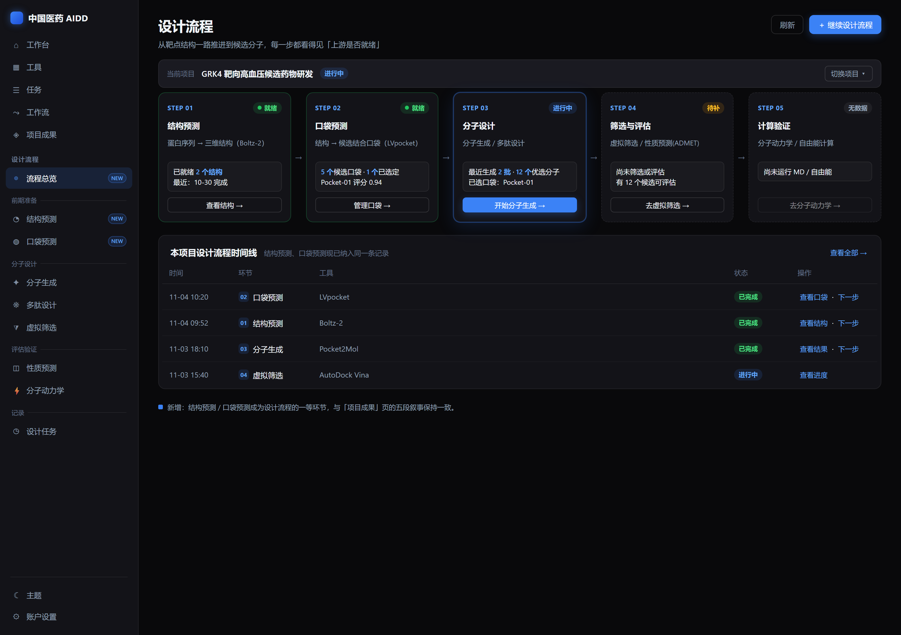
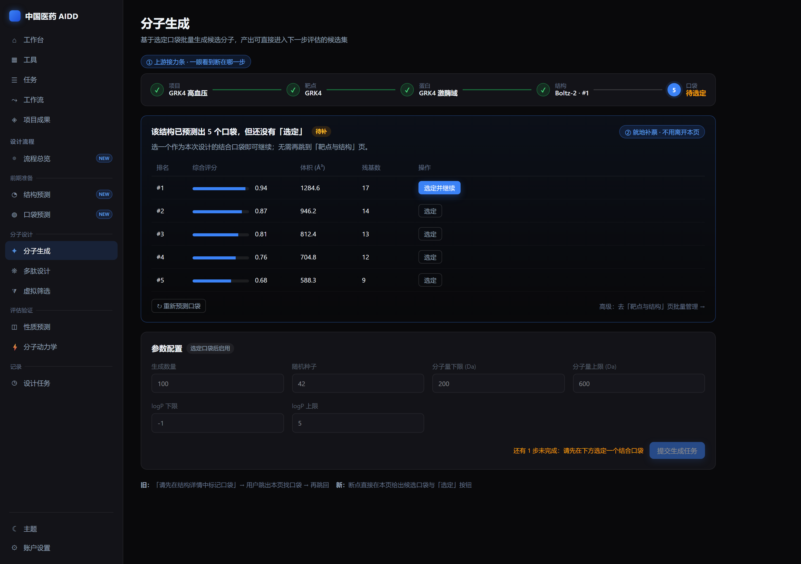
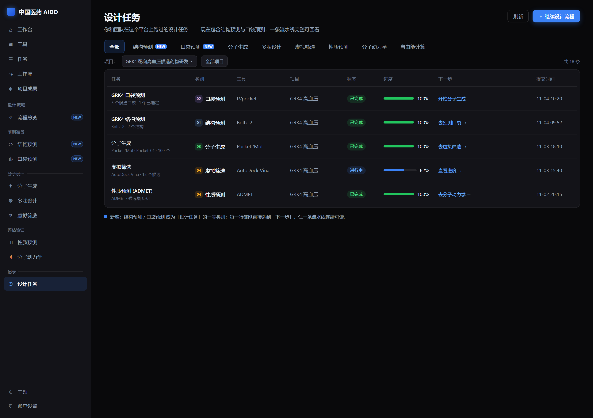

# 「设计流程」UX 重设计 —— 把结构预测 / 口袋预测纳入设计主链路

- 日期：2026-11-04
- 状态：**设计待评审**（未实现；已过一轮 builder-check，歧义已在 §12 定夺）
- 关联：`docs/06-UI交互与原型说明.md`、`docs/16-用户操作手册.md`、`docs/01-PRD`（P-06~P-17）
- 涉及代码：`frontend/src/components/layout/AppShell.vue`、`frontend/src/views/design/*`、`frontend/src/domain/design/runs.ts`、`frontend/src/views/targets/*`、`frontend/src/api/{design,targets}.ts`、`frontend/src/locales/*`

## 1. 为什么做（intent）

现在「设计」在信息架构里被表达成一份**工具清单**：侧栏「设计工具」下只有 分子生成 / 多肽设计 / 性质预测 / 虚拟筛选 / 分子动力学，外加「设计任务」汇总。但 AIDD 的真实工作是一条从靶点/序列做到候选分子的**流水线**，它前面还有两步——**结构预测**、**口袋预测**——目前被放在「项目 → 靶点与结构」里，而分子生成/多肽设计又**强制要求「已选定口袋」**（`PocketPicker` 只列 `pocket.selected` 的口袋）。

于是从「设计工具」进入做设计，用户视角的真实体验是：

1. **第一步就断**：选到结构后口袋下拉为空，只提示「请先在结构详情中标记口袋」——用户被迫跳出到另一个模块（项目→靶点与结构→结构详情）去预测口袋、选定口袋，再跳回来。
2. **历史被拆成两处**：「设计任务」只汇总后 5 个环节，结构/口袋任务散落在任务中心，一条流水线在记录里看不全。
3. **宣称与可用不一致**：首页能力图与「项目成果」页讲的是完整 5 段故事（口袋探索 → 分子生成/筛选 → 对接/亲和力 → 性质预测 → 先导优化），而用户真正干活的侧栏却缺前两段。
4. **上下文反复丢失**：设计工具是全局的，但依赖（项目/靶点/蛋白/结构/口袋）都是项目内的，每次进来都要重新下钻。

这不是「少两个菜单」的问题，而是「工具清单」与「流程」两种心智模型的错位。只把两个入口塞进侧栏，用户仍然要在模块间来回跳——问题不解决。

**复核后补充（重要，避免重复造轮子）**：平台其实已有一个「引导式 Workflow」——`/workflow` 的「引导式」页签（`views/workflow/GuidedWorkflow.vue`，7 步：结构预测 → 口袋识别 → 分子生成 → 多肽设计 → 亲和力预测 → ADMET → 虚拟筛选），且它已经把分子生成 / 多肽 / ADMET / 筛选**内嵌在同一页**。问题有两处：① 结构预测、口袋识别这两步仍然只是「跳外链」（去结构预测 / 去口袋识别），恰是同一个死路；② 整个向导埋在「工作流」页签里，不在「设计工具」，用户根本找不到。所以本设计**不是从零造向导**，而是：把这条已有引导流程**扶正为「设计流程」的落地页**、**补齐前两步的就地操作**、并让任务历史覆盖全程。

## 2. 目标（goals）

1. 让用户在**一个连续的地方**完成 结构 → 口袋 → 设计 → 评估 的推进。
2. 每一步都**状态可见**：上游是否就绪、当前有什么、下一步做什么。
3. **就地补票**：缺结构/口袋时，在当前页面直接预测/选定，不跳走丢上下文。
4. 结构预测、口袋预测成为设计主链路的**一等环节**：在导航、流程页、任务历史中都出现。
5. **专家不被锁死**：流程是引导不是强制向导，老用户仍可直接进入任一工具。

## 3. 非目标（non-goals）

- 不改后端领域模型、任务/产物契约、工具包；全部复用既有 API（`predictStructure` / `predictPockets` / `selectPocket` / `listStructures` / `listPockets`）。
- 不重做「靶点与结构」细节页——保留它，作为深度管理与批量操作入口。
- 不引入新预测模型，不改变现有推理逻辑。
- 不做全站导航大改；只重排「设计工具」分区并新增一个流程总览页。
- **不新建与 `GuidedWorkflow` 并行的第二套向导**：复用并扩展既有 `GuidedWorkflow.vue`。
- **不新建并行的阶段模型**：就绪判定复用 `GET /projects/{id}/stage`（`ProjectStage`）。

## 4. 反目标（anti-goals，即「技术上能跑也算失败」）

- 只是把两个菜单加入侧栏，用户仍需在模块间来回跳。
- 新流程页沦为只读仪表盘，没有真正的就地操作。
- 把专家用户困在只能线性前进的向导里，无法直达某个工具。
- 结构/口袋的独立入口复制一套预测逻辑，与既有 Predict/Pockets 页行为分叉。

## 5. 用户与场景（who & when）

主用户：计算化学 / 药物设计科学家，按**项目**工作。三类进入时刻：

- **A 冷启动**：手上只有靶点或一条蛋白序列，想一路做到候选分子。
- **B 热启动**：已有结构、已有选定口袋，只想快速批量生成/筛选。
- **C 回看**：想知道「这个项目走到哪、上次那批结果在哪、下一步做什么」。

## 6. 设计原则

1. 以**流程**组织设计，而不是以**工具**。
2. **状态可见**：就绪 / 待补 / 无数据，一眼可辨。
3. **就地补票**：缺上游就在本页补，不丢失已选上下文。
4. **引导不强制**：流程是脚手架，专家可跳过。

## 7. 信息架构（IA）

### 7.1 侧栏「设计工具」→「设计流程」，按阶段分组

```
设计流程
  流程总览            ← 新增：/design（本分区落地页）
  ── 前期准备
  结构预测            ← 新增
  口袋预测            ← 新增
  ── 分子设计
  分子生成
  多肽设计
  虚拟筛选
  ── 评估验证
  性质预测
  分子动力学
  ── 记录
  设计任务
```

- 分组标签在侧栏折叠态隐藏，仅图标显示（沿用现状）。
- 保留各工具的直达入口（不改成「只留一个流程入口」），以免破坏老用户习惯；`流程总览` 作为新增首项承担引导职责。
- 移动端侧栏本就是抽屉，项变多不受影响。

### 7.2 新增「设计流程总览」页 `/design`

以**项目**为上下文，把 5 个阶段画成一条可点击的流水线。这是本分区的默认落地页；点「开始 / 继续」进入**引导式流程**（复用 `GuidedWorkflow`，见 §8.4）。状态数据来自 `getProjectStage`。

## 8. 关键页面设计

> 三张关键页面原型见本节各小节末尾（源文件为 `specs/assets/*.html`，`.png` 为其渲染图）。

### 8.1 设计流程总览 `/design`



- **页头**：标题「设计流程」+ 副标题 + 项目切换器（默认上次使用的项目；无项目时给「新建/选择项目」引导）。
- **阶段流水线**（横向、带连接线），5 段：
  1. **结构预测** — 蛋白序列 → 三维结构
  2. **口袋预测** — 结构 → 候选口袋
  3. **分子设计** — 分子生成 / 多肽设计
  4. **筛选与评估** — 虚拟筛选 / 性质预测(ADMET)
  5. **计算验证** — 分子动力学 / 自由能
- 每个阶段卡片：编号+名称、**状态徽标**（就绪 ✓ / 待补 ! / 无数据 ○）、一句「当前有什么」（如「2 个结构 · 1 个已选口袋 · 最近分子生成 2 批」）、**主行动按钮**（去预测结构 / 去预测口袋 / 开始分子生成 / …）。前置未满足时按钮显示「先去上一步」并高亮该上游阶段。
- **下方**：本项目设计任务时间线（最近 N 条，含结构/口袋任务），每行「查看结果 / 继续下一步」。
- **空态**：从未开始 → 「从建立靶点开始」引导（建靶点 → 加蛋白 → 预测结构）。

### 8.2 上游接力条（分子生成 / 多肽设计 / 虚拟筛选 的输入区）——**核心改动**



把现有 `PocketPicker` 的 5 个平铺下拉，升级为**步骤条 + 就地补票**：

```
① 项目 → ② 靶点 → ③ 蛋白 → ④ 结构 → ⑤ 口袋（已选定）
```

- 每步：已完成 ✓、当前高亮、未完成灰；当前页顶部一条横向 stepper。
- **④ 结构缺失**（该蛋白还没结构）：显示「该蛋白还没有结构」+ 按钮 **「预测结构」** → 就地展开 Boltz-2 参数（复用 `targets.predict` 字段），提交后轮询，完成后自动选中新结构并推进到下一步。
- **⑤ 口袋缺失/未选定**：显示 **「预测口袋」** → 就地提交 `pockets:predict` 并轮询；完成后列出候选口袋，每行带 **「选定」**（就地 `pockets/{id}:select`）；选定后流程完成、提交按钮点亮。
- 保留「高级：去靶点与结构页管理」次链接，供批量/深度操作。
- 结果：彻底消灭「请先在结构详情中标记口袋」这条死路。

### 8.3 设计任务 `/design/runs`



- 类别页签**新增**：`结构预测`、`口袋预测`（与后端 slug 对齐，见 §9）。
- 「新建设计任务」→ 改为 **「继续设计流程」**，跳 `/design`（带当前项目）。
- 行内新增 **「下一步」** 动作：按任务类别给出后继（结构→口袋、口袋→分子生成、生成→筛选/评估、评估→MD/自由能）。
- 可选增强：按项目过滤/分组，让「一条线」连续可读。

### 8.4 引导式流程（复用并改造 `GuidedWorkflow`）

现有 `GuidedWorkflow.vue` 的 7 步保留，但**前两步改为就地操作**，并把它作为 `/design` 的引导视图（不再只藏在「工作流 → 引导式」）：

| 总览 5 段 | 引导 7 步 | 就绪数据（`ProjectStage.counters`） | 本次改动 |
|---|---|---|---|
| ① 结构预测 | structure | `structures` | 「跳外链」→ **就地结构预测** |
| ② 口袋预测 | pocket | `selected_pockets` | 「跳外链」→ **就地预测 + 选定** |
| ③ 分子设计 | molecule / peptide | `candidates` | 已内嵌，保留 |
| ④ 筛选与评估 | affinity / admet / screen | `submitted_tasks` | 已内嵌，保留 |
| ⑤ 计算验证 | （暂无独立步） | `finished_tasks` | 从总览第 5 段直达 MD/自由能工具；后续可补步 |

- 步骤条允许**任意跳步**（专家不被锁死）；但每步顶部显示本步就绪状态与「还差什么」（取自 `gaps`）。
- 阶段命名以 `pipeline.ts` 的映射为唯一来源，保证「总览 / 引导 / 设计任务 / 项目成果」四处一致。

## 9. 数据与接口（技术可行性）

- 复用 `frontend/src/api/targets.ts`：`predictStructure(proteinId, data)`、`predictPockets(structureId, data)`、`selectPocket(pocketId, selected)`、`listStructures`、`listPockets`。
- 复用 `frontend/src/api/design.ts`：`listDesignProjects / listProjectTargets / loadTargetProteins / listProteinStructures / listStructurePockets`（`PocketPicker` 已在用）。
- **任务 slug 常量**（对齐后端 `app/services/domain_targets.py`）：
  - 结构预测：`boltz2-structure-prediction`（候选别名 `boltz-2`、`boltz2-structure-prediction`）
  - 口袋预测：`lvpocket-pocket-prediction`
- **新增 `frontend/src/domain/design/pipeline.ts`（薄适配，非并行真相）**：把 `ProjectStage` 的 S0–S6 映射到设计视角的 5 段——结构预测←`counters.structures`、口袋预测←`counters.selected_pockets`、分子设计←`counters.candidates`、筛选与评估←`counters.submitted_tasks`、计算验证←`counters.finished_tasks`；`gaps[]`（`NO_STRUCTURE / NO_POCKET_SELECTED / NO_CANDIDATE…`，含 `action` 与 `link`）直接驱动总览页的「下一步 / 去补」按钮。**就绪判定的唯一真相仍是后端 `compute_project_stage`**，前端只做展示映射，避免与「项目成果」页出现两套口径。
- **引导式流程复用 `views/workflow/GuidedWorkflow.vue`**：该组件已内嵌分子生成/多肽/ADMET/筛选，本次把「结构预测」「口袋识别」两步从「跳外链」改为**就地预测**（复用 §8.2 的共享组件），并把组件提升为「设计流程」的引导视图（`/design` 落地页内嵌或复用同一组件），不再只藏在「工作流」页签。
- **共享预测逻辑（满足 §4 反目标）**：把 `Predict.vue`（结构预测）与 `Pockets.vue`（口袋预测 + 选定）的「表单 + 提交 + 轮询」抽成共享 composable/组件（如 `useStructurePrediction` / `usePocketPrediction` + `StructurePredictForm` / `PocketPredictPanel`），供既有页面与上游接力条**同源复用**，不写第二套。

## 10. 状态、边界与降级

- 长任务（结构/口袋预测）：提交后进入轮询（复用现有任务轮询）；显示进度与预计状态；完成自动刷新并推进。
- 失败：就地 `AppInlineError` + 重试；不丢已选上下文。
- 无权限 / 无项目：流程总览给明确空态与创建引导。
- 移动端：stepper 纵向堆叠；阶段卡片单列。

## 11. 分期（phasing）

- **P1｜可见性**：侧栏分组 + 设计任务新增两类 + 流程总览页（导航与状态展示，暂不含内联操作）。
- **P2｜就地补票（核心）**：上游接力条 + 结构/口袋就地预测 + 口袋就地选定。
- **P3｜连续性**：设计任务「下一步」、按项目分组、空态引导、流程总览时间线联动。

## 12. 我的取舍（builder 可直接照此落地，除非用户反对）

> 已按 builder-check 复核意见逐条定夺（原文档遗留的实现歧义）。

- **就绪数据源**：复用 `GET /projects/{id}/stage`（`ProjectStage`：`currentStage/reachedStages/gaps/counters`），`pipeline.ts` 只做「S0–S6 → 总览 5 段」展示映射。**不新建并行阶段模型**；`gaps[]` 驱动「下一步/去补」。
- **阶段口径**：总览 5 段对外展示、引导沿用现有 7 步、后端按 S0–S6 推导，三者用 §8.4 的映射表对齐，命名以 `pipeline.ts` 为唯一来源。
- **「下一步」上下文**：先做**纯前端跳转**（带 `project_id`），不扩后端任务序列化去预选口袋；「带口袋预选」列后续（需后端）。
- **预测完成→推进**：`predictStructure/predictPockets` 只回 `task_id`；实现为「提交前记录 结构/口袋 id 集合 → 任务终态（`/tasks/{id}/events` 或轮询）→ 重新 `listStructures/listPockets` → 取新增那条并选中」。并发多次预测取最新一条（已知边界，可接受）。
- **复用 vs 重构**：把 `Predict.vue` / `Pockets.vue` 的表单+提交+轮询抽成共享 composable/组件，`Predict/Pockets` 与上游接力条同源复用；允许改动 targets 模块，但只做抽取、不改行为。
- 侧栏**保留工具直达入口**（而非只留一个流程入口），新增「流程总览」并分组。
- slug 常量化放 `types/design.ts`，供 `domain/design/runs.ts` 与 `pipeline.ts` 共用。
- 视觉沿用现有暗色主题与语义 token（不新增配色体系）。

## 13. 范围建议（我的推荐，请拍板后进入实现计划）

- **一次交付 P1 + P2**：侧栏分组 + 流程总览页 + 设计任务两类 + 上游接力条（PocketPicker 就地化）+ `GuidedWorkflow` 前两步就地化 + 共享预测组件。
  - 理由：P1 单独做仍是只读看板、没解决痛点；P1+P2 才是「从断点走到分子」的完整闭环。
- **P3 后置**：「下一步」上下文增强、按项目分组、引导补「计算验证」步。
- **侧栏**：保留分组直达入口（约 9 项），不改为仅两项，避免破坏老用户习惯。

认可后我会先出实施计划（`docs/superpowers/plans/`）再动代码。

## 14. 验收（怎么算做成）

- 从「设计工具（设计流程）」进入，用户能在**不离开流程**的情况下，从「某蛋白无结构」一路预测结构→预测口袋→选定口袋→提交分子生成。
- 设计任务页能看到结构预测、口袋预测两类任务，并能从一行跳到「下一步」。
- 侧栏、流程总览、设计任务三处的阶段命名与顺序一致，且与「项目成果」页的流程叙事不打架。
